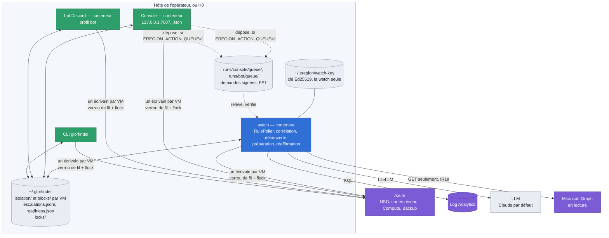
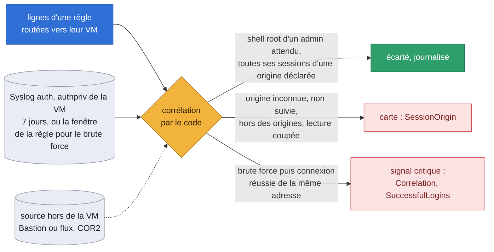
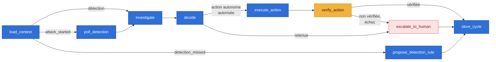
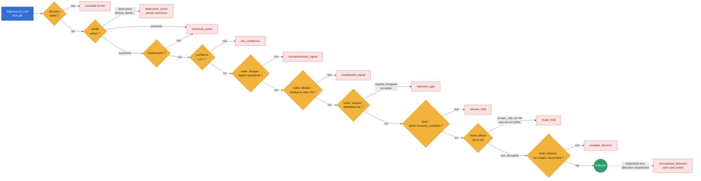
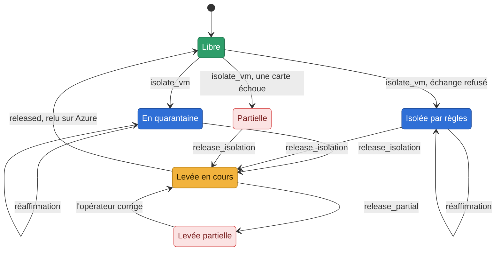
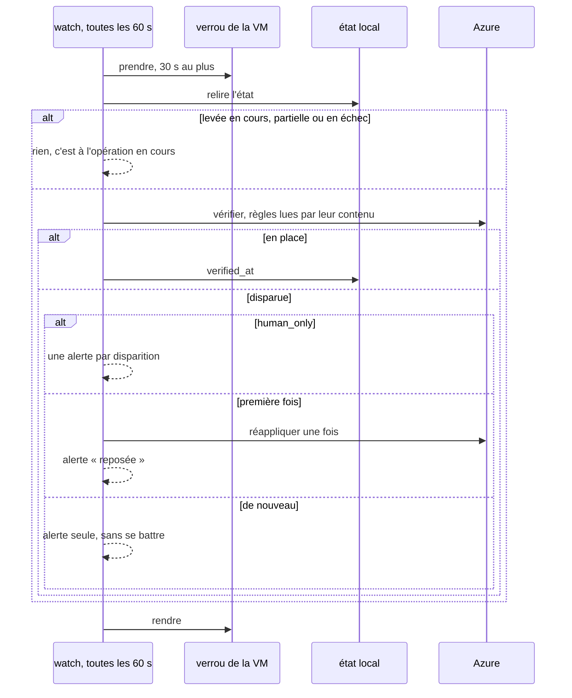
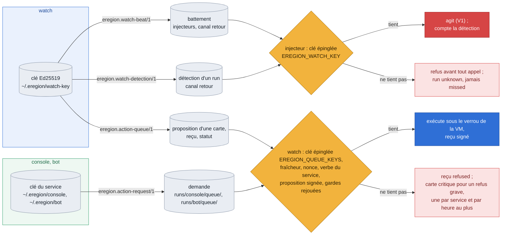

# Architecture d'Eregion

Ce document montre comment les pièces s'emboîtent : la boucle rouge/bleu, les processus et
l'état qu'ils partagent, la corrélation, le graphe de décision, les gardes qui encadrent le LLM,
la vie d'une isolation et la réaffirmation, la clé de la watch et la file d'actions signée, les
identités (l'exécuteur d'identité compris) ; puis la cible de la 0.3 (composants, vocabulaire commun,
les trois zones, l'arborescence). Les schémas sont en Mermaid (rendus par GitHub), avec un code couleur
commun : rouge = attaque (Annatar), bleu = Glorfindel, ambre = garde ou vérification, vert = humain ou succès,
violet = Azure, rose = escalade ou échec, gris = données.
Pour **comment on prouve** que tout cela tient, voir [`design/preuves.md`](design/preuves.md) ;
pour l'isolation compatible avec l'infrastructure as code, [`design/module-isolation-iac.md`](design/module-isolation-iac.md) ;
pour les frontières, qui y est de confiance et ce qui les tient, le [modèle de menace](design/modele-de-menace.md).

## La boucle complète

Annatar attaque pour de vrai, Glorfindel détecte dans les journaux, raisonne, agit, vérifie
sur Azure et retient. Un humain approuve ce qui est destructif, et ce que le mode de la VM
ne laisse pas faire seul. Une attaque ratée produit une règle de détection proposée.

```mermaid
flowchart LR
    subgraph Red["Annatar — rouge"]
        A1["Scénario ou campagne<br/>MITRE ATT#amp;CK"] --> A2["Attaque réelle<br/>par Run Command"]
    end
    subgraph Az["Azure"]
        VM[("VM cible")] --> LAW[("Log Analytics<br/>Perf, Syslog, StorageBlobLogs")]
    end
    subgraph Blue["Glorfindel — bleu"]
        RP["RulePoller<br/>une requête par règle"] --> COR["corrélation<br/>par le code, sans modèle"]
        COR --> INV["investigate<br/>requêtes ciblées"]
        INV --> DEC["decide<br/>LLM + mémoire RAG + exemples"]
        DEC --> G{"gardes<br/>déterministes"}
        G -->|autorisé| EX["execute_action"]
        EX --> VER["verify_action<br/>relu sur Azure"]
        VER --> ST["store_cycle<br/>ChromaDB + journal"]
        G -->|retenu| ESC["escalade"]
    end
    H["Humain<br/>console, Discord, CLI"]
    A2 --> VM
    LAW --> RP
    EX -->|"quarantaine, deny, snapshot"| VM
    ESC --> H
    H -->|"approuve"| EX
    A2 -. "detection_missed" .-> PR["propose_detection_rule<br/>autoring groundé"]
    PR --> H
    H -->|"approve-rule"| RULES[("detection_rules.yaml")]
    RULES --> RP
    classDef red fill:#d64545,stroke:#9e2a2a,color:#ffffff
    classDef azure fill:#7b5cd6,stroke:#4f3a99,color:#ffffff
    classDef blue fill:#2f6fd6,stroke:#1d4a9a,color:#ffffff
    classDef guard fill:#f2b33d,stroke:#b07a12,color:#2b1d00
    classDef warn fill:#fbe3e3,stroke:#d64545,color:#7a1f1f
    classDef human fill:#2e9e6a,stroke:#1d6b47,color:#ffffff
    classDef data fill:#e9edf3,stroke:#8a96a8,color:#18212b
    class A1,A2 red
    class VM,LAW azure
    class RP,COR,INV,DEC,EX,ST,PR blue
    class G,VER guard
    class ESC warn
    class H human
    class RULES data
    style Red fill:#fdeeee,stroke:#d64545,color:#7a1f1f
    style Az fill:#f1edfc,stroke:#7b5cd6,color:#4f3a99
    style Blue fill:#eaf1fd,stroke:#2f6fd6,color:#1d4a9a
```



Deux asymétries voulues : la **réaction** est raisonnée par le LLM (aucune table TTP → action),
la **détection** est faite de règles explicites exécutées par un poller déterministe — même
quand c'est le LLM qui les a écrites, elles restent des propositions qu'un humain ratifie.

## Processus et état partagé

La watch, la console, le bot et la CLI sont des processus distincts sur l'hôte de l'opérateur (ou
sur H0). Ils partagent l'état local et ne touchent une VM qu'un à la fois.



- **Aujourd'hui, la console et le bot écrivent sur Azure eux-mêmes**, sous leur identité (sur H0,
  celle de la VM, partagée par les trois conteneurs). Avec `EREGION_ACTION_QUEUE=1` (faux par
  défaut), ils ne font plus que déposer une demande signée, que la watch juge et exécute
  ([plus bas](#la-clé-de-la-watch-et-la-file-dactions-signée)).
- **La watch lit Microsoft Graph, en lecture seule** (IR1a) : les paramètres du plan d'une carte
  d'identité, et sa vérification après le geste d'un humain. Sans droit sur Graph, elle dit
  « unreadable », jamais « held ». Elle n'écrit jamais sur Entra ID.

- **Un fichier d'état par VM**, nommé `<nom>--<empreinte de l'ID>.json` en minuscules : deux VMs
  homonymes dans deux groupes ne se mélangent pas, et la casse de l'ID ne crée pas de doublon.
- **Un écrivain par VM** : isoler, lever, bloquer, débloquer, `reset --from-azure` et la
  réaffirmation prennent le verrou de la VM (fil + `flock`, réentrant). Le `flock` est ce qui
  sépare les processus ; il est testé à part, sur de vrais processus (`tests/unit/test_locks.py`).

## La corrélation, avant la décision

Une détection qui relie deux événements vaut plus que deux détections isolées. La corrélation
(`glorfindel/correlation.py`, COR1, COR2) est une brique de Glorfindel : elle tourne dans le
RulePoller, juste après le routage des lignes d'une règle vers leurs VM, avant tout signal. Aucun
cycle n'est ouvert et aucun appel au modèle n'est fait. Le modèle ne voit pas la liste des origines
et ne tranche pas l'écart : la ligne ne porte que le fait établi par le code (`SessionOrigin`, ou
`Correlation` et `SuccessfulLogins`), et c'est elle qui part au modèle, ces champs compris (le
[modèle de menace](design/modele-de-menace.md), §4).



- **Deux usages** : qualifier le shell root d'un administrateur attendu par l'origine de sa session
  SSH (ADM1), et marquer un brute force SSH suivi d'une connexion réussie de la même adresse.
- **Inconnu, donc carte** (A0) : une requête qui échoue, une lecture coupée, une ligne qui ne nomme
  pas sa VM, aucune session trouvée, le plafond de requêtes atteint — le shell root reste une carte,
  qui dit pourquoi. Une commande sensible reste une carte, quelle que soit l'origine.
- **L'origine** est lue dans la VM ; avec une source déclarée (`expected_sudo.origin_proof`,
  COR2), chaque session doit avoir sa trace hors de la VM. auditd (AUD1) ajoute les commandes d'un
  shell root. Ce qu'elle lit, ses limites : [`design/correlation.md`](design/correlation.md).

## Le graphe de décision



Toute exception d'un cycle finit en escalade (`action_failed`, `cycle_failed`), jamais en
ligne de console : une menace détectée n'est pas perdue parce qu'un appel a échoué. Plus
largement, une dépendance qui tombe (modèle, API du cloud, télémétrie, configuration) fait
échouer Glorfindel **fermé** : rien de disruptif ne part seul (G2,
[`glorfindel.md`](glorfindel.md), « Pannes des dépendances »).

## Les gardes qui encadrent le LLM

Le LLM propose ; une suite de gardes déterministes décide si l'action part seule. Une action
destructive n'est jamais autonome, quel que soit le mode. Chaque garde qui retient une action
autonome donne son propre type d'escalade, que la console affiche. Une VM retenue parce
qu'elle n'est pas prête reçoit en plus, du contrôle de préparation, une carte `readiness_hold`.



Le mode configuré n'est qu'une intention : une VM ne devient autonome qu'une fois contrôlée
**prête** (droits, préséance des règles, coupure des sessions possible), ou après que ses
réserves ont été montrées et acceptées.

## La vie d'une isolation



- **Partielle** : une carte a échoué ; ce qui est posé reste posé et enregistré.
  **Levée en cours** : l'intention est notée (`releasing_at`) avant de toucher Azure.
  **Levée partielle** : quelque chose n'a pas pu être défait ou vérifié ; l'état est gardé.
- **Quarantaine** : chaque carte porte, le temps de l'isolation, le NSG de quarantaine de
  Glorfindel à la place du sien. Le NSG du client reste intact et revient à la levée.
  L'original est noté dans l'état **et** en tag sur le NSG de quarantaine, pour qu'une levée
  sans état sache quoi remettre ; s'il est inconnu, la carte reste en quarantaine et la levée
  le dit. Le NSG de quarantaine refuse aussi le DNS et l'IMDS d'Azure.
- **Par règles** (repli quand une politique ou les droits refusent l'échange) : un deny entrant
  et sortant qui vise toujours les IP de la carte, sur le NSG de la carte, ou sur celui du
  subnet si une allow du client passe avant. Ce repli ne peut pas refuser le DNS et l'IMDS à
  une seule VM : il le déclare (`platform_open`).
- **La levée balaie toujours** : elle défait ce que l'état connaît, puis relit chaque carte et
  retire ce que l'état ignore (crash, réponse perdue, ancienne adresse d'une carte).

## La réaffirmation

Toutes les 60 secondes, le watch relit sur Azure chaque isolation et chaque blocage
enregistrés, sous le verrou de la VM.



Une isolation retirée par un `terraform apply` ou à la main est reposée une fois, puis
Glorfindel alerte sans insister : il ne se bat pas contre un pipeline ou une décision humaine.

## La clé de la watch et la file d'actions signée

La watch tient une paire Ed25519 que seul son service monte (`~/.eregion/watch-key/`, jamais sous
`~/.glorfindel` ni sous `runs/` ; `eregion_core/watch_key.py`). Une clé, trois usages, chacun signé
sous son propre domaine : un battement ne se lit jamais comme une détection, ni comme une pièce de
la file, ni l'inverse.



- **Le battement** (SEC19) : la garde « jamais sans Glorfindel » ne croit qu'un battement signé par
  la clé que l'injecteur épingle de son côté (`EREGION_WATCH_KEY`, jamais lue dans le canal), dont
  le compteur monte. Il porte le périmètre de la watch, et la liste des détections qu'il couvre
  (SEC21b).
- **Les détections** (SEC21) : un injecteur ne compte une détection pour « vue » que signée par la
  clé épinglée, pour son run et son signal. Un `missed` ne se conclut que sur un battement signé ;
  sinon, le run est `unknown`. Détail : [`design/watch-key.md`](design/watch-key.md).
- **La file d'actions signée** (FS1a à FS1c, derrière `EREGION_ACTION_QUEUE=1`, faux par défaut) :
  la console et le bot déposent une demande signée par la clé de leur service, chacun dans son
  répertoire de `runs/` ; la watch la vérifie avant tout appel au cloud (la clé épinglée de ce
  répertoire, `EREGION_QUEUE_KEYS`, dans son seul environnement ; la fraîcheur ; le nonce ; un verbe
  d'une liste fermée, permis à ce service ; une proposition qu'elle a elle-même signée sur la carte),
  rejoue les gardes du geste et exécute avec son propre code. Le reçu est signé par la watch. Ce qui
  reste avant de l'activer, et avant que seule la watch tienne le rôle d'écriture (FS1d à FS1f) :
  [`design/file-actions-signee.md`](design/file-actions-signee.md), et le [modèle de
  menace](design/modele-de-menace.md), §5.

## Les identités

Chaque service a l'identité de ce que son code appelle ; sur H0, la watch, la console et le bot
partagent celle de la VM (le [modèle de menace](design/modele-de-menace.md), §5).

**La carte complète** (IDM1) — chaque identité d'Azure, d'Entra ID, de GitHub, de Discord, du poste et
du téléphone, où vit son secret, ses droits, ce qu'elle ne peut pas, sa rotation, et les schémas de
leurs liens : [`design/identites.md`](design/identites.md). Un test la tient aux déclarations du dépôt.

| Identité | Ce qu'elle tient | Ce qu'elle ne tient jamais |
|---|---|---|
| la watch | la lecture des journaux, la réponse sur les groupes inscrits ; Microsoft Graph en lecture (IR1a, quatre permissions posées à la main, `docs/operations.md`) | une écriture sur Entra ID, le restore |
| la console, le bot | leurs gestes sur Azure, le restore compris (hors H0, qui ne restaure pas ; la console isole ce qu'un humain approuve) ; avec la file, une demande signée | le bot : la coupure des sessions (il n'isole pas) |
| l'exécuteur d'identité (IR1b) | son application, deux permissions de Graph (`Application.ReadWrite.OwnedBy`, `User.RevokeSessions.All`) ; User Administrator sur la seule unité administrative du banc, Directory Readers au tenant, Attribute Assignment Reader sur l'ensemble d'attributs d'Eregion ; Log Analytics Reader sur le workspace ; **désactivé par défaut** | l'identité de la VM (son propre certificat seulement), un droit hors de son contrat |
| Orodruin | la lecture du groupe du banc, l'écriture sur chaque VM inscrite et chaque expérience ; Graph en lecture (IDI1), désactivé par défaut ; le binaire Stratus, lancé depuis Orodruin, emploie cette identité (R2b la sépare) | une écriture sur le groupe entier |

**L'exécuteur d'identité** répondra à une identité volée d'Entra ID — retirer un identifiant ajouté,
désactiver puis réactiver un principal, révoquer des sessions —, toujours sur l'approbation d'un
humain, jamais seul ; la watch n'écrit jamais sur Entra ID. Son application est posée par
`infra/glorfindel-host/identity_executor.tf`, désactivée par défaut. Son contrat est lu à son
démarrage (`glorfindel/providers/azure/identity_contract.py`) : son jeton, puis ses droits relus
dans Graph contre une liste fermée ; tout droit de plus le rend passif, et passif, il refuse de
démarrer. Il n'a encore aucun verbe : c'est IR1c. Conception :
[`design/reponse-identite.md`](design/reponse-identite.md).

## Vers la 0.3 : composants, vocabulaire et zones

Cette section décrit la cible de la huitième passe (13/10, voir [`ROADMAP.md`](../ROADMAP.md),
« Vers la 1.0 ») ; le code l'adopte lot par lot — l'inscription et la zone avec O0, l'expérience
avec E1, Orodruin avec O1, Gothmog avec G0. Les schémas ci-dessus décrivent le code d'aujourd'hui.

### Les composants

Glorfindel est le produit ; le reste est l'atelier qui l'éprouve.

| Composant | Rôle | Où | État |
|---|---|---|---|
| Glorfindel | détecter, enquêter, répondre ; son IA est l'IA sous test | `glorfindel/` | existe |
| Annatar | attaques : ses scénarios, et deux adaptateurs vers des bibliothèques publiques, appelées par identifiant — Atomic Red Team dans une VM (R1), Stratus Red Team sur le plan de contrôle Azure (R2a, fusionné ; son binaire épinglé n'est pas encore livré dans l'image, sa cible et son identité sont la conception R2b, [`design/stratus-cible.md`](design/stratus-cible.md)) | `annatar/`, interface d'injecteur dans `annatar/executors/`, adaptateurs dans `annatar/engines/` | existe, évolue |
| Gothmog | pannes déclarées en code, exécutées par un moteur public (Chaos Studio d'abord) | `gothmog/` ; l'expérience dans `infra/terraform/chaos.tf` | G0 ✅ (19/10, arrêt de VM mesuré sur le banc) |
| Orodruin | hôte d'exécution jetable des injecteurs : identité limitée, sortie réseau limitée, contrat vérifié au démarrage, arrêt d'urgence | `infra/orodruin/`, état Terraform séparé | O1 |
| Celebrimbor | construit et inscrit les cibles du banc | `infra/terraform/` | existe |
| Inscription et périmètre | un seul garde-fou de cible pour tout injecteur, présent ou futur | `eregion_core/inscription.py` | existe (O0) |
| Schéma d'expérience | une même description pour une technique et pour une panne | `schemas/`, `technique_catalog.yaml` | E1 |
| IA d'analyse | explique, trie, rapporte ; chaque affirmation cite son run ; n'écrit pas de règle, n'agit pas ; chaque proposition attend un humain | collection ChromaDB distincte, autre modèle, refusés s'ils sont ceux de Glorfindel (`analysis/separation.py`) ; tri `analysis/triage.py` | IA0, IA1 |

### Le vocabulaire commun

Le framework ne parle qu'avec ces mots ; la correspondance par cloud passe par l'interface de
fournisseur (MC0, livrée avec A1 le 26/10, `glorfindel/providers/interface.py`). Chaque fournisseur
a un adaptateur, seul à importer son SDK, et y déclare ses capacités dans ces mots : le contrôle
réseau en `network_quarantine` (isoler par un groupe de quarantaine) et `network_rules` (isoler par
règles, bloquer), `session_drain` (couper les sessions déjà ouvertes), `restore_point`, chacune avec
les droits qu'elle demande. La préparation de Glorfindel lit ces droits. Azure est le seul
adaptateur qui tourne (`glorfindel/providers/azure/`). Un second, AWS (`glorfindel/providers/aws/`,
MC1, 26/10), est écrit contre un monde simulé et ne tourne sur aucun compte avant MC2 : il déclare
`network_quarantine` (un groupe de sécurité de quarantaine par VPC) et `network_rules` pour les seuls
blocages (ACL réseau du sous-réseau) — ni isolation par règles, ni `session_drain`, ni
`restore_point`. Ce que les mots veulent dire sur AWS, et les hypothèses à mesurer :
[`design/monde-aws.md`](design/monde-aws.md).

| Concept | Sens |
|---|---|
| Cible | ressource qu'on a le droit d'éprouver |
| Inscription | marque posée à la construction (tags `eregion-target=<banc>` et `eregion-zone` sur la cible et son groupe ; pour une identité d'Entra ID, deux clés : ses tags Graph et `eregion-identities` sur le groupe du banc, IDI1 ; pour un utilisateur de test, deux moitiés : l'unité administrative restreinte du banc qui le tient et l'attribut `Eregion` sur lui, IDI1b) ; sans elle, aucun injecteur n'agit ; elle porte la zone de la cible |
| Zone | `bench`, `twin` ou `production` — ce qu'une expérience a le droit d'y faire |
| Contrôle réseau | ce qui autorise ou refuse le trafic : isoler, bloquer, lever |
| Télémétrie | où arrivent les logs et les métriques |
| Requête de détection | règle dans le langage de la télémétrie |
| Point de restauration | sauvegarde ou instantané pour revenir à un état connu |
| Moteur d'injection | outil public qui exécute une technique ou une panne, par identifiant |
| Expérience | une technique (`kind: technique`) ou une panne (`kind: fault`), décrite par le même schéma |
| Identité d'exécution | l'identité d'Orodruin, limitée aux cibles inscrites, révocable |
| Mode ombre | Glorfindel décide sur le vrai trafic sans agir ; on mesure ses décisions (`human_only` + verdicts) |
| VM sentinelle | une VM vide dans le réseau de production, inscrite, pour éprouver la chaîne complète |
| Jumeau | réplique de la topologie du client, depuis son code ou la découverte, avec son rapport d'écart |
| Banc de référence | nos topologies types (Celebrimbor), sur lesquelles nous publions nos preuves |
| Glorfindel de base | le produit livré par versions : surface surveillée, règles de base, actions, garde-fous |
| Glorfindel adapté | la couche du client : ses règles, sa mémoire, sa retenue, ses marches ; une mise à jour ne l'écrase jamais |

### Les trois zones

Règle de production : **jamais de panne ni d'action destructive sur une charge réelle.**

| Zone | Ce qui y tourne | Refusé |
|---|---|---|
| `bench` | techniques, destructif, pannes, reprise | — |
| `twin` | idem, avec le rapport d'écart au client | — |
| `production` | mode ombre ; techniques `destructive: false` sur VM inscrites ; chaîne complète sur la VM sentinelle | toute panne, toute expérience destructive |

Seule la zone `bench` sert en 0.3 ; les deux autres sont codées et testées (O0, `eregion_core/inscription.py`) : tout ce qui est inconnu est refusé — pas de tag, identifiant de banc vide, valeur dans une autre casse (Azure garde les valeurs telles qu'écrites, compare les noms sans casse), zone absente ou hors des trois, groupe et cible en désaccord, caractère destructif non déclaré en production. Pendant la migration, l'ancien tag `annatar-test=true` (posé seulement sur Celebrimbor) vaut zone `bench`. La feuille de
route 1.0 envisage, en production, des pannes des seules dépendances de Glorfindel (modèle,
télémétrie, configuration), jamais des charges du client : O0 les refuse comme toute panne ; une
exception, si elle vient, viendra par un lot explicite.

#### Une identité d'Entra ID (IDI1, #546)

Une identité d'Entra ID ne porte pas de tag ARM. Elle s'inscrit par **deux clés, une par plan**,
comme une VM l'est par son groupe et par elle-même (`identity_enrollment`, `eregion_core/inscription.py`) :

| Clé | Où | Ce qu'elle dit | Qui peut l'écrire |
|---|---|---|---|
| Entra | les `tags` de l'**application** (Microsoft Graph) | `eregion-target=<banc>`, `eregion-zone=<zone>` | ses propriétaires (tout membre peut inscrire une application), les administrateurs d'applications |
| ARM | le groupe du banc | `eregion-identities=<object id de l'application …>`, sa zone `eregion-zone` | qui écrit sur le groupe du banc — les mêmes que pour inscrire une VM |

Une clé seule n'ouvre rien : une marque posée dans Entra ne suffit pas, et les deux zones doivent
concorder. La garde refuse aussi : un tenant que le périmètre ne nomme pas (`EREGION_TENANT_ID`) ; un
jeton du lecteur ou une application d'un autre tenant (`tid`, `appOwnerOrganizationId`) ; une
application multi-tenant (elle atteint d'autres tenants) ; un principal qui n'est pas celui d'une
application. **Jamais une cible**, la liste partagée d'`eregion_core/never_target.py` (que lira aussi
l'exécuteur d'IR1) : l'identité de Glorfindel, celle d'Orodruin, celle d'Annatar, les opérateurs, les
applications de Microsoft et de tout autre tenant, le principal d'une ressource (une identité managée,
une API qui expose des rôles ou que d'autres appellent), une application dont le principal possède
l'une d'elles ; sans opérateur nommé (`EREGION_OPERATOR_OBJECT_ID`), ou une liste mal écrite, toute
identité. **Jamais une identité privilégiée** (décision du 05/11 : l'exécuteur d'IR1 deviendra
propriétaire des identités inscrites, et être propriétaire d'une application, c'est pouvoir agir comme
elle) : un rôle d'annuaire, actif ou éligible, à toute portée ; une appartenance à un groupe (un groupe
peut porter un rôle) ; un objet possédé (posséder un groupe ou un principal à rôle, c'est le tenir) ;
une permission d'application — aucune n'est admise tant qu'une technique de R2 n'en exige pas. En `production`, la
zone décide comme pour une VM : une technique non destructive seule. Une lecture qui échoue refuse.
Celebrimbor crée et inscrit une identité de test du banc (`infra/terraform/entra_identity.tf`,
désactivée par défaut) ; Orodruin la lit avec `Application.Read.All` et `RoleManagement.Read.Directory`,
rien d'autre dans Graph (`infra/orodruin`, `graph_read_enabled`). Un utilisateur de test s'inscrit
autrement (IDI1b, ci-dessous) ; ici, une application seule.

**Limite acceptée au banc** (Jonathan, 05/11) : la garde ne lit ni les rôles Azure (RBAC) de
l'identité hors du groupe du banc, ni ses consentements délégués (`oauth2PermissionGrants`).
L'identité de test de Celebrimbor n'en a aucun. IDI2 (#556) devra lever cette limite avant d'inscrire
toute identité qui ne vient pas de Celebrimbor.

**Pourquoi cette forme** (D, deux clés), plutôt que :

| Option | Ce qui l'a écartée |
|---|---|
| les attributs de sécurité personnalisés d'Entra seuls | la marque la mieux cloisonnée (seul un Administrateur de l'attribution les écrit), mais deux rôles d'Entra de plus pour Jonathan, un droit Graph de plus pour le lecteur, et un provider Terraform qui ne les gère pas (hypothèse) |
| les `tags` du seul principal de service | ce sont l'union des siens et de ceux de son application : le tenant d'origine d'une application multi-tenant les écrit ; et tout propriétaire d'application aussi |
| une unité administrative (restreinte) | elle ne prend pas les principaux de service, seulement utilisateurs, groupes et appareils — retenue pour les utilisateurs de test (IDI1b) |
| une liste en configuration (orodruin.env) | une marque qui ne vit pas avec l'identité ni avec le banc : rien ne la relie à ce que Celebrimbor a construit, et une coquille inscrit une identité de production |

La clé ARM porte la confiance (qui écrit sur le groupe du banc peut déjà y inscrire une VM) ; la clé
Entra porte la zone et dit, sur l'identité elle-même, qu'elle est au banc.

#### Un utilisateur de test d'Entra ID (IDI1b, #573)

Un utilisateur n'a pas de `tags`. Il s'inscrit par **deux moitiés**, la même forme que pour une VM
(`user_enrollment`, `eregion_core/inscription.py`) :

| Moitié | Où | Ce qu'elle dit | Qui peut l'écrire |
|---|---|---|---|
| l'unité | l'**unité administrative restreinte** du banc le tient ; son `id` est épinglé (`EREGION_BENCH_ADMIN_UNIT_ID`, la sortie `entra_bench_unit_id` de Celebrimbor), jamais cherché par son nom | l'utilisateur est au banc, en zone `bench` (l'unité est celle de Celebrimbor) | un Administrateur des rôles privilégiés ou général, ou un administrateur à la portée de l'unité ; chaque entrée s'écrit dans `AuditLogs` |
| l'attribut | un attribut de sécurité personnalisé de l'ensemble `Eregion`, sur l'utilisateur | `Eregion.eregionTarget=<banc>`, `Eregion.eregionZone=<zone>` (un nom d'attribut n'admet pas le tiret : la garde fait la correspondance avec `eregion-target`) | un Administrateur d'attribution d'attributs seulement : ni User Administrator, ni l'Administrateur général par défaut |

Une moitié qui manque, deux moitiés qui ne s'accordent pas (un autre banc, une zone qui n'est pas celle
de l'unité), une unité qui n'est pas restreinte, qui est dynamique ou qui n'est pas celle qui est épinglée, des attributs que le
lecteur ne peut pas lire : refusé. La garde refuse aussi : un invité (un utilisateur d'un autre
tenant) ; un membre d'une autre unité administrative ; une identité de `never_target` (un opérateur,
un compte de secours, le lecteur) ; **un utilisateur privilégié** — un rôle d'annuaire actif ou
éligible, une appartenance à un groupe ou à un rôle, un objet possédé, un rôle d'application. Une
lecture qui échoue refuse.

**Pourquoi restreinte** : dans une unité restreinte, seuls les administrateurs à sa portée gèrent ses
membres ; une permission de Graph large ne les touche pas. L'exécuteur d'IR1 y tient User
Administrator, borné à l'unité, et ne peut ni inscrire ni désinscrire un utilisateur : il n'écrit ni
l'appartenance ni l'attribut. Le fournisseur `azuread` 3.10.0 ne sait pas créer une unité restreinte,
ni un ensemble d'attributs (hypothèse 13 de `docs/design/reponse-identite.md`, tranchée sur le schéma
du fournisseur verrouillé) : Celebrimbor les crée par l'API de Graph
(`infra/terraform/scripts/entra_bench_unit.py`, `make celebrimbor-unit-prepare`), puis Terraform pose
les utilisateurs, leur attribut, leur appartenance et les rôles de l'exécuteur
(`infra/terraform/entra_bench_unit.tf`, désactivé par défaut).

### Le cycle d'une expérience

Une même boucle pour une technique et pour une panne.

| Étape | Eregion aujourd'hui | Bibliothèques d'attaque | Moteurs de chaos |
|---|---|---|---|
| Préparer | `eregion_core/inscription.py` (périmètre, inscription, zone), préflight ; `gothmog preflight` (cibles relues dans l'expérience) | Stratus `warmup` | cible inscrite auprès du moteur (`chaos.tf`) |
| État normal | `glorfindel/posture.py`, `glorfindel/readiness.py` ; `gothmog/probes.py` (avant, pendant, après) | — | Chaos Toolkit `steady-state-hypothesis` |
| Injecter | `annatar/executors/` ; `gothmog/engines/chaos_studio.py` | Stratus `detonate`, test Atomic, capacité Caldera | expérience ou objet de panne |
| Observer | `annatar/collectors/`, signaux (`attack_started` ; `fault_started` dans `runs/gothmog/`, hors de ce que la watch lit) | — | sondes pendant l'expérience |
| Revenir | `annatar clean`, `glorfindel release` ; retour d'une panne vérifié par sonde, repli `start_vm` | Stratus `revert`, `cleanup` | Chaos Toolkit `rollbacks` |
| Verdict | le run au format commun (`eregion_core/run_report.py`, C1), `annatar report`, `gothmog report`, la console (Annatar, Gothmog) et sa matrice de couverture | — | — |

**Le run, unifié (C1, #80, 30/10).** Une attaque et une panne écrivent le même rapport,
`runs/<injecteur>/<run_id>.json` : les sept clés de toujours (`scenario`, `run_id`, `mitre`, `result`,
`metrics`, `thresholds`, `checks`), une seule classe dans le cœur partagé
(`eregion_core/run_report.RunReport` ; Annatar et Gothmog n'en gardent que l'affichage). Le
rapport dit ce qu'il est, dans `metrics` : `run_format` (1), `kind` (`technique` ou `fault`),
`injector`, `experiment_id` (l'identifiant ATT&CK ou celui de la panne, comme le catalogue et
les fenêtres le nomment), et pour une attaque `resource_id` (la VM visée : la décision de la
watch n'est rattachée que sur elle). Ajout compatible : un rapport d'avant se lit comme avant, le schéma
(`schemas/run_report.schema.json`) admet les autres champs, et le contrat des signaux
(`eregion_core/signals.py`) ne change pas. Un seul lecteur, `read_run`, donne la vue que la
console partage (indicateurs, matrice) : la date (le T0 de l'attaque, le début de la panne), ce
que le run a mesuré lui-même (détection, latence) ; `timeline` y joint l'enregistrement de la
watch qui a décidé, et donne les temps d'un incident : attaque, détection, décision, action
vérifiée (`outcome.verified_at` quand la watch l'écrit, sinon l'heure de l'enregistrement) —
ce sur quoi BL1 mesure le temps pour contenir. Le temps pour contenir de l'accueil et celui de
la matrice passent tous deux par `timeline`, seul endroit à étendre ; elle ne voit qu'un
enregistrement : un incident contenu à un cycle suivant (une action approuvée ensuite, une
isolation au cycle d'après) n'y a pas de `contain_s` (BL1).

**La matrice de couverture** (`eregion_console/coverage.py`) en tire, pour chaque technique du
catalogue et chaque panne déclarée, la dernière preuve, son âge et l'état de la ligne
(`regressed`, `proven`, `aging`, `stale`, `unproven`, `never`), et l'évolution semaine par
semaine ; elle nourrit la couverture et l'âge de la dernière preuve (`docs/glorfindel.md`,
« Matrice de couverture »). Tout est lu dans les fichiers de l'hôte : aucun appel au cloud.

### L'arborescence visée

```
glorfindel/              le produit (existe)
annatar/                 attaque (existe) ; executors/ l'interface d'injecteur (R1), engines/ les adaptateurs Atomic (R1) et Stratus (R2a)
gothmog/                 pannes (G0) : moteur Chaos Studio, sondes, exécuteur, signaux, rapport
eregion_core/            inscription et périmètre (O0) ; validation des schémas d'expérience et du catalogue (E1) ; le run au format commun (C1) ; existent
schemas/                 scenario.schema.json (existe) + experiment.schema.json + technique_catalog.schema.json (E1, existent)
technique_catalog.yaml   techniques (existe) + pannes (E1)
infra/terraform/         Celebrimbor (existe) ; pose eregion-target (O0), inscrit les cibles Chaos Studio (G0, chaos.tf)
infra/orodruin/          Orodruin, état Terraform séparé (O1, fait) : VM, identité, sortie fermée, canal des fenêtres et canal retour (#159)
infra/canary/            canary azurerm (existe)
CLAUDE_ORODRUIN.md       session Orodruin (O1, O2)
CLAUDE_GOTHMOG.md        session Gothmog (G0 à G4)
```
