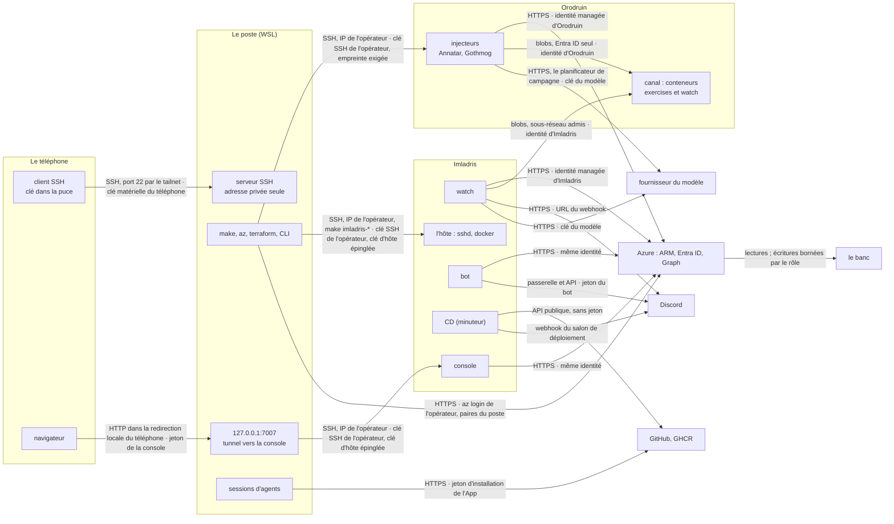
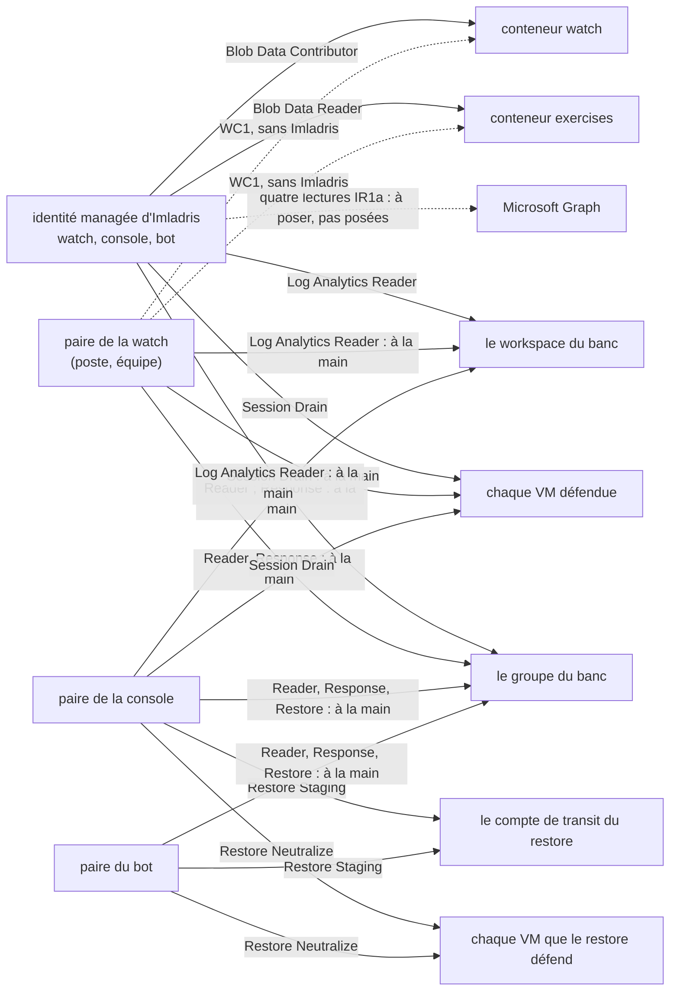
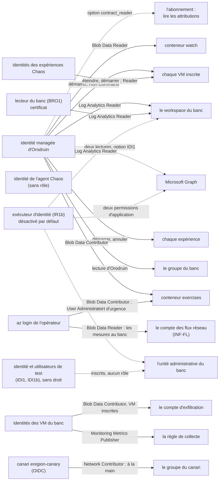
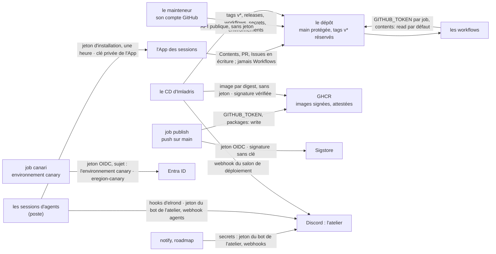

# La carte des identités

_IDM1 (#687), 11/11, pour la 0.6.0. Demandée par Jonathan le 10/11 : un schéma d'architecture, et les droits entre toutes les identités — Azure, Entra ID, GitHub, Discord, les bots, le poste, le téléphone, Orodruin et Imladris (anciennement H0)._

**Règle d'écriture (dépôt public).** Aucun identifiant réel : des rôles, des portées par type (« le groupe du banc », « chaque VM inscrite »), des noms génériques. Les noms techniques restent ceux du dépôt : `make imladris-*`, `infra/glorfindel-host/`, les variables, la ressource Azure de l'hôte. Un point encore ouvert est dit de façon neutre, comme au [modèle de menace](modele-de-menace.md).

**Pourquoi un document à part**, et non une section de [`docs/architecture.md`](../architecture.md) : la carte est une référence que l'on relit ligne à ligne, et un test la tient (§4). `architecture.md` dit les concepts et le vocabulaire ; il y renvoie. Un document à part garde aussi ce que le test lit à une seule page.

**Ce qu'elle dit, et d'où.** Chaque ligne de la matrice (§3) est tirée des déclarations du dépôt : les rôles de `infra/identities/`, les attributions Terraform (`infra/terraform/`, `infra/glorfindel-host/`, `infra/orodruin/`, Entra ID compris), l'environnement que le compose et les fichiers d'exemple donnent à chaque conteneur, les secrets et permissions des workflows. Ce qui n'est pas dans le dépôt (la liste du bot, la règle du réseau privé, le compte du mainteneur) est déclaré à la main, et marqué comme tel. `python3 scripts/identity_map.py check` relit le tout, et `tests/unit/test_identity_map.py` échoue si une déclaration apparaît sans sa ligne (§4).

**Sommaire** : [1. Les composants](#1-les-composants) · [2. Les schémas](#2-les-schémas) · [3. La matrice](#3-la-matrice) · [4. D'où vient chaque ligne](#4-doù-vient-chaque-ligne) · [5. L'écart avec le banc réel](#5-lécart-avec-le-banc-réel) · [6. Ce que la carte ne dit pas](#6-ce-que-la-carte-ne-dit-pas)

---

## 1. Les composants

| Composant | Ce qu'il est | Ce qui y tourne |
|---|---|---|
| **Le poste** | la machine de l'opérateur (WSL) | `make`, `az`, `terraform`, la CLI ; une watch et une console locales s'il les lance ; les sessions d'agents ; le serveur SSH que joint le téléphone |
| **Le téléphone** | l'appareil de l'opérateur | un client SSH, sa clé dans la puce sécurisée ; un navigateur pour la console, par son propre tunnel |
| **Le réseau privé** | un tailnet Tailscale | une seule règle : le téléphone vers le port 22 du poste |
| **Imladris** | la VM où Glorfindel tourne en continu (`infra/glorfindel-host/`, groupe à lui) | trois conteneurs : la watch, la console (service `war-room`), le bot Discord ; le CD (un minuteur systemd, hors conteneur) |
| **Orodruin** | la VM des injecteurs (`infra/orodruin/`, état à part) | Annatar et Gothmog, lancés à la demande dans un conteneur durci ; le canal (un compte de stockage) ; plus tard, le minuteur du drill (DRL1, en conception) |
| **Le banc** | Celebrimbor (`infra/terraform/`) : le groupe du banc, ses VM, son workspace, son coffre, ses expériences Chaos | les VM inscrites, et une VM non inscrite qui reçoit de vraies attaques ; leur agent Azure Monitor |
| **Entra ID** | le tenant | les principaux d'Eregion, l'identité et les utilisateurs de test du banc (IDI1, IDI1b) |
| **Discord** | deux usages séparés | la défense (le bot de Glorfindel, ses cartes, son salon) ; l'atelier (le bot Eregion, ses webhooks : CI, lots, releases, déploiement) |
| **GitHub** | le dépôt, ses releases, GHCR | `main` protégée, tags `v*` réservés au mainteneur ; les images signées |
| **La CI** | les workflows de `.github/workflows/` | tests, mutants, images, publication, canari, notifications |

**Orodruin, armé ou passif.** Son identité managée est une seule identité. « Armé » n'en est pas une seconde : c'est le verdict du contrat, relu à chaque démarrage, quand cette identité ne tient que ce que les injecteurs demandent (`eregion_core/orodruin.py`, [`orodruin-contract.md`](orodruin-contract.md)). Tout droit en trop la rend `passive` : l'injecteur refuse avant tout appel au cloud.

**Imladris, trois conteneurs, une identité.** La watch, la console et le bot y partagent l'identité managée de la VM : le point de jeton de la VM répond à chacun d'eux, une identité par conteneur ne s'y sépare pas ([`docs/operations.md`](../operations.md), « Identités Azure »). Sur un poste, chaque service a sa paire (V-17).

---

## 2. Les schémas

Quatre schémas plutôt qu'un seul illisible : le réseau, les identités de la défense, celles du rouge et du banc, l'atelier. **Chaque lien porte ce qui le traverse, puis, après « · », sous quelle identité.**

### 2.1 Le réseau : qui joint qui

Ce qui n'y passe pas : aucune entrée sur Imladris ni sur Orodruin hors du SSH depuis l'IP de l'opérateur (leurs NSG) ; la console n'écoute que sur `127.0.0.1` d'Imladris ; Imladris n'a aucun peering avec le banc (il parle aux API d'Azure, pas aux VM) ; la sortie d'Orodruin est fermée sauf ARM, Entra ID, l'API du modèle, DNS, IMDS et la règle `storage` : le service tag du stockage en 443, pour le canal, qui ouvre **tout compte de stockage de la région** — une sortie bornée à la région, à resserrer par un point de terminaison privé si Orodruin quitte le banc (`infra/orodruin/main.tf`) ; le téléphone ne joint que le port 22 du poste ; Orodruin ne tire ni n'écoute rien d'autre que ce SSH.

### 2.2 Les identités de la défense : Imladris et les paires du poste

Un trait plein : posé par le Terraform d'Imladris ou de Celebrimbor, sauf « à la main » (les commandes de [`docs/operations.md`](../operations.md), « Identités Azure »). Un pointillé : optionnel ou pas encore posé. La watch ne restaure jamais : aucune flèche de Restore, Restore Neutralize ni Restore Staging ne part de l'identité d'Imladris ni de la paire de la watch (le plan d'Imladris refuse son identité parmi les principaux qui restaurent).

### 2.3 Les identités du rouge et du banc

Le contrat d'Orodruin n'accepte hors du banc que deux attributions : la lecture des siennes (`contract_reader`) et le canal (`EREGION_CHANNEL_SCOPE`, `EREGION_WATCH_CHANNEL_SCOPE`, ce dernier en lecture seule). Une VM du groupe qui n'est pas inscrite reste hors d'atteinte : l'écriture porte sur chaque VM inscrite, une attribution à la portée de la VM.

### 2.4 L'atelier : GitHub, la CI, le CD, Discord

Le CD d'Imladris ne tient aucune identité GitHub : il lit l'API publique et tire l'image publique, puis vérifie sa signature (l'émetteur OIDC de GitHub, ce workflow, `main`, ce commit). Le bot de l'atelier ne va jamais sur Imladris ; le seul secret de l'atelier qui y vit est le webhook du salon de déploiement ([`docs/atelier-discord.md`](../atelier-discord.md)).

---

## 3. La matrice

Une ligne par identité. Les colonnes : **où elle vit** ; **son secret**, ou l'absence de secret ; **qui s'en sert** ; **ses droits** — rôle, portée par type, actions qui comptent ; **ce qu'elle ne peut pas** ; **sa rotation et son expiration** ; **la frontière** du [modèle de menace](modele-de-menace.md) qui la tient (§1 la console, §2 `runs/`, §3 Discord, §4 le fournisseur du modèle, §5 les hôtes, §6 la CI et le CD, §7 les sessions, §8 la session Banc, §9 le téléphone) ; **déclarée** : `dépôt` (Terraform, un fichier de rôle, un workflow), `code` (tirée à l'exécution par le code d'Eregion), `à la main` (hors du dépôt ; le dépôt n'en porte au plus que la variable), `prévue` (rien ne la déclare encore).

### 3.0 Les rôles, action par action

Un rôle se lit par ses actions, pas par son usage : ce que le code en fait est borné par le code ; ce que l'identité **peut** faire est borné par ces actions et leur portée. Chaque action d'un fichier de `infra/identities/` et de chaque définition de rôle Terraform est nommée ici, et le test l'exige (§4). Les rôles d'Eregion (`infra/identities/`) sont créés une fois par tenant ; leur nom complet est « Eregion Glorfindel … ».

**Eregion Glorfindel Response** — attribué sur **chaque groupe** qui tient une VM inscrite (ses NIC, NSG, VNet) et sur celui du coffre. L'usage : isoler, lever, bloquer, débloquer, un instantané. Le droit est plus large que l'usage : sur tout le groupe, **ce rôle peut rendre une VM plus joignable**.

| Rôle | Action | Ce qu'elle permet, sur toute ressource de la portée |
|---|---|---|
| **Response** | `Microsoft.Network/networkInterfaces/write` | réécrire **toute carte réseau du groupe** : son NSG, ses configurations d'IP, son sous-réseau, ses ASG, ses pools d'équilibreur |
| **Response** | `Microsoft.Network/virtualNetworks/subnets/join/action` | joindre une carte à **tout sous-réseau** du groupe |
| **Response** | `Microsoft.Network/networkSecurityGroups/write` | créer ou réécrire **tout NSG** du groupe, ses règles en ligne comprises |
| **Response** | `Microsoft.Network/networkSecurityGroups/join/action` | associer un NSG du groupe à une carte |
| **Response** | `Microsoft.Network/networkSecurityGroups/securityRules/write` | écrire **toute règle** de tout NSG du groupe, une autorisation entrante comprise |
| **Response** | `Microsoft.Network/networkSecurityGroups/securityRules/delete` | supprimer toute règle de tout NSG du groupe, un refus du client compris |
| **Response** | `Microsoft.Network/publicIPAddresses/join/action` | attacher **toute IP publique** du groupe à une carte |
| **Response** | `Microsoft.Network/applicationSecurityGroups/joinIpConfiguration/action` | placer une configuration d'IP dans tout ASG du groupe |
| **Response** | `Microsoft.Network/loadBalancers/backendAddressPools/join/action` | placer une carte dans tout pool d'équilibreur du groupe |
| **Response** | `Microsoft.Network/loadBalancers/inboundNatRules/join/action` | lier une carte à toute règle NAT entrante du groupe |
| **Response** | `Microsoft.RecoveryServices/Vaults/backupFabrics/protectionContainers/protectedItems/backup/action` | déclencher une sauvegarde à la demande de tout élément protégé du coffre |

Response n'a pas Run Command, ni restore, ni suppression d'une ressource autre qu'une règle de NSG, ni aucune action `Microsoft.Authorization`.

**Eregion Glorfindel Session Drain** et **Eregion Glorfindel Restore Neutralize** — attribués **VM par VM**, jamais sur un groupe.

| Rôle | Action | Ce qu'elle permet |
|---|---|---|
| **Session Drain**, **Restore Neutralize** | `Microsoft.Compute/virtualMachines/runCommand/action` | lancer **toute commande, en root**, sur la VM de la portée. Le rôle ne borne pas la commande : c'est le code qui l'écrit (`ss -K`, la neutralisation), jamais le modèle |

**Eregion Glorfindel Restore** — attribué sur **le groupe de la VM** (sur le banc : le groupe du banc), celui du coffre et celui du compte de transit. L'usage : un restore en place qu'un humain a approuvé. Le droit, lui, porte sur tout le groupe.

| Rôle | Action | Ce qu'elle permet, sur toute ressource de la portée |
|---|---|---|
| **Restore** | `Microsoft.Compute/virtualMachines/deallocate/action` | désallouer **toute VM** du groupe |
| **Restore** | `Microsoft.Compute/virtualMachines/start/action` | démarrer toute VM du groupe |
| **Restore** | `Microsoft.Compute/virtualMachines/write` | réécrire **toute VM** du groupe : son profil, sa taille, ses disques attachés (le disque système compris), ses `userData`, son identité système |
| **Restore** | `Microsoft.Compute/disks/write` | créer ou réécrire **tout disque** managé du groupe |
| **Restore** | `Microsoft.RecoveryServices/Vaults/backupFabrics/protectionContainers/protectedItems/recoveryPoints/restore/action` | restaurer tout point de restauration du coffre |
| **Restore** | `Microsoft.Storage/storageAccounts/write` | réécrire la **configuration de tout compte de stockage** du groupe : son pare-feu, l'accès par clé partagée, l'accès public — dont le compte des flux réseau (INF-FL), qui tient tant qu'aucune identité joignable depuis une VM n'y écrit ; ni ses clés, ni ses données |

Restore n'a pas Run Command (sorti par SEC17). Mais réécrire une VM et ses disques, puis la démarrer, revient à **en remplacer le disque système** : sur toute VM du groupe, un droit aussi fort qu'une commande root.

**Eregion Glorfindel Restore Staging** — attribué sur **le seul compte de transit** du restore.

| Rôle | Action | Ce qu'elle permet |
|---|---|---|
| **Restore Staging** | `Microsoft.Storage/storageAccounts/listKeys/action` | lire les clés du compte, donc **toutes ses données** |

**Les rôles sur mesure de Terraform** (`azurerm_role_definition`), chacun assignable sous le seul groupe du banc, sauf `contract_reader`.

| Rôle | Action | Ce qu'elle permet |
|---|---|---|
| **la lecture d'Orodruin** (`injector_read`, sur le groupe) | `Microsoft.Resources/subscriptions/resourceGroups/read`, `Microsoft.Compute/virtualMachines/read`, `Microsoft.Network/networkSecurityGroups/read`, `Microsoft.Network/networkInterfaces/read`, `Microsoft.Network/virtualNetworks/subnets/read`, `Microsoft.Chaos/experiments/read`, `Microsoft.Chaos/experiments/executions/read` | lire le groupe, ses VM, NSG, cartes, sous-réseaux et expériences |
| **l'injecteur de VM** (`injector_vm`, VM inscrite par VM inscrite) | `Microsoft.Compute/virtualMachines/start/action`, `Microsoft.Compute/virtualMachines/runCommand/action` | démarrer la VM ; y lancer **toute commande, en root** |
| **l'injecteur de Chaos** (`injector_chaos`, expérience par expérience) | `Microsoft.Chaos/experiments/start/action`, `Microsoft.Chaos/experiments/cancel/action` | démarrer et annuler l'expérience |
| **la lecture du contrat** (`contract_reader`, sur l'abonnement, en option) | `Microsoft.Authorization/roleAssignments/read`, `Microsoft.Authorization/roleDefinitions/read` | lire toutes les attributions et définitions de rôle de l'abonnement |
| **l'arrêt de G0** (`chaos_vm_shutdown`, VM par VM) | `Microsoft.Compute/virtualMachines/read`, `Microsoft.Compute/virtualMachines/powerOff/action`, `Microsoft.Compute/virtualMachines/start/action` | lire, éteindre et démarrer la VM ; pas la supprimer |

### 3.1 Imladris

| Identité | Où elle vit | Son secret | Qui s'en sert | Ses droits | Ce qu'elle ne peut pas | Rotation, expiration | Frontière | Déclarée |
|---|---|---|---|---|---|---|---|---|
| `imladris-mi` — l'identité managée d'Imladris | la VM d'Imladris (identité système) | aucun : un jeton du point de jeton de la VM, quelques heures | la watch, la console et le bot, ensemble ; tout processus de la VM (le point de jeton répond à chacun) | `Reader` sur le groupe du banc et `Log Analytics Reader` sur son workspace (Terraform) ; **Eregion Glorfindel Response** sur le groupe (à la main, hors de l'état, BL1c) : réécrire toute carte réseau, tout NSG et toute règle du groupe, y attacher toute IP publique — de quoi rendre une VM plus joignable (§3.0) ; **Eregion Glorfindel Session Drain** sur chaque VM défendue (`session_drain_vms`) : toute commande en root sur elle ; dans le canal : lire `exercises`, écrire `watch` ; dans Graph : quatre lectures pour IR1a, **à poser (pas posées)**, à la main : `Application.Read.All` (les applications et les principaux de service du tenant), `DelegatedPermissionGrant.Read.All` (les consentements délégués du tenant), `RoleManagement.Read.Directory` (les attributions de rôles d'annuaire, actives et éligibles), `User.Read.All` (**tout l'annuaire** des utilisateurs), hors de l'état d'Imladris | restaurer (ni Restore, ni Restore Neutralize, ni Restore Staging : le plan d'Imladris refuse son identité) ; écrire sur Entra ID ; Run Command hors des VM défendues ; agir hors du groupe du banc, sauf le canal d'Orodruin (lire `exercises`, écrire `watch`) ; écrire les fenêtres d'exercice | sans expiration ; se révoque en retirant ses attributions, ou en détruisant la VM (l'identité part avec elle) | §5 (§1, §3) | dépôt, à la main |

### 3.2 Orodruin

| Identité | Où elle vit | Son secret | Qui s'en sert | Ses droits | Ce qu'elle ne peut pas | Rotation, expiration | Frontière | Déclarée |
|---|---|---|---|---|---|---|---|---|
| `orodruin-mi` — l'identité managée d'Orodruin, « armée » quand son contrat tient | la VM d'Orodruin (identité système) | aucun : un jeton par IMDS ; l'environnement (`orodruin.env`) n'a ni `AZURE_CLIENT_ID` ni secret | les injecteurs (Annatar, Gothmog) dans leur conteneur durci ; le binaire de Stratus qu'ils lancent reçoit son environnement | la lecture d'Orodruin sur le groupe du banc (VM, NSG, NIC, sous-réseaux, expériences) ; démarrer et Run Command (toute commande, en root) sur chaque VM inscrite ; démarrer et annuler chaque expérience Chaos ; `Log Analytics Reader` ; écrire `exercises`, lire `watch` ; en option, lire **toutes les attributions et définitions de rôle de l'abonnement** (`contract_reader`) et deux lectures de Graph (`Application.Read.All`, `RoleManagement.Read.Directory`, IDI1) | écrire sur une VM non inscrite, sur le groupe entier ; écrire `watch` (ce que dit la watch) ; tenir un autre droit, un joker, une action de données : le contrat la rend `passive` ; un rôle d'annuaire ; agir sans watch vivante (V1) | sans expiration ; `make orodruin-kill` retire ses attributions depuis le poste ; une VM inscrite après l'apply n'a pas de droit avant `make orodruin-lock` | §5 | dépôt |

### 3.3 Le poste et ses paires

| Identité | Où elle vit | Son secret | Qui s'en sert | Ses droits | Ce qu'elle ne peut pas | Rotation, expiration | Frontière | Déclarée |
|---|---|---|---|---|---|---|---|---|
| `operateur-az` — le `az login` de l'opérateur | le poste (le cache de `az`) | la session d'Entra ID de son compte | l'opérateur : chaque `terraform apply`, `orodruin-kill`, `bench-preflight`, `azure-pairs-expiry` | ce que tient son compte (le propriétaire de l'abonnement : tout, rôles et identités compris) ; écrire `exercises` (`channel_operator`, l'arrêt d'urgence ferme les fenêtres) ; lire les blobs du compte des flux réseau du banc (`Storage Blob Data Reader`, INF-FL : les mesures au banc ; sans clé partagée, son rôle de propriétaire n'ouvre pas le plan de données) ; son object id est dans la liste de ce qui n'est jamais une cible (`EREGION_OPERATOR_OBJECT_ID`) | jamais une watch : le plan d'Orodruin refuse son object id parmi les rédacteurs de `watch` ; jamais une cible d'un injecteur ni de l'exécuteur | celle de son compte ; hors du dépôt | §5 | dépôt, à la main |
| `paire-watch` — la paire de la watch d'un poste ou d'une équipe | le poste : `.envrc` (`GLORFINDEL_AZURE_CLIENT_*`, et `AZURE_CLIENT_*` pour le venv), ou le `team.env` d'une équipe | un secret client, dans `.envrc` | la watch du compose ; la CLI lancée depuis le venv | `Reader`, `Log Analytics Reader`, **Eregion Glorfindel Response** sur les groupes inscrits : toute carte réseau, tout NSG, toute règle, toute IP publique de ces groupes (§3.0) ; **Eregion Glorfindel Session Drain** sur chaque VM défendue (à la main) : toute commande en root sur elle ; sans Imladris, lire `exercises` et écrire `watch` (WC1, `watch_principal_ids`) ; dans Graph, si la watch du poste lit les identités : les mêmes quatre lectures d’IR1a, **à poser (pas posées)**, à la main : `Application.Read.All` (les applications et les principaux de service du tenant), `DelegatedPermissionGrant.Read.All` (les consentements délégués du tenant), `RoleManagement.Read.Directory` (les attributions de rôles d'annuaire, actives et éligibles), `User.Read.All` (**tout l'annuaire** des utilisateurs) | restaurer : ni Restore, ni Restore Neutralize, ni Restore Staging ; écrire sur Entra ID ; être prise en repli par un autre service (aucun repli, SEC11) ; pour l'instance d'une équipe (`Reader` seul) : écrire | 90 jours, `make pair-rotate PAIR=watch` (ROT1 : le nouveau ajouté et vérifié, puis l’ancien retiré ; la date notée sur Imladris, rappelée dans `#deploy` à J-14, J-7, J-1 et le jour même) ; `make azure-pairs-expiry` avertit à moins de 14 jours | §5 | dépôt, à la main |
| `paire-console` — la paire de la console | le poste : `.envrc` (`EREGION_CONSOLE_AZURE_CLIENT_*`) ; sur Imladris, vide (l'identité de la VM) | un secret client | la console du poste ; un restore lancé du poste (`make bench-restore`, la CLI pour cette commande seule) ; le téléphone par le terminal du poste | `Reader`, `Log Analytics Reader`, **Eregion Glorfindel Response** et **Eregion Glorfindel Restore** sur les groupes inscrits (à la main) : avec Response, toute carte réseau, tout NSG, toute règle, toute IP publique de ces groupes ; avec Restore, désallouer, démarrer et **réécrire toute VM** du groupe (profil, disques attachés, `userData`, identité système), réécrire **tout disque**, réécrire la **configuration de tout compte de stockage** du groupe (pare-feu, clé partagée, accès public), dont le compte des flux réseau, restaurer depuis le coffre (§3.0) ; **Eregion Glorfindel Session Drain** sur chaque VM défendue (`session_drain_principals`) : toute commande en root sur elle ; **Eregion Glorfindel Restore Neutralize** sur chaque VM que le restore défend : toute commande en root sur elle ; **Eregion Glorfindel Restore Staging** sur le seul compte de transit : ses clés, donc ses données (Terraform d'Imladris) ; son id dans `GLORFINDEL_RESTORE_PRINCIPALS` et `GLORFINDEL_OWN_CALLERS` | Run Command hors des VM défendues et de celles que le restore défend — mais réécrire une VM et ses disques puis la démarrer vaut une commande root, sur toute VM du groupe ; les clés et les données d'un compte autre que celui de transit ; un rôle (aucune action `Microsoft.Authorization`) | 90 jours, `make pair-rotate PAIR=console`, mêmes rappels, même avertissement ; une paire vide ne fait pas échouer le restore, qui dit son identité (`Identity :`) | §5 (§1) | dépôt, à la main |
| `paire-bot` — la paire du bot d'un poste | le poste : `GLORFINDEL_BOT_AZURE_CLIENT_*` ; sur Imladris, vide | un secret client | le bot du compose, et la CLI que lancent ses boutons (Restore, Revert) | `Reader`, **Eregion Glorfindel Response**, **Eregion Glorfindel Restore** (à la main) : les mêmes droits de groupe que la console (§3.0) — toute carte réseau, tout NSG, toute IP publique ; réécrire toute VM, tout disque, la configuration de tout compte de stockage du groupe, dont le compte des flux réseau ; **Eregion Glorfindel Restore Neutralize** sur chaque VM que le restore défend : toute commande en root sur elle ; **Eregion Glorfindel Restore Staging** sur le seul compte de transit (Terraform d'Imladris) | Session Drain : le code ne coupe pas les sessions sous son identité — mais Neutralize est Run Command, et réécrire une VM vaut une commande root sur toute VM du groupe ; les clés et les données d'un compte autre que celui de transit ; un rôle | 90 jours, `make pair-rotate PAIR=bot`, mêmes rappels | §5 (§3) | dépôt, à la main |
| `paire-annatar` — la paire d'Annatar sur un poste | le poste : `ANNATAR_AZURE_CLIENT_*` | un secret client | les conteneurs d'Annatar et de Gothmog lancés du poste, qui y restent passifs | `Reader` sur le banc, pour valider, lister, `--dry-run`, `gothmog preflight` | écrire sur Azure (`Reader` seul) ; et, par le code, agir hors d'un Orodruin armé (un injecteur y reste passif) ; prendre `AZURE_CLIENT_*` (jamais, `x-injector`) | un an par défaut ; `az ad sp credential reset --id <appId>`, à la main : `make pair-rotate` ne la fait pas tourner | §5 | à la main |
| `operateur-ssh` — la clé SSH de l'opérateur | sa moitié privée sur le poste (ou son agent SSH, `HOST_SSH_KEY`) ; sa moitié publique sur Imladris, Orodruin et les VM du banc | la clé privée | l'opérateur, et `make` (imladris-*, orodruin-*, bench-*) ; le tunnel du poste vers la console d'Imladris (`eregion-console-tunnel.service`, MOB2), armé 12 h au plus, qui doit l'ouvrir sans demande (`BatchMode`) | un shell sur Imladris, sur Orodruin, sur une VM du banc ; leur NSG n'admet le SSH que depuis l'IP de l'opérateur (`operator_cidr`) | joindre une VM depuis une autre adresse ; servir sans la clé d'hôte attendue (§ suivante) | aucune date ; la changer passe par `admin_ssh_public_key`, dont le plan dit l'effet sur chaque VM (à relire avant l'apply) | §5 (§9) | dépôt, à la main |
| `cles-hote` — les clés d'hôte d'Imladris et d'Orodruin, épinglées | sur chaque VM ; leurs empreintes dans l'environnement de l'opérateur (`HOST_SSH_FINGERPRINT`, `ORO_SSH_FINGERPRINT`) | la clé privée d'hôte, sur la VM | le client SSH du poste (`known_host.sh`, un `known_hosts` dédié) ; le tunnel du poste (MOB2), son propre `~/.eregion/console-tunnel/known_hosts`, la seule clé de l'empreinte `HOST_SSH_FINGERPRINT`, nommée par l'unité | prouver au poste qu'il parle à la bonne VM | être remplacée sans que le poste refuse ; sans empreinte, Orodruin refuse toujours (jamais `accept-new`) ; Imladris l'accepte au premier contact et le dit | la VM recréée, une nouvelle clé : relire l'empreinte (`make orodruin-fingerprint`, ou sur l'hôte) | §5 | à la main |
| `lecteur-banc` — l'identité de lecture de la session Banc (BRO1) | une application mono-tenant et son principal ; la clé sur le poste (`~/.config/eregion-banc/`, 0600) | un certificat ; la clé privée n'entre jamais dans l'état | la seule session Claude « Banc », lancée hors du dépôt | `Log Analytics Reader` sur le seul workspace du banc | écrire ; un autre workspace, le groupe, l'abonnement, Imladris ; Graph, un rôle d'annuaire ; servir à une session de code (le script refuse) | 30 jours par défaut, 90 au plus (le plan refuse plus de 91) ; `make celebrimbor-reader-key` | §8 | dépôt |
| `cle-modele` — les clés des fournisseurs du modèle | Imladris : `host.env`, puis `~/eregion/.env` (0600) ; le poste : `.envrc` ; Orodruin : `orodruin.env`, si le planificateur s'en sert | une clé d'API par fournisseur ; aucune pour Ollama | la watch seule (décisions, rapport de campagne) ; le planificateur d'Annatar | appeler l'API du modèle | entrer dans la console ou le bot (le compose ne la leur donne pas) ; décider seule : la décision passe les gardes du code | celle du fournisseur ; hors du dépôt | §4 | à la main |

### 3.4 Le banc et Entra ID

| Identité | Où elle vit | Son secret | Qui s'en sert | Ses droits | Ce qu'elle ne peut pas | Rotation, expiration | Frontière | Déclarée |
|---|---|---|---|---|---|---|---|---|
| `vm-banc-mi` — les identités managées des VM du banc | chaque VM du banc (identité système) | aucun | l'agent Azure Monitor de la VM ; une technique d'exfiltration jouée sur la VM | `Monitoring Metrics Publisher` sur la règle de collecte ; `Storage Blob Data Contributor` sur le compte d'exfiltration, pour les VM inscrites | écrire ailleurs ; une VM non inscrite n'a pas l'exfiltration | sans expiration ; part avec la VM | §5 | dépôt |
| `chaos-experiences` — les identités des expériences Chaos Studio | chaque expérience du banc (identité système) | aucun | Chaos Studio, quand Orodruin démarre l'expérience | le rôle sur mesure de G0 (lire, éteindre, démarrer) sur sa seule VM ; `Reader` sur elle pour les fautes à agent | supprimer une VM ; agir sur une autre VM que la sienne | sans expiration ; part avec l'expérience | §5 | dépôt |
| `chaos-agent` — l'identité de l'agent Chaos | une identité assignée par l'utilisateur, portée par chaque VM du bruit bénin | aucun | l'agent Chaos de la VM, pour s'authentifier auprès de Chaos Studio | aucun rôle | toute action ARM : elle ne sert qu'à authentifier l'agent auprès de Chaos Studio | sans expiration ; part avec la stack | §5 | dépôt |
| `entra-test-app` — l'identité de test du banc (IDI1) | une application mono-tenant et son principal, taguée au banc | aucun : ni secret, ni certificat, ni identifiant fédéré (une technique en ajoute un, que la règle voit) | les techniques d'identité (R2), comme cible | aucun rôle Azure, aucun rôle d'annuaire, aucun consentement | être une identité d'Eregion : la garde refuse l'identité de Glorfindel, d'Orodruin et de l'opérateur | part avec la stack, ou `entra_test_identity_enabled` remis à faux | §5 | dépôt |
| `entra-test-users` — les utilisateurs de test (IDI1b) | des membres du tenant, dans l'unité administrative restreinte du banc, l'attribut d'inscription posé | un mot de passe que personne ne connaît, dans l'état local seul | les verbes d'IR1 (désactiver, réactiver, révoquer les sessions), comme cible | aucun rôle, aucun groupe, aucune licence | se faire inscrire par l'exécuteur : `User Administrator` n'écrit ni l'attribut ni l'appartenance à l'unité restreinte (à la portée de l'unité, il peut, lui, le désactiver, réinitialiser son mot de passe, le supprimer) | tiré à l'apply, jamais montré | §5 | dépôt |
| `executeur-identite` — l'exécuteur d'identité (IR1b) | une application mono-tenant et son principal ; un conteneur d'Imladris plus tard (IR1c), à qui le point de jeton de la VM est coupé | un certificat, sa clé tirée sur Imladris dans un répertoire que lui seul monte (IR1c, à venir) ; aucun secret dans l'état | lui seul, sur une demande signée rattachée à une proposition signée par la watch, après un humain | deux permissions de Graph : `Application.ReadWrite.OwnedBy` — **créer des applications dans le tenant**, et écrire (identifiants, état) celles qu'il possède ; `User.RevokeSessions.All` — révoquer les sessions de **tout utilisateur du tenant**, que le code borne aux utilisateurs inscrits (hypothèse 4 de [`reponse-identite.md`](reponse-identite.md)) ; `Log Analytics Reader` ; `User Administrator` à la portée de l'unité du banc (y désactiver, réactiver, réinitialiser, supprimer un utilisateur) ; `Directory Readers` au tenant (lire l'annuaire) ; `Attribute Assignment Reader` sur l'ensemble Eregion ; tout désactivé par défaut | désactiver un utilisateur hors de l'unité (`User Administrator` y est borné) | la fin du certificat, à fixer par IR1c | §5 | dépôt |

### 3.5 GitHub, la CI, le CD

| Identité | Où elle vit | Son secret | Qui s'en sert | Ses droits | Ce qu'elle ne peut pas | Rotation, expiration | Frontière | Déclarée |
|---|---|---|---|---|---|---|---|---|
| `mainteneur-github` — le compte GitHub du mainteneur | GitHub | son compte, son jeton dans son propre terminal (jamais lu par une session) | Jonathan seul | administrer le dépôt ; créer un tag `v*` (règle du dépôt) ; publier une release, donc déployer Imladris ; changer un workflow, un secret, un environnement | rien n'est délégué de ces gestes à une session | celle de son compte ; hors du dépôt | §6 (§7) | à la main |
| `app-sessions` — l'App des sessions (`eregion-agents`) | GitHub, installée sur ce seul dépôt ; sa clé sur le poste (`~/.config/eregion-agents/`, 0600) | une clé privée RSA, dont `scripts/agent_token.py` tire un jeton d'installation d'une heure | les sessions d'agents, par les emballages de `gh` et de `git` | Contents, Pull requests et Issues en écriture — *Contents* en écriture crée, modifie et supprime une **release en brouillon** ; Actions, Checks, Commit statuses et Metadata en lecture | Workflows (une branche qui touche `.github/workflows/` est refusée à son push) ; administration, secrets, environnements, paquets ; un tag `v*`, donc publier une release : la règle du dépôt les réserve à Jonathan ; un autre dépôt | le jeton expire en une heure ; la clé se révoque dans les réglages de l'App | §7 | à la main |
| `github-token` — le jeton de chaque job (`GITHUB_TOKEN`) | chaque run de workflow | le jeton du run, qui expire avec lui | le job, et lui seul | `contents: read` par défaut, partout ; `issues: write` pour les issues de la CI rouge sur macOS, des mutants fragiles et de l'audit des dépendances ; `packages: write` et `attestations: write` pour publish seul | écrire le code, un tag, une release ; donner une écriture à un job qui ne la déclare pas (`tests/unit/test_workflows.py`) | la fin du run | §6 | dépôt |
| `publish-oidc` — la signature sans clé des images | le job publish, sur un push vers `main` de ce dépôt seul | aucun secret durable : un jeton OIDC du job, certifié par Sigstore | publish seul (`id-token: write`) | signer et attester les images de GHCR, au nom de ce workflow, sur `main`, à ce commit | signer depuis une PR, un fork, un autre ref (le job est gardé par son dépôt et son ref) | le certificat vit minutes ; chaque image a la sienne | §6 | dépôt |
| `canari` — le principal du canari azurerm (`eregion-canary`) | Entra ID ; son identifiant fédéré ne fait confiance qu'à l'environnement `canary` de ce dépôt, qui ne déploie que depuis `main` | aucun secret durable : le jeton OIDC du job, échangé contre un jeton d'Entra ID ; ses ids sont des secrets de l'environnement | le job du canari seul | `Network Contributor` sur un seul groupe, créé une fois par Jonathan (à la main). Son appid (`EREGION_RULE_CANARY_APPID`) est retiré de deux règles de la couche du client du banc, `nsg-change-outside-glorfindel` (CAN2) et `entra-sp-unusual-signin` (CAN3) : ses écritures dans son groupe et ses connexions fédérées n'y lèvent pas de carte | créer ou supprimer un groupe ; agir hors de ce groupe ; servir un autre job (son sujet nomme l'environnement) | le jeton vit minutes ; l'identifiant fédéré n'expire pas, il se retire | §6 | dépôt, à la main |

### 3.6 Discord

| Identité | Où elle vit | Son secret | Qui s'en sert | Ses droits | Ce qu'elle ne peut pas | Rotation, expiration | Frontière | Déclarée |
|---|---|---|---|---|---|---|---|---|
| `discord-bot` — le bot de Glorfindel | une application Discord ; son jeton dans le `host.env` d'Imladris (le conteneur du bot seul) | le jeton du bot | le bot, un seul par jeton ; la watch et la console ne voient que `GLORFINDEL_DISCORD_BOT=1`, jamais sa valeur | poster les cartes et leurs fils dans le salon ; ses boutons lancent la CLI (Restore, Revert) sous l'identité Azure de son conteneur | par le code, agir pour un clic hors de la liste des autorisés ; par le compose, recevoir la clé du modèle ou le jeton de la console | aucune date ; se régénère dans le portail de Discord, puis `make imladris-push` | §3 | à la main |
| `discord-autorises` — qui peut cliquer les boutons | `DISCORD_ALLOWED_USERS`, `DISCORD_ALLOWED_ROLES` : des ids Discord, dans le `host.env` (le bot, et une copie pour la watch) | aucun : des ids | le bot, qui juge chaque clic ; la watch, qui relit l'humain qu'une demande du bot nomme | un clic accepté | vides, tous les boutons refusent (fermé par défaut) | à la main, à chaque changement d'équipe | §3 | à la main |
| `discord-admin` — le compte administrateur du serveur Discord | Discord : le compte qui administre le serveur des salons d'Eregion | son compte Discord | l'opérateur, ou qui administre le serveur | donner et retirer les rôles du serveur, donc ceux de `DISCORD_ALLOWED_ROLES` : qui reçoit l'un d'eux peut cliquer **Restore** et **Revert** ; gérer les salons, leurs webhooks, les applications invitées | rien sur Azure : un clic passe encore les gardes du bot et de la CLI, sous l'identité Azure du conteneur du bot | celle de son compte ; hors du dépôt | §3 | à la main |
| `discord-webhook` — le webhook des escalades | son URL dans le `host.env` (la watch, la console) ou le `.envrc` | l'URL porte un jeton | la watch et la console ; muet quand le bot tient le salon | poster dans un salon | lire, cliquer | aucune date ; se recrée dans les paramètres du salon | §3 | à la main |
| `atelier-bot` — le bot Eregion de l'atelier | une application Discord ; son jeton dans les secrets du dépôt et sur le poste (`~/.config/eregion/`) | le jeton du bot, et les ids de ses salons | `notify.yml`, `roadmap.yml`, les hooks d'elrond sur le poste | le forum des lots, le message de la feuille de route, le tableau des agents | aller sur Imladris (jamais) ; être donné à l'événement d'un fork | aucune date ; se régénère dans le portail de Discord, puis les secrets | §3 (§6) | à la main |
| `atelier-webhooks` — les webhooks de l'atelier | les secrets du dépôt (CI, agents, releases) ; le webhook du salon de déploiement dans la configuration du CD d'Imladris | chaque URL porte un jeton | `notify.yml` ; le CD d'Imladris, pour le salon de déploiement seul | poster dans son salon | le webhook des releases n'est donné qu'à un événement `release` ou à la PR de version du dépôt | aucune date ; se recrée dans les paramètres du salon | §3 (§6) | à la main |

### 3.7 Les clés et jetons d'Eregion

| Identité | Où elle vit | Son secret | Qui s'en sert | Ses droits | Ce qu'elle ne peut pas | Rotation, expiration | Frontière | Déclarée |
|---|---|---|---|---|---|---|---|---|
| `console-jeton` — le jeton de la console | `EREGION_CONSOLE_TOKEN` (ou son ancien nom) dans le `host.env`, sinon tiré au premier démarrage dans `~/.eregion/console/`, que seul son service monte | le jeton ; puis un cookie de session de 12 heures | l'opérateur, par le tunnel SSH (le poste, le téléphone) | chaque route de la console : voir, approuver, demander un exercice | servir sous un nom qui n'est pas de la boucle locale, hors `EREGION_CONSOLE_HOSTS` ; être lu par la watch ou le bot | à la main : le changer, redémarrer ; après la perte du téléphone | §1 | code |
| `cle-watch` — la clé Ed25519 de la watch | sa moitié privée dans `~/.eregion/watch-key/` (0600), monté par la watch seule ; sa moitié publique épinglée chez les injecteurs et la console (`EREGION_WATCH_KEY`) | la moitié privée | la watch, qui signe son battement et ses détections | faire croire aux injecteurs qu'une watch vit (V1) et ce qu'elle détecte | signer depuis un autre conteneur ; être crue d'une autre clé, ou rejouée | à la main : effacer, laisser la watch en tirer une, réépingler (`make imladris-watch-key`) | §5 (§2) | code |
| `cles-file` — les clés de la file d'actions (FS1) | la console (`~/.eregion/console`) et le bot (`~/.eregion/bot`), chacun la sienne ; leurs moitiés publiques épinglées chez la watch (`EREGION_QUEUE_KEYS`) | les moitiés privées | la console et le bot, qui signent chaque demande | déposer une demande que la watch juge et exécute | être crue dans le répertoire de l'autre ; exécuter elle-même | à la main : retirer, redémarrer, réépingler (`make imladris-queue-keys`) | §2 | code |
| `cle-harnais` — la clé de l'attestation du harnais (SEC19) | sa moitié privée sur le poste (`cosign.key`, tirée par `make harness-key`) ; sa moitié publique dans le `.env` d'Imladris (`EREGION_HARNESS_KEY`), lue par le CD seul | la clé privée cosign | le mainteneur, qui signe l'attestation d'un nouveau verrou ; le CD, qui la vérifie | faire accepter au CD une release qui change `requirements/glorfindel.txt` | entrer dans un conteneur ou dans le dépôt ; signer d'une autre clé | `make harness-key` dans un autre répertoire, la nouvelle ligne poussée, l'attestation re-signée ; révoquer : vider la variable | §6 | code |

### 3.8 Le téléphone et le réseau privé

| Identité | Où elle vit | Son secret | Qui s'en sert | Ses droits | Ce qu'elle ne peut pas | Rotation, expiration | Frontière | Déclarée |
|---|---|---|---|---|---|---|---|---|
| `telephone-cle` — la clé SSH du téléphone | la puce sécurisée du téléphone, non exportable ; sa moitié publique dans l'`authorized_keys` du poste | la clé, débloquée par biométrie | l'opérateur, son téléphone déverrouillé | un terminal sur le poste, **sous l'utilisateur du poste** : avec lui son `az login`, ses paires (si `.envrc` est chargé), sa clé SSH vers Imladris et Orodruin, la clé de l'App des sessions ; et une redirection locale vers `127.0.0.1:7007` seule (la console, par le tunnel du poste) | un mot de passe, une autre redirection, un agent, une socket ; joindre Imladris ou Orodruin depuis le téléphone (depuis le terminal du poste, oui : c'est l'opérateur) | à la main : retirer sa ligne d'`authorized_keys`, ou l'appareil du tailnet | §9 | à la main |
| `tailscale` — le compte Tailscale et la règle d'accès | le compte de l'opérateur, avec MFA ; la règle collée dans sa console d'administration (le modèle : `infra/poste/tailscale-acl.hujson`) | la session du compte ; la clé de chaque appareil | le téléphone et le poste | le téléphone vers le port 22 du poste, rien d'autre ; Tailscale SSH fermé | admettre un autre appareil, un autre port ; entrer sans la clé du téléphone | celle des appareils de Tailscale, un réglage de son compte (hors du dépôt) | §9 | à la main |

### 3.9 Prévues

Marquées comme telles : rien ne les déclare encore. Chacune dit le lot qui la posera.

| Identité | Où elle vit | Son secret | Qui s'en sert | Ses droits | Ce qu'elle ne peut pas | Rotation, expiration | Frontière | Déclarée |
|---|---|---|---|---|---|---|---|---|
| `stratus` — l'identité de Stratus Red Team (R2, R2c) | un principal à part, dans un bac à sable d'Orodruin privé de l'IMDS d'Orodruin ; un abonnement de test dédié, vide | une fédération (workload identity), sans secret durable ; pendant la mesure, un secret à expiration courte | le binaire de Stratus, et lui seul ; l'identité d'Orodruin y gagne la lecture de ses attributions (`AUTHZ_READ_ONLY`) sur cet abonnement | un rôle fermé, sur le seul abonnement dédié : les actions mesurées de chaque technique ([`stratus-cible.md`](stratus-cible.md)) | agir sur le banc ; une action `Microsoft.Authorization` ; écrire ses paramètres de diagnostic ; s'armer tant qu'elle tient autre chose que le rôle fermé (`orodruin-check` reste passif) | le kill la coupe seule ; à fixer par R2c | §5 | prévue |
| `executeur-restore` — l'exécuteur de restore (FS1g) | un service à part, son propre principal | à fixer par FS1g | lui seul, sur une demande signée de la console ou du bot | seul à tenir **Restore** (toute VM, tout disque, la configuration de tout compte de stockage du groupe, §3.0), **Restore Neutralize** et **Restore Staging** ; la console et le bot deviennent lecteurs | être la watch : elle ne restaure jamais (SEC7) | à fixer par FS1g | §5 | prévue |
| `totp` — le secret à usage unique du restore (TOT1, #685) | à fixer par TOT1 | un secret TOTP, partagé avec l'application d'authentification de l'opérateur | l'opérateur, au restore depuis la console | avec le nom tapé, le second facteur d'un restore depuis la console ou le téléphone | d'ici là, le restore depuis le téléphone passe par le terminal du poste, la clé matérielle tenant lieu de second facteur | à fixer par TOT1 | §1 (§9) | prévue |
| `graph-dediee` — l'identité Graph dédiée (0.6.2) | à fixer à la 0.6.2 ; jamais l'identité d'Imladris | à fixer | la lecture des appartenances aux groupes, pour la levée de la probation ([`levee-probation.md`](levee-probation.md), Q11) | des lectures de Graph, à fixer | écrire ; être l'identité de la watch ou de la VM | à fixer | §5 | prévue |

---

## 4. D'où vient chaque ligne

Le registre : chaque déclaration du dépôt, et les lignes de la matrice qu'elle nourrit. `scripts/identity_map.py` la tire du dépôt et la compare à ce tableau ; `tests/unit/test_identity_map.py` échoue :
- si une déclaration n'a pas sa ligne ici — un rôle de `infra/identities/` ; une ressource Terraform (`.tf` ou `.tf.json`) qui est une identité ou un droit : une attribution ou une définition de rôle, de tout type qui le dit (`role_assignment`, `role_definition` : azurerm, azuread, PIM, Cosmos DB…), une identité assignée, un identifiant fédéré, une politique d'accès d'un coffre de clés, une ressource azapi de type `Microsoft.Authorization/roleAssignments` ou `roleDefinitions`, toute ressource `azuread_*` ; une ressource qui porte un bloc `identity`, `admin_ssh_key` ou `access_policy`, `dynamic` ou non, à toute profondeur, ou un `admin_password` ; une étiquette de ressource avec ou sans guillemets ; une variable d'identité du compose ou d'un fichier d'environnement d'exemple ; un secret (`secrets.X`, `secrets['X']`), un `secrets: inherit` ou une permission d'écriture d'un workflow (`.yml`, `.yaml`) ;
- si **le rôle, la portée ou le principal d'une attribution change** : la clé d'une attribution (toute ressource dont le type contient `role_assignment`) porte son rôle, l'expression de sa portée et celle de son principal (`… [<rôle> @ <portée> → <principal>]`) ; une clé changée est une déclaration nouvelle, sans sa ligne ;
- si **les actions d'un rôle**, dans les tableaux de §3.0 (`| **<rôle>** | `<action>` |`), ne sont pas exactement celles de son fichier de `infra/identities/` (Actions et DataActions) ou de sa définition Terraform (`actions`, `data_actions`, le joker `"*"` compris), rôle par rôle : une action ajoutée à un rôle échoue, même nommée ailleurs ;
- si une NotAction, une permission de Graph ou un rôle d'annuaire qu'un `.tf` nomme **n'est nommé nulle part dans la matrice** (§3, entre accents graves) ;
- si une ligne d'ici ne vit plus dans le dépôt, ou nomme une ligne absente de la matrice ;
- si une ligne `dépôt` de la matrice n'est nourrie par aucune déclaration, ou une ligne `prévue` l'est déjà ;
- si un rôle n'est nommé sur aucune de ses lignes, si une ligne n'a pas ses neuf colonnes ou sa frontière.

Une **variable d'identité** : un nom qui dit un principal, un identifiant, un secret, une clé ou la portée d'un droit (`CLIENT_ID`, `SECRET`, `PASSWORD`, `TENANT_ID`, `OBJECT_ID`, `_TOKEN`, `API_KEY`, `_KEY`, `_KEYS`, `SAS`, `CONNECTION_STRING`, `FINGERPRINT`, `CERT`, `WEBHOOK`, `ALLOWED_USERS`, `ALLOWED_ROLES`, `PRINCIPAL`, `IDENTIT`, `OWN_CALLERS`, `APPID`, `APP_ID`, `AUTHKEY`, `PASSPHRASE`, `CREDENTIAL`, `_PAIR`, `_SCOPE` ; lue dans le compose sous ses deux formes, `KEY: valeur` et `- KEY=valeur` ; `IDENTITY_VAR` dans le script).

### Les rôles

| Déclaration | Lignes |
|---|---|
| `infra/identities/glorfindel-response.json` | `imladris-mi`, `paire-watch`, `paire-console`, `paire-bot` |
| `infra/identities/glorfindel-session-drain.json` | `imladris-mi`, `paire-watch`, `paire-console` |
| `infra/identities/glorfindel-restore.json` | `paire-console`, `paire-bot` |
| `infra/identities/glorfindel-restore-neutralize.json` | `paire-console`, `paire-bot` |
| `infra/identities/glorfindel-restore-staging.json` | `paire-console`, `paire-bot` |

### Terraform : Imladris (`infra/glorfindel-host/`)

| Déclaration | Lignes |
|---|---|
| `infra/glorfindel-host:azurerm_linux_virtual_machine.host#identity` | `imladris-mi` |
| `infra/glorfindel-host:azurerm_linux_virtual_machine.host#admin_ssh_key` | `operateur-ssh` |
| `infra/glorfindel-host:azurerm_role_assignment.bench_reader [Reader @ data.azurerm_resource_group.bench → azurerm_linux_virtual_machine.host.identity[0].principal_id]` | `imladris-mi` |
| `infra/glorfindel-host:azurerm_role_assignment.bench_logs_reader [Log Analytics Reader @ data.azurerm_log_analytics_workspace.bench → azurerm_linux_virtual_machine.host.identity[0].principal_id]` | `imladris-mi` |
| `infra/glorfindel-host:azurerm_role_assignment.session_drain [Eregion Glorfindel Session Drain @ each.value → azurerm_linux_virtual_machine.host.identity[0].principal_id]` | `imladris-mi` |
| `infra/glorfindel-host:azurerm_role_assignment.session_drain_principals [Eregion Glorfindel Session Drain @ data.azurerm_virtual_machine.session_drain[each.value.vm] → each.value.principal]` | `paire-console` |
| `infra/glorfindel-host:azurerm_role_assignment.restore_neutralize [Eregion Glorfindel Restore Neutralize @ data.azurerm_virtual_machine.restore[each.value.vm] → each.value.principal]` | `paire-console`, `paire-bot` |
| `infra/glorfindel-host:azurerm_role_assignment.restore_staging [Eregion Glorfindel Restore Staging @ data.azurerm_resources.restore_staging[0].resources[0] → each.value]` | `paire-console`, `paire-bot` |
| `infra/glorfindel-host:azuread_application.identity_executor` | `executeur-identite` |
| `infra/glorfindel-host:azuread_service_principal.identity_executor` | `executeur-identite` |
| `infra/glorfindel-host:azuread_app_role_assignment.identity_executor [data.azuread_service_principal.identity_executor_msgraph[0].app_role_ids[each.value] @ data.azuread_service_principal.identity_executor_msgraph[0].object_id → azuread_service_principal.identity_executor[0].object_id]` | `executeur-identite` |
| `infra/glorfindel-host:azuread_application_certificate.identity_executor` | `executeur-identite` |
| `infra/glorfindel-host:azurerm_role_assignment.identity_executor_logs_reader [Log Analytics Reader @ data.azurerm_log_analytics_workspace.bench → azuread_service_principal.identity_executor[0].object_id]` | `executeur-identite` |

### Terraform : Orodruin (`infra/orodruin/`)

| Déclaration | Lignes |
|---|---|
| `infra/orodruin:azurerm_linux_virtual_machine.host#identity` | `orodruin-mi` |
| `infra/orodruin:azurerm_linux_virtual_machine.host#admin_ssh_key` | `operateur-ssh` |
| `infra/orodruin:azurerm_role_definition.injector_read` | `orodruin-mi` |
| `infra/orodruin:azurerm_role_definition.injector_vm` | `orodruin-mi` |
| `infra/orodruin:azurerm_role_definition.injector_chaos` | `orodruin-mi` |
| `infra/orodruin:azurerm_role_definition.contract_reader` | `orodruin-mi` |
| `infra/orodruin:azurerm_role_assignment.bench_reader [azurerm_role_definition.injector_read @ data.azurerm_resource_group.bench → azurerm_linux_virtual_machine.host.identity[0].principal_id]` | `orodruin-mi` |
| `infra/orodruin:azurerm_role_assignment.vm_injector [azurerm_role_definition.injector_vm @ each.value → azurerm_linux_virtual_machine.host.identity[0].principal_id]` | `orodruin-mi` |
| `infra/orodruin:azurerm_role_assignment.experiment_injector [azurerm_role_definition.injector_chaos @ each.value → azurerm_linux_virtual_machine.host.identity[0].principal_id]` | `orodruin-mi` |
| `infra/orodruin:azurerm_role_assignment.bench_logs_reader [Log Analytics Reader @ data.azurerm_log_analytics_workspace.bench → azurerm_linux_virtual_machine.host.identity[0].principal_id]` | `orodruin-mi` |
| `infra/orodruin:azurerm_role_assignment.contract_reader [azurerm_role_definition.contract_reader[0] @ data.azurerm_subscription.current → azurerm_linux_virtual_machine.host.identity[0].principal_id]` | `orodruin-mi` |
| `infra/orodruin:azurerm_role_assignment.channel_writer [Storage Blob Data Contributor @ azurerm_storage_container.exercises → azurerm_linux_virtual_machine.host.identity[0].principal_id]` | `orodruin-mi` |
| `infra/orodruin:azurerm_role_assignment.watch_channel_reader [Storage Blob Data Reader @ azurerm_storage_container.watch → azurerm_linux_virtual_machine.host.identity[0].principal_id]` | `orodruin-mi` |
| `infra/orodruin:azuread_app_role_assignment.graph_read [data.azuread_service_principal.msgraph[0].app_role_ids[each.value] @ data.azuread_service_principal.msgraph[0].object_id → azurerm_linux_virtual_machine.host.identity[0].principal_id]` | `orodruin-mi` |
| `infra/orodruin:azurerm_role_assignment.channel_operator [Storage Blob Data Contributor @ azurerm_storage_container.exercises → data.azurerm_client_config.operator.object_id]` | `operateur-az` |
| `infra/orodruin:azurerm_role_assignment.channel_watch_reader [Storage Blob Data Reader @ azurerm_storage_container.exercises → var.watch_principal_id]` | `imladris-mi` |
| `infra/orodruin:azurerm_role_assignment.watch_channel_writer [Storage Blob Data Contributor @ azurerm_storage_container.watch → var.watch_principal_id]` | `imladris-mi` |
| `infra/orodruin:azurerm_role_assignment.channel_station_watch_reader [Storage Blob Data Reader @ azurerm_storage_container.exercises → each.value]` | `paire-watch` |
| `infra/orodruin:azurerm_role_assignment.watch_channel_station_writer [Storage Blob Data Contributor @ azurerm_storage_container.watch → each.value]` | `paire-watch` |

### Terraform : le banc et Entra ID (`infra/terraform/`)

| Déclaration | Lignes |
|---|---|
| `infra/terraform:azurerm_linux_virtual_machine.baseline#identity` | `vm-banc-mi`, `chaos-agent` |
| `infra/terraform:azurerm_linux_virtual_machine.multinic#identity` | `vm-banc-mi` |
| `infra/terraform:azurerm_linux_virtual_machine.sharednsg#identity` | `vm-banc-mi` |
| `infra/terraform:azurerm_linux_virtual_machine.baseline#admin_ssh_key` | `operateur-ssh` |
| `infra/terraform:azurerm_linux_virtual_machine.multinic#admin_ssh_key` | `operateur-ssh` |
| `infra/terraform:azurerm_linux_virtual_machine.sharednsg#admin_ssh_key` | `operateur-ssh` |
| `infra/terraform:azurerm_role_assignment.ama_dcr [Monitoring Metrics Publisher @ azurerm_monitor_data_collection_rule.celebrimbor → azurerm_linux_virtual_machine.baseline[each.key].identity[0].principal_id]` | `vm-banc-mi` |
| `infra/terraform:azurerm_role_assignment.multinic_ama_dcr [Monitoring Metrics Publisher @ azurerm_monitor_data_collection_rule.celebrimbor → azurerm_linux_virtual_machine.multinic[0].identity[0].principal_id]` | `vm-banc-mi` |
| `infra/terraform:azurerm_role_assignment.sharednsg_ama_dcr [Monitoring Metrics Publisher @ azurerm_monitor_data_collection_rule.celebrimbor → azurerm_linux_virtual_machine.sharednsg[each.key].identity[0].principal_id]` | `vm-banc-mi` |
| `infra/terraform:azurerm_role_assignment.vm_storage_exfil [Storage Blob Data Contributor @ azurerm_storage_account.exfil → azurerm_linux_virtual_machine.baseline[each.key].identity[0].principal_id]` | `vm-banc-mi` |
| `infra/terraform:azurerm_role_assignment.flows_operator_reader [Storage Blob Data Reader @ azurerm_storage_account.flows → data.azurerm_client_config.operator.object_id]` | `operateur-az` |
| `infra/terraform:azurerm_chaos_studio_experiment.shutdown#identity` | `chaos-experiences` |
| `infra/terraform:azurerm_chaos_studio_experiment.disk#identity` | `chaos-experiences` |
| `infra/terraform:azurerm_chaos_studio_experiment.cpu#identity` | `chaos-experiences` |
| `infra/terraform:azurerm_chaos_studio_experiment.restart#identity` | `chaos-experiences` |
| `infra/terraform:azurerm_role_definition.chaos_vm_shutdown` | `chaos-experiences` |
| `infra/terraform:azurerm_role_assignment.chaos_vm_shutdown [azurerm_role_definition.chaos_vm_shutdown[0] @ azurerm_linux_virtual_machine.baseline[each.key] → azurerm_chaos_studio_experiment.shutdown[each.key].identity[0].principal_id]` | `chaos-experiences` |
| `infra/terraform:azurerm_role_assignment.chaos_disk_read [Reader @ azurerm_linux_virtual_machine.baseline[each.key] → azurerm_chaos_studio_experiment.disk[each.key].identity[0].principal_id]` | `chaos-experiences` |
| `infra/terraform:azurerm_role_assignment.chaos_cpu_read [Reader @ azurerm_linux_virtual_machine.baseline[each.key] → azurerm_chaos_studio_experiment.cpu[each.key].identity[0].principal_id]` | `chaos-experiences` |
| `infra/terraform:azurerm_role_assignment.chaos_restart [azurerm_role_definition.chaos_vm_shutdown[0] @ azurerm_linux_virtual_machine.baseline[each.key] → azurerm_chaos_studio_experiment.restart[each.key].identity[0].principal_id]` | `chaos-experiences` |
| `infra/terraform:azurerm_user_assigned_identity.chaos_agent` | `chaos-agent` |
| `infra/terraform:azuread_application.bench_reader` | `lecteur-banc` |
| `infra/terraform:azuread_service_principal.bench_reader` | `lecteur-banc` |
| `infra/terraform:azuread_application_certificate.bench_reader` | `lecteur-banc` |
| `infra/terraform:azurerm_role_assignment.bench_reader [local.bench_reader_role @ azurerm_log_analytics_workspace.celebrimbor → azuread_service_principal.bench_reader[0].object_id]` | `lecteur-banc` |
| `infra/terraform:azuread_application.bench_test` | `entra-test-app` |
| `infra/terraform:azuread_service_principal.bench_test` | `entra-test-app` |
| `infra/terraform:azuread_user.bench_test` | `entra-test-users` |
| `infra/terraform:azuread_administrative_unit_member.bench_test` | `entra-test-users` |
| `infra/terraform:azuread_directory_role_assignment.identity_executor [local.entra_role_templates[each.value.role] @ each.value.scope → var.entra_identity_executor_object_id]` | `executeur-identite` |

### L'environnement (le compose, `host.env.example`, `orodruin.env.example`, `.envrc.example`, `team.env.example`)

| Déclaration | Lignes |
|---|---|
| `env:AZURE_CLIENT_ID` | `paire-watch`, `paire-console`, `paire-bot`, `paire-annatar` |
| `env:AZURE_CLIENT_SECRET` | `paire-watch`, `paire-console`, `paire-bot`, `paire-annatar` |
| `env:AZURE_TENANT_ID` | `paire-watch`, `paire-console`, `paire-bot`, `paire-annatar` |
| `env:GLORFINDEL_AZURE_CLIENT_ID` | `paire-watch` |
| `env:GLORFINDEL_AZURE_CLIENT_SECRET` | `paire-watch` |
| `env:EREGION_CONSOLE_AZURE_CLIENT_ID` | `paire-console` |
| `env:EREGION_CONSOLE_AZURE_CLIENT_SECRET` | `paire-console` |
| `env:GLORFINDEL_BOT_AZURE_CLIENT_ID` | `paire-bot` |
| `env:GLORFINDEL_BOT_AZURE_CLIENT_SECRET` | `paire-bot` |
| `env:GLORFINDEL_AZURE_PAIR` | `paire-console`, `paire-bot` |
| `env:GLORFINDEL_OWN_CALLERS` | `paire-watch`, `paire-console`, `paire-bot` |
| `env:GLORFINDEL_RESTORE_PRINCIPALS` | `paire-console`, `paire-bot` |
| `env:ANNATAR_AZURE_CLIENT_ID` | `paire-annatar` |
| `env:ANNATAR_AZURE_CLIENT_SECRET` | `paire-annatar` |
| `env:EREGION_CHANNEL_SCOPE` | `orodruin-mi` |
| `env:EREGION_WATCH_CHANNEL_SCOPE` | `orodruin-mi` |
| `env:EREGION_TENANT_ID` | `orodruin-mi` |
| `env:EREGION_OPERATOR_OBJECT_ID` | `operateur-az` |
| `env:EREGION_PROTECTED_IDENTITIES` | `orodruin-mi`, `imladris-mi`, `paire-watch`, `executeur-identite` |
| `env:EREGION_IDENTITY_EXECUTOR_CLIENT_ID` | `executeur-identite` |
| `env:EREGION_RULE_CANARY_APPID` | `canari` |
| `env:ANTHROPIC_API_KEY` | `cle-modele` |
| `env:OPENAI_API_KEY` | `cle-modele` |
| `env:MISTRAL_API_KEY` | `cle-modele` |
| `env:AZURE_API_KEY` | `cle-modele` |
| `env:DISCORD_BOT_TOKEN` | `discord-bot` |
| `env:GLORFINDEL_DISCORD_BOT` | `discord-bot` |
| `env:DISCORD_ALLOWED_USERS` | `discord-autorises` |
| `env:DISCORD_ALLOWED_ROLES` | `discord-autorises` |
| `env:GLORFINDEL_WEBHOOK_URL` | `discord-webhook` |
| `env:EREGION_CONSOLE_TOKEN` | `console-jeton` |
| `env:GLORFINDEL_WARROOM_TOKEN` | `console-jeton` |
| `env:EREGION_WATCH_KEY` | `cle-watch` |
| `env:EREGION_QUEUE_KEYS` | `cles-file` |
| `env:EREGION_HARNESS_KEY` | `cle-harnais` |

### Les workflows (`.github/workflows/`)

| Déclaration | Lignes |
|---|---|
| `workflow:canary-azurerm.yml:canary:id-token` | `canari` |
| `workflow:canary-azurerm.yml:secrets.CANARY_AZURE_CLIENT_ID` | `canari` |
| `workflow:canary-azurerm.yml:secrets.CANARY_AZURE_TENANT_ID` | `canari` |
| `workflow:canary-azurerm.yml:secrets.CANARY_AZURE_SUBSCRIPTION_ID` | `canari` |
| `workflow:publish.yml:publish:id-token` | `publish-oidc` |
| `workflow:publish.yml:publish:attestations` | `publish-oidc`, `github-token` |
| `workflow:publish.yml:publish:packages` | `github-token` |
| `workflow:publish.yml:secrets.GITHUB_TOKEN` | `github-token` |
| `workflow:ci.yml:macos-red:issues` | `github-token` |
| `workflow:mutants-night.yml:issues:issues` | `github-token` |
| `workflow:pip-audit.yml:*:issues` | `github-token` |
| `workflow:notify.yml:secrets.EREGION_DISCORD_BOT_TOKEN` | `atelier-bot` |
| `workflow:notify.yml:secrets.EREGION_DISCORD_LOTS_FORUM` | `atelier-bot` |
| `workflow:notify.yml:secrets.EREGION_DISCORD_WEBHOOK_AGENTS` | `atelier-webhooks` |
| `workflow:notify.yml:secrets.EREGION_DISCORD_WEBHOOK_CI` | `atelier-webhooks` |
| `workflow:notify.yml:secrets.EREGION_DISCORD_WEBHOOK_RELEASES` | `atelier-webhooks` |
| `workflow:roadmap.yml:secrets.EREGION_DISCORD_BOT_TOKEN` | `atelier-bot` |
| `workflow:roadmap.yml:secrets.EREGION_DISCORD_LOTS_FORUM` | `atelier-bot` |
| `workflow:roadmap.yml:secrets.EREGION_DISCORD_ROADMAP_CHANNEL` | `atelier-bot` |

**Ajouter une identité.** Une attribution, un rôle, une variable ou un secret nouveau : sa ligne dans la matrice (ou la ligne existante qu'il élargit), puis sa ligne ici. `python3 scripts/identity_map.py check` dit ce qui manque, `list` ce que le dépôt déclare.

---

## 5. L'écart avec le banc réel

La matrice dit ce que le dépôt déclare ; le banc peut dire autre chose. Le 09/11, un rôle Restore d'avant SEC17 tenait encore Run Command sur des groupes entiers : seul le restore l'a montré. `make bench-preflight` (BNC1, `scripts/bench_preflight.py`) lit déjà, sous le `az login` de l'opérateur, les attributions de l'identité d'Imladris et de celle d'Orodruin (leurs ids lus dans les sorties Terraform locales) et la définition de leurs rôles, et dit deux dérives connues : un rôle Restore qui tient encore `runCommand/action`, un rôle Restore Staging absent du compte de transit.

**La suite proposée (non codée ici)** : une vérification « l'écart à la carte », dans `bench-preflight`, en lecture seule.
1. **Ce qu'on attend**, tiré du dépôt et non d'une liste à part : pour chaque principal connu (l'identité d'Imladris, celle d'Orodruin, les paires de la console et du bot, le lecteur du banc), les couples (rôle, type de portée) que son Terraform déclare (`identity_map.py` connaît déjà ces ressources) et ceux que la matrice dit « à la main » (Reader et Response sur le groupe du banc pour Imladris). Il faut pour cela une forme lisible par la machine de ces couples : une colonne « attendu » au registre, ou les adresses Terraform relues avec leur `role_definition_name` et leur portée.
2. **Ce qui est**, une lecture par principal : `az role assignment list --all --assignee <id>`, les définitions des rôles personnalisés (ce que `bench_preflight` fait déjà pour Imladris et Orodruin).
3. **La comparaison**, par (rôle, type de portée) — jamais un id affiché : une attribution vivante absente de la carte est un ✗ (« plus que la carte ») ; une attribution de la carte absente du banc est un ⚠ (« moins que la carte », un geste en attente) ; une définition de rôle qui diffère de son fichier de `infra/identities/` est un ✗ (le cas du 09/11).

Pourquoi pas maintenant : elle demande de lire les paires de la console et du bot par leur propre login ou par Graph, une forme machine des attendus « à la main », et ses tests sur un faux `az` ; ce n'est pas un petit pas, et `bench-preflight` tient déjà les deux dérives qui ont coûté. À ouvrir comme un lot à part, après la 0.6.0.

---

## 6. Ce que la carte ne dit pas

- **Le vivant.** Elle dit ce que le dépôt déclare, et ce que l'opérateur a déclaré à la main ; elle ne lit pas le banc (§5).
- **Les valeurs.** Aucun identifiant, aucune valeur de secret, aucun nom de compte : le dépôt est public.
- **Les droits intégrés d'Azure en détail.** `Reader`, `Log Analytics Reader`, `Network Contributor`, `Monitoring Metrics Publisher`, `Storage Blob Data …` sont des rôles intégrés : leur définition est celle d'Azure, à mesurer où elle compte (`Log Analytics Reader` porterait `Microsoft.Support/*`, [§8 du modèle de menace](modele-de-menace.md#8-la-session-banc-et-lidentité-de-lecture-du-banc)).
- **Les comptes d'Azure qui ne sont pas d'Eregion** : le tenant de l'opérateur, ses autres principaux, l'ancien principal partagé (`Contributor`) là où il traînerait encore ([`docs/operations.md`](../operations.md), « Retirer l'ancien principal partagé »).
- **Le minuteur du drill** (DRL1, en conception) : il tournera sous l'identité d'Orodruin, sans identité de plus ; son permis d'armement s'écrira sous celle de l'opérateur ([`drill-banc.md`](drill-banc.md)).
- **Les variables qui ne disent pas une identité** (un abonnement, un workspace, l'URL d'un canal) : hors du registre, par la règle de `IDENTITY_VAR`. Un nom d'identité qui ne suit pas cette règle échappe au test ; le test le dit pour les noms connus, pas pour un nom neuf.
- **Ce que le test ne lit pas, et pourquoi** :
  - **ce qui s'attribue hors de Terraform** : les rôles posés à la main (les commandes de [`docs/operations.md`](../operations.md), « Identités Azure » ; Response sur le groupe du banc pour Imladris), un `az role assignment create` dans le `Makefile` ou un script, l'attribut d'inscription posé par `scripts/entra_bench_unit.py` (un `local-exec`). Ils sont dans la matrice, marqués « à la main », mais aucune clé ne les tient : seul le banc les montre (§5) ;
  - **les ressources qui donnent un droit sans être d'un type lu** : un déploiement de modèle ARM (`azurerm_*_template_deployment`), une ressource azapi d'un autre type que les attributions et définitions de rôle, une ressource `azapi_update_resource` : leur corps est du JSON libre, le lire serait deviner ;
  - **un rôle ou une portée qui passe par une variable ou un `local`** : la clé porte l'expression (`local.bench_reader_role`, `each.value`), pas sa valeur. Changer la valeur d'un `local` ne change pas la clé ; changer l'expression, si. Une permission de Graph n'est exigée que si elle est écrite en clair dans un `.tf` et a la forme `<Ressource>[.<Sous>].<Verbe>…[.<Portée>]` (le verbe : `Read`, `ReadWrite`, `Write`, `Send`, `Manage`, `Revoke`, `Invite`, `Create`, `Export`, `Import`, `Delete`, `Access`) ; un rôle d'annuaire, que s'il est écrit en clair face à l'id de son modèle ;
  - **un rôle intégré élargi par Azure** : la clé dit son nom, pas ses actions ;
  - **la forme du Terraform** : le lecteur va ligne à ligne, il ne parse pas le HCL. Une ressource écrite sur une seule ligne est vue, mais ses attributs ne sont pas lus (sa clé d'attribution dit `?`) ; un bloc ou une liste d'actions dont l'accolade ou le crochet n'est pas sur la ligne attendue, une chaîne qui porte une accolade sans guillemet, un `.tf.json` pour les actions de ses définitions de rôle : hors de portée ;
  - **les secrets d'un workflow** : `secrets.X`, `secrets['X']`, `secrets[<expression>]`, `toJSON(secrets)` et `secrets: inherit` sont lus ; un secret passé par une autre fonction, ou lu par une action tierce sans apparaître dans le fichier, ne l'est pas ;
  - **le `Makefile`** : les empreintes (`HOST_SSH_FINGERPRINT`, `ORO_SSH_FINGERPRINT`) et la clé SSH (`HOST_SSH_KEY`) y sont des variables de `make`, pas de l'environnement des conteneurs ; elles ont leur ligne, déclarée « à la main » ;
  - **les réglages de GitHub et de Discord** : règles du dépôt, environnements, droits de l'App, rôles du serveur. Ils n'existent pas dans le dépôt.

**Où c'est** : ce document ; `scripts/identity_map.py` ; `tests/unit/test_identity_map.py` ; les renvois : le [modèle de menace](modele-de-menace.md), [`docs/architecture.md`](../architecture.md), [`docs/operations.md`](../operations.md) (« Identités Azure »).
