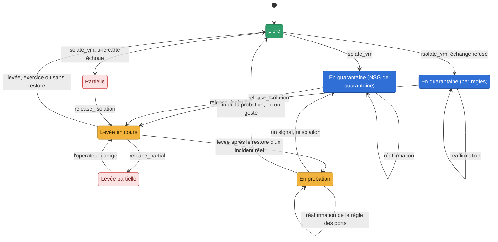

# La levée après un restore : seule et en probation, sauf porte prouvée ouverte (LEV1, #690) — conception

_Conception — 10/11 (LEV1, #690) — statut : **conception seulement**. Rien n'est codé ni mesuré. Les
décisions de Jonathan du 10/11 sont dans l'issue, et ce sont ses commentaires qui font foi ; elles sont
reprises ci-dessous. Les questions qui restent sont au §15._

> **Décisions de Jonathan (10/11, révisées le même jour).**
> - **Un exercice prouvé par le plan de contrôle** (un run d'Orodruin, cause connue) : la levée reste
>   seule, comme aujourd'hui. Le banc garde son geste unique.
> - **Un incident réel** : H0 lève seul, **en probation**. Sauf quand la porte est prouvée ouverte :
>   le principal qui a agi sur la VM garde ses droits. Ou quand la VM est marquée « levée humaine
>   après restore ». La quarantaine reste alors, avec une carte qui propose la révocation (le plan
>   d'IR1a).
> - **Dans tous les cas**, les disques d'origine sont gardés pour l'enquête et nommés.
> - **La probation suit toute levée après le restore d'un incident réel, quel que soit le mode.** En
>   `human_only`, la levée est humaine, puis la probation commence, et une réinfection n'est qu'une
>   carte. En `non_disruptive`, la réisolation est autonome.
> - **`full_auto`** ne rend pas le restore autonome à lui seul : le restore est destructif et relève de
>   `allow_destructive` (décision du 10/06).
> - **Le vocabulaire** : la *quarantaine*, c'est la VM coupée ; la *probation*, la VM en service sous
>   surveillance renforcée. On parle de l'action ; la décision de la prendre reste celle du mode.
> - **La probation s'éprouve au banc** : un exercice « comme un incident réel », puis le T1136.001
>   d'Atomic Red Team pendant la probation. On mesure la réisolation.
> - **Une limite à écrire** : un vecteur dans l'invité (une faille applicative, un mot de passe faible)
>   échappe au plan de contrôle. Seules la probation et la réisolation le couvrent.

**Règle de lecture.** Ce qui est lu dans le code est une affirmation, avec son fichier et sa ligne (au
commit `e6850672`). Ce qui est dit d'Azure vient de la documentation de Microsoft ou d'une mesure au
banc, et le dit : une **hypothèse** est à mesurer (§14). Le replay privé de la décision (quatre
scénarios, deux modes) est la référence : là où ce document s'en écarte, il le dit (§13).

---

## 0. En bref

- **Une seule règle de levée après un restore**, dans un module neutre (`glorfindel/response/lift.py`,
  à écrire). La watch, `glorfindel release`, la console et le bot passent tous par elle. Elle rend
  un verdict parmi trois :
  - **exercice** : lever, sans probation ;
  - **probation** : lever, puis mettre en probation ;
  - **retenue** : garder la quarantaine, et une carte qui dit pourquoi.

  Le mode décide ensuite qui exécute : H0 seul en `non_disruptive`, un humain en `human_only`.
- **La porte prouvée ouverte** : un tiers a agi sur la VM par le plan de contrôle. Cela veut dire une
  Run Command, une extension (VMAccess comprise), une écriture de la VM, de ses disques, de ses cartes
  réseau, de son NSG ou de son identité. Le journal d'activité le dit, sur une fenêtre qui commence
  7 jours avant le point restauré. Et ce tiers **garde ses droits** sur la VM : ses attributions de
  rôle et leurs définitions, relues en lecture seule par le Reader que H0 tient déjà.
  - Des droits qui ne se lisent pas entièrement ne prouvent pas la porte fermée : la quarantaine
    reste (Q2).
  - La carte propose la révocation sous la forme du plan d'IR1a : des étapes exactes, puis un bouton
    **Verify**.
  - Une fois les droits relus absents, la watch lève, en probation.
- **L'exercice prouvé** : trois faits, chacun avec son auteur.
  - Une fenêtre publiée par le canal d'Orodruin.
  - Sur la cible de cette fenêtre, les gestes de l'attaque, sous l'**identité d'Orodruin** et dans
    la fenêtre, lus au journal d'activité.
  - **Aucun tiers** sur la VM pendant la fenêtre de lecture.

  Une étiquette « exercice » sans ces faits ne vaut rien : le cas est traité comme un incident réel.
  L'option « comme un incident réel » d'une demande ne fait qu'ajouter des gardes.
- **La probation, 24 h par défaut** (Q3).
  - Les ports d'administration (22, 3389, 5985, 5986) sont fermés depuis Internet par une règle de
    Glorfindel, réversible, nommée, que la réaffirmation et le balayage des orphelines reconnaissent.
  - Des règles et des seuils propres à la probation, par règle de détection, dans le fichier des
    règles, jamais dans le prompt.
  - **La réisolation au moindre signal, décidée par le code, sans le modèle**. En `non_disruptive`,
    H0 réisole seul. En `human_only`, une carte haute, poussée, avec l'isolement approuvable en un
    clic.
- **Les disques d'origine** : leurs identifiants sont notés à l'isolement. Après le restore, ils sont
  nommés sur la carte et dans le rapport comme preuves, à ne pas supprimer. Glorfindel ne les touche
  jamais.
- **La preuve** :
  - six propriétés pour la machine des invariants (§10), sur un faux Azure qui gagne les attributions
    de rôle et le journal d'activité complet ;
  - au banc, un T1486 « comme un incident réel », puis un T1136.001 pendant la probation, et la
    réisolation mesurée par `make bench-report`.
- **Six lots de code**, LEV2 à LEV7 (§12), et un lot de vocabulaire, LEV8.

---

## 1. Ce que le code fait aujourd'hui

### 1.1 Les chemins de levée

| Chemin | Ce qu'il fait | Où |
|---|---|---|
| La watch (REC1, REC1b) | lit la reprise sur Azure ; prouvée, émet son propre `recovery_complete`, que le graphe traite. La levée est autonome dans les modes qui la permettent, une carte `mode_hold` en `human_only` | `glorfindel/recovery_watch.py:233` (`recovery_pass`), `:363` (`_emit`) |
| `glorfindel restore --wait` | restaure, puis construit le `recovery_complete`, le garantit pour son processus et appelle `agent.respond` : la levée se décide **dans le processus du poste**, avec sa config | `glorfindel/cli.py:1589-1597` |
| `restore --keep-isolated` | n'émet rien. La VM reste isolée ; `glorfindel release` à la main | `glorfindel/cli.py:1584` |
| La console, le bot, `glorfindel release` | un humain lève, sans condition sur le restore | `eregion_console/api.py:1375`, `glorfindel/cli.py:316` |

La précondition de levée (`glorfindel/agent.py:1449`, `_apply_release_precondition`) ne regarde que le
signal. Une levée proposée par le modèle passe sur un `recovery_complete` garanti (SEC3) dont la
neutralisation est `True`. Tout le reste est retenu.

**Le trou** (le constat de l'issue) : rien ne distingue un exercice d'un incident réel au moment de
la levée. Un restore remet un état propre, mais ne ferme pas le vecteur d'entrée. `--keep-isolated` ne
vaut que pour le processus du poste : la watch de H0 ne le connaît pas et lève quand même.

### 1.2 Ce qui sert déjà

- **Le journal d'activité, lu par H0** : `_activity_events` (`glorfindel/providers/azure/recovery.py`)
  lit les événements de la VM, page par page, au plus 20, une page de plus étant une erreur. REC1b ne
  garde que `runCommand/action`. LEV1 en lit plus, avec la même lecture.
- **Les droits d'un principal, lus comme Azure les lit** : `action_held`
  (`glorfindel/providers/azure/restore_rights.py:140`) évalue les jokers et les `notActions`.
  `make bench-preflight` (BNC1) lit déjà les attributions de H0 et d'Orodruin et leurs définitions.
- **L'étiquette d'exercice** (B2, `eregion_core/exercise.py:701`, `source_of`) : une fenêtre
  d'injecteur, bornée, qui ne marque qu'une VM inscrite. Elle **n'abaisse aucune garde**
  (`docs/dagorlad.md`, « Ce que Glorfindel voit »). LEV1 garde cette règle : l'étiquette seule ne donne
  jamais une levée seule.
- **L'identité d'Orodruin** : la sortie `principal_id` d'`infra/orodruin` (`outputs.tf:10`). H0 ne la
  connaît pas aujourd'hui.
- **Le plan d'IR1a sur une carte** (`docs/design/reponse-identite.md` §3.2) : des étapes exactes pour
  l'humain, puis **Verify**, qui relit et dit « held », « not held » ou « unreadable ».
- **Ce qu'on sait des disques** (`docs/azure.md`) : après un restore sur place, les anciens disques OS
  et de données restent dans le groupe, non attachés.

---

## 2. Le vocabulaire : quarantaine, probation

**Deux mots, posés partout** (décision du 10/11) :

| Mot | Sens | En anglais |
|---|---|---|
| **Quarantaine** | la VM isolée, coupée du réseau, **quel que soit le mécanisme** : le NSG de quarantaine sur chaque carte, ou le repli par règles | *quarantine* |
| **Probation** | la VM remise en service après le restore d'un incident réel, sous surveillance renforcée : ports d'administration fermés depuis Internet, règles et seuils de probation, réisolation au moindre signal selon le mode | *probation* |

**On parle de l'action** : isoler (mettre en quarantaine), lever, mettre en probation, finir la
probation. **La décision** de la prendre reste celle du mode, comme pour toute action. Les noms d'API
ne changent pas : `isolate_vm` et `release_isolation` restent les noms des actions
(`AUTONOMOUS_ACTIONS`), des cartes et de l'état.

**Un conflit à lever.** Aujourd'hui, « en quarantaine » désigne un mécanisme : le NSG de quarantaine
sur la carte, par opposition à « Isolée par règles » (`docs/architecture.md`, « La vie d'une
isolation »). Avec le nouveau sens, les deux sont la quarantaine. Le mécanisme garde son nom : le **NSG
de quarantaine**, et **le repli par règles**. Le diagramme devient :

La liste exacte des endroits qui reçoivent ces mots est au §11.

---

## 3. La règle, une seule, pour tous les chemins

### 3.1 Le verdict

La règle se lit dans l'ordre, et s'arrête au premier cas qui s'applique. Elle ne s'applique qu'à une
levée **après un restore prouvé** : les conditions de REC1 et REC1b sont tenues (le job, sur place, le
point, la VM qui tourne, la neutralisation). Une condition qui manque donne déjà une carte
aujourd'hui, et rien ne change là.

| # | Cas | Verdict | Ce que dit la carte |
|---|---|---|---|
| 1 | une condition de REC1 ou de REC1b manque | **retenue** (inchangé) | `release_hold`, sa raison |
| 2 | la VM est marquée « levée humaine après restore » (§3.4) | **retenue** | « Levée humaine demandée pour cette VM » ; les disques d'origine ; la levée approuvable |
| 3 | **exercice prouvé** (§5), sans l'option « comme un incident réel » | **exercice** : lever, sans probation | — (comme aujourd'hui) |
| 4 | **la porte n'est pas prouvée fermée** : un tiers a agi sur la VM (§4.1), et ses droits sont lus comme tenus, ou ne se lisent pas entièrement | **retenue** | `lift_door_open` : qui, quoi, quand ; ses droits ; le plan de révocation ; Verify |
| 5 | une réinfection pendant une probation précède ce restore (§6.5) | **retenue** | « Seconde reprise après une réinfection : levée humaine » |
| 6 | sinon (aucun tiers, ou un tiers dont les droits sont relus absents) | **probation** : lever, puis mettre en probation | `probation_started` : la durée, la règle des ports, les disques d'origine |

Le cas 4 sépare deux situations, que la carte dit autrement :
- **la porte prouvée ouverte** : les droits sont lus, et ils tiennent encore ;
- **la porte non prouvée fermée** : un droit ne se lit pas (§4.4).

La décision de l'issue parle de la porte « prouvée ouverte ». Ce document retient aussi le second cas
(Q2) : un tiers a agi, ce qui prouve qu'une porte a existé, et rien ne prouve qu'elle est fermée.

### 3.2 Par mode

La règle donne le verdict ; **le mode décide qui exécute**. C'est la couche politique qui existe déjà
après `decide`, jamais un contournement (`docs/glorfindel.md`, « Modes d'autonomie par asset »). Le
mode est le mode effectif, celui de la préparation (L6).

| Verdict | `human_only` | `non_disruptive` |
|---|---|---|
| exercice | carte `mode_hold` : l'humain lève, sans probation | H0 lève seul, sans probation |
| probation | carte `mode_hold` « Lever en probation » : l'humain lève, puis la probation commence | H0 lève seul, puis la probation commence |
| retenue | la carte, la quarantaine reste | la carte, la quarantaine reste ; la porte relue fermée (cas 4) : H0 lève seul, en probation |
| un signal pendant la probation | carte haute, poussée, `probation_signal` : l'isolement approuvable en un clic | H0 réisole seul ; une carte `probation_reisolated` le dit |

**En `human_only`, « Lever en probation » est un seul geste.** Le bouton approuve la levée et la règle
des ports ensemble : l'humain a approuvé les deux. `human_only` n'exécute rien de lui-même, mais exécute
ce que l'humain approuve.

**`full_auto`** (toujours refusé par la validation de la configuration) : il ne change rien ici. Le
restore reste le geste humain sans l'opt-in `allow_destructive`, qui est un axe séparé du mode
(décision du 10/06). Le jour où `full_auto` existera, il se lira comme `non_disruptive` pour la levée
et la probation.

### 3.3 Où la règle vit, et pourquoi elle ne touche pas au prompt

- **Le module neutre** `glorfindel/response/lift.py` (sans SDK, MC0) :
  - `lift_verdict(facts, *, lift_human) -> Verdict` : le verdict (`exercise`, `probation`, `hold`),
    sa raison, ses étapes, les disques d'origine ;
  - `facts` vient de l'adaptateur : la reprise (REC1), les acteurs et leurs droits (§4), la preuve de
    l'exercice (§5).
- **L'adaptateur** (`glorfindel/providers/azure/`) gagne deux lectures :
  - `observed_actors(resource_id, since)` : les gestes sur la VM, ses disques, ses cartes, son NSG et
    son identité, lus au journal d'activité ;
  - `observed_rights(principal, resource_id)` : les attributions qui touchent la VM, et leurs
    définitions.
- **Le verdict ne passe pas par le signal.** `_build_user_message()` écrit tout le signal dans le
  message du modèle (`glorfindel/agent.py:3034`, `json.dumps(signal, …)`). Un champ de plus dans le
  `recovery_complete` changerait donc ce que voit le modèle : c'est une zone qui exige un run de bout
  en bout. Le verdict est donc **noté à côté** :
  - par la watch, dans `~/.glorfindel/recoveries.json`, sous le job (son enregistrement existe déjà),
    avec l'id du signal ;
  - `_apply_release_precondition` le relit pour le signal garanti qu'il juge. Un verdict absent ou
    illisible donne une retenue, jamais une levée.

  **Un test fige le message du modèle** sur un `recovery_complete`, avec et sans verdict noté : le
  même à l'octet. C'est le modèle de `tests/unit/test_dagorlad_blind.py`.
- **Le modèle peut toujours refuser de lever.** Il propose, ou non, `release_isolation` sur le
  `recovery_complete`, comme aujourd'hui. La règle ne fait que retenir ce qu'il propose, puis, sur une
  levée exécutée, mettre en probation. La probation n'est jamais une proposition du modèle.

L'autre option était une levée après restore **sans le modèle** : une décision construite par le code
(comme une carte `identity_change`). Elle est écartée ici : elle change le graphe pour un cas que la
précondition tient déjà. C'est la question Q8.

### 3.4 Les chemins, unifiés

- **La watch** : seule à lever d'elle-même après un restore. `recovery_watch` applique la règle après
  les conditions de REC1 :
  - un verdict **retenue** écrit sa carte. Le cas 4 n'est **pas terminal** : la watch relit les droits
    à chaque passe, comme elle relit une VM arrêtée, et lève quand ils sont relus absents ;
  - un verdict **exercice** ou **probation** émet le `recovery_complete` et note le verdict.
- **`glorfindel restore --wait` ne lève plus dans son processus** (Q5). Il attend le job, dit ce qu'il
  a vu (le point, la neutralisation), puis dit que la levée est celle de la watch qui tient
  l'isolation, sur cet hôte ou sur H0. La règle reste ainsi en un seul endroit. Une probation demande
  une watch qui la tienne : la réaffirmation de la règle des ports, la réisolation, la fin. Un
  processus de poste qui lève, puis s'arrête, ne la tient pas. Sur un poste qui a aussi sa watch, le
  délai `GLORFINDEL_RECOVERY_GRACE_S` n'a plus d'objet pour ce cas : la watch lève à sa passe suivante.
- **`--keep-isolated` reste, pour l'opérateur qui le veut**, et atteint enfin la watch qui lève :
  - sur le poste, `restore --keep-isolated` pose une **retenue** sur la watch qui tient l'isolation,
    avant de lancer le restore. Vers H0, par SSH, la clé d'hôte vérifiée (comme `make bench-report`),
    une commande de la CLI de H0 qui n'écrit que la retenue. La forme exacte se fixe dans LEV3 ;
  - la retenue ne fait qu'ajouter une garde : forgée, elle garde une VM en quarantaine, jamais ne la
    lève. Elle vit dans `~/.glorfindel/lift_holds.json`, que seul Glorfindel écrit (la watch, la
    console, la CLI de l'hôte) ;
  - si la retenue ne peut pas être posée (H0 injoignable), la commande le dit en rouge
    avant de lancer le restore, et demande de confirmer ;
  - même effet : la VM marquée « levée humaine après restore » (ci-dessous), ou le bouton **Keep in
    quarantine** sur la carte d'isolement de la console.
- **La console, le bot et `glorfindel release`** : la levée d'un humain passe par le même module.
  - Une VM dont le dernier restore a le verdict **probation** ou **retenue** est levée **en
    probation** : la probation suit toute levée après le restore d'un incident réel.
  - Le bouton dit « Lift into probation ». Sur une carte `lift_door_open`, il demande de confirmer :
    la porte est ouverte.
  - Il n'y a pas de « lever sans probation » en un clic. Un humain qui veut finir la probation le fait
    ensuite, par un geste tracé (§6.4).
  - Le bot montre la carte et propose les mêmes boutons que pour une levée aujourd'hui.
- **L'option par VM « levée humaine après restore »** vit dans la ligne des modes d'autonomie :
  `autonomy.lift_human: [<motifs>]` dans `glorfindel-config.yaml`. Les noms se résolvent comme
  `autonomy.assets` : `fnmatchcase` en minuscules, et deux entrées en désaccord donnent la plus
  prudente. Le sélecteur de la console l'écrit. C'est une garde : elle ne fait que retenir.

**Hors de cette règle** : une levée **sans restore**. C'est le cas d'un faux positif levé par un
humain, ou d'une VM nettoyée à la main. Elle ne met pas en probation : une probation après une levée
humaine sans restore est un autre sujet, à décider hors de LEV1 (§15, points ouverts).

---

## 4. La porte prouvée ouverte

### 4.1 Ce qui compte comme « a agi sur la VM »

Un **geste**, c'est un événement du journal d'activité (`Microsoft.Insights/eventtypes/values`, la
lecture de REC1b) dont la ressource est la VM, un de ses disques, une de ses cartes réseau, un NSG
qui la gouverne, ou une identité qu'elle porte. Et dont l'opération est dans la table ci-dessous. Il
compte **quel que soit son statut**, comme REC1b compte une Run Command : un essai qui a échoué dit
qu'un principal a tenté, et ses droits sont alors lus. Seul un **refus de la plateforme**
(`Conflict`, `OperationNotAllowed`, la lecture de REC1b) ne compte pas : il n'a rien atteint.

| Opération (ARM) | Pourquoi c'est une porte |
|---|---|
| `Microsoft.Compute/virtualMachines/runCommand/action` | du code dans l'invité, en root (Run Command v1) |
| `Microsoft.Compute/virtualMachines/runCommands/write`, `/delete` | idem, Run Command managé (v2), rejoué au démarrage |
| `Microsoft.Compute/virtualMachines/extensions/write`, `/delete` | une extension : Custom Script, **VMAccess** (un mot de passe ou une clé SSH remis), tout agent. Une extension de la liste blanche de `_replayable_scripts` (`glorfindel/providers/azure/restore.py:399`) ne compte pas, VMAccess n'y est jamais |
| `Microsoft.Compute/virtualMachines/write` | le profil d'OS, `userData`, `customData`, une identité attachée, un disque attaché |
| `Microsoft.Compute/virtualMachines/attachDetachDataDisks/action`, `…/reimage/action`, `…/redeploy/action` | un disque ou un état remplacé hors du restore |
| `Microsoft.Compute/disks/write`, `…/beginGetAccess/action` | un disque de la VM écrit, ou exporté par un SAS |
| `Microsoft.SerialConsole/serialPorts/connect/action` | une console interactive sur la VM (hypothèse : le journal la porte sous cette opération) |
| `Microsoft.Network/networkInterfaces/write` | une carte changée : une adresse, une IP publique, un autre NSG |
| `Microsoft.Network/publicIPAddresses/join/action` | une IP publique posée sur la carte |
| `Microsoft.Network/networkSecurityGroups/securityRules/write`, `…/networkSecurityGroups/write` (sur un NSG qui gouverne la VM) | un port ouvert devant la VM |
| `Microsoft.ManagedIdentity/userAssignedIdentities/assign/action` | une identité donnée à la VM |

**Hors de la table**, et donc pas des gestes : la lecture, le démarrage, l'arrêt, la désallocation
(ils ne posent rien dans la VM), et les sauvegardes. La liste est fermée et vit dans l'adaptateur : une
opération qui manque se signale par un lot, jamais par le modèle.

### 4.2 Qui n'est pas un tiers

Un **tiers**, c'est tout appelant (`caller`, `claims.appid`, `claims.oid`, comparés comme REC1b les
compare) qui n'est pas l'un de ceux-ci :

| Appelant | Comment il est connu | Quand il n'est pas un tiers |
|---|---|---|
| Glorfindel (la watch, H0) | `GLORFINDEL_OWN_CALLERS`, `AZURE_CLIENT_ID` | toujours : l'isolement, la coupure, la neutralisation de H0 |
| un principal qui restaure | `GLORFINDEL_RESTORE_PRINCIPALS` | toujours : la neutralisation, le restore |
| Azure Backup | l'application du service de sauvegarde de Microsoft, son appId lu au banc (hypothèse : c'est lui qui écrit les disques d'un « Replace disks ») | pendant le job seulement, de son début à sa fin |
| Orodruin | `GLORFINDEL_INJECTOR_PRINCIPALS` (nouveau : la sortie `principal_id` d'`infra/orodruin`, dans `host.env`) | **dans une fenêtre d'exercice prouvée qui nomme la VM** (§5). Hors d'elle, Orodruin est un tiers : son identité volée agit comme une autre |
| un appelant attendu, déclaré par l'opérateur | `lift.expected_callers: [<object id>]` (nouveau, dans `glorfindel-config.yaml`, comme `expected_sudo.admins`) | toujours, et la carte le dit : « X, attendu, a agi à T » (Q6) |

**Pourquoi des appelants attendus.** Chez un client, un pipeline ou un administrateur agit sur ses VM
chaque semaine. Une politique `DeployIfNotExists` y pose même l'agent de supervision par une
extension. Sans cette liste, chaque incident réel sur une telle VM serait une porte « ouverte », et la
levée seule par défaut ne servirait jamais. Le prix est écrit : **un appelant attendu dont l'identité
est volée passe pour un attendu**. La carte le nomme toujours, et la probation couvre ce cas comme un
vecteur dans l'invité.

### 4.3 La fenêtre

**De 7 jours avant le point restauré jusqu'à maintenant** (`lift.lookback_days`, 7 par défaut, au
plus 90 : la rétention du journal d'activité). Q4.
- **Pourquoi avant le point** : un geste d'avant le point est dans le disque restauré. Un geste
  d'après le point a eu lieu sur la VM qui vient d'être restaurée.
- **Pourquoi 7 jours** : le point est en général de la veille (une sauvegarde quotidienne). Une
  intrusion qui précède le chiffrement de quelques jours y entre. Une plus ancienne échappe au plan de
  contrôle, comme un vecteur dans l'invité : la probation la couvre.
- **La lecture est bornée** comme celle de REC1b : au plus 20 pages, une page de plus est une erreur.
  Une lecture coupée ou en échec rend les acteurs **illisibles** : retenue, cas 4.

**L'écart dit sur la carte** (la persistance possible) : le point restauré, la première activité
suspecte connue (la première détection, le premier geste d'un tiers) et l'écart entre les deux. Un geste
de tiers **avant** le point est dit en rouge : « le disque restauré porte peut-être ce qu'il a posé ».
Ce n'est pas une retenue de plus : la règle de `--before` (REC1) reste celle de la détection, et un
administrateur légitime d'avant le point ne bloque pas la levée. Une persistance que le plan de
contrôle ne voit pas est le rôle de la probation.

### 4.4 Le tiers garde-t-il ses droits

**Lu en lecture seule, avec le Reader que H0 tient déjà sur le groupe du banc** (`infra/glorfindel-host/main.tf:203`).
`Microsoft.Authorization/*/read` est sous `*/read` : rien n'est ajouté à H0.

1. **Les attributions qui touchent la VM** : `GET {vm}/providers/Microsoft.Authorization/roleAssignments`.
   Une liste à une portée rend aussi celles des portées au-dessus, le groupe et l'abonnement
   (hypothèse : lu par le Reader du groupe, à mesurer). On garde celles dont le `principalId` est un
   des identifiants du tiers.
2. **Leurs définitions** : `GET …/roleDefinitions/{id}`. Une attribution donne la porte si sa
   définition tient une des opérations du §4.1. La lecture est celle d'`action_held` : les jokers, les
   `notActions` et les `dataActions`.
3. **Le verdict des droits** :
   - **tenus** : une attribution au moins donne une opération du §4.1 ;
   - **absents** : la liste est lue entièrement et aucune ne la donne ;
   - **illisibles** : une lecture échoue, ou une portée échappe à H0.

**Ce qui reste illisible depuis H0**, et fait donc une retenue quand le tiers est là :
- **un groupe** : une attribution à un groupe dont le tiers serait membre. Lire l'appartenance demande
  Microsoft Graph, que H0 ne lit pas (`glorfindel/providers/azure/graph.py`, « Without them — H0
  today —, every read is `Unreadable` »). Une attribution à un groupe qui donne la porte, sans
  l'appartenance lue, est **illisible**, jamais absente ;
- **une éligibilité PIM** (`roleEligibilityScheduleInstances`) : un droit qu'on active à la demande.
  Lisible sous `*/read` d'après la documentation (hypothèse) ; illisible, c'est une retenue ;
- **un groupe d'administration** : une attribution au-dessus de l'abonnement, que BNC1 dit déjà ne
  pas lire ;
- **une attribution de refus** (`denyAssignments`), une condition ABAC ou un verrou : ils ne font que
  retirer. Ignorés, ils peuvent faire lire « tenus » ce qui ne l'est plus. C'est le sens prudent.

**Un tiers qui n'existe plus** (un principal supprimé, que l'annuaire ne connaît plus) : ses
attributions orphelines ne donnent rien. Ses droits sont **absents**, et la carte le dit.

**Pourquoi « illisible » retient** (Q2) : la règle « un fait absent fait une carte, jamais une levée »
est celle de REC1. Un tiers a agi : la porte a existé. Une levée seule sur une lecture incomplète
serait la seule levée du projet faite sur ce qu'on n'a pas lu.

### 4.5 Ce que dit la carte, et le plan d'IR1a

La carte `lift_door_open` (action `review_door`, rien d'approuvable en un clic tant que la porte est
ouverte) dit :

- **qui** : le tiers, comme `make bench-report` dit un appelant. Son rôle s'il est connu (un humain, une
  application), son identifiant masqué dans le texte public, entier dans la console ;
- **quoi, quand** : chaque geste du §4.1, son heure, son statut, et sa place par rapport au point ;
- **ses droits** : chaque attribution qui donne la porte (le rôle, la portée), ou ce qui ne se lit
  pas ;
- **le plan**, dans la forme d'IR1a (§3.2 de `reponse-identite.md`), écrit par le code depuis la
  lecture, jamais par le modèle :
  1. **retirer l'attribution**, pour chacune : `az role assignment delete --ids <id>`. C'est une étape
     pour l'humain, avec son propre compte : retirer un rôle Azure demande Owner ou User Access
     Administrator, qu'aucune identité d'Eregion ne tient. C'est la même règle qu'IR1 (« À côté :
     l'attribution d'un rôle Azure … hors d'IR1 ») ;
  2. **couper l'identifiant** :
     - pour un principal de service : la rotation ou le retrait de ses identifiants. Un verbe de
       l'exécuteur d'identité (`entra_remove_credential`) quand il est inscrit et qu'IR1c existe ;
       sinon une étape ;
     - pour un utilisateur : `entra_revoke_sessions`, dans les mêmes conditions ;
  3. **Verify** : relit les droits (§4.4) et dit « held », « not held » ou « unreadable ».
- **les disques d'origine** (§8) et le point restauré ;
- **l'enquête pendant la quarantaine** : l'accès forensique (`isolation.forensic_sources`), pour
  entrer dans la VM sans la lever.

### 4.6 Quand la porte se referme

- **La watch relit les droits à chaque passe** (`GLORFINDEL_RECOVERY_INTERVAL_S`, 60 s), tant que la
  carte attend. Verify ne fait que relire plus tôt, à la demande.
- **Relus absents**, la watch attend encore `lift.settle_s` (600 s par défaut). La documentation de
  Microsoft dit qu'un changement d'attribution peut prendre jusqu'à 10 minutes à s'appliquer
  (hypothèse, à mesurer). Un jeton déjà émis survit aussi à la révocation de ses sessions, 60 à
  90 minutes par défaut (`reponse-identite.md`, §0). Puis elle relit une dernière fois et lève, en
  probation (en `non_disruptive`), ou change la carte en « Lift into probation » (en `human_only`).
- **Un nouveau geste du tiers** pendant ce temps : la carte le dit, et le délai repart.

Le replay fait lever une minute après la révocation ; ce délai l'allonge à dix (§13).

### 4.7 Ce que la porte ne voit pas

- **Un vecteur dans l'invité** (une faille applicative, un mot de passe faible, une clé SSH volée) :
  il n'écrit rien au plan de contrôle. Seules la probation et la réisolation le couvrent. C'est la
  limite de l'issue, écrite.
- **L'identité de la VM elle-même** : un attaquant dans l'invité prend un jeton par l'IMDS (la
  quarantaine le refuse, L17 ; la VM en probation, non) et agit ailleurs sous l'identité de la VM.
  Ses gestes sur **d'autres** ressources ne sont pas dans le journal de la VM. Proposé, hors de LEV1 :
  dire sur la carte si la VM porte une identité, et ses droits.
- **Les connexions Entra aux VM** (`virtualMachines/login/action`) : ce sont des `dataActions`, que le
  journal d'activité ne porte pas. Les droits qui les donnent sont lus (§4.4), les connexions non.
- **Bastion** : une session par Bastion s'écrit dans les journaux de Bastion, pas dans celui de la VM
  (hypothèse). Elle est donc vue comme un vecteur dans l'invité.

---

## 5. L'exercice prouvé

### 5.1 Trois faits, chacun avec son auteur

| Fait | Son auteur | Ce qui le tient |
|---|---|---|
| **une fenêtre d'exercice qui nomme la VM**, tirée du canal d'Orodruin (`note_pulled`, `eregion_core/exercise.py:371`), qui couvre la première détection de l'incident | Orodruin, ou l'opérateur (les deux seuls rédacteurs du conteneur `exercises`, `infra/orodruin/main.tf`) | les bornes de B2 et de SEC-A1 : durée, avance, chaîne, VM inscrite. **Une étiquette, pas une preuve** |
| **les gestes de l'attaque sur cette VM, sous l'identité d'Orodruin, dans la fenêtre**, lus au journal d'activité (au moins un geste du §4.1, une Run Command pour T1486 ou T1136.001) | ARM, qui écrit seul le journal | `GLORFINDEL_INJECTOR_PRINCIPALS`, comparé comme REC1b compare |
| **aucun tiers** sur la VM pendant toute la fenêtre de lecture (§4.3), et **aucun geste d'Orodruin hors d'une fenêtre** qui nomme la VM | ARM | la lecture du §4 |

**La cible de la demande** : la watch ne lit jamais la demande de Dagorlad (`docs/dagorlad.md`, « Il
ne voit pas le plan »), et LEV1 ne change pas ça. La cible prouvée est celle de la fenêtre, qu'Orodruin
écrit depuis le fil de la demande. Le journal d'activité, lui, prouve que l'identité d'Orodruin a agi
**sur cette VM**, et pas sur une autre.

**Une fenêtre locale** (une watch de poste, sans canal) : la fenêtre n'est pas tirée du canal. La
preuve repose alors sur le seul journal d'activité : les gestes de l'identité qui lance l'injecteur
(`GLORFINDEL_INJECTOR_PRINCIPALS`, sur ce poste) dans la fenêtre. Sans principal configuré, aucun
exercice n'est jamais prouvé : chaque restore suit la règle d'un incident réel, ce qui est le sens
prudent.

### 5.2 Ce qui défait la preuve

- **Un tiers** dans la fenêtre de lecture : pendant un exercice, un vrai intrus a pu agir. La levée
  suit alors la règle d'un incident réel (cas 4 ou 6).
- **Orodruin hors de sa fenêtre** : un geste de son identité qui n'est couvert par aucune fenêtre
  nommant la VM. Son identité est alors lue comme celle d'un tiers.
- **Une fenêtre refusée** par B2, ou absente : il n'y a pas d'exercice.
- **Une panne de Gothmog** (Chaos Studio) agit sous l'identité de l'expérience de Chaos Studio, pas
  sous celle d'Orodruin. Elle ne mène pas à un restore aujourd'hui (le run de reprise `x-reprise`
  restaure une VM détruite, sans quarantaine). Si un jour elle y mène, l'identité de l'expérience
  devra être déclarée comme celle d'Orodruin : hors de LEV1.

### 5.3 L'option « comme un incident réel »

**Pour éprouver la probation au banc**, un exercice doit pouvoir suivre le chemin d'un incident réel.
Sinon, un exercice prouvé lève sans probation, et la probation ne se mesure jamais.

- **Où elle se pose** : par fil, dans la demande de Dagorlad. Une case « as a real incident » sur un
  fil, puis la commande `make orodruin-exercise REQUEST=…`. Orodruin l'écrit dans la fenêtre,
  `as_real: true`, avec l'identifiant de la demande.
- **Ce qu'elle fait** : l'exercice reste prouvé (§5.1), mais le cas 3 ne s'applique pas. La règle
  passe à la porte, puis à la probation.
- **La porte, pendant un exercice « comme un incident réel »** : Orodruin a agi, et garde ses droits
  (c'est l'injecteur du banc). Compté comme un tiers, il retiendrait toujours la quarantaine, et le
  scénario « vecteur dans l'invité » ne se jouerait jamais. Il n'est donc **pas un tiers dans sa
  fenêtre prouvée** (§4.2), comme pour un exercice ordinaire ; tout autre appelant l'est. C'est plus
  prudent que le cas 3, qui lève sans probation : l'option n'enlève aucune garde.
- **Le scénario « porte ouverte »** se joue alors autrement : un **second principal du banc**, déclaré
  pour ça, agit sur la VM avant l'attaque (Q7). Ce n'est pas dans le premier exercice de LEV7.
- **Forgée, elle ne retire jamais une garde** :
  - une fenêtre qui dit `as_real: true` à tort rend la levée plus prudente (une probation au lieu d'une
    levée sans probation) ;
  - une fenêtre qui l'omet à tort laisse un exercice prouvé, qui demande toujours les faits du §5.1 ;
  - le champ est fixé à la première lecture de la fenêtre, comme ses autres champs (SEC14, une fenêtre
    revue ne change que sa fin).

### 5.4 Ce que le modèle ne voit pas

Ni la preuve, ni l'option, ni le verdict : rien ne passe dans le signal (§3.3), et la fenêtre ne
passe pas au modèle aujourd'hui (B2). Le test de `test_dagorlad_blind.py` gagne un cas : une demande
avec `as_real`, et un message au modèle identique à l'octet.

---

## 6. La probation

### 6.1 Sa durée

**24 heures par défaut** (`probation.hours`, par VM possible dans `autonomy`), Q3. Le replay en
montre 6, à titre d'illustration.
- **Pourquoi 24 h** : la persistance la plus courante sous Linux se déclenche au démarrage
  (`@reboot`, une unité systemd), puis à l'heure ou au jour (cron, minuteurs systemd). 6 h prennent le
  démarrage et l'horaire, pas le quotidien. 24 h prennent les trois.
- **Ce qu'elle coûte** : les ports d'administration fermés depuis Internet un jour. L'accès par un
  bastion, un VPN ou une source étroite reste ouvert (§7.2). Et le risque de bruit d'une réisolation
  (§6.3).
- **Au-delà** : une persistance hebdomadaire échappe à la probation. La carte de fin le dit, et
  l'enquête sur les disques d'origine reste à faire.

### 6.2 La surveillance renforcée, sans toucher au prompt

« Seuils resserrés », c'est **par règle et par VM**, dans le fichier des règles, jamais dans ce que
voit le modèle :

- **Des règles de probation** : une règle peut déclarer `assets: [probation]`. Le RulePoller ne la fait
  alors tourner que sur les VM en probation. Ce sont des règles trop bruyantes en temps normal, mais
  justes sur une VM qu'on vient de restaurer après un incident :
  - un compte local créé (T1136.001) ;
  - une crontab ou un minuteur systemd changés (T1053.003) ;
  - une Run Command d'un tiers ;
  - une extension posée ;
  - une connexion sortante vers une adresse jamais vue ;
  - une écriture disque soutenue sous le seuil de `ransomware-disk-write`.

  Les règles qui existent déjà gardent leur nom (`t1136-001-local-account-creation-linux-v1`,
  `t1053-003-cron-crontab-replace`). Le lot dit lesquelles sont déjà justes partout (et restent pour
  toutes les VM) et lesquelles n'ont de sens qu'en probation.
- **Une variante de probation d'une règle** : `probation_query`, la même forme que `query`, avec un
  seuil plus bas (par exemple `ransomware-disk-write` à la moitié de son seuil). Le RulePoller fait
  tourner la variante sur les VM en probation, et la requête de base sur les autres. Une règle sans
  variante tourne telle quelle.
- **La même cadence** : `interval_s` garde son minimum de 30 s (SEC2). La probation ne rend pas une règle
  plus fréquente, elle la rend plus sensible.
- **Ce que voit le modèle** : rien de neuf. En probation, une détection ne passe pas par le modèle
  (§6.3). Hors probation, rien ne change.

La validation du fichier des règles (P1, la couche du client) admet les deux champs. Une règle de la
couche du client peut en déclarer.

### 6.3 La réisolation au moindre signal

**Oui, de façon déterministe, sans les tirages du modèle** (Q1).

- **Le routage** : une détection dont la VM est en probation passe par un nœud de code, `probation_gate`,
  avant `decide`. Il construit la décision : `isolate_vm`, `decided_by: probation`, la raison (la règle,
  le moment, la probation). Aucun appel au modèle, et le cycle le note (`store_cycle`).
- **Puis les gardes, telles qu'elles sont** : la couche du mode (en `human_only`, `mode_hold` et une
  carte haute, poussée), le verrou de préparation, la garde destructive. Le code ne remplace que le
  tirage du modèle, jamais une garde.
- **Ce qui compte comme un signal** :
  - une détection d'une règle, de base ou de probation, sur la VM ;
  - une détection du plan de contrôle qui nomme la VM (son NSG changé hors de Glorfindel, une
    attribution à sa portée) ;
  - **et seulement un signal dont le moment est après le début de la probation**. Une détection de
    l'incident d'origine qui arrive en retard (l'ingestion, la déduplication du RulePoller) ne
    réisole pas.

  Une détection d'identité ancrée sur la VM n'est pas un signal de la VM (son ancre n'est qu'une
  ancre, comme pour B2).
- **Un exercice pendant la probation** (le T1136.001 du banc) réisole aussi : l'étiquette n'abaisse
  aucune garde.

**Le risque de bruit, et ce qui le borne.**
- **Le bruit attendu** : les vérifications de l'opérateur après la levée.
  - un `sudo` d'un administrateur déclenche `sudo-privilege-escalation` ;
  - une lecture d'intégrité par Run Command peut déclencher `auditd-sensitive-root-command`.

  Ce sont des signaux vrais, sur une VM qui sort d'un incident : la règle les prend au mot.
- **Ce qui le borne** :
  - **la rareté** : seule une VM restaurée après un incident réel est en probation ;
  - **la réversibilité** : la réisolation est une isolation, levée par le même chemin ;
  - **les exceptions** qui existent déjà (`expected_sudo.admins`) ;
  - **une carte de probation qui dit comment vérifier** sans réisoler : par Run Command sous un
    principal qui restaure, ou par SSH d'un administrateur déclaré ;
  - **la mesure** : une réisolation de probation qu'un humain juge à tort compte dans « actions
    disruptives à tort », un des cinq indicateurs ;
  - **un mode de probation par VM**, `probation.on_signal: card`, qui fait de la réisolation une carte
    même en `non_disruptive`, pour une charge où le bruit coûterait trop.
- **Pas de grâce au début de la probation** : la persistance `@reboot` se déclenche dans les
  premières minutes. C'est la fenêtre où la probation sert le plus.

### 6.4 La fin, et les gestes

- **À la fin** (`ends_at`), la watch retire la règle des ports (§7.5) et vide l'état. Une carte
  `probation_ended` le dit. Elle se ferme seule et rappelle l'enquête sur les disques d'origine.
- **Les gestes**, par la console, le bot (montrer seulement) et la CLI :
  - `glorfindel probation status [<vm>]` ;
  - `glorfindel probation end <vm> --yes` : finir maintenant, tracé dans le journal des actions de
    l'opérateur ;
  - `glorfindel probation extend <vm> --hours N`.

  Finir n'est pas une levée : la VM est déjà en service. Le geste retire la règle des ports et la
  surveillance renforcée.
- **`glorfindel list`, la tuile de la console, `/api/state`** : un état `PROBATION · until HH:MM`,
  avec la règle des ports (posée, non posée et pourquoi).
- **L'état** : `~/.glorfindel/probation/<vm>.json` (0600, écrit entier, comme l'isolation). Il porte :
  - le `resource_id`, `started_at`, `ends_at` ;
  - l'incident : l'isolement, la première détection, le job, le point ;
  - le verdict ;
  - les placements de la règle des ports : NSG, nom, priorité, carte, adresses, ports ;
  - les disques d'origine, et le nombre de réisolations.

  Illisible, l'état ne se lit jamais comme « pas de probation » (SEC3) : la VM est traitée comme en
  probation, et la réaffirmation le dit sur une carte.

### 6.5 Une réinfection

- **La réisolation** est un nouvel isolement, **rattaché** à l'incident d'origine. La carte dit
  « Réinfection pendant la probation » et nomme les deux jeux de disques d'origine.
- **Le début de l'incident**, pour le restore suivant, reste celui de l'incident d'origine. La règle
  de `--before` (`restore_plan.incident_start`) le lit sur l'état de probation, et non à la
  réisolation : il faut un point plus ancien.
- **La levée après le restore suivant est humaine** (cas 5, Q9) : la boucle s'est corrigée une fois,
  et ne lève pas seule deux fois de suite sur le même incident. Le replay s'arrête là, sur le choix de
  l'humain : un point plus ancien, ou la quarantaine gardée pour l'enquête.
- **La règle des ports reste posée** pendant la quarantaine : inutile, mais sans danger. L'état de
  probation passe à `suspended` ; la levée suivante décide de nouveau.

---

## 7. Les ports d'administration fermés depuis Internet

### 7.1 La forme de la règle

| | |
|---|---|
| **Nom** | `glorfindel-probation-<vm>-<carte>-<empreinte>`, par `_placement_rule_base("glorfindel-probation", …)` comme les isolations et les blocages (L24 : l'empreinte de la carte à la fin) |
| **Sens, accès** | entrant, **deny** |
| **Source** | le service tag `Internet` |
| **Destination** | les adresses privées de la carte, toujours. Même sur le NSG de la carte : un NSG peut gouverner plusieurs cartes |
| **Ports** | TCP 22, 3389, 5985, 5986 (`probation.admin_ports`, validés comme `isolation.forensic_ports`) |
| **Priorité** | la première libre avant la première allow large du client sur ces ports, et après ses allows étroites (§7.2) |
| **Où** | le NSG de la carte, ou celui de son sous-réseau. Un trafic doit passer les deux, un deny dans l'un suffit (`docs/design/module-isolation-iac.md`, « Faits établis ») |

**Elle n'est posée que s'il y a quelque chose à fermer** : une allow effective, depuis une source
large, sur un port d'administration, pour cette carte. C'est la lecture de préséance de L3
(`_shadowing_rules`). Sans exposition, rien n'est écrit, et la carte dit « aucun port d'administration
exposé depuis Internet ». On évite ainsi d'écrire dans le NSG d'un client pour rien : c'est une dérive
de plus pour son Terraform.

**Elle n'ouvre jamais rien** : c'est un deny, et Glorfindel n'écrit jamais d'allow pour elle.

### 7.2 Les règles du client sur ces ports

| Règle du client | Ce que fait la probation |
|---|---|
| une allow **étroite** (son bureau, son bastion, son VPN : un préfixe d'au plus /24 en IPv4, /64 en IPv6, Q10) | elle reste : la règle se pose **après** elle. Ses administrateurs gardent l'accès |
| une allow **large** (`*`, `Internet`, `0.0.0.0/0`, un préfixe plus large que le seuil) | la règle se pose **avant** elle, à la première priorité libre. Une règle du client n'est jamais déplacée (L3) |
| un deny déjà en place sur ces ports depuis Internet | rien à poser |
| aucune priorité libre entre les deux, sur aucun des deux NSG | rien n'est posé. La probation commence quand même (surveillance, réisolation) et la carte dit « ports d'administration non fermés : <la règle du client qui l'empêche> » |
| une allow large **avant** une allow étroite | la règle se pose avant l'allow large si une priorité est libre ; sinon, comme ci-dessus |

Le seuil « étroit » est une question (Q10). Celui des sources forensiques (au plus 256 adresses,
`config.validate_forensic_sources`) est le précédent du dépôt.

### 7.3 La réaffirmation et les orphelines

- **La réaffirmation** (`glorfindel/reassert.py`) lit l'état de probation comme elle lit un blocage :
  - la règle en place : `verified_at` ;
  - la règle disparue : reposée **une fois** hors de `human_only`, puis une alerte seule, sans se
    battre (L5) ;
  - en `human_only`, une alerte seule.

  Une règle devenue allow (quelqu'un l'a retournée) est dite, jamais corrigée (V-16). Une allow du
  client posée avant elle pendant la probation est dite aussi : c'est un geste sur le NSG de la VM,
  que la règle `nsg-change-outside-glorfindel` voit déjà, et donc un signal de probation (§6.3).
- **Le balayage des orphelines** (`glorfindel/orphans.py`, `glorfindel/providers/azure/sweep.py:314`)
  prend aussi le préfixe `glorfindel-probation-`. Une règle de probation laissée par une carte qui
  n'existe plus vise une adresse qu'Azure a pu donner à une autre VM. Elle est traitée comme les
  autres : une carte, puis le retrait seul en `non_disruptive`. Elle ne coupe que les ports
  d'administration depuis Internet, mais elle n'appartient plus à personne.
- **`glorfindel reset`** (`sweep_vm_rules`) retire aussi les règles de probation de la VM, par leur nom,
  avec ou sans état.

### 7.4 Le Terraform du client, et le module d'isolation

- **Le mécanisme par défaut** (des règles posées à la volée, L3) : la règle de probation est une règle
  de plus sur le NSG du client.
  - Un NSG à règles **séparées** la garde.
  - Un NSG à règles **en ligne** la perd au prochain `terraform apply`. La réaffirmation la repose
    une fois, puis alerte, et la carte dit pourquoi.

  C'est le comportement des blocages d'aujourd'hui (`module-isolation-iac.md`, L5).
- **Le module d'isolation (L8, pas encore construit)** gagne une troisième ancre, déclarée une fois
  dans le code du client :
  - une ASG `glorfindel-probation` par VNet ;
  - dans chaque NSG qui gouverne des VM défendues, une règle en **priorité 102** : deny entrant
    depuis `Internet`, sur les ports d'administration, vers l'ASG `glorfindel-probation` ;
  - pendant la probation, Glorfindel ajoute les ipConfigurations de la VM à l'ASG, et les en retire à
    la fin. Terraform n'y voit aucune dérive (l'appartenance à une ASG, `module-isolation-iac.md`).

  Un client qui veut garder ses allows étroites les met avant 102. La plage réservée devient
  **100–102**, visible dans son code et dans ses revues.
- **Sans ancre**, Glorfindel garde le mécanisme par défaut, et l'audit le dit, comme pour les deux
  autres ancres.

### 7.5 Le retrait

- **À la fin de la probation**, ou par `glorfindel probation end` : le même chemin qu'un déblocage. Sous
  le verrou de la VM, l'intention est notée d'abord (`ending_at`), puis la règle est retirée de chaque
  placement et relue. L'état se vide une fois la règle relue absente. Un retrait en échec garde l'état
  (`probation_end_partial`), et le dit.
- **Une VM supprimée** pendant sa probation : la levée de I7S cherche ses règles par le nom de ses
  cartes, et le balayage des orphelines est le filet.

---

## 8. Les disques d'origine, gardés pour l'enquête

- **Notés à l'isolement** : l'identifiant du disque OS et de chaque disque de données de la VM, dans
  l'état d'isolation (`disks_at_isolation`). L'adaptateur lit déjà la VM à l'isolement.
- **Après le restore sur place** : les disques actuels de la VM ne sont plus ceux-là. Ceux de l'état,
  non attachés, sont **les disques d'origine** (`docs/azure.md` : « les anciens disques OS et data
  restent non attachés dans le RG », mesuré). Ils sont relus par leur id : présents, absents (supprimés
  par quelqu'un, ce qui est dit en rouge), ou attachés ailleurs.
- **Nommés partout** : sur la carte de levée (chaque verdict), sur la carte de probation, dans le rapport
  du run, dans `make bench-report`. Avec la mention « preuves : ne pas supprimer » et la commande du
  verrou pour l'humain : `az lock create --lock-type CanNotDelete --name eregion-evidence --resource <id>`.
  **Glorfindel ne les écrit jamais** : ni tag, ni verrou, ni suppression. Il n'en a pas le droit, et un
  défenseur qui écrit sur les preuves les altère.
- **Une réinfection** : deux jeux de disques d'origine. Les deux sont nommés, le plus ancien en premier.
- **Au banc** : les disques d'origine d'un exercice sont jetables. La remise en état (étape 9 du guide
  T1486) les nomme et les distingue de ceux que Terraform suit, qu'il ne faut pas supprimer
  (`docs/azure.md`). Ceux d'un exercice « comme un incident réel » aussi : c'est un exercice.

**Hypothèse à mesurer** : le nom que le restore sur place donne aux disques qu'il pose, et le fait que
ceux d'origine restent dans le groupe de la VM, quelle que soit l'option du job.

---

## 9. Le modèle de menace

**Une frontière qui change**, dans la page « Le canal `runs/` et l'état local », à la suite de « Une
levée lue sur Azure » (`docs/design/modele-de-menace.md`, §2). Ce qui s'ajoute, une fois construit :

| | Menace | Ce qui la tiendra |
|---|---|---|
| E | Une fenêtre d'exercice forgée fait lever seule une VM après un vrai incident | La levée sans probation demande les gestes de l'identité d'Orodruin sur la VM, dans la fenêtre, au journal d'activité, et aucun tiers. L'étiquette seule donne la règle d'un incident réel (§5) |
| E | Un `as_real` forgé, ou retiré | Posé, il rend la levée plus prudente ; retiré, l'exercice reste à prouver. Le champ est figé à la première lecture (§5.3) |
| E | Un attaquant qui tient l'identité d'Orodruin agit sur une VM | Hors d'une fenêtre qui nomme la VM, Orodruin est un tiers : sa porte est lue comme celle d'un autre (§4.2) |
| E | Un attaquant qui tient un appelant attendu | Il passe pour attendu, et la carte le nomme. Seules la probation et la réisolation le couvrent. **Assumé**, écrit (§4.2) |
| T | Une retenue (`lift_holds.json`) forgée | Elle garde une VM en quarantaine, jamais ne la lève. C'est un déni de service sur une VM déjà coupée, dit sur sa carte |
| T | La règle de probation retirée par un tiers pendant la probation | La réaffirmation la repose une fois, puis alerte ; le retrait est un geste sur le NSG de la VM, donc un signal de probation |
| D | Un bruit qui réisole sans fin une VM en probation | Chaque réisolation est une carte. Après une réinfection, la levée suivante est humaine (§6.5). `probation.on_signal: card` par VM |
| I | Les disques d'origine supprimés pour effacer la trace | Glorfindel n'a pas ce droit et ne les touche pas. Leur absence est dite en rouge. Le verrou est le geste de l'humain (§8) |

**Ce qui reste, assumé** : un vecteur dans l'invité, un appelant attendu volé, une persistance plus
lente que la probation, un droit par un groupe que H0 ne lit pas (il retient, ce qui est sûr mais
bruyant). La frontière tient autant que les identités qu'elle croit : celles qui restaurent, celle
d'Orodruin dans sa fenêtre, les appelants attendus.

---

## 10. La preuve

### 10.1 La machine des invariants

Le faux Azure (`tests/unit/fake_azure.py`) gagne :
- les attributions de rôle à chaque portée (la VM, le groupe, l'abonnement) et leurs définitions,
  jokers et `notActions` compris ;
- des principaux : un tiers, un groupe, une éligibilité ;
- le journal d'activité de chaque opération du §4.1, sous son appelant ;
- l'identité d'Orodruin et ses fenêtres ;
- la règle de probation évaluée comme Azure évalue un NSG.

Le monde bouge :
- un tiers agit avant ou après le point ;
- ses droits sont retirés, ou jamais ;
- une lecture échoue ;
- une fenêtre est forgée, ou `as_real` posé ;
- une détection arrive pendant la probation, avant elle, en retard ;
- un `terraform apply` retire la règle ;
- la VM est supprimée.

Les oracles se tirent du journal du test, jamais des marqueurs du code (A0).

| Propriété | Ce qu'elle dit |
|---|---|
| **LV1** | Jamais une levée seule (sans approbation humaine) après un restore, si un tiers qui a agi sur la VM dans la fenêtre garde ses droits, ou si ses droits ne se lisent pas |
| **LV2** | Jamais une levée après le restore d'un incident non prouvé exercice sans probation : son état écrit, et la règle des ports posée ou son absence dite, dans la même opération |
| **LV3** | Jamais une levée sans probation sur la seule étiquette : une fenêtre sans gestes de l'identité d'Orodruin dans le journal donne la règle d'un incident réel |
| **LV4** | Une détection sur une VM en probation, d'un moment après le début de la probation : en `non_disruptive`, une isolation sans aucun appel au modèle ; en `human_only`, aucune écriture et une carte. Une détection d'un moment antérieur ne réisole jamais |
| **LV5** | Jamais une règle `glorfindel-probation-*` sur Azure pour une VM dont la probation est finie, une passe après la fin ; jamais une règle de probation qui coupe une allow étroite du client, ni une allow écrite |
| **LV6** | Les disques d'origine jamais écrits ni supprimés par Glorfindel, et nommés sur chaque carte de levée |

Plus, au niveau des tests de l'unité :
- le message au modèle identique à l'octet, avec et sans verdict noté (§3.3) ;
- `restore --wait` qui ne lève plus ;
- `--keep-isolated` qui pose la retenue sur la watch.

Les mutants sont dans chaque lot de code (`scripts/mutants/<lot>.py`), une plage demandée à
l'Orchestre. Ce lot de conception n'en a pas.

### 10.2 L'exercice au banc

**« La probation au banc »**, un guide à part (`docs/banc-probation.md`), sur le modèle de
`docs/banc-t1486.md`. Jonathan lance chaque geste.

1. **Avant** : `make bench-preflight`, qui gagne trois lignes :
   - `GLORFINDEL_INJECTOR_PRINCIPALS` posé sur H0 ;
   - la version de H0 qui porte LEV ;
   - aucune probation déjà en cours sur gondolin.
2. **La demande** : dans Dagorlad, le fil T1486 vers gondolin, avec la case « as a real incident »,
   puis `make orodruin-exercise REQUEST=…`. (`make bench-run`, de MOB1, la portera plus tard.)
3. **La détection, l'isolement, le restore** : comme le guide T1486, étapes 4 à 6.
4. **La levée en probation** : H0 lit la reprise, la porte (aucun tiers : Orodruin est dans sa
   fenêtre), et lève en probation. On note :
   - le temps de la fin du job à la levée ;
   - la règle des ports : posée, ou « aucun port exposé » sur le banc (gondolin n'aurait ni IP
     publique ni allow depuis Internet : H8).
5. **Pendant la probation** : le T1136.001 d'Atomic Red Team (vendorisé, épinglé,
   `annatar/atomics/`), lancé par une seconde demande de Dagorlad sur gondolin. Non destructif. Il a
   été mesuré en 44,7 s de la technique à la détection le 20/10.
6. **La mesure** :
   - le temps de l'injection à la réisolation par H0 (en `non_disruptive`) ;
   - la carte `probation_reisolated` ;
   - l'absence d'appel au modèle sur ce cycle (`decided_by: probation`).
7. **La fin** : pas de restore, rien n'est chiffré. La levée est humaine et sans restore, donc sans
   nouvelle probation (§3.4). Puis `glorfindel probation end` vide l'état suspendu, et la remise en
   état suit.
8. **Le rapport** : `make bench-report RUN=…` compose la chronologie, qui gagne les événements de
   probation (le début, la règle, le signal, la réisolation, la fin). Le replay privé de LEV1 et le
   replay public (`docs/replay/`) gagnent ce cas, avec les chiffres mesurés.

BL1b (« jamais un script maison ») et DRL1 (le drill de la semaine) restent intacts : T1136.001 est
public, et le drill n'est pas touché.

---

## 11. La doc et le vocabulaire : la liste exacte

Chaque lot de code met à jour la doc de ce qu'il change. Le vocabulaire se pose dans ces endroits :

| Où | Ce qui change |
|---|---|
| `docs/architecture.md`, « Le vocabulaire commun » | deux lignes : **Quarantaine**, **Probation** (§2) |
| `docs/architecture.md`, « La vie d'une isolation » | le diagramme du §2 : l'état *En probation* entre la levée et *Libre* ; « En quarantaine » nomme les deux mécanismes |
| `docs/glorfindel.md` | « La reprise lue sur Azure » renvoie ici, puis gagne « La levée après un restore » et « La probation » ; « Vérification post-action » gagne la règle des ports |
| `docs/azure.md` | la règle de probation, sa place, ses droits (ceux d'un blocage), ce qu'en fait un `apply` |
| `docs/banc-t1486.md` | « La levée » : le cas d'un exercice prouvé (inchangé), et le renvoi au guide de la probation ; l'étape 9 nomme les disques d'origine |
| `docs/operations.md` | `GLORFINDEL_INJECTOR_PRINCIPALS`, `lift.*`, `probation.*`, `autonomy.lift_human`, `glorfindel probation …` ; `restore --wait` et `--keep-isolated` |
| `docs/design/modele-de-menace.md` | le paragraphe du §9, dans « Ce qui tient » une fois construit |
| `docs/design/module-isolation-iac.md` | la troisième ancre, priorité 102, et la plage 100–102 |
| `docs/dagorlad.md` | l'option « as a real incident » d'un fil |
| `docs/fichiers-cles.md` | `~/.glorfindel/probation/`, `lift_holds.json` |
| `README.md` | « the only human step is approving the backup restore » vaut pour un **exercice** ; pour un incident réel : « the VM comes back in *probation* on its own, unless the door is proven open » ; les mots *quarantine* et *probation* |
| le manuel public (`docs/manuel/modules.yaml`) | les briques des lots de code, en anglais (*quarantine*, *probation*) |
| le replay public (`docs/replay/index.html`) | son texte dit déjà « the quarantine is lifted ». Il gagne la probation après la levée d'un incident réel, et le cas mesuré au banc |
| `docs/adoption/index.html` | la ligne sur « a second human step » (#668) à revoir |
| les cartes (`glorfindel/escalations.py`, `recovery_watch.py`) | les textes en français, avec *quarantaine* et *probation* ; les types `lift_door_open`, `probation_started`, `probation_signal`, `probation_reisolated`, `probation_ended` |
| la console (`eregion_console/static/glorfindel.js`) | le libellé de chaque nouveau type de carte (`ESC_LABELS`, sinon le type brut s'affiche) ; la tuile `PROBATION · until HH:MM` à côté d'`ISOLATED` ; « Lift into probation », « Keep in quarantine » |
| le bot (`glorfindel/bot.py`) | « lever l'isolation » devient « lever la quarantaine » ; « mettre en probation » |
| `glorfindel list` (`glorfindel/cli.py:2067`), la TUI (`glorfindel/tui.py:282`) | `ISOLATED` reste (le mot d'API, en anglais), et `PROBATION` s'ajoute |

---

## 12. Le découpage en lots de code

Dans l'ordre. Chacun est vert seul, avec ses tests, ses mutants et sa doc.

| Lot | Session | Ce qu'il fait | Ce qu'il prouve |
|---|---|---|---|
| **LEV2** — les faits | Glorfindel | `observed_actors` et `observed_rights` dans l'adaptateur (§4.1, §4.4) ; `disks_at_isolation` dans l'état ; le faux Azure gagne les attributions, les définitions et le journal complet ; la carte d'isolement dit les acteurs, pour information. **Aucun changement de levée** | les lectures justes sur le faux, aux formes mesurées au banc (les mêmes que BNC1) ; une lecture coupée est illisible, jamais vide |
| **LEV3** — la règle | Glorfindel | `glorfindel/response/lift.py` ; les cas 1 à 6 dans `recovery_watch` ; le verdict noté à côté ; la précondition qui le relit ; la preuve de l'exercice (`GLORFINDEL_INJECTOR_PRINCIPALS`) ; `autonomy.lift_human` ; `restore --wait` qui ne lève plus ; `--keep-isolated` et `lift_holds.json` ; la carte `lift_door_open` et son plan, Verify. **La probation n'est encore qu'un état** (pas de règle des ports, pas de réisolation) | LV1, LV3 ; le message au modèle identique à l'octet ; un exercice prouvé lève seul, un incident réel donne une levée en probation, une étiquette sans preuve donne la règle d'un incident réel |
| **LEV4** — la probation | Glorfindel | la règle des ports (pose, préséance, allows étroites), sa réaffirmation, les orphelines, `reset`, la fin ; `probation_gate` et la réisolation sans modèle ; `assets: [probation]` et `probation_query` dans le RulePoller ; la réinfection ; `glorfindel probation …` | LV2, LV4, LV5, LV6 ; la règle n'ouvre rien et ne coupe pas une allow étroite, sur le faux qui évalue comme Azure |
| **LEV5** — ce que voit l'humain | Console | la tuile, les cartes et leurs libellés, « Lift into probation », « Keep in quarantine », Verify, le sélecteur de `lift_human` ; le bot ; `glorfindel list` | les textes échappés (#254), aucun script en ligne ; les boutons qui ne font qu'ajouter une garde |
| **LEV6** — l'exercice « comme un incident réel » | Annatar, Orodruin, Console (Dagorlad) | la case d'un fil, `as_real` dans la demande et dans la fenêtre, lu par la watch, figé à la première lecture | forgé, il n'enlève aucune garde ; Dagorlad reste aveugle (`test_dagorlad_blind.py`) |
| **LEV7** — au banc | Tests, avec Jonathan | le guide `docs/banc-probation.md` ; `bench-preflight` et `bench-report` qui gagnent la probation ; le run, puis la mesure ; les replays mis à jour | une réisolation pendant la probation, mesurée |
| **LEV8** — le vocabulaire | General | le §11, ce que les lots n'ont pas déjà posé : `docs/architecture.md`, README, le manuel, l'accueil, le replay public | `tests/unit/test_docs_budget.py`, `test_manuel.py` |

**Dépendances** :
- LEV3 attend LEV2.
- LEV4 attend LEV3.
- LEV5 et LEV6 peuvent tourner ensemble après LEV3, avec les types de carte figés par LEV3.
- LEV7 attend LEV4, LEV5 et LEV6, et une release que H0 déploie.
- LEV8 vient en dernier, pour que la doc ne décrive rien qui n'existe pas.
- Le jalon reste la 0.6.0, avec l'identité défendue : LEV4 touche le RulePoller, LEV3 la carte d'IR1a.

---

## 13. Ce qui s'écarte du replay

Le replay privé (10/11) est suivi pour les quatre scénarios et les deux modes. Les écarts :

1. **La porte non prouvée fermée retient aussi** (§3.1, cas 4). Le replay ne montre que la porte
   prouvée ouverte. Un tiers dont les droits ne se lisent pas entièrement retient ici la quarantaine
   (Q2).
2. **Dix minutes entre la révocation et la levée** (§4.6). Le replay lève une minute après : la
   propagation d'une attribution retirée peut prendre jusqu'à dix minutes.
3. **La probation dure 24 h** (§6.1), contre 6 h illustratives dans le replay (Q3).
4. **La lecture du journal à +3 min** : le replay montre H0 qui lit le journal d'activité juste après
   l'isolement. Ici, cette lecture n'est qu'une **information** sur la carte d'isolement (LEV2). Le
   verdict se décide à la levée, sur une lecture de toute la fenêtre jusqu'à ce moment-là.
5. **Après une réinfection, la levée suivante est humaine** (§6.5). Le replay s'arrête sur le choix
   de l'humain ; ce document le rend explicite (Q9).
6. **`make bench-restore` et `make bench-run`** n'existent pas encore (MOB1, #686). Le restore passe
   aujourd'hui par `glorfindel restore` sur le poste, et la demande par `make orodruin-exercise`.
7. **Un exercice en `human_only`** : comme dans le replay, la levée est une carte, sans probation.

---

## 14. Les hypothèses à mesurer

| # | Hypothèse | Comment la mesurer | Si elle tombe |
|---|---|---|---|
| H1 | Le Reader du groupe lit les attributions héritées de l'abonnement (`roleAssignments` à la portée de la VM) | un `GET` sous l'identité de H0, au banc | l'abonnement devient une portée illisible : retenue quand un tiers a agi |
| H2 | Les éligibilités PIM se lisent sous `*/read` | idem, `roleEligibilityScheduleInstances` | illisibles : retenue |
| H3 | Un changement d'attribution s'applique en 10 min au plus | retirer une attribution au banc, essayer l'opération toutes les minutes | ajuster `lift.settle_s` |
| H4 | L'appelant des écritures de disques d'un « Replace disks » est le service de sauvegarde, son appId | le journal du restore du banc (`make bench-report`) | l'exclure par sa forme réelle |
| H5 | Les disques d'origine restent dans le groupe, non attachés, sous leur nom | le restore du banc | les nommer par ce que le job rapporte |
| H6 | La console série et Bastion : leurs opérations au journal d'activité | une connexion au banc | la table du §4.1 change |
| H7 | Le journal d'activité porte chaque opération du §4.1 sous la ressource de la VM, de sa carte ou de son NSG | une écriture de chaque sorte au banc, puis la lecture | la table change ; une opération non portée est un vecteur dans l'invité |
| H8 | Gondolin n'a ni IP publique ni allow depuis Internet sur un port d'administration | le NSG du banc | la règle des ports se pose au banc, et se mesure |

---

## 15. Questions pour Jonathan

Chacune a son option recommandée en premier. Une à la fois.

- **Q1 — La réisolation en probation.**
  1. **(recommandée)** Décidée par le code, sans le modèle, sur tout signal de la VM d'après le début
     de la probation ; en `human_only`, une carte.
  2. Le modèle décide, comme hors probation.
  3. Le code, mais seulement sur les règles de probation.
- **Q2 — Un tiers a agi, et ses droits ne se lisent pas entièrement** (un groupe, PIM, un groupe
  d'administration).
  1. **(recommandée)** La quarantaine reste : rien ne prouve la porte fermée.
  2. Levée en probation, la carte le dit.
- **Q3 — La durée de la probation.**
  1. **(recommandée)** 24 h : le démarrage, l'horaire et le quotidien.
  2. 6 h, comme le replay.
  3. 72 h.
- **Q4 — La fenêtre du journal d'activité.**
  1. **(recommandée)** De 7 jours avant le point jusqu'à maintenant.
  2. 30 jours.
  3. Depuis le point seulement.
- **Q5 — `restore --wait`.**
  1. **(recommandée)** Il ne lève plus lui-même : la levée est celle de la watch qui tient l'isolation.
  2. Il applique la même règle dans son processus.
- **Q6 — Les appelants attendus** (un pipeline, un administrateur, une politique qui pose un agent).
  1. **(recommandée)** Une liste déclarée, jamais une porte, toujours nommée sur la carte.
  2. Tout appelant compte : chaque geste d'un humain retient la quarantaine.
- **Q7 — Le scénario « porte ouverte » au banc.**
  1. **(recommandée)** Plus tard, avec un second principal du banc déclaré pour ça.
  2. Dans le premier exercice de LEV7, Orodruin compté comme la porte.
- **Q8 — Le modèle sur un `recovery_complete`.**
  1. **(recommandée)** Il propose comme aujourd'hui ; la règle retient, et la probation suit la levée.
  2. La levée après un restore décidée par le code seul, sans le modèle.
- **Q9 — Après une réinfection pendant la probation.**
  1. **(recommandée)** La levée après le restore suivant est humaine.
  2. La même règle s'applique de nouveau.
- **Q10 — Une allow « étroite » du client, qu'on garde pendant la probation.**
  1. **(recommandée)** Au plus /24 en IPv4 et /64 en IPv6.
  2. Au plus 256 adresses, comme les sources forensiques.
  3. Aucune exception : tout Internet est fermé sur ces ports.

**Points ouverts, hors de LEV1** :
- une probation après une levée humaine **sans** restore (un incident réel nettoyé à la main) ;
- dire sur la carte l'identité que porte la VM, et ses droits (§4.7) ;
- l'identité d'une expérience de Chaos Studio, si une panne mène un jour à un restore (§5.2).
