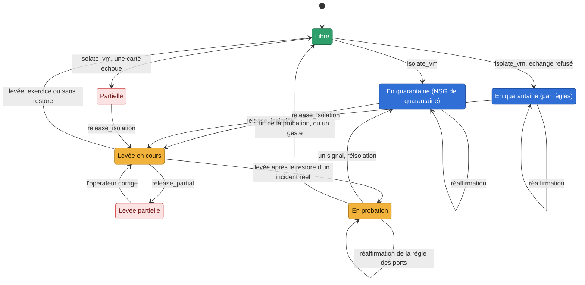

# La levée après un restore : seule et en probation, sauf porte prouvée ouverte (LEV1, #690) — conception

_Conception — 10/11 (LEV1, #690), corrigée après trois relectures en Opus 5.5 (10/11) — statut :
**conception seulement, toutes les questions tranchées**. Rien n'est codé ni mesuré. Les décisions de
Jonathan du 10/11 sont dans l'issue, et ce sont ses commentaires qui font foi ; elles sont reprises
ci-dessous. Jonathan a tranché le 10/11 chaque question du §15 : Q1, Q11 et Q13 d'abord, puis toutes
les autres selon l'option recommandée. Les lots de code (§12) partent de ces décisions._

> **Ce que LEV2 a posé (10/11, #690)** — les faits, sans rien changer à la levée :
> - `observed_actors` (`glorfindel/providers/azure/door.py`) : la table du §4.1, fermée, lue comme
>   le dit le §4.1 (une lecture exacte par ressource, une lecture du groupe filtrée sur les enfants,
>   chacune bornée à 20 pages ; coupée ou en échec : illisible, jamais vide). La règle d'un NSG
>   partagé se juge sur le corps de la requête de l'événement, sinon sur la règle telle qu'elle est,
>   sinon elle compte ;
> - `observed_rights` (`door_rights.py`) : le §4.4, en lecture seule, aucun droit ajouté. Écarts
>   prudents : une attribution **à un groupe d'administration** qui donnerait la porte est illisible,
>   même directe ; un principal supprimé est illisible dès qu'**une** attribution lui reste, quel que
>   soit son rôle (« restauré, il ne retrouverait rien », pris à la lettre) ;
> - `disks_at_isolation` dans l'état (§8), tiré de la lecture de la VM que l'isolement faisait déjà ;
> - la carte d'isolement dit les acteurs et leurs droits, pour information (§13, point 6). Sa fenêtre
>   part de 7 jours avant l'**isolement** : avant un restore, c'est le moment connu ; LEV3 relira à la
>   levée, depuis 7 jours avant le point restauré ;
> - le faux Azure gagne le journal complet, les attributions, les définitions et les éligibilités ;
> - la mesure de H7, H9, H12, et de H1 et H2, préparée pour Jonathan : `docs/banc-lev2.md`. **Les
>   hypothèses restent ouvertes** jusqu'à la mesure.
>
> - **Q16, tranchée par Jonathan (10/11)** et posée par la correction de LEV2 : `securityRules/delete`
>   et `virtualNetworks/subnets/write` entrent dans la table (§4.1). La liste des règles de chaque NSG
>   client que l'isolement lit déjà est notée à côté des disques (`nsg_rules_at_isolation`), sans
>   appel de plus. **Le chemin du NSG de quarantaine n'en lit aucune** : la liste y est vide, et une
>   règle retirée d'un NSG partagé compte alors toujours.

> **Décisions de Jonathan (10/11, révisées le même jour).**
> - **Un exercice prouvé par le plan de contrôle** (un run d'Orodruin, cause connue) : la levée reste
>   seule, comme aujourd'hui. Le banc garde son geste unique.
> - **Un incident réel** : Imladris (anciennement H0) lève seul, **en probation**. Sauf quand la porte est prouvée ouverte :
>   le principal qui a agi sur la VM garde ses droits. Ou quand la VM est marquée « levée humaine
>   après restore ». La quarantaine reste alors, avec une carte qui propose la révocation (le plan
>   d'IR1a).
> - **Dans tous les cas**, les disques d'origine sont gardés pour l'enquête et nommés.
> - **La probation suit toute levée après le restore d'un incident réel, quel que soit le mode.** En
>   `human_only`, la levée est humaine, puis la probation commence, et une réinfection n'est qu'une
>   carte. En `non_disruptive`, la réisolation est autonome.
> - **`full_auto`** ne rend pas le restore autonome à lui seul : le restore est destructif et relève de
>   `allow_destructive` (décision du 10/06).
> - **Le vocabulaire** : la *quarantaine*, c'est la VM coupée ; la *probation*, la VM en service sous
>   surveillance renforcée. On parle de l'action ; la décision de la prendre reste celle du mode.
> - **La probation s'éprouve au banc** : un exercice « comme un incident réel », puis le T1136.001
>   d'Atomic Red Team pendant la probation. On mesure la réisolation.
> - **Une limite à écrire** : un vecteur dans l'invité (une faille applicative, un mot de passe faible)
>   échappe au plan de contrôle. Seules la probation et la réisolation le couvrent.

**Règle de lecture.** Ce qui est lu dans le code est une affirmation, avec son fichier et sa ligne (au
commit `e6850672`). Ce qui est dit d'Azure vient de la documentation de Microsoft ou d'une mesure au
banc, et le dit : une **hypothèse** est à mesurer (§14). Le replay privé de la décision (quatre
scénarios, deux modes) est la référence : là où ce document s'en écarte, il le dit (§13).

---

## 0. En bref

- **Une seule règle de levée après un restore**, dans un module neutre (`glorfindel/response/lift.py`,
  à écrire). La watch, `glorfindel release`, la console et le bot passent tous par elle. Une levée
  humaine lit elle-même sur Azure s'il y a eu un restore depuis l'isolement : elle n'attend pas le
  verdict de la watch. La règle rend un verdict parmi trois :
  - **exercice** : lever, sans probation ;
  - **probation** : lever, puis mettre en probation ;
  - **retenue** : garder la quarantaine, et une carte qui dit pourquoi.

  Le mode décide ensuite qui exécute : Imladris seul en `non_disruptive`, un humain en `human_only`.
- **Une détection sur la VM après la fin du restore**, avant la levée, retient la levée : la VM
  restaurée a démarré sous la quarantaine, et ce qu'elle a fait au démarrage compte. Seul un humain
  lève alors. Et aucun verdict ne se rend avant la fin du job plus une marge de latence du journal
  (`lift.log_settle_s`, Q14).
- **La porte prouvée ouverte** : un tiers a agi sur la VM par le plan de contrôle. Cela veut dire une
  Run Command, une extension (VMAccess comprise), une écriture de la VM, de ses disques, de ses cartes
  réseau, de son NSG ou de son identité. Le journal d'activité le dit, ressources enfants comprises
  (une extension, une Run Command managée, la console série), sur une fenêtre qui commence 7 jours
  avant le point restauré. Et ce tiers **garde ses droits** sur la VM : ses attributions de rôle et
  leurs définitions, relues en lecture seule par le Reader qu'Imladris tient déjà.
  - Glorfindel et les principaux de restore ne sont pas des tiers **seulement** pour leurs propres
    opérations, sur leurs propres cibles, dans leur fenêtre. Hors de là, ce sont des tiers.
  - Des droits qui ne se lisent pas entièrement ne prouvent pas la porte fermée : la quarantaine
    reste, avec une carte. **Aucun droit en plus pour Imladris** (décidé par Jonathan, Q11) : un droit qui
    passe par un groupe (caché ou non), une éligibilité PIM, la propriété d'un groupe, ou un principal
    supprimé (restaurable depuis la corbeille d'Entra) est illisible. On mesure au banc combien de fois
    ça arrive.
  - Un droit qui en redonne un (écrire une attribution ou une définition de rôle) est une porte.
  - La carte propose la révocation sous la forme du plan d'IR1a : des étapes exactes, puis un bouton
    **Verify**.
  - Une fois les droits relus absents, la watch lève, en probation.
- **L'exercice prouvé** : trois faits, chacun avec son auteur.
  - Une fenêtre publiée par le canal d'Orodruin.
  - Sur la cible de cette fenêtre, les gestes de l'attaque, sous l'**identité d'Orodruin** et dans
    la fenêtre, lus au journal d'activité.
  - **Aucun tiers** sur la VM pendant la fenêtre de lecture.

  Une étiquette « exercice » sans ces faits ne vaut rien : le cas est traité comme un incident réel.
  Le verdict « exercice » n'existe qu'en zone `bench` ou `twin`, jamais en `production` ; la zone est
  notée à l'isolement, et la plus prudente des deux lectures l'emporte. L'option
  « comme un incident réel » d'une demande ne fait qu'ajouter des gardes.
- **La probation, 24 h par défaut** (Q3).
  - Les ports d'administration (22, 3389, 5985, 5986) sont fermés depuis Internet par une règle de
    Glorfindel, réversible, nommée. Son état est écrit avant elle, pour que tout ce qui reconnaît les
    règles de Glorfindel la reconnaisse : la détection du plan de contrôle (AL1), la réaffirmation, le
    balayage des orphelines, `reset`. Elle est posée et relue **avant** que la quarantaine soit
    retirée.
  - Des règles et des seuils propres à la probation, par règle de détection, dans le fichier des
    règles, jamais dans le prompt.
  - **La réisolation au moindre signal dans l'invité, décidée par le code, sans le modèle, selon le
    mode** (décidé par Jonathan, Q1). Un nœud de code en tête de `decide`, garde par garde (§6.3). En `non_disruptive`, Imladris
    réisole seul. En `human_only`, une carte haute, poussée, avec l'isolement approuvable en un clic.
    **Une détection du plan de contrôle** sur une VM en probation est toujours une carte
    `probation_signal`, jamais une réisolation seule (décidé par Jonathan, Q13). Ces cycles ne vont
    jamais en mémoire.
- **Les disques d'origine** : leurs identifiants sont notés à l'isolement. Après le restore, ils sont
  nommés sur la carte et dans le rapport comme preuves, à ne pas supprimer. Glorfindel ne les touche
  jamais.
- **La preuve** :
  - huit propriétés pour la machine des invariants (§10), sur un faux Azure qui gagne les attributions
    de rôle et le journal d'activité complet ;
  - au banc, un T1486 « comme un incident réel », puis un T1136.001 pendant la probation, et la
    réisolation mesurée par `make bench-report`.
- **Six lots de code**, LEV2 à LEV7 (§12), et un lot de vocabulaire, LEV8.

---

## 1. Ce que le code fait aujourd'hui

### 1.1 Les chemins de levée

| Chemin | Ce qu'il fait | Où |
|---|---|---|
| La watch (REC1, REC1b) | lit la reprise sur Azure ; prouvée, émet son propre `recovery_complete`, que le graphe traite. La levée est autonome dans les modes qui la permettent, une carte `mode_hold` en `human_only` | `glorfindel/recovery_watch.py:233` (`recovery_pass`), `:363` (`_emit`) |
| `glorfindel restore --wait` | restaure, puis construit le `recovery_complete`, le garantit pour son processus et appelle `agent.respond` : la levée se décide **dans le processus du poste**, avec sa config | `glorfindel/cli.py:1589-1597` |
| `restore --keep-isolated` | n'émet rien. La VM reste isolée ; `glorfindel release` à la main | `glorfindel/cli.py:1584` |
| La console, le bot, `glorfindel release` | un humain lève, sans condition sur le restore | `eregion_console/api.py:1375`, `glorfindel/cli.py:316` |

La précondition de levée (`glorfindel/agent.py:1449`, `_apply_release_precondition`) ne regarde que le
signal. Une levée proposée par le modèle passe sur un `recovery_complete` garanti (SEC3) dont la
neutralisation est `True`. Tout le reste est retenu.

**Le trou** (le constat de l'issue) : rien ne distingue un exercice d'un incident réel au moment de
la levée. Un restore remet un état propre, mais ne ferme pas le vecteur d'entrée. `--keep-isolated` ne
vaut que pour le processus du poste : la watch d'Imladris ne le connaît pas et lève quand même.

### 1.2 Ce qui sert déjà

- **Le journal d'activité, lu par Imladris** : `_activity_events` (`glorfindel/providers/azure/recovery.py`)
  lit les événements de la VM, page par page, au plus 20, une page de plus étant une erreur. REC1b ne
  garde que `runCommand/action`. LEV1 en lit plus, avec la même lecture.
- **Les droits d'un principal, lus comme Azure les lit** : `action_held`
  (`glorfindel/providers/azure/restore_rights.py:140`) évalue les jokers et les `notActions`.
  `make bench-preflight` (BNC1) lit déjà les attributions d'Imladris et d'Orodruin et leurs définitions.
- **L'étiquette d'exercice** (B2, `eregion_core/exercise.py:701`, `source_of`) : une fenêtre
  d'injecteur, bornée, qui ne marque qu'une VM inscrite. Elle **n'abaisse aucune garde**
  (`docs/dagorlad.md`, « Ce que Glorfindel voit »). LEV1 garde cette règle : l'étiquette seule ne donne
  jamais une levée seule.
- **L'identité d'Orodruin** : la sortie `principal_id` d'`infra/orodruin` (`outputs.tf:10`). Imladris ne la
  connaît pas aujourd'hui.
- **Le plan d'IR1a sur une carte** (`docs/design/reponse-identite.md` §3.2) : des étapes exactes pour
  l'humain, puis **Verify**, qui relit et dit « held », « not held » ou « unreadable ».
- **Ce qu'on sait des disques** (`docs/azure.md`) : après un restore sur place, les anciens disques OS
  et de données restent dans le groupe, non attachés.

---

## 2. Le vocabulaire : quarantaine, probation

**Deux mots, posés partout** (décision du 10/11) :

| Mot | Sens | En anglais |
|---|---|---|
| **Quarantaine** | la VM isolée, coupée du réseau, **quel que soit le mécanisme** : le NSG de quarantaine sur chaque carte, ou le repli par règles | *quarantine* |
| **Probation** | la VM remise en service après le restore d'un incident réel, sous surveillance renforcée : ports d'administration fermés depuis Internet, règles et seuils de probation, réisolation au moindre signal selon le mode | *probation* |

**On parle de l'action** : isoler (mettre en quarantaine), lever, mettre en probation, finir la
probation. **La décision** de la prendre reste celle du mode, comme pour toute action. Les noms d'API
ne changent pas : `isolate_vm` et `release_isolation` restent les noms des actions
(`AUTONOMOUS_ACTIONS`), des cartes et de l'état.

**Un conflit à lever.** Aujourd'hui, « en quarantaine » désigne un mécanisme : le NSG de quarantaine
sur la carte, par opposition à « Isolée par règles » (`docs/architecture.md`, « La vie d'une
isolation »). Avec le nouveau sens, les deux sont la quarantaine. Le mécanisme garde son nom : le **NSG
de quarantaine**, et **le repli par règles**. Le diagramme devient :

La liste exacte des endroits qui reçoivent ces mots est au §11.

---

## 3. La règle, une seule, pour tous les chemins

### 3.1 Le verdict

La règle se lit dans l'ordre, et s'arrête au premier cas qui s'applique. Elle ne s'applique qu'à une
levée **après un restore prouvé** : les conditions de REC1 et REC1b sont tenues (le job, sur place, le
point, la VM qui tourne, la neutralisation). Une condition qui manque donne déjà une carte
aujourd'hui, et rien ne change là.

| # | Cas | Verdict | Ce que dit la carte |
|---|---|---|---|
| 1 | une condition de REC1 ou de REC1b manque | **retenue** (inchangé) | `release_hold`, sa raison |
| 2 | **une détection sur la VM datée après la fin du restore** (§6.3, la borne) | **retenue, levée par un humain seulement** | `lift_signal_after_restore` : la règle, le moment ; « le disque restauré a peut-être rejoué quelque chose au démarrage » ; « Lift into probation » approuvable par un humain qui l'a lue |
| 3 | la VM est marquée « levée humaine après restore », ou une retenue est posée (§3.4) | **retenue** | « Levée humaine demandée pour cette VM » ; les disques d'origine ; la levée approuvable |
| 4 | **exercice prouvé** (§5), en zone `bench` ou `twin`, sans l'option « comme un incident réel » | **exercice** : lever, sans probation | — (comme aujourd'hui) |
| 5 | **la porte n'est pas prouvée fermée** : un tiers a agi sur la VM (§4.1, §4.2), et ses droits sont lus comme tenus, ou ne se lisent pas entièrement | **retenue** | `lift_door_open` : qui, quoi, quand ; ses droits ; le plan de révocation ; Verify |
| 6 | une réinfection pendant une probation précède ce restore (§6.5) | **retenue** | « Seconde reprise après une réinfection : levée humaine » |
| 7 | la règle des ports doit être posée (une exposition, §7.1) et ne l'est pas, ou ne se relit pas | **retenue** (elle tombe quand la règle est posée et relue) | « Ports d'administration exposés depuis Internet, règle non posée : <pourquoi> » ; « Lift into probation (ports open) », approuvable explicitement par un humain |
| 8 | sinon (aucun tiers, ou un tiers dont les droits sont relus absents) | **probation** : lever, puis mettre en probation | `probation_started` : la durée, la règle des ports, les disques d'origine |

Le cas 5 sépare deux situations, que la carte dit autrement :
- **la porte prouvée ouverte** : les droits sont lus, et ils tiennent encore ;
- **la porte non prouvée fermée** : un droit ne se lit pas (§4.4).

La décision de l'issue parle de la porte « prouvée ouverte ». Ce document retient aussi le second cas
(Q2, tranchée avec Q11) : un tiers a agi, ce qui prouve qu'une porte a existé, et rien ne prouve qu'elle est fermée.

**Le cas 2 ne tombe jamais seul** : une détection d'après le restore ne disparaît pas. Il ne se lève
que par un humain, qui lit la détection puis lève en probation (ou garde la quarantaine, ou restaure un
point plus ancien). La watch ne lève jamais d'elle-même une VM qui a ce cas. Une détection d'après le
restore est aussi un signal pour la décision ordinaire (le modèle, la VM étant encore en quarantaine),
qui n'est pas changée.

**Pas de verdict trop tôt.** Le journal d'activité arrive en retard (minutes, parfois plus de dix pour
`AzureActivity`, `activity.py` ; la latence de la lecture REST de REC1b n'est pas mesurée, H12). La règle
ne rend **aucun** verdict avant la fin du job plus `lift.log_settle_s` (900 s par défaut, Q14) : un
geste d'un tiers juste avant le restore, ou une détection du démarrage, aurait sinon le temps de
manquer à la lecture. Le délai `GLORFINDEL_RECOVERY_GRACE_S` de REC1 (300 s) est pris dedans.

### 3.2 Par mode

La règle donne le verdict ; **le mode décide qui exécute**. C'est la couche politique qui existe déjà
après `decide`, jamais un contournement (`docs/glorfindel.md`, « Modes d'autonomie par asset »). Le
mode est le mode effectif, celui de la préparation (L6).

| Verdict | `human_only` | `non_disruptive` |
|---|---|---|
| exercice | carte `mode_hold` : l'humain lève, sans probation | Imladris lève seul, sans probation |
| probation | carte `mode_hold` « Lever en probation » : l'humain lève, puis la probation commence | Imladris lève seul, puis la probation commence |
| retenue | la carte, la quarantaine reste | la carte, la quarantaine reste ; la porte relue fermée (cas 5) : Imladris lève seul, en probation |
| un signal dans l'invité pendant la probation | carte haute, poussée, `probation_signal` : l'isolement approuvable en un clic | Imladris réisole seul ; une carte `probation_reisolated` le dit |
| un signal du plan de contrôle pendant la probation (Q13) | carte `probation_signal`, l'isolement approuvable en un clic | la même carte : jamais une réisolation seule |

**En `human_only`, « Lever en probation » est un seul geste.** Le bouton approuve la levée et la règle
des ports ensemble : l'humain a approuvé les deux. `human_only` n'exécute rien de lui-même, mais exécute
ce que l'humain approuve.

**`full_auto`** (toujours refusé par la validation de la configuration) : il ne change rien ici. Le
restore reste le geste humain sans l'opt-in `allow_destructive`, qui est un axe séparé du mode
(décision du 10/06). Le jour où `full_auto` existera, il se lira comme `non_disruptive` pour la levée
et la probation.

### 3.3 Où la règle vit, et pourquoi elle ne touche pas au prompt

- **Le module neutre** `glorfindel/response/lift.py` (sans SDK, MC0) :
  - `lift_verdict(facts, *, lift_human) -> Verdict` : le verdict (`exercise`, `probation`, `hold`),
    sa raison, ses étapes, les disques d'origine ;
  - `facts` vient de l'adaptateur : la reprise (REC1), les acteurs et leurs droits (§4), la preuve de
    l'exercice (§5).
- **L'adaptateur** (`glorfindel/providers/azure/`) gagne deux lectures :
  - `observed_actors(resource_id, since)` : les gestes sur la VM, ses disques, ses cartes, son NSG et
    son identité, lus au journal d'activité ;
  - `observed_rights(principal, resource_id)` : les attributions qui touchent la VM, et leurs
    définitions.
- **Le verdict ne passe pas par le signal.** `_build_user_message()` écrit tout le signal dans le
  message du modèle (`glorfindel/agent.py:3034`, `json.dumps(signal, …)`). Un champ de plus dans le
  `recovery_complete` changerait donc ce que voit le modèle : c'est une zone qui exige un run de bout
  en bout. Le verdict est donc **noté à côté** :
  - par la watch, dans `~/.glorfindel/recoveries.json`, sous le job (son enregistrement existe déjà),
    avec l'id du signal ;
  - `_apply_release_precondition` le relit pour le signal garanti qu'il juge. Un verdict absent ou
    illisible donne une retenue, jamais une levée.

  **Un test fige le message du modèle** sur un `recovery_complete`, avec et sans verdict noté : le
  même à l'octet. C'est le modèle de `tests/unit/test_dagorlad_blind.py`.
- **Le modèle peut toujours refuser de lever.** Il propose, ou non, `release_isolation` sur le
  `recovery_complete`, comme aujourd'hui. La règle ne fait que retenir ce qu'il propose, puis, sur une
  levée exécutée, mettre en probation. La probation n'est jamais une proposition du modèle.

L'autre option était une levée après restore **sans le modèle** : une décision construite par le code
(comme une carte `identity_change`). Elle est écartée ici : elle change le graphe pour un cas que la
précondition tient déjà. Tranché par Jonathan (Q8) : le modèle propose, la règle retient.

### 3.4 Les chemins, unifiés

- **La watch** : seule à lever d'elle-même après un restore. `recovery_watch` applique la règle après
  les conditions de REC1 :
  - un verdict **retenue** écrit sa carte. Les cas 5 et 7 ne sont **pas terminaux** : la watch les
    relit à chaque passe, comme elle relit une VM arrêtée, et lève quand ils tombent. Les cas 2, 3 et
    6 ne tombent que par un geste humain ;
  - un verdict **exercice** ou **probation** émet le `recovery_complete` et note le verdict.
- **`glorfindel restore --wait` ne lève plus dans son processus** (Q5). Il attend le job, dit ce qu'il
  a vu (le point, la neutralisation), puis dit que la levée est celle de la watch qui tient
  l'isolation, sur cet hôte ou sur Imladris. La règle reste ainsi en un seul endroit. Une probation demande
  une watch qui la tienne : la réaffirmation de la règle des ports, la réisolation, la fin. Un
  processus de poste qui lève, puis s'arrête, ne la tient pas. Sur un poste qui a aussi sa watch, le
  délai `GLORFINDEL_RECOVERY_GRACE_S` n'a plus d'objet pour ce cas : la watch lève à sa passe suivante.
- **`--keep-isolated` reste, pour l'opérateur qui le veut**, et atteint enfin la watch qui lève. Il
  pose une **retenue** (`hold_lift`) sur la VM, que la watch lit au cas 3. La retenue ne fait
  qu'ajouter une garde : forgée, elle garde une VM en quarantaine, jamais ne la lève.
  - **Par la file d'actions signée** (Q12, tranchée) : `hold_lift` est un verbe fermé de la file de
    FS1 (`docs/design/file-actions-signee.md`, `eregion_core/action_queue.py`, `VERBS`). La
    **console** le dépose, signé ; la watch le juge et l'écrit dans `~/.glorfindel/lift_holds.json`.
    Le bot ne le dépose pas : il n'a que `reset` dans `SERVICE_VERBS`, et LEV1 ne l'élargit pas ; il
    montre la retenue. **Tant que la file est éteinte** par défaut (`EREGION_ACTION_QUEUE`), la route
    de la console écrit la retenue elle-même, comme elle écrit les autres actions aujourd'hui (FS1c,
    le chemin synchrone) : la watch n'est alors pas la seule à l'écrire.
  - **Le retrait d'une retenue** est un geste humain, tracé (Q15, tranchée) : le bouton **Release hold** de la
    console d'Imladris, le nom de la VM tapé, ou `glorfindel lift-hold clear <vm> --yes` sur Imladris ; un verbe
    fermé `clear_lift_hold` de la file, pour la console seule. Il est écrit au journal des actions de
    l'opérateur (`runs/console/manual_actions.jsonl`). Une retenue n'expire jamais, et la watch ne la
    retire jamais d'elle-même ; retirée, la passe suivante applique la règle. Retirer la marque « levée
    humaine après restore » d'une VM est un changement de configuration, tracé de même.
  - **Sur le poste**, `restore --keep-isolated` n'a pas de clé de la file. Il dit, avant de lancer le
    restore, qu'il faut poser la retenue sur la console d'Imladris (le bouton **Keep in quarantine** de la
    carte d'isolement), ou marquer la VM « levée humaine après restore », et demande de confirmer.
    **La relecture de la retenue depuis le poste est une limite, à fixer dans LEV3** : aucune lecture
    publiée de l'état de la watch n'existe aujourd'hui pour le poste. Deux formes possibles, en lecture
    seule : la route de la console d'Imladris qui rend les retenues (`GET`, sous son jeton), ou le lecteur de
    Imladris de BNC1 (`scripts/bench_h0_reader.py`, un conteneur jetable, sans réseau, ses montages en lecture
    seule). Tant que LEV3 ne l'a pas fixée, le poste dit qu'il n'a pas relu la retenue.
  - Écartée (Q12) : une commande de la CLI d'Imladris par SSH, qui écrirait la retenue depuis le poste. Elle
    donnerait au poste une écriture dans l'état de la watch, à rebours de FS1.
- **La console, le bot et `glorfindel release`** : la levée d'un humain passe par le même module, et
  **lit elle-même le restore** :
  - avant de lever, elle lit sur Azure, comme la watch (`observed_restore`), s'il y a un job de
    restore de la VM fini depuis l'isolement. Elle n'attend pas que la watch ait noté son verdict :
    une levée humaine qui précède la passe de la watch suit la même règle ;
  - **un restore lu, ou une lecture qui échoue** : la levée est **en probation**. La probation suit
    toute levée après le restore d'un incident réel, et une lecture qui échoue ne prouve rien.
    Quand la lecture échoue, la borne des signaux de la probation (§6.3) est **le moment de
    l'isolement** (rien ne dit quand le restore a fini), et une carte le dit ;
  - **la levée humaine calcule aussi la porte** (§4) et la règle des ports (§7) : une porte ouverte, ou
    des ports exposés sans règle, sont dits avant le geste, et l'humain confirme explicitement ;
  - **un exercice prouvé** (le même calcul que la watch, §5) : la levée est sans probation ;
  - **l'absence prouvée d'un restore** (le coffre lu, aucun job depuis l'isolement) : la levée est
    sans probation, comme aujourd'hui (un faux positif levé par un humain) ;
  - le bouton dit « Lift into probation ». Sur une carte `lift_door_open`, il demande de confirmer :
    la porte est ouverte ;
  - il n'y a pas de « lever sans probation » en un clic. Un humain qui veut finir la probation le fait
    ensuite, par un geste tracé (§6.4) ;
  - le bot montre la carte et propose les mêmes boutons que pour une levée aujourd'hui.
- **L'option par VM « levée humaine après restore »** vit dans la ligne des modes d'autonomie :
  `autonomy.lift_human: [<motifs>]` dans `glorfindel-config.yaml`. Les noms se résolvent comme
  `autonomy.assets` : `fnmatchcase` en minuscules, et deux entrées en désaccord donnent la plus
  prudente. Le sélecteur de la console l'écrit. C'est une garde : elle ne fait que retenir.

**Hors de cette règle** : une levée **sans restore**, prouvée sans restore. C'est le cas d'un faux
positif levé par un humain, ou d'une VM nettoyée à la main. Elle ne met pas en probation : une
probation après une levée humaine sans restore est un autre sujet, à décider hors de LEV1 (§15,
points ouverts). **Une VM dont la probation est suspendue** (réisolée pendant sa probation, §6.5) en
est l'exception : levée sans restore, elle reprend sa probation.

---

## 4. La porte prouvée ouverte

### 4.1 Ce qui compte comme « a agi sur la VM »

Un **geste**, c'est un événement du journal d'activité (`Microsoft.Insights/eventtypes/values`, la
lecture de REC1b) dont la ressource est la VM ou une de ses ressources enfants, un de ses disques, une
de ses cartes réseau, une règle d'un NSG qui la gouverne, ou une identité qu'elle porte. Et dont
l'opération est dans la table ci-dessous. Il compte **quel que soit son statut**, comme REC1b compte
une Run Command : un essai qui a échoué dit qu'un principal a tenté, et ses droits sont alors lus.
Seul un **refus de la plateforme** (`Conflict`, `OperationNotAllowed`, la lecture de REC1b) ne compte
pas : il n'a rien atteint.

| Opération (ARM) | La ressource de l'événement | Pourquoi c'est une porte |
|---|---|---|
| `Microsoft.Compute/virtualMachines/runCommand/action` | la VM | du code dans l'invité, en root (Run Command v1) |
| `Microsoft.Compute/virtualMachines/runCommands/write`, `/delete` | **enfant** : `<vm>/runCommands/<nom>` | idem, Run Command managé (v2), rejoué au démarrage |
| `Microsoft.Compute/virtualMachines/extensions/write`, `/delete` | **enfant** : `<vm>/extensions/<nom>` | une extension : Custom Script, **VMAccess** (un mot de passe ou une clé SSH remis), `AADSSHLoginForLinux` et `AADLoginForWindows` (un accès ouvert par Entra), le gestionnaire de Run Command (`RunCommandLinux`, `RunCommandHandler*` : du code root), tout agent. **Toute écriture d'extension par un tiers compte, quel que soit son type.** La liste blanche de `_replayable_scripts` (`_REPLAY_SAFE_EXTENSIONS`, `glorfindel/providers/azure/restore.py:365-397`) ne sert qu'au rejeu de REC1b, jamais ici : elle contient justement le gestionnaire de Run Command et les connexions AAD. Une politique `DeployIfNotExists` qui pose un agent passe par `lift.expected_callers`, opération par opération (§4.2). L'écriture d'extension qui accompagne une Run Command v1 de Glorfindel ou d'un principal qui restaure (hypothèse H7) est excusée **comme une partie de cette Run Command** : même appelant, même moment, jamais par son type |
| `Microsoft.Compute/virtualMachines/write` | la VM | le profil d'OS, `userData`, `customData`, une identité attachée, un disque attaché |
| `Microsoft.Compute/virtualMachines/attachDetachDataDisks/action`, `…/reimage/action`, `…/redeploy/action` | la VM | un disque ou un état remplacé hors du restore |
| `Microsoft.Compute/disks/write`, `…/beginGetAccess/action` | chaque disque de la VM (et de `disks_at_isolation`, §8) | un disque de la VM écrit, ou exporté par un SAS |
| `Microsoft.SerialConsole/serialPorts/connect/action` | **enfant** : `<vm>/providers/Microsoft.SerialConsole/serialPorts/<n>` (hypothèse, H6) | une console interactive sur la VM |
| `Microsoft.Network/networkInterfaces/write` | chaque carte de la VM | une carte changée : une adresse, une IP publique, un autre NSG |
| `Microsoft.Network/publicIPAddresses/join/action` | l'IP publique, ou la carte (hypothèse, H7) | une IP publique posée sur la carte |
| `Microsoft.Network/networkSecurityGroups/securityRules/write`, `…/networkSecurityGroups/write` | **enfant** : la règle `<nsg>/securityRules/<nom>`, ou le NSG | un port ouvert devant la VM. **Sur un NSG partagé**, seule une règle qui couvre la VM compte : sa destination (entrante) ou sa source (sortante) contient une adresse de la VM, ou `*`, `VirtualNetwork`, un préfixe qui la contient, une ASG d'une de ses cartes. Une règle visant une autre VM d'un NSG partagé n'est pas un geste sur celle-ci |
| `Microsoft.Network/networkSecurityGroups/securityRules/delete` (Q16) | **enfant** : la règle `<nsg>/securityRules/<nom>` | une règle retirée : un refus retiré rouvre un port. Sur un NSG qui gouverne la VM seule, il compte toujours. **Sur un NSG partagé**, il ne compte pas seulement si la liste des règles relevée à l'isolement (`nsg_rules_at_isolation`) montre que la règle supprimée ne couvrait pas la VM ; sans cette liste (une isolation d'avant LEV2, ou par le NSG de quarantaine), ou la règle absente de la liste, il compte |
| `Microsoft.Network/virtualNetworks/subnets/write` (Q16) | le sous-réseau d'une carte de la VM | un NSG ou une table de routes détachés ou changés : il compte toujours |
| `Microsoft.ManagedIdentity/userAssignedIdentities/assign/action` | l'identité | une identité donnée à la VM |
| `Microsoft.Resources/tags/write`, `Microsoft.Resources/subscriptions/resourceGroups/write` (et les tags par `virtualMachines/write`) | la VM, ou son groupe | les tags d'inscription et de zone changés (`eregion-target`, `eregion-zone`) : la zone d'une VM décide si un exercice peut lever sans probation (§5.1) |

**La lecture, ressource par ressource.** REC1b lit avec `resourceUri eq '<vm>'`. Une ressource enfant
(une extension, une Run Command managée, une règle de NSG, la console série) a son propre
`resourceUri`, et ce filtre ne la rend pas (hypothèse H9, à mesurer avant LEV3 : que le filtre soit
exact, ou qu'il rende les enfants). La lecture de LEV2 est donc :
- **une lecture exacte par ressource** : la VM, chaque carte, chaque disque, chaque NSG qui la
  gouverne, et l'identité qu'elle porte ;
- **une lecture du groupe de la VM** (`resourceGroupName eq '<rg>'`), filtrée par le code sur les
  enfants de la VM et de ses NSG (le préfixe de leur id, insensible à la casse) ; et celle du groupe
  de chaque NSG ou carte qui vit ailleurs ;
- **chacune avec sa propre borne** : 20 pages, comme REC1b. Une lecture coupée rend les acteurs
  **illisibles** (cas 5). La lecture d'un groupe chargé peut dépasser la borne : c'est une retenue,
  dite, et la borne se mesure au banc (H9) ;
- **une opération dont l'événement ne nomme pas la ressource attendue** (H7) se cherche par la lecture
  du groupe ; si aucune lecture ne la rend au banc, elle sort de la table et devient un vecteur dans
  l'invité.

**Hors de la table**, et donc pas des gestes : la lecture, le démarrage, l'arrêt, la désallocation
(ils ne posent rien dans la VM), et les sauvegardes. La liste est fermée et vit dans l'adaptateur : une
opération qui manque se signale par un lot, jamais par le modèle.

### 4.2 Qui n'est pas un tiers

Un **tiers**, c'est tout appelant (`caller`, `claims.appid`, `claims.oid`, comparés comme REC1b les
compare) qui n'est pas l'un de ceux-ci, **pour ce geste-là**. Aucun appelant n'est excusé pour
tout : chacun ne l'est que pour ses propres opérations, sur ses propres cibles, dans sa fenêtre. C'est
la règle d'AL1 et de SID1 (`glorfindel/providers/azure/activity.py`, son en-tête), reprise telle
quelle. L'écriture d'extension qui accompagne une Run Command v1 de Glorfindel ou d'un principal qui
restaure est excusée comme une partie de cette Run Command, jamais par son type (§4.1, hypothèse H7).

| Appelant | Comment il est connu | Quand il n'est pas un tiers |
|---|---|---|
| Glorfindel (la watch, Imladris) | `GLORFINDEL_OWN_CALLERS`, `AZURE_CLIENT_ID` | pour une opération que ses capacités déclarent (`CAPABILITIES`, `glorfindel/providers/azure/capabilities.py`), sur une cible que son état nomme comme sienne (`owned_target`, `activity.py:193` : le NSG de quarantaine, une règle d'une isolation, d'un blocage ou d'une probation, une carte mise en quarantaine). Sa Run Command, seulement la coupure d'une isolation de son état, dans `drains_at` (SID1). Tout autre geste sous son identité est un tiers, et la carte le dit en critique : son identifiant est peut-être dans d'autres mains |
| un principal qui restaure | `GLORFINDEL_RESTORE_PRINCIPALS` | pour la neutralisation (la dernière Run Command avant le job, après l'isolement, la règle de REC1b) et pour le restore lui-même (les écritures de la VM et de ses disques pendant le job). Tout autre geste, ou hors de ces moments, est un tiers |
| Azure Backup | l'identifiant public de son application, déjà lu par AL2 (`docs/glorfindel.md`, « Les points de restauration, Azure Backup exclu ») ; reste l'hypothèse H4 : c'est lui qui écrit les disques d'un « Replace disks » | pendant le job seulement, de son début à sa fin, et pour les écritures de la VM et de ses disques |
| Orodruin | `GLORFINDEL_INJECTOR_PRINCIPALS` (nouveau : la sortie `principal_id` d'`infra/orodruin`, dans `host.env`) | **dans une fenêtre d'exercice prouvée qui nomme la VM** (§5), en zone `bench` ou `twin`. Hors d'elle, Orodruin est un tiers : son identité volée agit comme une autre |
| un appelant attendu, déclaré par l'opérateur | `lift.expected_callers` (nouveau, dans `glorfindel-config.yaml`), **par opération** (Q6) | pour les opérations que l'opérateur lui a déclarées, et elles seules. **Jamais** pour une Run Command (v1 ou v2), une extension VMAccess, `AADSSHLoginForLinux` ou `AADLoginForWindows`, ni `beginGetAccess` : du code dans l'invité, un accès remis ou ouvert, un disque exporté ne sont jamais la routine. La carte le dit toujours : « X, attendu pour <opération>, a agi à T » |

**Pourquoi des appelants attendus.** Chez un client, un pipeline écrit la VM ou ses cartes chaque
semaine, et une politique `DeployIfNotExists` y pose l'agent de supervision par une extension. Sans
cette liste, chaque incident réel sur une telle VM serait une porte « ouverte », et la levée seule par
défaut ne servirait jamais. Une liste **par opération** borne le prix : un pipeline excusé pour
`virtualMachines/write` ne l'est pas pour une Run Command. Le prix restant est écrit : **un appelant
attendu dont l'identité est volée passe pour attendu, pour ses opérations déclarées**. La carte le
nomme toujours, et la probation couvre ce cas comme un vecteur dans l'invité.

### 4.3 La fenêtre

**De 7 jours avant le point restauré jusqu'à maintenant** (`lift.lookback_days`, 7 par défaut, au
plus 90 : la rétention du journal d'activité). Q4.
- **Pourquoi avant le point** : un geste d'avant le point est dans le disque restauré. Un geste
  d'après le point a eu lieu sur la VM qui vient d'être restaurée.
- **Pourquoi 7 jours** : le point est en général de la veille (une sauvegarde quotidienne). Une
  intrusion qui précède le chiffrement de quelques jours y entre. Une plus ancienne échappe au plan de
  contrôle, comme un vecteur dans l'invité : la probation la couvre.
- **La lecture est bornée** comme celle de REC1b : au plus 20 pages, une page de plus est une erreur.
  Une lecture coupée ou en échec rend les acteurs **illisibles** : retenue, cas 5.
- **« Maintenant », pas avant la marge** : la lecture qui décide se fait après la fin du job plus
  `lift.log_settle_s` (§3.1). Ce qui arrive plus tard encore est pris par la relecture ci-dessous.
- **Pendant la probation, la porte est relue** à chaque passe, sur la fenêtre jusqu'à la levée : un
  geste d'un tiers d'avant la levée, arrivé en retard au journal, est découvert. C'est un fait du plan
  de contrôle : une carte `probation_signal` qui dit « une porte découverte après la levée », jamais
  une réisolation seule (Q13).

**L'écart dit sur la carte** (la persistance possible) : le point restauré, la première activité
suspecte connue (la première détection, le premier geste d'un tiers) et l'écart entre les deux. Un geste
de tiers **avant** le point est dit en rouge : « le disque restauré porte peut-être ce qu'il a posé ».
Ce n'est pas une retenue de plus : la règle de `--before` (REC1) reste celle de la détection, et un
administrateur légitime d'avant le point ne bloque pas la levée. Une persistance que le plan de
contrôle ne voit pas est le rôle de la probation.

### 4.4 Le tiers garde-t-il ses droits

**Lu en lecture seule, avec le Reader qu'Imladris tient déjà sur le groupe du banc** (`infra/glorfindel-host/main.tf:203`).
`Microsoft.Authorization/*/read` est sous `*/read`. **Aucun droit n'est ajouté à Imladris**, ni dans ARM ni
dans Graph (décidé par Jonathan, Q11) : le module Graph reste en `GET` seul
(`glorfindel/providers/azure/graph.py`, tenu par `tests/unit/test_identity_plan.py`).

1. **Les attributions qui touchent la VM**, lues **à chaque portée où un geste du §4.1 se fait** : la VM,
   chaque carte, chaque disque, chaque NSG qui la gouverne (souvent dans un autre groupe), l'identité
   qu'elle porte. `GET {portée}/providers/Microsoft.Authorization/roleAssignments`. Une liste à une
   portée rend aussi celles des portées au-dessus, le groupe et l'abonnement (hypothèse H1 : lu par le
   Reader du groupe, à mesurer). Une portée qu'Imladris ne lit pas (le NSG d'un autre groupe, sans Reader)
   est **illisible**.
2. **Leurs définitions** : `GET …/roleDefinitions/{id}`. Une attribution donne la porte si sa
   définition tient, **à la portée de l'attribution** :
   - une des opérations du §4.1 ;
   - **ou un droit qui en redonne un** : `Microsoft.Authorization/roleAssignments/write` (Owner, User
     Access Administrator, Role Based Access Control Administrator), ou
     `Microsoft.Authorization/roleDefinitions/write` (réécrire une définition qu'il tient déjà). Un tiers
     qui garde ce droit se rend la porte quand il veut : ses droits sont **tenus**.

   La lecture est celle d'`action_held` : les jokers, les `notActions` et les `dataActions`.
3. **Le principal** : on garde les attributions dont le `principalId` est un des identifiants du tiers.
   Une attribution **à un groupe** (`principalType: Group`) qui donnerait la porte ne se rattache pas au
   tiers sans lire l'appartenance, ce qu'Imladris ne fait pas.
4. **Le verdict des droits** :
   - **tenus** : une attribution directe au moins donne une opération du §4.1, ou un droit qui en
     redonne un ;
   - **absents** : chaque portée est lue entièrement, aucune attribution directe ne donne la porte, et
     **aucune attribution à un groupe** ne la donnerait non plus ;
   - **illisibles** : une lecture échoue, une portée échappe à Imladris, ou un chemin ne se lit pas (ci-dessous).

**Ce qui est illisible depuis Imladris**, et fait donc une retenue avec une carte quand le tiers est là
(décidé par Jonathan, Q11) :
- **un droit qui passe par un groupe**, caché ou non : une attribution à un groupe qui donnerait la
  porte, dont Imladris ne lit pas les membres ;
- **une éligibilité PIM**, à un rôle (`roleEligibilityScheduleInstances`, hypothèse H2 : lisible sous
  `*/read`) ou **à un groupe** (PIM pour les groupes, dans Entra, qu'Imladris ne lit pas) ;
- **la propriété d'un groupe** qui porte la porte : le propriétaire s'y ajoute quand il veut. Elle se
  lit dans Graph : illisible ;
- **un groupe d'administration** : une attribution au-dessus de l'abonnement, que BNC1 dit déjà ne
  pas lire ;
- **un principal supprimé** : un objet supprimé reste restaurable depuis la corbeille d'Entra
  (30 jours, d'après la documentation, hypothèse H11), avec ses attributions orphelines qui reprennent
  effet. Ses droits sont **illisibles**, et la quarantaine reste ; seul un humain lève. Ils ne sont
  lus **absents** que lorsque **toutes** les portées du point 1 ont été relues entièrement sans aucune
  attribution à ce `principalId`, directe ou orpheline : restauré, il ne retrouverait rien. La carte le
  dit : « principal supprimé, restaurable ; supprimer ses attributions orphelines ferme la porte ».

**Hors de portée, et dit** : `Microsoft.Authorization/elevateAccess/action`, l'élévation d'un
administrateur général d'Entra au rôle User Access Administrator sur tout le tenant. Elle ne s'attribue
pas, aucune lecture d'ARM ne la montre, et un administrateur général peut toujours rouvrir la porte. La
carte le rappelle ; c'est un risque du tenant, pas de la VM.

**Ce qui ne fait que retirer** : une attribution de refus (`denyAssignments`), une condition ABAC, un
verrou. Ignorés, ils peuvent faire lire « tenus » ce qui ne l'est plus. C'est le sens prudent.

**Le prix, et sa mesure.** Chez un client, un groupe porte presque toujours un rôle qui écrit les VM
(« Contributeur » sur l'abonnement, à un groupe d'administrateurs). Sans lire l'appartenance, **tout
tiers retient la quarantaine dès qu'un tel groupe existe** : la levée seule ne sert alors qu'aux
incidents sans tiers au plan de contrôle (le vecteur dans l'invité, le cas le plus courant). Jonathan
l'accepte (Q11) : la carte dit le groupe, et la levée humaine en probation reste à un clic. **LEV7 mesure
au banc** combien de levées cette lecture retient. Si c'est trop fréquent, une lecture d'appartenance
viendra plus tard, par **l'identité Graph dédiée prévue à la 0.6.2**, jamais par l'identité d'Imladris.

**Pourquoi « illisible » retient** : la règle « un fait absent fait une carte, jamais une levée » est
celle de REC1. Un tiers a agi : la porte a existé. Une levée seule sur une lecture incomplète serait la
seule levée du projet faite sur ce qu'on n'a pas lu.

### 4.5 Ce que dit la carte, et le plan d'IR1a

La carte `lift_door_open` (action `review_door`, rien d'approuvable en un clic tant que la porte est
ouverte) dit :

- **qui** : le tiers, comme `make bench-report` dit un appelant. Son rôle s'il est connu (un humain, une
  application), son identifiant masqué dans le texte public, entier dans la console ;
- **quoi, quand** : chaque geste du §4.1, son heure, son statut, et sa place par rapport au point ;
- **ses droits** : chaque attribution qui donne la porte (le rôle, la portée), ou ce qui ne se lit
  pas ;
- **le plan**, dans la forme d'IR1a (§3.2 de `reponse-identite.md`), écrit par le code depuis la
  lecture, jamais par le modèle :
  1. **retirer l'attribution**, pour chacune : `az role assignment delete --ids <id>`. C'est une étape
     pour l'humain, avec son propre compte : retirer un rôle Azure demande Owner ou User Access
     Administrator, qu'aucune identité d'Eregion ne tient. C'est la même règle qu'IR1 (« À côté :
     l'attribution d'un rôle Azure … hors d'IR1 ») ;
  2. **couper l'identifiant** :
     - pour un principal de service : la rotation ou le retrait de ses identifiants. Un verbe de
       l'exécuteur d'identité (`entra_remove_credential`) quand il est inscrit et qu'IR1c existe ;
       sinon une étape ;
     - pour un utilisateur : `entra_revoke_sessions`, dans les mêmes conditions ;
  3. **Verify** : relit les droits (§4.4) et dit « held », « not held » ou « unreadable ».
- **les disques d'origine** (§8) et le point restauré ;
- **l'enquête pendant la quarantaine** : l'accès forensique (`isolation.forensic_sources`), pour
  entrer dans la VM sans la lever.

### 4.6 Quand la porte se referme

- **La watch relit les droits à chaque passe** (`GLORFINDEL_RECOVERY_INTERVAL_S`, 60 s), tant que la
  carte attend. Verify ne fait que relire plus tôt, à la demande.
- **Relus absents**, la watch attend encore `lift.settle_s` (600 s par défaut), puis relit une
  dernière fois et lève, en probation (en `non_disruptive`), ou change la carte en « Lift into
  probation » (en `human_only`). Le délai couvre **la propagation d'ARM** : ARM évalue les attributions
  à chaque requête, avec un cache, et la documentation de Microsoft dit qu'un changement peut prendre
  jusqu'à 10 minutes (hypothèse H3, à mesurer). Un jeton déjà émis ne porte pas les rôles d'ARM : il ne
  garde pas un droit retiré au-delà de cette propagation.
- **La vie d'un jeton** est un autre sujet : un jeton d'Entra vit 60 à 90 minutes par défaut, et
  survit à la révocation des sessions (`reponse-identite.md`, §0). Il sert à Graph et aux autres API
  qu'il ouvre, pas aux rôles d'ARM retirés. La carte le dit, pour les étapes d'identité du plan (§4.5),
  et la probation couvre ce qui reste.
- **Un nouveau geste du tiers** pendant ce temps : la carte le dit, et le délai repart.

Le replay fait lever une minute après la révocation ; ce délai l'allonge à dix (§13).

### 4.7 Ce que la porte ne voit pas

- **Un vecteur dans l'invité** (une faille applicative, un mot de passe faible, une clé SSH volée) :
  il n'écrit rien au plan de contrôle. Seules la probation et la réisolation le couvrent. C'est la
  limite de l'issue, écrite.
- **L'identité de la VM elle-même** : un attaquant dans l'invité prend un jeton par l'IMDS (la
  quarantaine le refuse, L17 ; la VM en probation, non) et agit ailleurs sous l'identité de la VM.
  Ses gestes sur **d'autres** ressources ne sont pas dans le journal de la VM. Proposé, hors de LEV1 :
  dire sur la carte si la VM porte une identité, et ses droits.
- **Les connexions Entra aux VM** (`virtualMachines/login/action`) : ce sont des `dataActions`, que le
  journal d'activité ne porte pas. Les droits qui les donnent sont lus (§4.4), les connexions non.
- **Bastion** : une session par Bastion s'écrit dans les journaux de Bastion, pas dans celui de la VM
  (hypothèse). Elle est donc vue comme un vecteur dans l'invité.

---

## 5. L'exercice prouvé

### 5.1 Trois faits, chacun avec son auteur

| Fait | Son auteur | Ce qui le tient |
|---|---|---|
| **une fenêtre d'exercice qui nomme la VM**, tirée du canal d'Orodruin (`note_pulled`, `eregion_core/exercise.py:371`), qui couvre la première détection de l'incident | Orodruin, ou l'opérateur (les deux seuls rédacteurs du conteneur `exercises`, `infra/orodruin/main.tf`) | les bornes de B2 et de SEC-A1 : durée, avance, chaîne, VM inscrite. **Une étiquette, pas une preuve** |
| **les gestes de l'attaque sur cette VM, sous l'identité d'Orodruin, dans la fenêtre**, lus au journal d'activité (au moins un geste du §4.1, une Run Command pour T1486 ou T1136.001) | ARM, qui écrit seul le journal | `GLORFINDEL_INJECTOR_PRINCIPALS`, comparé comme REC1b compare |
| **aucun tiers** sur la VM pendant toute la fenêtre de lecture (§4.3), et **aucun geste d'Orodruin hors d'une fenêtre** qui nomme la VM | ARM | la lecture du §4 |

**Et la zone** : la VM est en zone `bench` ou `twin`, lue sur ses tags et ceux de son groupe par la
watch (O0, `eregion_core/inscription.py`). Des tags se changent : la zone est donc **notée à
l'isolement** dans l'état (`zone_at_isolation`), relue à la levée, et **la plus prudente des deux**
l'emporte (`production`, puis `twin`, puis `bench`) ; une zone illisible vaut `production`. Une écriture
des tags de la VM ou de son groupe est un geste (§4.1) : sous un tiers, c'est la porte. **En
`production`, le verdict « exercice » n'existe pas** :
un restore y suit toujours la règle d'un incident réel. La règle de production n'y admet ni panne ni
technique destructive, donc aucun exercice n'y mène à un restore ; une fenêtre qui le dirait ment. Et
une levée sans probation sur une charge réelle ne doit jamais reposer sur l'identité d'Orodruin, qui
écrit aussi la fenêtre (§9).

**La cible de la demande** : la watch ne lit jamais la demande de Dagorlad (`docs/dagorlad.md`, « Il
ne voit pas le plan »), et LEV1 ne change pas ça. La cible prouvée est celle de la fenêtre, qu'Orodruin
écrit depuis le fil de la demande. Le journal d'activité, lui, prouve que l'identité d'Orodruin a agi
**sur cette VM**, et pas sur une autre.

**Une fenêtre locale** (une watch de poste, sans canal) : elle vaut **pour le développement seulement,
jamais sur Imladris**. Sur Imladris, seule une fenêtre tirée du canal compte pour la preuve ; une fenêtre locale y
est refusée pour le verdict « exercice », dite. Sur un poste, la preuve repose sur le seul journal
d'activité : les gestes de l'identité qui lance l'injecteur (`GLORFINDEL_INJECTOR_PRINCIPALS`, sur ce
poste) dans la fenêtre. Sans principal configuré, aucun exercice n'est jamais prouvé : chaque restore
suit la règle d'un incident réel, ce qui est le sens prudent.

### 5.2 Ce qui défait la preuve

- **Un tiers** dans la fenêtre de lecture : pendant un exercice, un vrai intrus a pu agir. La levée
  suit alors la règle d'un incident réel (cas 5 ou 8).
- **Orodruin hors de sa fenêtre** : un geste de son identité qui n'est couvert par aucune fenêtre
  nommant la VM. Son identité est alors lue comme celle d'un tiers.
- **Une fenêtre refusée** par B2, ou absente : il n'y a pas d'exercice.
- **Une panne de Gothmog** (Chaos Studio) agit sous l'identité de l'expérience de Chaos Studio, pas
  sous celle d'Orodruin. Elle ne mène pas à un restore aujourd'hui (le run de reprise `x-reprise`
  restaure une VM détruite, sans quarantaine). Si un jour elle y mène, l'identité de l'expérience
  devra être déclarée comme celle d'Orodruin : hors de LEV1.

### 5.3 L'option « comme un incident réel »

**Pour éprouver la probation au banc**, un exercice doit pouvoir suivre le chemin d'un incident réel.
Sinon, un exercice prouvé lève sans probation, et la probation ne se mesure jamais.

- **Où elle se pose** : par fil, dans la demande de Dagorlad. Une case « as a real incident » sur un
  fil, puis la commande `make orodruin-exercise REQUEST=…`. Orodruin l'écrit dans la fenêtre,
  `as_real: true`, avec l'identifiant de la demande.
- **Ce qu'elle fait** : l'exercice reste prouvé (§5.1), mais le cas 4 ne s'applique pas. La règle
  passe à la porte, puis à la probation.
- **La porte, pendant un exercice « comme un incident réel »** : Orodruin a agi, et garde ses droits
  (c'est l'injecteur du banc). Compté comme un tiers, il retiendrait toujours la quarantaine, et le
  scénario « vecteur dans l'invité » ne se jouerait jamais. Il n'est donc **pas un tiers dans sa
  fenêtre prouvée** (§4.2), comme pour un exercice ordinaire ; tout autre appelant l'est. C'est plus
  prudent que le cas 4, qui lève sans probation : l'option n'enlève aucune garde.
- **Le scénario « porte ouverte »** se joue alors autrement : un **second principal du banc**, déclaré
  pour ça, agit sur la VM avant l'attaque (Q7). Ce n'est pas dans le premier exercice de LEV7.
- **Forgée, elle ne retire jamais une garde** :
  - une fenêtre qui dit `as_real: true` à tort rend la levée plus prudente (une probation au lieu d'une
    levée sans probation) ;
  - une fenêtre qui l'omet à tort laisse un exercice prouvé, qui demande toujours les faits du §5.1 ;
  - le champ est fixé à la première lecture de la fenêtre, comme ses autres champs (SEC14, une fenêtre
    revue ne change que sa fin).

### 5.4 Ce que le modèle ne voit pas

Ni la preuve, ni l'option, ni le verdict : rien ne passe dans le signal (§3.3), et la fenêtre ne
passe pas au modèle aujourd'hui (B2). Le test de `test_dagorlad_blind.py` gagne un cas : une demande
avec `as_real`, et un message au modèle identique à l'octet.

---

## 6. La probation

### 6.1 Sa durée

**24 heures par défaut** (`probation.hours`, par VM possible dans `autonomy`), Q3. Le replay en
montre 6, à titre d'illustration.
- **Pourquoi 24 h** : la persistance la plus courante sous Linux se déclenche au démarrage
  (`@reboot`, une unité systemd), puis à l'heure ou au jour (cron, minuteurs systemd). 6 h prennent le
  démarrage et l'horaire, pas le quotidien. 24 h prennent les trois.
- **Ce qu'elle coûte** : les ports d'administration fermés depuis Internet un jour. L'accès par un
  bastion, un VPN ou une source étroite reste ouvert (§7.2). Et le risque de bruit d'une réisolation
  (§6.3).
- **Au-delà** : une persistance hebdomadaire échappe à la probation. La carte de fin le dit, et
  l'enquête sur les disques d'origine reste à faire.

### 6.2 La surveillance renforcée, sans toucher au prompt

« Seuils resserrés », c'est **par règle et par VM**, dans le fichier des règles, jamais dans ce que
voit le modèle :

- **Des règles de probation** : une règle peut déclarer `assets: [probation]`. Le RulePoller ne la fait
  alors tourner que sur les VM en probation. Ce sont des règles trop bruyantes en temps normal, mais
  justes sur une VM qu'on vient de restaurer après un incident :
  - un compte local créé (T1136.001) ;
  - une crontab ou un minuteur systemd changés (T1053.003) ;
  - une Run Command d'un tiers ;
  - une extension posée ;
  - une connexion sortante vers une adresse jamais vue ;
  - une écriture disque soutenue sous le seuil de `ransomware-disk-write`.

  Les règles qui existent déjà gardent leur nom (`t1136-001-local-account-creation-linux-v1`,
  `t1053-003-cron-crontab-replace`). Le lot dit lesquelles sont déjà justes partout (et restent pour
  toutes les VM) et lesquelles n'ont de sens qu'en probation.
- **Une variante de probation d'une règle** : `probation_query`, la même forme que `query`, avec un
  seuil plus bas (par exemple `ransomware-disk-write` à la moitié de son seuil). Le RulePoller fait
  tourner la variante sur les VM en probation, et la requête de base sur les autres. Une règle sans
  variante tourne telle quelle.
- **La même cadence** : `interval_s` garde son minimum de 30 s (SEC2). La probation ne rend pas une règle
  plus fréquente, elle la rend plus sensible.
- **Ce que voit le modèle** : rien de neuf. En probation, une détection ne passe pas par le modèle
  (§6.3). Hors probation, rien ne change.

La validation du fichier des règles (P1, la couche du client) admet les deux champs. Une règle de la
couche du client peut en déclarer.

### 6.3 La réisolation au moindre signal

**Décidé par Jonathan (10/11, Q1) : la réisolation est décidée par le code, sans le modèle ; en
`human_only`, c'est une carte.**

**La place exacte : en tête de `decide`**, comme les décisions construites par le code d'AL1 et de C2
(`glorfindel/agent.py`, le début de `decide` : `_is_identity` → `_identity_decision`, puis
`_is_control_plane` → `_control_plane_decision`). Dans l'ordre :
1. `_is_identity(signal)` → `_identity_decision` (inchangé : une détection d'identité ancrée sur la VM
   n'est pas un signal de la VM) ;
2. **`_in_probation(signal)` → `_probation_decision`** (nouveau) ;
3. `_is_control_plane(signal)` → `_control_plane_decision` (inchangé, pour une VM qui n'est pas en
   probation).

Le graphe route ce signal comme AL1 : **sans enquête** (`investigate` ne tourne pas, la réisolation
n'attend pas des requêtes), sans appel au modèle. `_probation_decision` construit `isolate_vm`,
`decided_by: probation`, `confidence: 0.0` (comme la décision d'AL1, `glorfindel/agent.py:1079` : le
texte du mode écrit la confiance en pourcentage, `agent.py:1543`, et un `null` le casserait), la
raison (la règle, le moment, la probation), puis résout le mode et la
préparation **par le même code que `decide`** (le mode de l'asset, `--mode`, la config illisible
tenue en `human_only`, le verrou de préparation), et passe les gardes une à une :

| Garde (`glorfindel/agent.py`) | Sur une décision de probation | Pourquoi |
|---|---|---|
| `_apply_executable_guard` (action implémentée) | **appliquée** | `isolate_vm` l'est : elle passe ; la garde reste, en cas d'erreur de code |
| `_apply_confidence_gate` | **sans objet** | aucune confiance de modèle ; la décision porte `confidence: 0.0` et `decided_by: probation`, et le cycle le dit |
| `_apply_signal_guardrail` (un indicateur de menace reconnu) | **appliquée** | une action disruptive sur un signal sans indicateur reconnu est retenue, même en probation. Chaque règle de probation (§6.2) doit déclarer ses colonnes d'indicateur (`_INDICATOR_COLUMNS`), et une règle Syslog ses motifs curés (`_CURATED_SYSLOG_PATTERNS`) : une ligne Syslog non curée (celle de `t1053-003-cron-crontab-replace`, aujourd'hui) n'est qu'une carte. Un lot qui ajoute une règle de probation le fait dans la même PR |
| `_apply_attribution_guard` | **appliquée** | une détection non attribuée, ou venue d'une appliance, n'isole jamais la VM d'ancrage, en probation comme ailleurs |
| `_apply_never_block_guard` | **sans objet** | elle ne porte que sur un blocage d'adresse |
| `_apply_telemetry_guard` | **sans objet** | elle retient ce que le modèle a lu vide ; aucune requête d'enquête n'est lue ici |
| `_apply_agreement_guard` (D-1, l'accord des tirages) | **disparaît** | il n'y a pas de tirage |
| `_apply_release_precondition` | **sans objet** | la décision n'est pas une levée |
| la couche du mode (`_apply_autonomy_mode`) | **appliquée** | en `human_only`, `mode_hold` : la carte `probation_signal`, haute, poussée, l'isolement approuvable en un clic ; `probation.on_signal: card` par VM fait de même en `non_disruptive` |
| le verrou de préparation (mode effectif, L6) | **appliqué** | une VM retenue par sa préparation est en `human_only` effectif : une carte |
| la garde destructive | **sans objet** | `isolate_vm` n'est pas destructive |

**Ce qui compte comme un signal** :
- une détection d'une règle, de base ou de probation, sur la VM ;
- **une détection du plan de contrôle** dont la cible est la VM, une de ses cartes, un de ses disques
  ou une règle d'un NSG qui la gouverne, **et qui couvre la VM** (le filtre du NSG partagé du §4.1).
  **Décidé par Jonathan (Q13) : c'est toujours une carte `probation_signal`, jamais une réisolation
  seule**, quel que soit le mode, l'isolement approuvable en un clic. Deux raisons, lues dans le code :
  `control_plane_operation` n'est pas un indicateur reconnu (la garde du signal la retiendrait), et la
  carte d'une détection du plan de contrôle est rangée sur sa cible, un NSG ou un disque, souvent
  `unattributed` (la garde d'attribution la retiendrait). La réisolation automatique ne repose que sur
  les détections **dans l'invité**. Les écritures de Glorfindel lui-même ne sont pas des signaux : AL1
  les écarte déjà, et la règle des ports y est reconnue (§7.3) ;
- **et seulement un signal dont le moment est après la fin du job de restore**, ou la création du
  disque OS restauré si elle est plus tôt (`os_disk_created`, lu par REC1). Pas après le début de la
  probation : la VM restaurée démarre **sous la quarantaine** (REC1 exige qu'elle tourne avant la
  levée), et une persistance `@reboot` s'y déclenche avant la levée. Sa télémétrie peut arriver après
  la levée, avec un moment d'avant ; elle compte. Une détection de l'incident d'origine, datée d'avant
  la fin du job, arrivée en retard (l'ingestion, la déduplication du RulePoller), ne réisole pas.

Une détection datée entre la fin du restore et la levée retient la levée (§3.1, cas 2) ; arrivée
après la levée, elle réisole.

**Une détection d'une règle de probation, ou d'une variante `probation_query`, ne va jamais au
modèle**, même si la probation a fini entre la requête et la décision : elle est décidée par le code.
La probation finie, c'est une carte sans action (« détection d'une règle de probation après sa fin »),
jamais un appel au modèle. Une règle de probation n'a pas été écrite pour ce que le modèle lit.

**Un exercice pendant la probation** (le T1136.001 du banc) réisole aussi : l'étiquette n'abaisse
aucune garde.

**Rien de la probation ne va au modèle, ni en mémoire.**
- **Les cycles `decided_by: probation` ne vont jamais dans ChromaDB** : `store_cycle` les écarte comme il
  écarte les cycles d'AL1 et de C2 (`glorfindel/agent.py`, la condition avant `memory.store`). Le signal
  ne porte rien de la probation : la condition lit `decided_by` dans l'état du cycle, à côté de
  `_is_control_plane(signal) or _is_identity(signal)`. Décidés par le code, ces cycles seraient servis
  au modèle comme des précédents d'une décision de données. Leur ligne de `debug.jsonl` est écrite. Un
  test le tient.
- **L'état de probation n'est jamais rangé comme une isolation ni comme un blocage** : son fichier vit à
  part (`~/.glorfindel/probation/`), et ni `_load_isolation_state` ni `_load_block_entries` ne le
  lisent. Ces deux lectures nourrissent « ## État actuel de la VM » dans `_build_user_message()`
  (`glorfindel/agent.py:3097`, `:3100`) : la probation n'y entre pas.
- **Une VM `suspended`** (réisolée pendant sa probation, §6.5) est en quarantaine : `_in_probation` est
  faux pour elle, et une détection y suit la décision ordinaire d'une VM isolée, comme aujourd'hui.
- **Le test du message à l'octet** (§3.3) s'étend : une VM en probation, puis une VM réisolée par la
  probation. Le message d'un cycle ultérieur sur elle est celui d'une VM isolée par le chemin ordinaire,
  à l'octet.

**Le risque de bruit, et ce qui le borne.**
- **Le bruit attendu** : les vérifications de l'opérateur après la levée.
  - un `sudo` d'un administrateur déclenche `sudo-privilege-escalation` ;
  - une lecture d'intégrité par Run Command peut déclencher `auditd-sensitive-root-command`.

  Ce sont des signaux vrais, sur une VM qui sort d'un incident : la règle les prend au mot.
- **Ce qui le borne** :
  - **la rareté** : seule une VM restaurée après un incident réel est en probation ;
  - **la réversibilité** : la réisolation est une isolation, levée par le même chemin ;
  - **les exceptions** qui existent déjà (`expected_sudo.admins`) ;
  - **une carte de probation qui dit comment vérifier** sans réisoler : par Run Command sous un
    principal qui restaure, ou par SSH **depuis une source étroite que le NSG du client admet** (son
    bastion, son VPN : la règle des ports ne la ferme pas, §7.2) et d'un administrateur déclaré. Le
    port 22 depuis Internet, lui, est fermé ;
  - **la mesure** : une réisolation de probation qu'un humain juge à tort compte dans « actions
    disruptives à tort », un des cinq indicateurs ;
  - **un mode de probation par VM**, `probation.on_signal: card`, qui fait de la réisolation une carte
    même en `non_disruptive`, pour une charge où le bruit coûterait trop.
- **Pas de grâce au début de la probation** : c'est la fenêtre où une persistance se manifeste, et la
  borne ci-dessus prend déjà ce qui s'est passé sous la quarantaine.

### 6.4 La fin, et les gestes

- **À la fin** (`ends_at`), la watch retire la règle des ports (§7.5) et vide l'état. Une carte
  `probation_ended` le dit. Elle se ferme seule et rappelle l'enquête sur les disques d'origine.
- **Les gestes**, par la console, le bot (montrer seulement) et la CLI :
  - `glorfindel probation status [<vm>]` ;
  - `glorfindel probation end <vm> --yes` : finir maintenant, tracé dans le journal des actions de
    l'opérateur ;
  - `glorfindel probation extend <vm> --hours N`.

  Finir n'est pas une levée : la VM est déjà en service. Le geste retire la règle des ports et la
  surveillance renforcée.
- **`glorfindel list`, la tuile de la console, `/api/state`** : un état `PROBATION · until HH:MM`,
  avec la règle des ports (posée, non posée et pourquoi).
- **L'état** : `~/.glorfindel/probation/<vm>.json` (0600, écrit entier, comme l'isolation). Il porte :
  - le `resource_id`, `started_at`, `ends_at` ;
  - l'incident : l'isolement, la première détection, le job, le point ;
  - le verdict ;
  - les placements de la règle des ports : NSG, nom, priorité, carte, adresses, ports ;
  - les disques d'origine, et le nombre de réisolations.

  Illisible, l'état ne se lit jamais comme « pas de probation » (SEC3) : la VM est traitée comme en
  probation, et la réaffirmation le dit sur une carte.

### 6.5 Une réinfection

- **La réisolation** est un nouvel isolement, **rattaché** à l'incident d'origine. La carte dit
  « Réinfection pendant la probation » et nomme les deux jeux de disques d'origine.
- **Le début de l'incident**, pour le restore suivant, reste celui de l'incident d'origine. La règle
  de `--before` (`restore_plan.incident_start`) le lit sur l'état de probation, et non à la
  réisolation : il faut un point plus ancien.
- **La levée après le restore suivant est humaine** (cas 6, Q9) : la boucle s'est corrigée une fois,
  et ne lève pas seule deux fois de suite sur le même incident. Le replay s'arrête là, sur le choix de
  l'humain : un point plus ancien, ou la quarantaine gardée pour l'enquête.
- **La règle des ports reste posée** pendant la quarantaine : inutile, mais sans danger. L'état de
  probation passe à `suspended`.
- **Une levée sans restore d'une VM `suspended`** (le signal jugé à tort, levé par un humain) :
  **la probation reprend**, pour une durée entière depuis la levée. La règle des ports, restée posée,
  est relue avant de retirer la quarantaine (§7.5). Une VM suspendue ne quitte jamais la quarantaine
  sans probation, sauf par le geste `glorfindel probation end` (§6.4), tracé.

---

## 7. Les ports d'administration fermés depuis Internet

### 7.1 La forme de la règle

| | |
|---|---|
| **Nom** | `glorfindel-probation-<vm>-<carte>-<empreinte>`, par `_placement_rule_base("glorfindel-probation", …)` comme les isolations et les blocages (L24 : l'empreinte de la carte à la fin) |
| **Sens, accès** | entrant, **deny** |
| **Source** | le service tag `Internet` |
| **Destination** | les adresses privées de la carte, toujours. Même sur le NSG de la carte : un NSG peut gouverner plusieurs cartes |
| **Ports** | TCP 22, 3389, 5985, 5986 (`probation.admin_ports`, validés comme `isolation.forensic_ports`) |
| **Priorité** | la première libre avant la première allow large du client sur ces ports, et après ses allows étroites (§7.2) |
| **Où** | le NSG de la carte, ou celui de son sous-réseau. Un trafic doit passer les deux, un deny dans l'un suffit (`docs/design/module-isolation-iac.md`, « Faits établis ») |

**Elle n'est posée que s'il y a quelque chose à fermer** : une allow effective, depuis une source
large, sur un port d'administration, pour cette carte. C'est la lecture de préséance de L3
(`_shadowing_rules`). Sans exposition, rien n'est écrit, et la carte dit « aucun port d'administration
exposé depuis Internet ». On évite ainsi d'écrire dans le NSG d'un client pour rien : c'est une dérive
de plus pour son Terraform.

**Elle n'ouvre jamais rien** : c'est un deny, et Glorfindel n'écrit jamais d'allow pour elle.

### 7.2 Les règles du client sur ces ports

| Règle du client | Ce que fait la probation |
|---|---|
| une allow **étroite** (son bureau, son bastion, son VPN : un préfixe d'au plus /24 en IPv4, /64 en IPv6, Q10) | elle reste : la règle se pose **après** elle. Ses administrateurs gardent l'accès |
| une allow **large** (`*`, `Internet`, `0.0.0.0/0`, un préfixe plus large que le seuil) | la règle se pose **avant** elle, à la première priorité libre. Une règle du client n'est jamais déplacée (L3) |
| un deny déjà en place sur ces ports depuis Internet | rien à poser |
| aucune priorité libre entre les deux, sur aucun des deux NSG | **rien n'est posé**, et c'est une retenue (§3.1, cas 7) : « ports d'administration exposés, la règle ne trouve pas de place : <la règle du client> ». Un humain peut lever en probation, ports ouverts, en le sachant |
| une allow large **avant** une allow étroite, sur les mêmes ports | **rien n'est posé** sur ce NSG : un deny avant l'allow large couperait aussi la source étroite, que le client admet. Sur l'autre NSG, la règle se pose si elle y trouve sa place ; sinon, la retenue du cas 7, qui le dit. LV5 tient : la probation ne coupe jamais une allow étroite |
| `isolation.forensic_sources` | elles vivent dans le NSG de quarantaine, qui part à la levée. Pendant la probation, l'accès des enquêteurs est celui que le NSG du client admet. S'il ne les admet que par une allow large, la règle des ports les coupe : la carte de probation le dit, avec la sortie (`glorfindel probation end`, ou une allow étroite du client) |

Le seuil « étroit » est tranché (Q10) : au plus /24 en IPv4 (256 adresses, le même nombre que le
plafond des sources forensiques, `config.validate_forensic_sources`) et /64 en IPv6, une longueur de
préfixe plutôt qu'un compte d'adresses, qui ne vaudrait rien en IPv6.

### 7.3 Ce qui reconnaît la règle : AL1, la réaffirmation, les orphelines

**L'état d'abord, puis la règle.** L'état de probation (§6.4) nomme chaque placement (le NSG, le nom,
la priorité, la carte) **avant** que la règle soit écrite, comme une isolation note son intention.
Sans cet ordre, l'écriture de la règle par Imladris se lirait comme une écriture de Glorfindel sur une cible
qui n'est pas la sienne : une détection AL1, donc un signal de probation, donc une réisolation de la VM
qu'on vient de lever.

Chaque endroit qui reconnaît les règles de Glorfindel la reconnaît, et LEV4 les nomme un par un :

| Où | Ce qui change |
|---|---|
| AL1 : `recorded_targets` (`glorfindel/providers/azure/activity.py:140`) et `owned_target` (`:193`) | les placements de l'état de probation sont des cibles de Glorfindel, comme ceux d'une isolation ou d'un blocage. Une écriture d'Imladris sur eux est écartée ; celle d'un autre est `GlorfindelManaged`, la plus grave |
| `CAPABILITIES` (`glorfindel/providers/azure/capabilities.py`) | la capacité `network_rules` déclare aussi la probation (`start_probation`, `end_probation`) : ses droits sont ceux d'un blocage (`securityRules/write`, `/delete`). La préparation et `tests/unit/test_provider_boundary.py` suivent |
| les règles retournées : `_TURNED_NAMES` (`glorfindel/providers/azure/turned.py:18`) | gagne `glorfindel-probation-` : une règle de probation retournée en allow est dite, jamais corrigée (V-16, I5Q) |
| le balayage des orphelines : les préfixes de `glorfindel/providers/azure/sweep.py:314` | gagne `glorfindel-probation-` |
| le balayage : `state_nics` et `live_names` | les cartes et les noms de l'état de probation en font partie : une règle de probation d'une carte vivante n'est jamais une orpheline |
| `glorfindel reset` (`sweep_vm_rules`) | retire aussi les règles de probation de la VM, par leur nom, avec ou sans état |
| la réaffirmation (`glorfindel/reassert.py`) | lit l'état de probation comme un blocage : la règle en place, `verified_at` ; disparue, reposée **une fois** hors de `human_only`, puis une alerte seule, sans se battre (L5) ; en `human_only`, une alerte seule. Une allow du client posée avant elle pendant la probation est dite ; c'est un geste sur le NSG de la VM, que la règle `nsg-change-outside-glorfindel` voit, donc un signal de probation (§6.3) |

Une règle de probation laissée par une carte qui n'existe plus vise une adresse qu'Azure a pu donner à
une autre VM. Elle est traitée comme les autres orphelines : une carte, puis le retrait seul en
`non_disruptive`. Elle ne coupe que les ports d'administration depuis Internet, mais elle n'appartient
plus à personne.

### 7.4 Le Terraform du client, et le module d'isolation

- **Le mécanisme par défaut** (des règles posées à la volée, L3) : la règle de probation est une règle
  de plus sur le NSG du client.
  - Un NSG à règles **séparées** la garde.
  - Un NSG à règles **en ligne** la perd au prochain `terraform apply`. La réaffirmation la repose
    une fois, puis alerte, et la carte dit pourquoi.

  C'est le comportement des blocages d'aujourd'hui (`module-isolation-iac.md`, L5).
- **Le module d'isolation (L8, pas encore construit)** gagne une troisième ancre, déclarée une fois
  dans le code du client :
  - une ASG `glorfindel-probation` par VNet ;
  - dans chaque NSG qui gouverne des VM défendues, une règle deny entrante depuis `Internet`, sur les
    ports d'administration, vers l'ASG `glorfindel-probation` ;
  - **sa priorité est celle que le client choisit** (`probation_priority`, une variable du module),
    **après** ses allows étroites sur ces ports et **avant** ses allows larges. Elle n'est pas dans la
    plage réservée 100–101 : une ancre en tête couperait les allows étroites du client, ce que la
    probation ne fait jamais (LV5). Le module la refuse si elle tombe dans 100–101 ;
  - pendant la probation, Glorfindel ajoute les ipConfigurations de la VM à l'ASG, et les en retire à
    la fin. Terraform n'y voit aucune dérive (l'appartenance à une ASG, `module-isolation-iac.md`).
  - **avant d'ajouter la VM à l'ASG**, Glorfindel relit la préséance sur chaque NSG qui la gouverne,
    comme pour une règle posée à la volée (§7.2) : une allow étroite du client placée après l'ancre (un
    code qui a bougé depuis), ou une allow large placée avant elle, est un conflit. En conflit, la VM
    n'entre pas dans l'ASG, Glorfindel prend le mécanisme par défaut, et la carte le dit.

  L'audit relit la place de l'ancre : une allow large du client avant elle la rend inutile, une allow
  étroite après elle est coupée par elle, et c'est dit.
- **Sans ancre**, Glorfindel garde le mécanisme par défaut, et l'audit le dit, comme pour les deux
  autres ancres.

### 7.5 La pose, avant la levée ; le retrait

- **La pose, avant de retirer la quarantaine.** La levée en probation se fait dans cet ordre, sous le
  verrou de la VM :
  1. l'état de probation écrit, avec ses placements (§7.3) ;
  2. la règle des ports posée sur le NSG du client : celui de la carte, mis de côté pendant la
     quarantaine (une règle s'écrit sur un NSG détaché), ou celui du sous-réseau ;
  3. la règle **relue** sur Azure, sa préséance comprise ;
  4. puis seulement la levée (`release_isolation`) ;
  5. la préséance relue une fois la carte rendue à son NSG.

  Sans cet ordre, la levée ouvrirait une fenêtre où les ports d'administration sont joignables depuis
  Internet, entre la quarantaine retirée et la règle posée. **Un échec à la pose ou à la relecture**
  arrête avant la levée : la quarantaine reste, et c'est la retenue du cas 7 (§3.1), relue à la passe
  suivante. Une levée qui échoue après la pose laisse la règle (sans danger) et l'état, qui le dit.
- **À la fin de la probation**, ou par `glorfindel probation end` : le même chemin qu'un déblocage. Sous
  le verrou de la VM, l'intention est notée d'abord (`ending_at`), puis la règle est retirée de chaque
  placement et relue. L'état se vide une fois la règle relue absente. Un retrait en échec garde l'état
  (`probation_end_partial`), et le dit.
- **Une VM supprimée** pendant sa probation : la levée de I7S cherche ses règles par le nom de ses
  cartes, et le balayage des orphelines est le filet.

---

## 8. Les disques d'origine, gardés pour l'enquête

- **Notés à l'isolement** : l'identifiant du disque OS et de chaque disque de données de la VM, dans
  l'état d'isolation (`disks_at_isolation`). L'adaptateur lit déjà la VM à l'isolement.
- **Après le restore sur place** : les disques actuels de la VM ne sont plus ceux-là. Ceux de l'état,
  non attachés, sont **les disques d'origine** (`docs/azure.md` : « les anciens disques OS et data
  restent non attachés dans le RG », mesuré). Ils sont relus par leur id : présents, absents (supprimés
  par quelqu'un, ce qui est dit en rouge), ou attachés ailleurs.
- **Nommés partout** : sur la carte de levée (chaque verdict), sur la carte de probation, dans le rapport
  du run, dans `make bench-report`. Avec la mention « preuves : ne pas supprimer » et la commande du
  verrou pour l'humain : `az lock create --lock-type CanNotDelete --name eregion-evidence --resource <id>`.
  **Glorfindel ne les écrit jamais** : ni tag, ni verrou, ni suppression. Il n'en a pas le droit, et un
  défenseur qui écrit sur les preuves les altère.
- **Une réinfection** : deux jeux de disques d'origine. Les deux sont nommés, le plus ancien en premier.
- **Au banc** : les disques d'origine d'un exercice sont jetables. La remise en état (étape 9 du guide
  T1486) les nomme et les distingue de ceux que Terraform suit, qu'il ne faut pas supprimer
  (`docs/azure.md`). Ceux d'un exercice « comme un incident réel » aussi : c'est un exercice.

**Hypothèse à mesurer** : le nom que le restore sur place donne aux disques qu'il pose, et le fait que
ceux d'origine restent dans le groupe de la VM, quelle que soit l'option du job.

---

## 9. Le modèle de menace

**Une frontière qui change**, dans la page « Le canal `runs/` et l'état local », à la suite de « Une
levée lue sur Azure » (`docs/design/modele-de-menace.md`, §2). Ce qui s'ajoute, une fois construit :

| | Menace | Ce qui la tiendra |
|---|---|---|
| E | Une fenêtre d'exercice forgée fait lever seule une VM après un vrai incident | La levée sans probation demande les gestes de l'identité d'Orodruin sur la VM, dans la fenêtre, au journal d'activité, et aucun tiers. L'étiquette seule donne la règle d'un incident réel (§5) |
| E | **L'identité d'Orodruin volée** : elle écrit la fenêtre (elle rédige le conteneur `exercises`) **et** agit sur la VM dans cette fenêtre. Les deux premiers faits du §5.1 tiennent alors | **Jamais en `production`** : le verdict « exercice » n'existe qu'en `bench` et `twin` (§5.1) ; sur une charge réelle, la levée est toujours en probation, ou retenue. Sur le banc, **assumé** : une levée sans probation sur une VM jetable. Le contrat d'Orodruin (inscrites seulement, révocable par `orodruin-kill`) borne ce que l'identité peut viser |
| E | Un `as_real` forgé, ou retiré | Posé, il rend la levée plus prudente ; retiré, l'exercice reste à prouver. Le champ est figé à la première lecture (§5.3) |
| E | Un attaquant qui tient l'identité d'Orodruin agit hors d'une fenêtre | Orodruin y est un tiers : sa porte est lue comme celle d'un autre (§4.2) |
| E | Un attaquant qui tient l'identité de Glorfindel, ou d'un principal qui restaure | Il n'est excusé que pour leurs opérations, sur leurs cibles, dans leur fenêtre (§4.2) : tout autre geste est un tiers, dit en critique |
| E | Un attaquant qui tient un appelant attendu | Il passe pour attendu, **pour les opérations déclarées seulement**, jamais pour une Run Command, VMAccess, une connexion AAD (`AADSSHLoginForLinux`, `AADLoginForWindows`) ou un export de disque ; la carte le nomme. La probation et la réisolation couvrent le reste. **Assumé**, écrit (§4.2) |
| T | Une retenue (`lift_holds.json`) forgée | Elle garde une VM en quarantaine, jamais ne la lève : un déni de service sur une VM déjà coupée, dit sur sa carte. La watch l'écrit sur une demande de la file signée ; tant que la file est éteinte, la route de la console l'écrit aussi (§3.4) |
| T | Une retenue retirée en silence | Le retrait est un geste humain, tracé au journal des actions de l'opérateur ; la watch ne retire jamais une retenue (§3.4) |
| E | Les tags de zone changés pour faire passer une VM de production pour une VM du banc | La zone est notée à l'isolement, la plus prudente l'emporte ; l'écriture des tags est un geste (§4.1, §5.1) |
| E | Un tiers qui garde le droit de se redonner un droit (écrire une attribution ou une définition de rôle) | C'est une porte (§4.4) |
| T | La règle de probation retirée par un tiers pendant la probation | La réaffirmation la repose une fois, puis alerte ; le retrait est un geste sur le NSG de la VM, donc un signal de probation |
| T | La règle de probation, écrite par Imladris, prise pour l'écriture d'un autre | L'état écrit avant la règle ; AL1 la reconnaît comme une cible de Glorfindel (§7.3) |
| I | Les ports d'administration joignables pendant la levée | La règle posée et relue avant que la quarantaine parte (§7.5) |
| D | Un bruit qui réisole sans fin une VM en probation | Chaque réisolation est une carte. Après une réinfection, la levée suivante est humaine (§6.5). `probation.on_signal: card` par VM |
| I | Les disques d'origine supprimés pour effacer la trace | Glorfindel n'a pas ce droit et ne les touche pas. Leur absence est dite en rouge. Le verrou est le geste de l'humain (§8) |

**Ce qui reste, assumé** : un vecteur dans l'invité, un appelant attendu volé pour ses opérations, une
persistance plus lente que la probation, un droit par un groupe qu'Imladris ne lit pas (il retient, ce qui
est sûr mais bruyant : mesuré au banc, Q11), un geste arrivé au journal après la marge (pris par la
relecture pendant la probation, une carte), l'identité d'Orodruin volée sur le banc. La frontière tient autant que les
identités qu'elle croit : celles qui restaurent, celle d'Orodruin dans sa fenêtre et sa zone, les
appelants attendus pour leurs opérations.

---

## 10. La preuve

### 10.1 La machine des invariants

Le faux Azure (`tests/unit/fake_azure.py`) gagne :
- les attributions de rôle à chaque portée (la VM, une carte, un disque, un NSG d'un autre groupe, le
  groupe, l'abonnement) et leurs définitions, jokers et `notActions` compris, et les droits qui en
  redonnent un ;
- un journal d'activité qui arrive en retard, d'un délai que la machine tire ;
- les tags de zone, changés entre l'isolement et la levée ;
- des principaux : un tiers, un groupe et ses membres (lisibles ou non), une éligibilité, un principal
  supprimé ;
- le journal d'activité de chaque opération du §4.1, sous son appelant, ressources enfants comprises,
  lu comme ARM le rend (le filtre exact, et la lecture du groupe) ;
- l'identité d'Orodruin et ses fenêtres, la zone de la VM ;
- la règle de probation évaluée comme Azure évalue un NSG, la quarantaine retirée après elle.

Le monde bouge :
- un tiers agit avant ou après le point, sur la VM ou sur un enfant ;
- Glorfindel ou un principal de restore agit hors de ses opérations ;
- ses droits sont retirés, ou jamais ; une lecture échoue ;
- une fenêtre est forgée, ou `as_real` posé ; la VM passe en `production` ;
- une détection arrive avant la fin du restore, entre le restore et la levée, pendant la probation,
  en retard ;
- un humain lève avant la passe de la watch ;
- la pose de la règle des ports échoue ;
- un `terraform apply` retire la règle ;
- la VM est supprimée.

Les oracles se tirent du journal du test, jamais des marqueurs du code (A0).

| Propriété | Ce qu'elle dit |
|---|---|
| **LV1** | Jamais une levée seule (sans approbation humaine) après un restore, si un tiers qui a agi sur la VM dans la fenêtre garde ses droits (un droit qui en redonne un compris), ou si ses droits ne se lisent pas (un groupe, une éligibilité, un principal supprimé dont une portée n'est pas relue en entier) ; et jamais un verdict avant la fin du job plus la marge du journal. Un tiers, c'est tout appelant hors de ses opérations excusées (§4.2) : un appelant attendu ne l'est que pour ses opérations déclarées, jamais pour une Run Command, VMAccess, une connexion AAD ou `beginGetAccess`. Une écriture d'extension par un tiers compte, quel que soit son type |
| **LV2** | Jamais une levée après le restore d'un incident non prouvé exercice sans probation, **quel que soit le chemin** (la watch, une levée humaine avant ou après sa passe) : son état écrit, la règle des ports posée et relue ou la retenue dite, dans la même opération. Seule l'absence d'un restore, lue sur le coffre, donne une levée sans probation |
| **LV3** | Jamais une levée sans probation sur la seule étiquette : une fenêtre sans gestes de l'identité d'Orodruin dans le journal donne la règle d'un incident réel ; et jamais en zone `production` |
| **LV4** | Une détection **dans l'invité** sur une VM en probation, d'un moment après la fin du job de restore : en `non_disruptive`, une isolation sans aucun appel au modèle ; en `human_only`, aucune écriture et une carte. Une détection **du plan de contrôle** sur une VM en probation : jamais une isolation sans approbation humaine, une carte `probation_signal`, quel que soit le mode. Une détection d'un moment antérieur à la fin du job ne réisole jamais. Une détection datée entre la fin du restore et la levée retient la levée, et seul un humain la lève |
| **LV5** | Jamais une règle `glorfindel-probation-*` sur Azure pour une VM dont la probation est finie, une passe après la fin ; jamais une règle de probation qui coupe une allow étroite du client, ni une allow écrite |
| **LV6** | Les disques d'origine jamais écrits ni supprimés par Glorfindel, et nommés sur chaque carte de levée |
| **LV7** | Jamais un moment, entre la quarantaine et la probation, où un port d'administration exposé est joignable depuis Internet, **sans approbation humaine explicite** de lever ports ouverts : la règle relue avant que la quarantaine parte, ou la quarantaine reste |
| **LV8** | Jamais un cycle `decided_by: probation` dans la mémoire, ni l'état de probation dans le message au modèle ; et l'écriture de la règle des ports par Glorfindel ne fait jamais de détection AL1 |

Plus, au niveau des tests de l'unité :
- le message au modèle identique à l'octet, avec et sans verdict noté, pour une VM en probation et
  pour une VM réisolée (§3.3, §6.3) ;
- `restore --wait` qui ne lève plus ;
- `hold_lift` qui ne fait que retenir, et `--keep-isolated` qui le dit.

Les mutants sont dans chaque lot de code (`scripts/mutants/<lot>.py`), une plage demandée à
l'Orchestre. Ce lot de conception n'en a pas.

### 10.2 L'exercice au banc

**« La probation au banc »**, un guide à part (`docs/banc-probation.md`), sur le modèle de
`docs/banc-t1486.md`. Jonathan lance chaque geste.

1. **Avant** : `make bench-preflight`, qui gagne trois lignes :
   - `GLORFINDEL_INJECTOR_PRINCIPALS` posé sur Imladris ;
   - la version d'Imladris qui porte LEV ;
   - aucune probation déjà en cours sur gondolin.
2. **La demande** : dans Dagorlad, le fil T1486 vers gondolin, avec la case « as a real incident »,
   puis `make orodruin-exercise REQUEST=…`. (`make bench-run`, livré par MOB1 (#711), lance déjà un
   fil depuis le poste ; il ne porte pas encore la case, qui vient avec LEV6.)
3. **La détection, l'isolement, le restore** : comme le guide T1486, étapes 4 à 6.
4. **La levée en probation** : Imladris lit la reprise, la porte (aucun tiers : Orodruin est dans sa
   fenêtre), et lève en probation. On note :
   - le temps de la fin du job à la levée ;
   - la règle des ports : posée. gondolin a une IP publique et SSH ouvert depuis Internet (H8,
     tombée le 12/11, §14) : la règle des ports s'y pose et s'y mesure.
5. **Pendant la probation** : le T1136.001 d'Atomic Red Team (vendorisé, épinglé,
   `annatar/atomics/`), lancé par une seconde demande de Dagorlad sur gondolin. Non destructif. Il a
   été mesuré en 44,7 s de la technique à la détection le 20/10.
6. **La mesure** :
   - le temps de l'injection à la réisolation par Imladris (en `non_disruptive`) ;
   - la carte `probation_reisolated` ;
   - l'absence d'appel au modèle sur ce cycle (`decided_by: probation`).
7. **La fin** : pas de restore, rien n'est chiffré. D'abord `glorfindel probation end`, le geste tracé
   qui finit la probation suspendue et retire la règle des ports. Puis la levée humaine : sans restore
   et sans probation suspendue, elle est sans probation (§3.4, §6.5). La remise en état suit (le compte
   créé par T1136.001 retiré, comme le fait déjà le nettoyage de l'atomic).
8. **Le rapport** : `make bench-report RUN=…` compose la chronologie, qui gagne les événements de
   probation (le début, la règle, le signal, la réisolation, la fin). Le replay privé de LEV1 et le
   replay public (`docs/replay/`) gagnent ce cas, avec les chiffres mesurés.

BL1b (« jamais un script maison ») et DRL1 (le drill de la semaine) restent intacts : T1136.001 est
public, et le drill n'est pas touché.

---

## 11. La doc et le vocabulaire : la liste exacte

Chaque lot de code met à jour la doc de ce qu'il change. Le vocabulaire se pose dans ces endroits :

| Où | Ce qui change |
|---|---|
| `docs/architecture.md`, « Le vocabulaire commun » | deux lignes : **Quarantaine**, **Probation** (§2) |
| `docs/architecture.md`, « La vie d'une isolation » | le diagramme du §2 : l'état *En probation* entre la levée et *Libre* ; « En quarantaine » nomme les deux mécanismes |
| `docs/glorfindel.md` | « La reprise lue sur Azure » renvoie ici, puis gagne « La levée après un restore » et « La probation » ; « Vérification post-action » gagne la règle des ports |
| `docs/azure.md` | la règle de probation, sa place, ses droits (ceux d'un blocage), ce qu'en fait un `apply` |
| `docs/banc-t1486.md` | « La levée » : le cas d'un exercice prouvé (inchangé), et le renvoi au guide de la probation ; l'étape 9 nomme les disques d'origine |
| `docs/operations.md` | `GLORFINDEL_INJECTOR_PRINCIPALS`, `lift.*`, `probation.*`, `autonomy.lift_human`, `glorfindel probation …` ; `restore --wait` et `--keep-isolated` |
| `docs/design/modele-de-menace.md` | le paragraphe du §9, dans « Ce qui tient » une fois construit |
| `docs/design/module-isolation-iac.md` | la troisième ancre, à la priorité que choisit le client, hors de la plage réservée 100–101, et la relecture de sa préséance avant d'y mettre une VM |
| `docs/dagorlad.md` | l'option « as a real incident » d'un fil |
| `docs/fichiers-cles.md` | `~/.glorfindel/probation/`, `lift_holds.json`, `zone_at_isolation` et `disks_at_isolation` dans l'état d'isolation |
| `README.md` | « the only human step is approving the backup restore » vaut pour un **exercice** ; pour un incident réel : « the VM comes back in *probation* on its own, unless the door is proven open » ; les mots *quarantine* et *probation* |
| le manuel public (`docs/manuel/modules.yaml`) | les briques des lots de code, en anglais (*quarantine*, *probation*) |
| le replay public (`docs/replay/index.html`) | son texte dit déjà « the quarantine is lifted ». Il gagne la probation après la levée d'un incident réel, et le cas mesuré au banc |
| `docs/adoption/index.html` | la ligne sur « a second human step » (#668) à revoir |
| les cartes (`glorfindel/escalations.py`, `recovery_watch.py`) | les textes en français, avec *quarantaine* et *probation* ; les types `lift_door_open`, `lift_signal_after_restore`, `probation_started`, `probation_signal`, `probation_reisolated`, `probation_ended` |
| la console (`eregion_console/static/glorfindel.js`) | le libellé de chaque nouveau type de carte (`ESC_LABELS`, sinon le type brut s'affiche) ; la tuile `PROBATION · until HH:MM` à côté d'`ISOLATED` ; « Lift into probation », « Keep in quarantine » |
| le bot (`glorfindel/bot.py`) | « lever l'isolation » devient « lever la quarantaine » ; « mettre en probation » |
| `glorfindel list` (`glorfindel/cli.py:2067`), la TUI (`glorfindel/tui.py:282`) | `ISOLATED` reste (le mot d'API, en anglais), et `PROBATION` s'ajoute |

---

## 12. Le découpage en lots de code

Dans l'ordre. Chacun est vert seul, avec ses tests, ses mutants et sa doc.

| Lot | Session | Ce qu'il fait | Ce qu'il prouve |
|---|---|---|---|
| **LEV2** — les faits | Glorfindel, puis Tests avec Jonathan | `observed_actors` et `observed_rights` dans l'adaptateur (§4.1, §4.4), les ressources enfants et chaque portée comprises ; `disks_at_isolation` dans l'état ; le faux Azure gagne les attributions, les définitions et le journal complet ; la carte d'isolement dit les acteurs, pour information. **Aucun changement de levée.** Puis **la mesure au banc de H7, H9 et H12** (la ressource de chaque événement, le filtre exact ou non, la borne de pages, la latence de la lecture), avec Jonathan, **avant LEV3** | les lectures justes sur le faux, aux formes mesurées ; une lecture coupée est illisible, jamais vide |
| **LEV3** — la règle | Glorfindel | `glorfindel/response/lift.py` ; les cas 1 à 8 dans `recovery_watch` ; le verdict noté à côté ; la précondition qui le relit ; la levée humaine qui lit le restore elle-même ; la preuve de l'exercice (`GLORFINDEL_INJECTOR_PRINCIPALS`, la zone) ; les appelants excusés par opération ; `autonomy.lift_human` ; `restore --wait` qui ne lève plus ; `hold_lift` et `clear_lift_hold` (FS1), `lift_holds.json` et `glorfindel lift-hold clear` ; la zone notée à l'isolement ; la marge `lift.log_settle_s` ; la carte `lift_door_open` et son plan, Verify. **La probation n'est encore qu'un état** (pas de règle des ports, pas de réisolation) | LV1, LV3 ; le message au modèle identique à l'octet ; un exercice prouvé lève seul, un incident réel donne une levée en probation, une étiquette sans preuve ou une VM en `production` donne la règle d'un incident réel |
| **LEV4** — la probation | Glorfindel | la règle des ports (pose et relecture avant la levée, préséance, allows étroites), sa reconnaissance partout (§7.3), sa réaffirmation, `reset`, la fin ; `_probation_decision` en tête de `decide`, garde par garde, hors de la mémoire ; `assets: [probation]` et `probation_query` dans le RulePoller ; la borne de la fin du restore ; la réinfection et `suspended` ; `glorfindel probation …` | LV2, LV4, LV5, LV6, LV7, LV8 ; la règle n'ouvre rien et ne coupe pas une allow étroite, sur le faux qui évalue comme Azure |
| **LEV5** — ce que voit l'humain | Console | la tuile, les cartes et leurs libellés, « Lift into probation », « Keep in quarantine », Verify, le sélecteur de `lift_human` ; le bot ; `glorfindel list` | les textes échappés (#254), aucun script en ligne ; les boutons qui ne font qu'ajouter une garde |
| **LEV6** — l'exercice « comme un incident réel » | Annatar, Orodruin, Console (Dagorlad) | la case d'un fil, `as_real` dans la demande et dans la fenêtre, lu par la watch, figé à la première lecture | forgé, il n'enlève aucune garde ; Dagorlad reste aveugle (`test_dagorlad_blind.py`) |
| **LEV7** — au banc | Tests, avec Jonathan | le guide `docs/banc-probation.md` ; `bench-preflight` et `bench-report` qui gagnent la probation ; le run, puis la mesure ; les replays mis à jour | une réisolation pendant la probation, mesurée |
| **LEV8** — le vocabulaire | General | le §11, ce que les lots n'ont pas déjà posé : `docs/architecture.md`, README, le manuel, l'accueil, le replay public | `tests/unit/test_docs_budget.py`, `test_manuel.py` |

**Dépendances** :
- LEV3 attend LEV2 et sa mesure au banc.
- LEV4 attend LEV3.
- LEV5 et LEV6 peuvent tourner ensemble après LEV3, avec les types de carte figés par LEV3.
- `hold_lift` par la file signée suit FS1 tel qu'il est (le chemin synchrone tant que la file est
  éteinte) ; Q12 l'a fixé.
- LEV7 attend LEV4, LEV5 et LEV6, et une release qu'Imladris déploie.
- LEV8 vient en dernier, pour que la doc ne décrive rien qui n'existe pas.
- Le jalon est la 0.6.1, avec R2 (décision de Jonathan du 13/11, LEV1b) : la 0.6.0 reste strictement
  l'identité défendue (ID1, IDI1, IR1a, NT1). LEV4 touche le RulePoller, LEV3 la carte d'IR1a : ils
  viennent après elle. Aucun droit en plus pour Imladris (Q11) : pas de consentement à attendre. LEV7 mesure combien de levées
  la lecture illisible d'un groupe retient ; trop, et une lecture Graph viendra plus tard, par
  l'identité Graph dédiée prévue à la 0.6.2.

---

## 13. Ce qui s'écarte du replay

Le replay privé (10/11) est suivi pour les quatre scénarios et les deux modes. Les écarts :

1. **La porte non prouvée fermée retient aussi** (§3.1, cas 5). Le replay ne montre que la porte
   prouvée ouverte. Un tiers dont les droits ne se lisent pas entièrement retient ici la quarantaine
   (Q2 et Q11, tranchées).
2. **Une détection entre la fin du restore et la levée retient la levée** (§3.1, cas 2). Le replay
   lève dès la reprise prouvée.
3. **La règle des ports est posée avant la levée**, et son échec retient (§3.1, cas 7, §7.5). Le replay
   montre la levée puis la probation.
4. **Dix minutes entre la révocation et la levée** (§4.6). Le replay lève une minute après : la
   propagation d'une attribution retirée peut prendre jusqu'à dix minutes.
5. **La probation dure 24 h** (§6.1), contre 6 h illustratives dans le replay (Q3).
6. **La lecture du journal à +3 min** : le replay montre Imladris qui lit le journal d'activité juste après
   l'isolement. Ici, cette lecture n'est qu'une **information** sur la carte d'isolement (LEV2). Le
   verdict se décide à la levée, sur une lecture de toute la fenêtre jusqu'à ce moment-là.
7. **Après une réinfection, la levée suivante est humaine** (§6.5). Le replay s'arrête sur le choix
   de l'humain ; ce document le rend explicite (Q9).
8. **`make bench-restore` et `make bench-run`** sont livrés (MOB1, #711) : le restore se lance du
   poste, ou du téléphone par le poste (`docs/demarrer/mobile.md`), et la demande d'un fil aussi.
   La case « as a real incident » ne passe que par Dagorlad et `make orodruin-exercise` : `make
   bench-run` ne la porte pas encore (LEV6).
9. **Un exercice en `human_only`** : comme dans le replay, la levée est une carte, sans probation.
10. **Un exercice prouvé ne lève sans probation qu'en `bench` et `twin`** (§5.1). Le replay ne joue
    que le banc.
11. **« Toute alerte réisole »** : le replay ne distingue pas l'invité du plan de contrôle. Ici, seule
    une détection dans l'invité réisole seule ; une détection du plan de contrôle est une carte (Q13,
    tranchée).
12. **Une marge avant le verdict** (§3.1, Q14) : le replay lève une minute après la fin du job ; ici,
    pas avant `lift.log_settle_s`, 15 min par défaut.

---

## 14. Les hypothèses à mesurer

| # | Hypothèse | Comment la mesurer | Si elle tombe |
|---|---|---|---|
| H1 | Le Reader du groupe lit les attributions héritées de l'abonnement (`roleAssignments` à la portée de la VM) | un `GET` sous l'identité d'Imladris, au banc | l'abonnement devient une portée illisible : retenue quand un tiers a agi |
| H2 | Les éligibilités PIM à un rôle se lisent sous `*/read` | idem, `roleEligibilityScheduleInstances` | illisibles : retenue |
| H3 | Un changement d'attribution s'applique en 10 min au plus | retirer une attribution au banc, essayer l'opération toutes les minutes | ajuster `lift.settle_s` |
| H4 | Azure Backup (son appId public, déjà lu par AL2) est l'appelant des écritures de la VM et de ses disques d'un « Replace disks » | le journal du restore du banc (`make bench-report`) | l'exclure par la forme réelle de ses lignes |
| H5 | Les disques d'origine restent dans le groupe, non attachés, sous leur nom | le restore du banc | les nommer par ce que le job rapporte |
| H6 | La console série et Bastion : leurs opérations au journal d'activité, et leur ressource | une connexion au banc | la table du §4.1 change |
| H7 | Le journal d'activité porte chaque opération du §4.1 sous la ressource que la table nomme ; et une Run Command v1 y écrit aussi, ou non, une extension (`RunCommandLinux`), sous le même appelant et au même moment | une écriture de chaque sorte au banc, puis la lecture (LEV2, avant LEV3) | la table change ; une opération jamais rendue est un vecteur dans l'invité |
| H8 | Gondolin n'a ni IP publique ni allow depuis Internet sur un port d'administration | le NSG du banc | la règle des ports se pose au banc, et se mesure. **Tombée le 12/11** : la carte de gondolin porte l'IP publique du banc (`pip-celebrimbor-gondolin`, `infra/terraform/network.tf`), le NSG du sous-réseau admet SSH de toute source (`allow-ssh`, priorité 1000), et un vrai brute force SSH venu d'Internet y a été bloqué seul (11:18 UTC). La levée en probation trouvera donc un port d'administration exposé au banc : sa règle s'y pose et s'y mesure |
| H9 | `resourceUri eq '<vm>'` est exact et ne rend pas les ressources enfants ; la lecture du groupe tient dans la borne de pages | les mêmes écritures, lues des deux façons (LEV2, avant LEV3) | la lecture d'enfants change ; une borne trop courte retient trop |
| H10 | Combien de levées la lecture illisible d'un groupe retient | les levées du banc et du jumeau, comptées (LEV7) | trop : la lecture d'appartenance par l'identité Graph de la 0.6.2 (Q11) |
| H11 | Un principal supprimé reste restaurable 30 jours, avec ses attributions orphelines qui reprennent effet | la documentation, puis un principal de test supprimé et restauré au banc | ses droits restent illisibles de toute façon : le texte de la carte change |
| H12 | La latence de la lecture REST du journal d'activité (`eventtypes/management/values`) : le temps entre une opération et sa lecture | une écriture datée au banc, lue toutes les 30 s (LEV2, avant LEV3) | ajuster `lift.log_settle_s` (Q14) ; au-delà de 30 min, le dire comme une limite |

---

## 15. Les décisions de Jonathan

Toutes les questions sont tranchées (10/11). Q1, Q11 et Q13 d'abord, puis toutes les autres selon
l'option recommandée. Aucune question ne reste ouverte.

| # | Question | La décision |
|---|---|---|
| Q1 | La réisolation en probation | décidée par le code, sans le modèle, sur tout signal dans l'invité daté après la fin du restore, selon le mode ; en `human_only`, une carte (§6.3) |
| Q2 | Un tiers a agi, et ses droits ne se lisent pas entièrement | la quarantaine reste, avec une carte (tranchée avec Q11) |
| Q3 | La durée de la probation | 24 h : le démarrage, l'horaire et le quotidien (§6.1) |
| Q4 | La fenêtre du journal d'activité | de 7 jours avant le point jusqu'à la levée, puis relue pendant la probation (§4.3) |
| Q5 | `restore --wait` | il ne lève plus lui-même : la levée est celle de la watch qui tient l'isolation (§3.4) |
| Q6 | Les appelants attendus | une liste opération par opération, toujours nommée sur la carte ; une Run Command, VMAccess, les connexions AAD et `beginGetAccess` ne sont jamais excusés (§4.2) |
| Q7 | Le scénario « porte ouverte » au banc | plus tard, avec un second principal du banc déclaré pour ça (§5.3) |
| Q8 | Le modèle sur un `recovery_complete` | il propose comme aujourd'hui ; la règle retient, et la probation suit la levée (§3.3) |
| Q9 | Après une réinfection pendant la probation | la levée après le restore suivant est humaine (§6.5) |
| Q10 | Une allow « étroite » du client | au plus /24 en IPv4 et /64 en IPv6 (§7.2) |
| Q11 | L'appartenance aux groupes | aucun droit en plus pour Imladris, pas de Graph : un droit par un groupe (caché ou non), une éligibilité PIM, la propriété d'un groupe sont illisibles, et la quarantaine reste. Mesuré au banc (H10) ; trop fréquent, une lecture viendra par l'identité Graph dédiée de la 0.6.2 (§4.4) |
| Q12 | La retenue `--keep-isolated` vers la watch | un verbe fermé `hold_lift` de la file signée de FS1, déposé par la console d'Imladris ; le poste te dit de le poser, et le relit (la forme est fixée dans LEV3, §3.4) |
| Q13 | Une détection du plan de contrôle sur une VM en probation | une carte `probation_signal`, jamais une réisolation seule (§6.3) |
| Q14 | La marge de latence du journal avant le verdict | 15 min après la fin du job, ajustées par la mesure de H12 (§3.1) |
| Q15 | Qui retire une retenue | un humain seul, par un geste tracé sur Imladris ; jamais la watch, jamais le bot, aucune expiration (§3.4) |
| Q16 | Le retrait d'une règle de NSG, et l'écriture du sous-réseau (10/11, à la relecture de LEV2) | deux gestes de plus dans la table du §4.1, au sens prudent. `securityRules/delete` : sur un NSG qui gouverne la VM, il compte toujours ; sur un NSG partagé, il ne compte pas seulement si la liste des règles relevée à l'isolement montre que la règle supprimée ne couvrait pas la VM, et sans cette liste il compte. `virtualNetworks/subnets/write`, sur le sous-réseau de la VM : il compte toujours. Les droits du tiers se lisent aussi sur ces opérations |

**Points ouverts, hors de LEV1** :
- une probation après une levée humaine **sans** restore (un incident réel nettoyé à la main) ;
- dire sur la carte l'identité que porte la VM, et ses droits (§4.7) ;
- l'identité d'une expérience de Chaos Studio, si une panne mène un jour à un restore (§5.2) ;
- la relecture de la retenue depuis le poste (§3.4), à fixer dans LEV3.
