# Le raisonnement et le modèle dans Eregion

_Référence — 22/11 (RAI1, #1045). La carte d'ensemble : où un modèle intervient, sur quoi il raisonne,
ce qu'il rend, ce que le code vérifie derrière lui, avec quels modèles, et comment on le mesure. Elle
renvoie au détail, sans le recopier. Elle est tenue à jour par chaque lot qui change ce qu'un modèle lit
ou rend, à commencer par ENQ2 à ENQ6, MEM2 et MEM-H (§10)._

**Règle de lecture.** Chaque fait sur le code cite son `fichier:ligne`, au commit de base `a815a927` ;
ceux de `glorfindel/agent.py` et de `glorfindel/enquiry/`, tels que les laisse ENQ2 (sur `26ec6587`).
Un numéro de ligne vieillit : à chaque mise à jour, on relit le code et on refait les numéros. Les
schémas sont en Mermaid, avec le code couleur d'[`architecture.md`](architecture.md) (bleu = code de
Glorfindel, ambre = garde, vert = humain ou succès, rose = escalade, gris = données, rouge = Annatar),
plus une couleur à part : **sarcelle = un modèle** (un LLM, ou le modèle d'embedding de la mémoire).

**Lié** : [`glorfindel.md`](glorfindel.md) (le graphe, les gardes de `decide`, les modes) ;
[`architecture.md`](architecture.md) (« La place du modèle », « Les gardes qui encadrent le LLM ») ;
[`analysis.md`](analysis.md) (IA0, IA1) ; [`operations.md`](operations.md) (le harnais, le verrou) ;
[`observation.md`](observation.md) (la calibration en production) ;
[`design/memoire.md`](design/memoire.md) (MEM1) ;
[`design/dossier-isolation.md`](design/dossier-isolation.md) (DOS2, la décision notée ; DOS4, les lectures
d'Azure du dossier, qui n'entrent pas dans ce que voit le modèle : ni le signal, ni la mémoire, ni le message
ne changent, un test le fige à l'octet) ;
[`design/enquete-raisonnee.md`](design/enquete-raisonnee.md) (ENQ1, la 0.7) ;
[`design/modele-de-menace.md`](design/modele-de-menace.md) (§4, le fournisseur du modèle).

---

## 0. En bref

- **Un modèle propose, le code décide.** Quatre endroits appellent un LLM : la décision de Glorfindel
  (`decide`), l'écriture d'une règle, le planificateur de campagne d'Annatar (facultatif) et l'IA
  d'analyse (le rapport IA0, le tri IA1). Chacun rend un appel d'outil à schéma fixe ; le code le lit
  défensivement, puis le juge. Aucun ne détecte, n'agit, ni ne vérifie (§1).
- **La mémoire n'a pas de LLM.** Elle range les cycles dans ChromaDB, sous un modèle d'embedding
  local ; le texte cherché n'est qu'un gabarit, et MEM1 a mesuré que la distance ne fait pas mieux que
  la date (§6). MEM2 a écrit la mémoire par clés et par date, sur SQLite, derrière un interrupteur
  éteint (`GLORFINDEL_MEMORY`) : éteint, le modèle voit ce qu'il voyait, à l'octet (§6). La séance de
  harnais du 24/11 : sous l'enquête, les clés valent la distance ; une mémoire abaisse la confiance sous le seuil, sans
  ôter au modèle l'isolement qu'il propose ; aucune citation
  n'y est vérifiée, elle ne mesure donc pas encore l'enquête (§6, §10.2).
- **Ce qui reste au code** : la détection, la corrélation, l'enquête d'aujourd'hui (six lectures d'un
  catalogue fermé, choisies par un aiguillage fixe), la décision sur le plan de contrôle et sur une identité, les actions, la vérification, les
  gardes et le routage (§1.3).
- **Avant l'appel, le plafond de la watch**, une borne qui tient (PRT1) : dix appels au modèle par
  minute pour toute la watch, dont six au plus pour les détections basses ; chaque décision réserve à
  son admission tous les tirages qu'elle peut faire et rend ceux qu'elle n'a pas faits ; les graves
  gardent toujours quatre places ; seul le plancher B3a passe au-delà.
  Au-delà, une détection basse est une carte sans décision, une grave attend sa place. À ne pas confondre avec le **plafond de la règle**,
  qui borne l'action après la réponse (§2.5, §2.6).
- **Trois modèles par défaut, un seul endroit** (`eregion_core/models.py`), tous appelés par LiteLLM et
  par une seule fonction (`eregion_core/llm_call.py`) qui force l'outil quand le modèle l'accepte. Le
  modèle par défaut de Glorfindel refuse le choix forcé comme la température : ses décisions partent
  en `auto`, et une réponse sans outil devient une escalade. Le modèle de l'analyse n'est jamais celui
  de Glorfindel (§7).
- **Ce que voit le modèle de la décision ne change pas sans un run de bout en bout** (la règle de
  `CLAUDE.md`), sauf un changement de la source du prompt ou de l'outil dont le rendu reste identique
  à l'octet, figé par un test (la dispense d'IR1a, §2.4).
- **La mesure** : le harnais (`make llm-compare`) note l'intégration, le jugement et les erreurs
  surconfiantes, et la latence, les jetons et le coût de chaque appel (HRN1) ; il atteste chaque verrou de dépendances pour le CD d'Imladris (anciennement H0) ; le
  rapport d'observation mesure la calibration sur les cartes jugées (§8).
- **Vers la 0.7**, l'enquête devient un raisonnement du modèle sur une base qui apprend, sans que la base
  devienne jamais une garde (§10).

---

## 1. Où le modèle intervient, et où il n'intervient pas

### 1.1 La chaîne de Glorfindel : le code et le modèle

Le graphe est construit dans `_build_graph` (`glorfindel/agent.py:3253`). Deux nœuds seulement
appellent un LLM : `decide` (`agent.py:1824-2038`) et `propose_detection_rule` (`agent.py:3027`). La
mémoire entre par `load_context`, qui demande trois cycles semblables (`agent.py:296-297`).

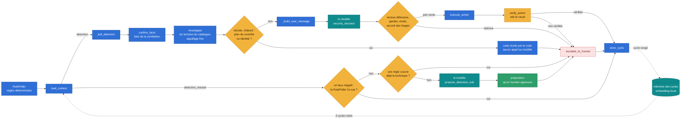

- `decide` sort avant tout appel sur une détection d'identité ou du plan de contrôle
  (`agent.py:1868-1871`) : leur carte est écrite par le code (`_identity_decision`, `agent.py:1123` ;
  `_control_plane_decision`, `agent.py:1058`).
- Sur une détection manquée, le nœud écarte d'abord un faux négatif (`agent.py:3054`), qui va droit à
  `store_cycle` (`agent.py:3208-3210`), et une technique déjà couverte par une règle (`agent.py:3101`),
  avant d'appeler le modèle.
- Une action dont l'effet n'est pas vérifié sur le cloud part en carte (`_route_after_verify`,
  `agent.py:3213-3219`).
- Toute exception d'un cycle finit en carte `cycle_failed`, jamais en action (`agent.py:3381`,
  `record_cycle_failure`, `agent.py:3384`).

### 1.2 Les modèles, par composant

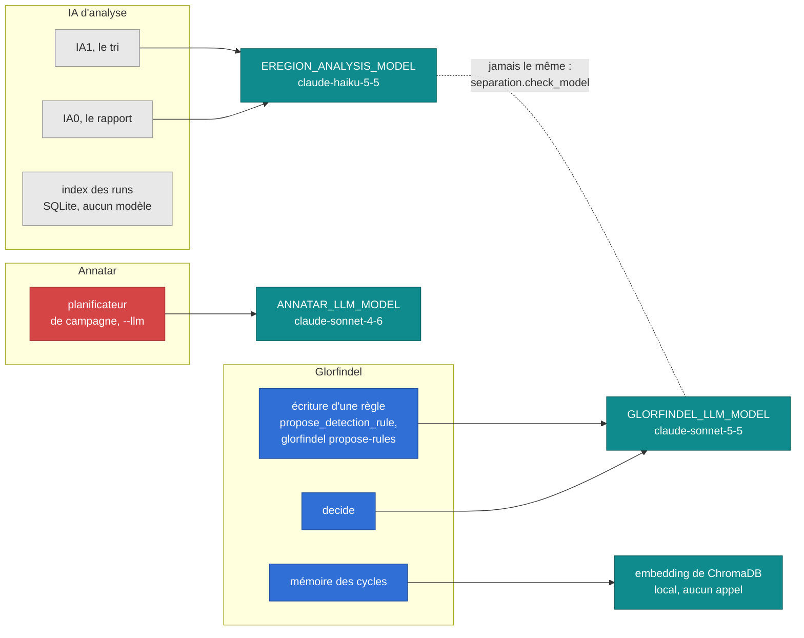

| Usage | Où | Outil rendu | Modèle par défaut | Ce que le code fait derrière |
|---|---|---|---|---|
| La décision | `glorfindel/agent.py:1824` | `security_decision` (`agent.py:104-170`) | `DEFAULT_LLM_MODEL` | lecture défensive, gardes, mode, accord des tirages (§2.3) |
| L'écriture d'une règle | `glorfindel/detection_authoring.py:339` | `propose_detection_rule` (`detection_authoring.py:165`) | le même | une proposition, jugée routable, approuvée par un humain (§3) |
| Le plan d'une campagne | `annatar/campaign/planner.py:125` | `campaign_plan` (`planner.py:51-82`) | `DEFAULT_ANNATAR_MODEL` | filtre au catalogue, ordre et budget fixés par le code (§4) |
| Le rapport IA0 | `analysis/campaign_report.py:1155` | `campaign_report` (`campaign_report.py:68-94`) | `DEFAULT_ANALYSIS_MODEL` | chaque affirmation vérifiée contre les runs qu'elle cite (§5) |
| Le tri IA1 | `analysis/triage.py:504` | `campaign_triage` (`triage.py:435-462`) | le même | chaque entrée vérifiée, toute proposition `pending` (§5) |
| La mémoire, l'interrupteur éteint (le défaut) | `glorfindel/memory.py:172-175` | aucun | l'embedding par défaut de ChromaDB | filtres de source, d'âge et de VM (§6) |
| La mémoire, l'interrupteur allumé (`GLORFINDEL_MEMORY=cles`, MEM2) | `glorfindel/memory_keys.py:252-282` | aucun | aucun : une table SQLite, lue par clés et par date | les mêmes filtres, la technique dans les clés, le verdict humain dit et préféré (MEM2b, §6) |
| L'index de l'IA d'analyse | `analysis/run_index.py:1-8` | aucun | aucun : une table SQLite, lue par clés (MEM3) | jamais la mémoire de Glorfindel (§5) |

Gothmog, Orodruin, la console et le bot n'appellent aucun modèle. La console affiche seulement le nom
du modèle de Glorfindel (`eregion_console/api.py:1088-1090`).

### 1.3 Ce qui reste au code

- **La détection** : le RulePoller lance les règles, en continu (`glorfindel/detection_rules.py:1738`).
  Aucun modèle sur ce chemin : une règle écrite par un modèle n'y entre qu'approuvée
  (`detection_authoring.py:19-22`).
- **La corrélation** : un brute force et la connexion qui le suit, un sudo et la session qui le porte,
  liés dans le RulePoller, « jamais dans le prompt, jamais par la confiance du modèle »
  (`glorfindel/correlation.py:1-7` ; [`design/correlation.md`](design/correlation.md)).
- **L'enquête d'aujourd'hui** : six lectures, choisies par le code sur les colonnes de la ligne,
  bornées à la VM du registre (`investigate`, `agent.py:540-603`). Depuis ENQ2, elles viennent d'un
  catalogue fermé (`glorfindel/enquiry/catalog.py:237-266`) : chacune a sa phrase pour le modèle, ses
  paramètres remplis par le code (chacun avec sa vérification), sa fenêtre (son `ago()`, comptée depuis
  la lecture ; l'ancrage sur le signal vient avec le lecteur KQL d'ENQ5), sa latence, son auteur et ce qu'elle sait dire
  sous Linux et sous Windows ; l'aiguillage reste celui d'avant (`glorfindel/enquiry/fixed.py:37-53`). Chaque
  lecture finit dans un état parmi sept (`catalog.py:53`, `outcome`, `:297`), qui reste au code. Le
  modèle ne peut demander aucune lecture : son seul outil est la décision (ENQ1 §1.1).
- **Le plan de contrôle et l'identité** : la carte est écrite par le code, sans enquête, sans appel et
  sans action recommandée (`agent.py:1061-1066`, `agent.py:1126-1132`).
- **Les actions** : une liste fermée et réversible (`AUTONOMOUS_ACTIONS`,
  `glorfindel/response/policy.py:10-17`) ; le reste demande un humain (`policy.py:35-46`), quelle que
  soit la confiance.
- **La vérification** : `verify_action` relit l'état du cloud après l'action (`agent.py:2456`).
- **Le routage** : une décision escaladée, une action qui demande un humain ou une action inconnue
  partent en carte (`_route_after_decide`, `agent.py:3228-3240`).
- **Chez Annatar et dans l'analyse** : la matérialisation d'un scénario (`annatar/campaign/synthesizer.py:1-5`),
  les faits d'une campagne et ses comptes (`analysis/campaign_report.py:6-8`), les éléments du tri et
  leurs causes (`analysis/triage.py:8-27`).

---

## 2. La décision de Glorfindel (`decide`)

### 2.1 Ce qu'elle lit

Deux messages (`agent.py:1917-1934`) :

- **Le prompt système**, `_SYSTEM_PROMPT` (`agent.py:172-242`) : la frontière d'autonomie, la façon de
  raisonner (ce qui est arrivé, ce que fait l'action, l'action minimale), les types d'événements, l'usage
  des cycles passés, puis les exemples. Il est mis en cache chez le fournisseur
  (`cache_control`, `agent.py:1924`).
- **Les exemples**, à la fin du prompt : six chaînes de raisonnement (`glorfindel/few_shot_examples.yaml:6-60`), mises en
  forme au chargement (`_load_few_shot_examples`, `agent.py:30-63`).
- **Le message**, `_build_user_message` (`agent.py:3456-3562`), en Markdown :
  - le signal entier, en JSON ;
  - l'indicateur principal normalisé ;
  - le contexte de l'enquête : une lecture sans lignes s'écrit « aucun résultat », qu'elle soit vide,
    sans objet (le compteur `Process` sous Linux), en échec ou refusée — ENQ2 n'y change rien
    (`Reading.seen`, `glorfindel/enquiry/catalog.py:133-135` ; le message figé à l'octet sur des
    signaux Linux et Windows, `tests/unit/test_enquiry_catalog.py`) ;
  - l'incident en cours sur la ressource ;
  - **l'état actuel de la VM**, lu dans les fichiers d'état, « source de vérité » (`agent.py:3526`, `:3532`) ;
  - les cycles passés, chacun avec sa source, `[RÉEL]` ou `[EXERCICE]` (`agent.py:3453`,
    `agent.py:3551-3557`), donnés comme historique, jamais comme état.

Ce que le modèle ne voit jamais : les requêtes en échec ou non lancées (`telemetry_gaps`, gardées hors
du signal, `investigate`, `agent.py:545-551` ; `Reading.gap`, `catalog.py:138-140`), l'état de chaque
lecture, si le signal courant est un exercice, le plan d'une carte
d'identité, et les champs de la ligne du cycle (§7.4).

### 2.2 Ce qu'elle rend

Un appel de l'outil `security_decision` (`agent.py:104-170`), huit champs requis : `reasoning`,
`confidence`, `action`, `reversible`, `explanation`, `escalate`, `escalation_reason`,
`suggested_steps`. La liste des actions qu'il annonce vient du code (`AUTONOMOUS_ACTIONS`,
`MODEL_GATED_ACTIONS`). Une action hors de ces listes est permise : elle part toujours en carte.

### 2.3 Ce que le code vérifie derrière

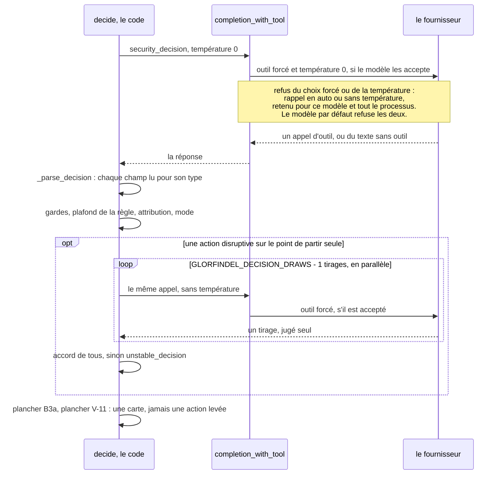

- **La lecture défensive** (`_parse_decision`, `agent.py:691-759`) : pas d'appel d'outil (possible dès
  que l'outil n'est plus forcé, le cas du modèle par défaut), des arguments
  illisibles, un booléen en texte, une confiance hors de [0, 1] ou qui n'est pas un nombre — jamais une
  exception, jamais une action. Une action illisible est une escalade. Seuls les champs du schéma sont
  gardés.
- **Les gardes, dans l'ordre du code** (`agent.py:1948-1962`) : la garde exécutable, la porte de
  confiance, le garde-fou du signal, la garde de télémétrie, la précondition de levée, le plafond de la
  règle, `never_block`, l'attribution, puis le mode d'autonomie. Ensuite l'accord des tirages
  (`agent.py:1964-1976`), puis les planchers (`agent.py:1978-1982`), qui proposent et n'exécutent
  jamais. Le détail de chaque garde : [`architecture.md`](architecture.md), « Les gardes qui encadrent
  le LLM », et [`glorfindel.md`](glorfindel.md).
- **Les tirages** : chaque tirage de confirmation passe la garde exécutable et la porte de confiance,
  comme le premier ; un appel en échec est un tirage qui n'accorde pas (`_confirming_draws`,
  `agent.py:1718-1743`). L'accord ne dépend pas de la confiance du premier tirage
  (`_apply_agreement_guard`, `agent.py:1746-1774`).
- **Un appel qui échoue**, après ses nouvelles tentatives, fait une carte `cycle_failed`
  (`agent.py:1935-1942`, `_decision_failed`, `agent.py:1796`).

### 2.4 Ce qui exige un run de bout en bout

- **La règle** (`CLAUDE.md`, Conventions) : un changement de `few_shot_examples.yaml`, de `_SYSTEM_PROMPT`
  ou de `_build_user_message()` attend un run de bout en bout sur T1486 et une autre technique, par
  Jonathan, avant la fusion. Les tests unitaires mockent le modèle : ils ne disent rien de ce qu'il en
  ferait.
- **La dispense d'IR1a** : un changement de la source du prompt ou du schéma de l'outil, dont le rendu
  reste identique à l'octet, se passe du run. Le test le fige par deux empreintes sha256
  (`tests/unit/test_identity_plan.py:153-163`). Elle ne vaut ni pour le message ni pour les exemples.
- **Ce que figent aussi les tests** : le message et le cycle de la mémoire, inchangés à l'octet par la
  ligne du cycle de DOS2 (`tests/unit/test_cycle_line.py:334`, `:350`) ; le prompt d'avant la puce de
  la clé de routage, pour le harnais des propositions (`tests/unit/test_detection_authoring.py:175`).
- **Ce qui n'en demande pas** : une garde, un plafond ou un mode qui change, quand ce que lit le modèle
  ne change pas. Ils se prouvent en tests et en mutants ([`design/preuves.md`](design/preuves.md)).
- **Le mouvement latéral, derrière son interrupteur** (SEC2d, #1147 ;
  [`design/mouvement-lateral.md`](design/mouvement-lateral.md)) : `GLORFINDEL_LATERAL` éteint (le défaut),
  le modèle lit ce qu'il lisait, à l'octet — la règle livrée, le message, le prompt, l'outil
  (`tests/unit/test_lateral.py`, `test_off_nothing_the_model_sees_changes_to_the_byte`, sur les empreintes
  ci-dessus). Allumé (dans la 0.7, avec le run de bout en bout d'ENQ5), **le modèle reçoit des détections
  qu'il ne recevait jamais** : une force brute SSH dont la source est une adresse privée ou du réseau du
  client. Le message d'une détection donnée ne change pas — le prompt, `_build_user_message()`, l'outil et
  le few-shot sont les mêmes, et le test le vérifie dans les deux positions — ; ce qui change, c'est quelles
  détections lui arrivent : celles du réseau du client en plus, celles d'une origine attendue en moins
  (écartées par le RulePoller, jamais lues). **La classe de la source n'est jamais dans le message** : le
  code la juge (décision 8), jamais le modèle. Ce que le modèle décide sur la cible suit ses gardes comme
  avant ; un blocage d'une adresse du client est retenu (SEC2b), et la carte qui propose d'isoler la VM
  source s'écrit à part, quel que soit son choix — jamais une action seule. Ce que le harnais et le run
  d'ENQ5 doivent regarder : si le modèle, voyant une source interne, isole la cible (la victime) au lieu
  de laisser la carte de la source faire son office ; si le prompt, écrit pour des sources d'Internet,
  oriente vers un blocage qui sera toujours retenu.

### 2.5 Avant l'appel : la file de décision et le plafond de la watch

Une détection n'appelle pas le modèle dès qu'elle arrive. Elle attend dans la file de sa VM, puis passe
une porte, `DecisionGate`, commune à toute la watch (`glorfindel/decision_queue.py:334`, créée une
fois par la watch, `glorfindel/watch/dispatch.py:36`, appelée avant chaque décision,
`dispatch.py:92-94`). Ces bornes viennent de SEC-A2 (#631), après l'audit du 06/11 : une ligne agrégée
par ses colonnes de texte fait une détection par valeur. Un compte local d'une VM surveillée qui écrit
vingt adresses nouvelles à chaque passe faisait ainsi **720 décisions par heure sur une seule VM**,
environ 2 160 appels au modèle, et une vraie détection de rançongiciel attendait des heures derrière
elles (`decision_queue.py:1-8`).

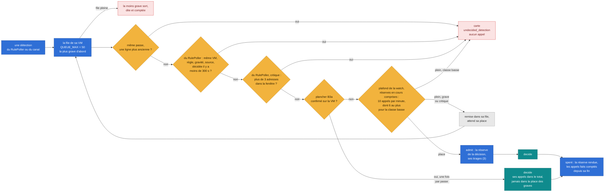

**Les trois classes** (`gravity`, `decision_queue.py:123`) : critique (une compromission que le
RulePoller a corrélée, COR1 : le mot de sa règle seule, jamais une ligne du canal `runs/`), grave (une
technique de `GRAVE_TTPS` : T1486, T1485, T1490, T1041, T1567, `decision_queue.py:92-95` — la donnée
est détruite ou s'en va), basse (le reste).

**Les bornes, toutes avant l'appel au modèle** (les constantes : `decision_queue.py:82-109`) :
- **`QUEUE_MAX` = 50** détections par file. Au-delà, la moins grave et la plus récente sort, avec sa
  carte, dite et comptée. Une détection grave ne sort jamais pour une autre : les non graves sortent
  d'abord, et une file pleine de graves refuse la nouvelle (`decision_queue.py:10-14`, `_enter`,
  `decision_queue.py:257-276`).
- **La plus grave d'abord** : critique, puis grave, puis basse, chaque classe dans son ordre d'arrivée
  (`decision_queue.py:15-20`).
- **`DEDUP_WINDOW_S` = 300 s**, pour les détections du RulePoller seulement (`decision_queue.py:449`) :
  une décision du modèle par VM, règle, gravité et source dans la
  fenêtre. Les autres détections de la fenêtre sont nommées sur une carte, sans appel. La fenêtre ne
  s'ouvre que sur une décision qui a contenu ou mis une carte devant un humain (`decision_queue.py:21-24`,
  `spent`, `decision_queue.py:486-506`).
- **`CRITICAL_ADDRESSES` = 3** adresses distinctes de la classe critique par VM dans la fenêtre, pour
  les détections du RulePoller seulement (`decision_queue.py:449-459`) :
  deux compromissions de deux adresses sont décidées toutes les deux, un flot d'adresses forgées ne
  l'est pas (`decision_queue.py:96-99`, `:365-376`).
- **Le plafond de la watch**, une borne qui tient depuis PRT1 (#1060) : **`MODEL_CALLS_PER_MIN` = 10**
  appels au modèle par minute, pour toute la watch ; la classe basse en prend au plus
  **`LOW_CALLS_PER_MIN` = 6** (`admit`, `decision_queue.py:434-484`, le calcul `:460-480` ; la règle,
  `decision_queue.py:33-53`). Avant PRT1, `admit` réservait un appel et les tirages de D-1 n'étaient
  comptés qu'après la décision : des fils de VM admis ensemble dépassaient la borne (cinq basses, 15
  appels pour 6 ; huit graves et deux basses, 30 appels dans la minute).
  - **La réserve** : une décision réserve, à son admission, tous les appels qu'elle peut faire
    (`reserve`, `decision_queue.py:393-402`) — `decision_draws` (3 par défaut), le premier tirage et
    ceux de confirmation, quel que soit le mode de la VM, lu dans `decide` après l'admission ; une
    proposition de règle, un appel. Elle est comptée tant que la décision est en cours, quelle que soit
    sa durée. Une réserve ne dépasse jamais la place de sa classe (6 pour la basse, 4 pour les
    graves) : une décision tient toujours dans une minute vide, et avec `GLORFINDEL_DECISION_DRAWS`
    au-dessus de 4, les tirages au-delà sont comptés après elle, comme avant.
  - **La réserve rendue** : à sa fin, la décision rend ce qu'elle n'a pas fait, et les appels faits
    comptent depuis sa fin, le côté sûr (`spent`, `decision_queue.py:486-506` ; `calls_made`,
    `decision_queue.py:175-188`). Un appel en `human_only`, en `non_disruptive` ou quand une garde a
    retenu l'action avant les tirages ; aucun quand le modèle n'a pas été atteint (`decision_model`
    absent : une identité ou le plan de contrôle lus en profondeur par `decide`). Ce qui ne se lit pas
    garde sa réserve : un appel qui échoue reste compté, un cycle échoué ou un graphe qui lève aussi
    (`decide_or_card`, `decision_queue.py:641-659`).
  - **À tout instant**, hors du plancher B3a, les appels comptés dans la minute glissante, réserves en cours comprises,
    restent sous dix, ceux de la classe basse sous six, et les graves et les critiques gardent leurs
    quatre places : une basse n'est admise que si sa réserve tient dans la place de la classe basse
    **et** dans le total ; une grave, si elle tient dans le total **ou** dans la place des graves. Le
    prix : la classe basse admet au plus deux décisions à trois tirages par minute, ou quatre d'un
    appel (une place de trois doit rester libre pour chacune).
  - Plafond atteint, une détection **basse** devient une carte `undecided_detection` (jamais une attaque
    que le monitoring a manquée, `detection_timeout` : elle attend, dans sa classe) : aucune action,
    aucune enquête, rien dans la mémoire (`record_undecided`, `decision_queue.py:571` ;
    `decision_queue.py:69-72`).
  - Plafond atteint, une détection **grave ou critique** n'est pas écartée : elle retourne dans sa
    file et attend sa place, le temps qu'un appel de la dernière minute vieillisse, ou au plus 5 s
    tant qu'une décision en cours peut rendre sa réserve (`room_in`, `decision_queue.py:404-411` ;
    `decide_or_card`, `decision_queue.py:641-659` ; `dispatch.py:95-97`). Sauf file pleine : elle en
    sort alors, dite et comptée (`dispatch.py:96`, `_enter`, `decision_queue.py:257-276`) — jamais
    une levée après un restore, protégée dans sa file comme une détection d'une technique grave
    (`protect`, `decision_queue.py:249`, `protected`, `:166-172`).
  - Le plancher B3a reste **le seul dépassement admis**, sur une détection seulement, comme celui de
    `decide` : sur une VM où un brute force a réussi puis root a été pris, sa détection passe, une fois
    par passe de sa règle ; une ligne du canal `runs/`, une fois par VM et par source dans la fenêtre
    (`_floor`, `decision_queue.py:413-432`). Ses appels sont comptés dans le total — la classe basse
    lui cède la place —, jamais dans la place des graves, qui gardent leurs quatre places
    (`_recent`, `decision_queue.py:382-391` ; `decision_queue.py:60-67`).
- **Ce qui appelle le modèle est compté** (`calls_model`, `MODEL_EVENTS`, `decision_queue.py:104-107`,
  `:146-149`) : une détection ; une attaque que le monitoring a manquée (`detection_timeout`, une ligne du
  canal `runs/` dont la décision préserve la VM), comptée et rangée dans la classe de sa technique,
  comme toute ligne du canal — jamais grave par son seul événement (SEC-E, V-08) — et jamais une
  carte : au-delà, elle attend, bornée par `CHANNEL_QUEUED_PER_VM` et `QUEUE_MAX` ; la levée après un
  restore vérifié (`recovery_complete`), comptée et rangée comme une grave quelle que soit sa
  technique (`call_class`, `decision_queue.py:152-163`) : jamais une carte, elle attend sa place ; et
  une proposition de règle (`detection_missed`, un
  exercice : comptée comme une basse ; au-delà, une carte « proposition de règle non faite
  (plafond) : relancer le scénario », avec ses étapes, `decision_queue.py:562-568` : rien ne la
  redemande). Une détection du plan de contrôle ou d'une identité est décidée par le code et ne
  compte pas (`decision_queue.py:71-72`).
- **`glorfindel respond`**, lancé à la main sur un fichier, ne passe pas par cette porte : seule la
  watch la crée (`dispatch.py:36`).

**Le disjoncteur en dollars (PRT2, #1160).** Le plafond de la watch borne combien d'appels par minute ; le
disjoncteur borne ce qu'ils coûtent, par jour UTC (`glorfindel/model_budget.py`, décisions de Jonathan des
23 et 24/11). Il est jugé **avant** la porte (`decide_or_card`, `budget.judge`), qui garde tout ce que
PRT1 tient derrière lui ; il n'est créé que par la watch (`dispatch.py`, `Ledger`, installé comme le garde
de chaque appel de son processus dans `eregion_core/llm_call.py`).

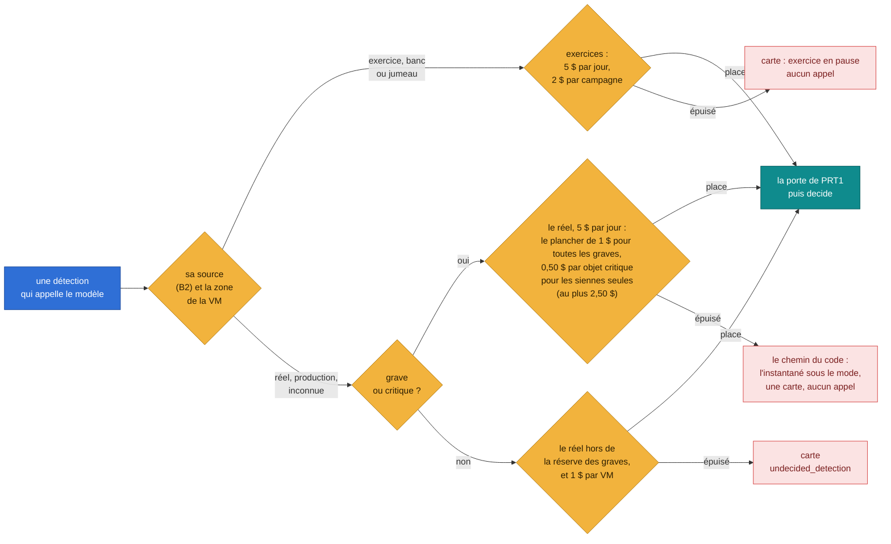

- **Deux enveloppes**, chacune avec son disjoncteur général : le réel (5 $ par jour) et les exercices
  (5 $ par jour pour Annatar, Gothmog et le drill ensemble, 2 $ par campagne). Épuisés, les exercices se
  mettent en pause ; le réel continue. L'enveloppe se choisit par la source de l'événement (`_cycle_source`,
  B2) : un exercice seulement quand une fenêtre d'injecteur couvre la VM **et** que sa zone, lue par la
  watch, est `bench` ou `twin` ; une source « exercice » en zone `production`, une zone illisible, une
  source inconnue comptent au réel. Une force brute venue d'Internet sur une VM du banc, hors fenêtre, est
  du réel. Les appels du planificateur d'Annatar restent hors de la porte (son processus n'a pas de garde).
- **Trois seaux.** Les graves (la classe critique ou grave de `call_class`, la levée après un restore
  comprise) ont une réserve que les ordinaires ne prennent jamais (décision de Jonathan du 24/11) : un
  plancher de 1 $, et 0,50 $ de plus par objet critique — une entrée d'`autonomy.assets` qui dit
  `critical: true`, lue strictement (`glorfindel/config.py`) —, jusqu'à 2,50 $ : réserve = min(2,50 $ ;
  1 $ + 0,50 $ × objets critiques). Le plancher sert à toutes les graves ; la part qu'apportent les objets
  critiques ne sert qu'aux graves des objets critiques (décision de Jonathan du 24/11) : une rafale de
  graves sur des VM non critiques s'arrête avant elle (`real/noncritical`), et une grave sur un objet
  critique puise dans toute l'enveloppe — seul le disjoncteur général l'envoie au chemin du code. Les
  ordinaires partagent ce que la réserve laisse (4 $ sans objet critique), au plus 1 $ par VM et par jour,
  et ne touchent jamais la réserve. Les exercices, leur enveloppe.
- **« N'attend jamais »**, ce que le code fait : la part qu'apportent les objets critiques est réservée à
  leurs graves (aucune autre grave, aucune ordinaire n'y puise), et une grave sur un objet critique n'est
  retenue que par le disjoncteur général du réel ; pendant le refroidissement du fournisseur, elle passe
  sans attendre, par le chemin du code. Il ne vaut pas pour le plafond par minute de PRT1 : là, elle attend
  sa place comme toute grave, au plus une minute environ (`room_in`) ; la criticité de l'objet dans le tri
  de la porte revient à PRT3.
- **Le compte.** Chaque appel à son coût réel, le prix de LiteLLM pour ses jetons (comme le compteur de
  HRN1). Vérifié **avant chaque appel** (`Ledger.before`, `Refused` : l'appel n'est jamais fait). Un coût
  inconnu compte 0,05 $ — un dépassement possible, jamais 0 ; un appel refusé par la limite du fournisseur
  (429) compte 0. Une décision n'est admise que si sa part — les appels qu'elle peut faire
  (`DecisionGate.share`, `decision_draws`), chacun au prix inconnu — tient dans ses seaux, à côté des parts
  des décisions en cours ; admise, sa part passe quel que soit le compte : **le dépassement est borné à la
  part d'une décision admise**. Au-delà de sa part, un appel ne passe que si un de plus tient. Les tirages
  de D-1 courent dans le contexte de leur décision (`_confirming_draws`, `contextvars`).
- **Épuisé.** Une grave passe par le chemin du code (`model_budget.code_decision`, appelé par `decide`
  quand son appel est refusé) : ce qu'un appel refusé avait déjà — l'instantané, jugé comme celui du modèle
  (la garde d'attribution, le mode de la VM : proposé sur sa carte en `human_only`, exécuté seul sinon avec
  la carte de SEC4a qui dit que rien n'est contenu), le plancher B3a qui propose l'isolement là où sa paire
  est confirmée, jamais exécuté ; la levée après un restore reste à un humain, la VM isolée. Le code
  n'isole jamais seul. Une ordinaire devient une carte `undecided_detection`. Une alerte, la carte
  `model_budget_tripped`, dit que le disjoncteur a sauté, une fois par jour et par disjoncteur.
- **Les limites du fournisseur** (429, quota, crédit) : après les nouvelles tentatives de LiteLLM, la
  décision prend le chemin du code au lieu d'un cycle échoué — sous le garde de la watch seulement : sans
  lui (le harnais, `glorfindel respond`), une limite reste un cycle échoué, que le harnais compte comme
  aucune décision valide —, et la watch ralentit (30 s, doublé à chaque
  limite, au plus 300 s) : une grave attend dans sa file, une grave sur un objet critique jamais (le chemin
  du code), une ordinaire devient une carte ; la limite encore, toute grave par le chemin du code.
- **Le compte survit au redémarrage** (`~/.glorfindel/model_budget.json`) et se remet à zéro à minuit
  UTC.
- **Côté Eregion, le disjoncteur est la seule borne de la dépense de la watch** (décision de Jonathan du
  24/11 : aucune limite posée chez le fournisseur pour l'installation de référence). Il ne borne ni le
  harnais et les séances lancées à la main (chacun son plafond), ni le planificateur d'Annatar (son
  processus, sans garde), ni une seconde watch (chacune son compte) ; un prix inconnu de LiteLLM compte
  0,05 $ par appel, et un fichier de compte perdu fait repartir la journée à 0. Le fournisseur plafonne
  toujours, au palier de l'organisation (Anthropic : Start 500 $, Build 1 000 $, Scale 200 000 $ par mois
  calendaire, Custom sans plafond), ou plus bas si l'opérateur y pose une limite — recommandé contre les
  abus, jamais obligatoire ; les deux réponses (le 429 du palier, le 400 d'une limite posée) sont lues
  comme une limite du fournisseur, et toute la watch prend alors le chemin du code jusqu'au mois suivant
  ([`operations.md`](operations.md), « Le budget du modèle dans la watch »).
- **Ce que voit le modèle ne change pas** : ni le prompt, ni `_build_user_message()`, ni le few-shot ;
  une décision que le budget refuse ne lui est jamais envoyée.

### 2.6 Le plafond de la watch n'est pas le plafond de la règle

Le même mot nomme deux choses qui n'ont rien en commun.

| | Le plafond de la watch (SEC-A2) | Le plafond de la règle (RDW1) |
|---|---|---|
| Ce qu'il borne | **combien** d'appels au modèle, par minute | **quelle action** une détection peut faire partir seule |
| Quand | **avant** l'appel, dans la file de décision | **après** la réponse, parmi les gardes de `decide` |
| Où | `glorfindel/decision_queue.py:82-109`, `DecisionGate.admit` | `glorfindel/rule_ceiling.py:1-30`, `_apply_rule_ceiling` (`agent.py:1591`), appelé `agent.py:1956` |
| Sa valeur | 10 appels par minute, 6 pour la classe basse | `ceiling.allow` de la règle : `[snapshot]` sur `ransomware-disk-write` (`glorfindel/rules/azure/detection_rules.yaml:65-68`) |
| Pourquoi | un flot de détections forgées affamait les vraies (audit du 06/11) | une sauvegarde écrit aussi vite qu'un chiffrement : le modèle a proposé `isolate_vm` à 80 % sur la panne bénigne du banc du 20/11 (`rule_ceiling.py:4-10`) |
| Ce qui en sort | une carte `undecided_detection` sans décision, ou une attente | l'action ramenée à l'instantané, l'isolement proposé à un humain sur la carte |

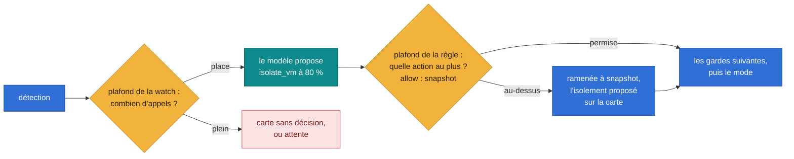

Un plafond de la règle se lève par un fait de la détection qu'elle nomme (`lifted_by`), vide pour
toute règle livrée (`rule_ceiling.py:20-23`). Le détail : [`glorfindel.md`](glorfindel.md), « Le
plafond par la règle ».

---

## 3. L'écriture d'une règle

Deux appelants partagent un seul appel (`glorfindel/detection_authoring.py:7-11`) : le nœud
`propose_detection_rule`, après une détection manquée (`agent.py:3126`), et
`glorfindel propose-rules`, pour une technique sans règle (`glorfindel/cli.py:2243`, `:2332`).

- **Ce qu'il lit** (`build_user_message`, `detection_authoring.py:273`) : l'entrée du catalogue de la
  technique, les vraies colonnes de la table (`getschema`, `detection_authoring.py:129-142`), la requête
  qui a manqué, les actions déjà prises sur la ressource, des résumés de cycles passés.
- **Le prompt** (`RULE_PROPOSAL_SYSTEM_PROMPT`, `detection_authoring.py:248-270`) : n'utiliser que les
  colonnes données, des seuils calibrés, et garder la clé de routage d'une table du plan des données
  (`ROUTING_KEY_INSTRUCTION`, `detection_authoring.py:233`).
- **Ce qu'il rend** : `propose_detection_rule` (`detection_authoring.py:165-220`), une analyse, un nom, la
  requête, un intervalle, une explication, une confiance. Une réponse sans outil lève
  (`_parse_proposal`, `detection_authoring.py:328-335`) : le cycle finit en carte.
- **Ce que le code vérifie** : la proposition est jugée à l'instant par le lecteur du chargement et de
  l'approbation (`proposed_rules.approval_refusal`, `glorfindel/proposed_rules.py:54` ;
  `agent.py:3146`). Une règle qui ne nomme pas sa VM est rangée « non approuvable ». Toute proposition
  attend un humain (`proposed_rules.approve`, `proposed_rules.py:156`) avant d'entrer dans le RulePoller.
- **La mesure** : `make llm-compare … PROPOSALS=1` (§8.2).
- **Le run de bout en bout** : aucun n'est exigé pour l'écriture d'une règle, qui ne fait que proposer.
  Le prompt d'avant la puce de la clé de routage est figé par empreinte
  (`tests/unit/test_detection_authoring.py:175`), et la mesure du harnais se joint à la PR qui change le
  prompt.

---

## 4. Le planificateur de campagne d'Annatar

Facultatif : `annatar campaign plan --llm` (`annatar/cli.py:398`, `use_llm=False` par défaut,
`annatar/campaign/planner.py:90`).

- **Ce qu'il lit** : le menu des techniques `implemented` du catalogue et l'objectif donné
  (`planner.py:138-145`).
- **Ce qu'il rend** : `campaign_plan`, une liste de techniques ordonnée (`planner.py:51-82`).
- **Ce que le code vérifie** : une technique hors du menu est retirée ; une réponse vide, sans outil ou
  qui échoue ramène l'ordre déterministe (`planner.py:98-106`, `planner.py:165-174`) ; l'ordre de la
  chaîne et le budget sont fixés par le code (`planner.py:108-110`). Le scénario est matérialisé sans
  modèle (`annatar/campaign/synthesizer.py:1-5`), et une technique destructive ne part pas sans
  `budget.allow_destructive`, lu dans le catalogue (`annatar/campaign/runner.py:204-208`).
- **Le run de bout en bout** : aucun n'est exigé ; le plan reste filtré et ordonné par le code.
- **Son modèle** : le sien, `claude-sonnet-4-6`, car le modèle par défaut de Glorfindel décline ce prompt
  (`eregion_core/models.py:20-24`).

---

## 5. L'IA d'analyse : le rapport (IA0) et le tri (IA1)

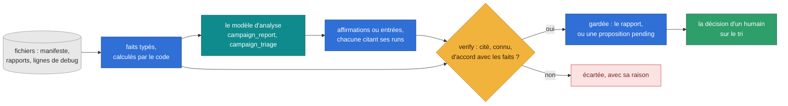

- **IA0, le rapport.** Les faits viennent des fichiers, jamais d'un modèle (`analysis/campaign_report.py:6-8`).
  Le modèle n'écrit que des affirmations typées, chacune citant des runs (`campaign_report.py:68-94`,
  `campaign_report.py:97-121`). `verify` (`campaign_report.py:1043`) écarte une affirmation sans
  citation, qui cite un run absent, que les faits contredisent, ou dont un nombre n'est pas dans les
  faits cités ; les écartées sont montrées, barrées, avec leur raison (`render`,
  `campaign_report.py:1213`).
- **IA1, le tri.** Ce qui est trié est calculé par le code (`items`, `analysis/triage.py:391`). Le
  modèle écrit une explication et une proposition d'un ensemble fermé par élément (`PROPOSALS`,
  `triage.py:94-100`). `verify` (`triage.py:544-577`) écarte une entrée que les faits ne soutiennent
  pas, ou qui porte une règle ; toute proposition gardée est écrite `pending` par le code.
- **La séparation.** Jamais le modèle de Glorfindel (`analysis/separation.py:44-54`), jamais sa mémoire :
  l'index des runs est une table SQLite à part, sans modèle (MEM3, `analysis/run_index.py:1-8` ;
  `campaign_report.py:588-596`).
- **Le run de bout en bout** : aucun n'est exigé pour l'analyse ; ses harnais la mesurent (§8.3).
- **Le détail** : [`analysis.md`](analysis.md).

---

## 6. La mémoire : un modèle d'embedding, pas un LLM

- **L'interrupteur** (MEM2, décision de Jonathan du 23/11) : `GLORFINDEL_MEMORY`, lu à l'ouverture de
  la mémoire (`CycleMemory`, `glorfindel/memory.py:76-115` ; `memory_mode`, `memory.py:61-73`). Vide ou
  `distance` (le défaut) : la mémoire par distance ci-dessous, celle d'avant MEM2, à l'octet. `cles` :
  la mémoire par clés (plus bas). Toute autre valeur garde la mémoire par distance, et le dit sur
  stderr : un interrupteur illisible ne coupe jamais la mémoire. Il s'allume avec ENQ5 seulement, après
  la séance de harnais (MEM-H) et le run de bout en bout de Jonathan.
- **Les clés qui ne s'ouvrent pas** (MEM2b, décision de Jonathan du 24/11) : la watch décide sur la
  distance et le dit fort (`fell_back`, `memory.py:118-125` ; sa bannière et une carte, `_say_memory`,
  `glorfindel/watch/startup.py`). Ce que voit le modèle est alors celui de la distance, à l'octet.

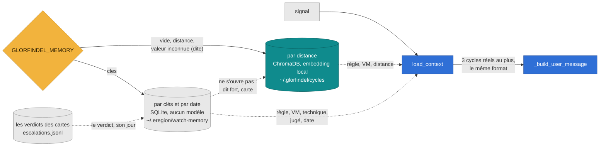

- **La mémoire par distance — le défaut** : une collection ChromaDB `cycles`, en distance cosinus (`glorfindel/memory.py:172-175`),
  sous la fonction d'embedding par défaut de ChromaDB, un modèle ONNX d'environ 80 Mo, chargé et appelé
  sur la machine (`scripts/chroma_model.py:5-8`, `:33-35`). Le magasin et le calcul d'embedding restent
  locaux ; en revanche, les résumés des trois cycles rendus partent chez le fournisseur, dans le message
  de la décision (`agent.py:3551-3557`) et dans celui de l'écriture d'une règle (`past_summaries`,
  `agent.py:3125`) (§2.1, §9).
- **Le texte cherché** n'est qu'un gabarit : technique, gravité, type, événement, fournisseur
  (`_signal_to_text`, `memory.py:399-406`). La ligne détectée n'y entre pas.
- **Ce qui est rendu** (`retrieve_similar`, `memory.py:233`) : trois cycles, réels seulement
  (`memory.py:315`), de moins de 90 jours (`memory.py:35-37`), au plus un par VM (`memory.py:53`),
  donnés au modèle comme historique (§2.1). Aucun verdict : ce chemin ne change pas avec MEM2b.
- **La mémoire par clés — allumée** (`glorfindel/memory_keys.py`) : les mêmes cycles, leur texte et
  leurs métadonnées, dans une table SQLite de `~/.eregion/watch-memory/cycles.sqlite3`, que seule la
  watch monte. Le rang (`rank`, `preferred`, `choose`, `memory_keys.py:101-128`) : la même règle, la
  même VM, la même technique, puis un précédent jugé avant un non jugé (MEM2b), puis le plus récent ;
  les mêmes bornes (réels seulement et 90 jours, `memory_keys.py:267` ; un cycle par copie et un par
  VM, `memory_keys.py:123`). Aucun embedding, aucun modèle. **Ce que voit le modèle** : le même format
  de message (`_build_user_message`, `_SYSTEM_PROMPT`, le few-shot et l'outil ne changent pas), d'autres
  cycles — sur la copie d'Imladris du 21/11, l'ensemble rendu change pour 458 signaux sur 479, et la
  part de la même technique passe de 77,3 % à 92,9 % ([`design/memoire.md`](design/memoire.md), §2.3).
- **Le verdict humain du précédent** (MEM2b, décision de Jonathan du 24/11) : la mémoire par clés ajoute
  au texte de chaque précédent le verdict de la carte que son cycle a ouverte (`card_verdicts`,
  `memory_keys.py:312-327`, lu à chaque décision : un verdict vient après le cycle). Le texte (`verdict_said`,
  `memory_keys.py:330-344`) : « verdict humain du <jour> : décision jugée juste (vraie attaque) », ou
  « (fausse alerte) » quand la décision n'a rien fait ; « décision jugée fausse (…) », « incertain »,
  « non jugé ». Le texte rendu (`memory_keys.py:274-282`) est le résumé suivi de ` | ` et du verdict, ce
  que le message montre sous « Cycles passés similaires » : `_build_user_message` n'est pas touché. La
  note de l'opérateur n'y entre jamais, seulement ces quelques mots fixés par le code. Un précédent reste
  de l'histoire (Q9) : il dit comment une décision a été jugée, jamais l'état de la VM. Le même texte
  entre dans `past_summaries` (l'écriture d'une règle, `agent.py:3125`).
- **Ce que figent les tests** : l'interrupteur éteint, le message d'un cas avec des précédents est
  celui d'avant MEM2 (son sha256, `tests/unit/test_memory_keys.py`) ; les sha256 d'ENQ2 restent verts.
  Allumé : le verdict dit, « non jugé » dit, le rang qui préfère le jugé sans passer les clés
  (`tests/unit/test_memory_verdicts.py`).
- **Ce que MEM1 a mesuré** (le 21/11, [`design/memoire.md`](design/memoire.md), §0) : la distance ne
  fait pas mieux que la date ; ce qui apporte, c'est la technique dans les clés de rang.
- **Ce qui se mesure** (MEM-H, #1028) : le harnais rejoue les mêmes cas sous trois mémoires — aucune,
  la distance, les clés —, sur des précédents qu'il construit lui-même, une mémoire neuve par cas, et
  compte ce qui bouge : la décision, la confiance, les erreurs surconfiantes par la règle du CD
  (`scripts/harness_precedents.py`, `make llm-compare … PRECEDENTS=1` ; `memoire.md` §9). Seuls les
  `past_cycles` changent entre les trois ; rien de ce que voit le modèle en production.
- **Ce que la séance a mesuré** (Jonathan, le 24/11, sur la v0.6.6 et `anthropic/claude-sonnet-5-5`,
  3 runs ; le détail cas par cas : [`design/memoire.md`](design/memoire.md), §9.3). Le harnais juge
  l'action proposée, avant le plafond de la règle (RDW1).

  | Passage | Mémoire | Bonnes décisions | Erreurs surconfiantes |
  |---|---|---|---|
  | 1. la décision seule, 7 cas (C2, C1, C3) | aucune | 16/21 | 5 |
  | | distance | 21/21 | 0 |
  | | clés | 18/21 | 3 |
  | 2. l'enquête, puis la décision, 10 cas (C4, C6, C5) | aucune | 24/30 | 6 |
  | | distance | 27/30 | 3 |
  | | clés | 27/30 | 3 |

  Au passage 1, les trois erreurs des clés sont dans un seul cas, l'écriture modeste sous la règle du
  rançongiciel : les clés y ramènent un second isolement T1486 (50 jours), la distance une force brute
  bénigne d'une autre technique (3 jours). La distance gagne ce cas par un précédent sans rapport, et la
  règle du CD compte ce cas comme une dérive de la distance aux clés. Au passage 2, de la distance aux
  clés, **aucune décision ni aucune confiance ne bouge**, alors que les précédents diffèrent sur 8 cas
  sur 10.
- **Ce que la séance montre** : **sous l'enquête, les clés valent la distance** ; au passage 1, EH12
  ne tient pas à la lettre (ci-dessous, MEM2b). **Une mémoire aide, en partie** : sur le pic de sauvegarde au verdict bénin, sans
  mémoire, le modèle isole à 0,75 ; sous l'une ou l'autre, la confiance descend entre 0,45 et 0,62, sous
  le seuil, et la garde le retient. Mais le modèle propose toujours l'isolement, cinq fois sur six. Mais **aucune citation n'est vérifiée** sous les trois mémoires (§10.2) : la séance mesure
  `decide` et la mémoire, **pas encore la valeur de l'enquête**.
- **Ce qui vient** : ENQ5b allume
  l'interrupteur, après MEM2b et après son run de bout en bout, puisque ce que voit le modèle change alors ; MEM4 sort
  chromadb, et la mémoire n'a plus de modèle du tout. MEM3 l'a déjà fait pour l'index de l'IA
  d'analyse, qui n'était lu que par clés (`analysis/run_index.py:1-8`).
- **La décision de Jonathan, le 24/11, après la séance : MEM2b avant ENQ5b.** Un précédent porte
  l'action, jamais le verdict (sa technique, son action, sa VM, sa règle, son âge, sa source) : deux
  anciens isolements apprennent « on isole ici », quelle qu'ait été l'ampleur de ce qu'ils ont contenu.
  C'est la cause de l'écart du passage 1, et EH12 n'y tient pas. **On corrige la cause** : chaque
  précédent porte le verdict humain quand il existe (vraie attaque ou fausse alerte), et le rang par
  clés préfère les précédents jugés. Sa forme exacte (le champ, le rang) reste au lot MEM2b, qui touche
  à la Q9 du 23/11 ([`design/enquete-raisonnee.md`](design/enquete-raisonnee.md), §14). Puis le passage
  1 se rejoue seul (environ 1,2 $) pour vérifier EH12. **Les clés ne s'allument pas avant.**
- **Ce que MEM2b a fait** (#1161) : le verdict dit et le rang qui préfère le jugé (« Le verdict humain du
  précédent », plus haut ; [`design/memoire.md`](design/memoire.md), §9.5). Le harnais garde les cycles
  du 24/11 et leur ajoute des verdicts ; les clés y choisissent les mêmes cycles. Le passage 1 se
  rejoue tel quel (`docs/operations.md`, « Le harnais des précédents »).

---

## 7. Les modèles

### 7.1 LiteLLM et les fournisseurs

Tous les appels passent par LiteLLM, qui nomme un modèle `<fournisseur>/<modèle>` et lit la clé du
fournisseur dans l'environnement. Les fournisseurs connus et leurs variables : `PROVIDER_ENV`
(`eregion_core/models.py:47-54`) — Anthropic, OpenAI, Azure OpenAI, Mistral, Ollama. Un modèle local
ou auto-hébergé se joint par `GLORFINDEL_LLM_BASE_URL` (`models.py:55-58`, `agent.py:1911-1913`) ;
le planificateur lit `ANNATAR_LLM_BASE_URL` (`planner.py:147`).

### 7.2 Les modèles par défaut

| Rôle | Constante | Valeur | Variable qui la remplace |
|---|---|---|---|
| Glorfindel : décision, écriture d'une règle | `DEFAULT_LLM_MODEL` (`models.py:19`) | `anthropic/claude-sonnet-5-5` | `GLORFINDEL_LLM_MODEL` |
| Annatar : le planificateur | `DEFAULT_ANNATAR_MODEL` (`models.py:24`) | `anthropic/claude-sonnet-4-6` | `ANNATAR_LLM_MODEL` |
| L'IA d'analyse | `DEFAULT_ANALYSIS_MODEL` (`models.py:27`) | `anthropic/claude-haiku-5-5` | `EREGION_ANALYSIS_MODEL` |

Une variable vide vaut le défaut (`models.py:30-39`). Aucun autre nom de modèle n'est écrit dans le
code (`tests/unit/test_models.py:11`). Changer le défaut, c'est une ligne, après le harnais et un run de
bout en bout (`models.py:9-13`).

### 7.3 Le tirage : température, outil forcé, bornes

Une seule fonction appelle le modèle, `completion_with_tool` (`eregion_core/llm_call.py:55-67`) :
- **l'outil forcé** (`tool_choice` qui le nomme) ; un modèle qui le refuse est rappelé une fois en
  `auto`, et retenu pour le processus (`llm_call.py:3-9`, `:42-52`) ;
- **la température** quand l'appelant en demande une ; un modèle qui la refuse la perd pour de bon, et
  `temperature_refused` le dit (`llm_call.py:11-14`, `:36-39`).

| Usage | Température | `max_tokens` | Délai | Nouvelles tentatives |
|---|---|---|---|---|
| Décision, premier tirage | 0 (`glorfindel/cycle_line.py:36`), sinon celle du fournisseur | 4096 (`agent.py:1919`) | `GLORFINDEL_LLM_TIMEOUT_S`, 120 s (`glorfindel/config.py:81`) | 2 (`agent.py:674`) |
| Décision, tirages de confirmation | celle du fournisseur | 4096 | le même | 2 |
| Écriture d'une règle | celle du fournisseur | 2048 (`detection_authoring.py:393-409`) | le même | aucune demandée |
| Planificateur | celle du fournisseur | 1024 (`planner.py:154-164`) | aucun demandé | aucune demandée |
| IA0, IA1 | celle du fournisseur | 2048 (`campaign_report.py:1167`, `triage.py:514`) | `EREGION_ANALYSIS_TIMEOUT_S`, 300 s (`campaign_report.py:1139-1140`) | aucune demandée |

Le modèle par défaut de Glorfindel refuse toute température fixée (mesuré le 26/10,
`cycle_line.py:32-35`) : son premier tirage est donc l'échantillonnage du fournisseur, et la ligne du
cycle le dit. Il refuse aussi le choix forcé (mesuré le 19/10, `llm_call.py:3-6`) : ses décisions
partent en `auto`, et une réponse sans outil devient une escalade (`_parse_decision`, `agent.py:691-759`). Le nombre de tirages qui doivent s'accorder est `GLORFINDEL_DECISION_DRAWS`, 3 par défaut,
de 2 à 10 (`config.py:105-106`) ; le seuil de la porte, `GLORFINDEL_CONFIDENCE_THRESHOLD`, 0,7
(`config.py:50`). Une valeur illisible retient tout (G2). Le nombre d'appels par minute, lui, est
borné avant l'appel par le plafond de la watch (§2.5).

### 7.4 La ligne du cycle (DOS2)

La ligne de debug de chaque cycle (`runs/glorfindel/<run_id>_debug.jsonl`, `_write_debug_record`,
`agent.py:2914`) porte, depuis DOS2, ce qui a décidé (`decision_fields`, `cycle_line.py:138-161`,
appelé `agent.py:2946-2947`) : `decision_model`, `decision_sampling` (la température demandée, refusée
ou non, `fixed` ou `provider_default`), `confirming_sampling`, `decision_temperature`,
`decision_draws`, `confidence_threshold`, `decision_draws_required`, `glorfindel_version` et
`rule_fingerprint` (`cycle_line.py:5-21`). Rien de cela n'entre dans la mémoire ni dans le message au
modèle (`cycle_line.py:23-26`).

---

## 8. La mesure

### 8.1 Le harnais de la décision

`scripts/llm_smoke.py` appelle le vrai `decide()` contre un vrai fournisseur, sans Azure ni mock
(`scripts/llm_smoke.py:1-31`). Dix-huit cas, en six genres (`llm_smoke.py:88-234`) : `act` (une menace
claire), `caution` (un signal ambigu, le discriminant), `paired` (le même brute force seul, puis dans un
incident), `floor` (le plancher B3a), `injection` (une consigne plantée dans une ligne,
`llm_smoke.py:174-206`) et `memory` (une mémoire d'exercices, ou empoisonnée, `llm_smoke.py:207-233`).

- **Deux notes** : l'intégration (un appel d'outil lisible) et le jugement.
- **La calibration** : la confiance moyenne des décisions justes et des fausses, et surtout les
  **erreurs surconfiantes** — fausses et au-dessus du seuil, donc passées par la porte
  (`llm_smoke.py:82-86`, `:527-536`). La leçon d'Eregion : la sûreté ne se délègue jamais à la confiance
  du modèle ; la porte n'est qu'une garde parmi d'autres.
- **La latence, les jetons, le coût** (HRN1, #1065) : chaque appel au modèle — la décision, ses tirages,
  une proposition de règle — est mesuré par `scripts/harness_meter.py`, qui enveloppe
  `completion_with_tool` le temps du run sans rien changer de ce qu'il passe (`llm_smoke.py:404-420`).
  La latence est prise sur une horloge monotone autour de l'appel, les jetons dans l'`usage` de la
  réponse, le coût chez LiteLLM (`completion_cost`) : un modèle qu'il ne sait pas chiffrer donne un coût
  **inconnu**, jamais 0 ; un appel en échec est compté à part. Le rapport le dit par genre de cas
  (latence médiane, p95 et max ; jetons moyens ; coût par décision avec et sans tirages ; coût du run),
  `--json` garde chaque appel. Ces chiffres calent le budget de l'enquête (ENQ1, Q2) et le disjoncteur
  en dollars (PRT2) ; ils n'entrent jamais dans l'attestation ([`operations.md`](operations.md),
  « La latence, les jetons, le coût »).
- **`make llm-compare`** (`Makefile:521-522`) compare des modèles. Avec `ATTEST=1`, deux passages, le
  verrou de la release en service puis le candidat, écrivent `requirements/harness.json`, que le CD
  d'Imladris exige signée (`scripts/harness_attest.py` ; [`operations.md`](operations.md), « Verrou
  des dépendances »). Appels payants : le geste de Jonathan.
- **Le genre `enquete`** (ENQ4, #1085) : `make llm-compare … ENQUETE=1` fait tourner la boucle de
  l'enquête sur des lectures enregistrées, puis `decide` d'aujourd'hui sur ce qu'elle a lu
  (`scripts/harness_enquete.py`) ; chaque tour de la boucle est mesuré comme un appel `enquiry` (§10.2).
  Jamais d'attestation.
- **Le genre `precedents`** (MEM-H, #1028) : `make llm-compare … PRECEDENTS=1` joue sept cas de la
  décision sous trois mémoires (aucune, la distance, les clés), sur des précédents construits par le
  harnais, une mémoire neuve par cas (`scripts/harness_precedents.py`) ; avec `ENQUETE=1`, la boucle
  sous les trois. Il dit ce qui bouge d'une mémoire à l'autre, les erreurs surconfiantes par la règle
  du CD, le coût par mémoire (§6). Jamais sans plafond, jamais d'attestation.

### 8.2 Le harnais des propositions de règles

`make llm-compare … PROPOSALS=1` mesure l'écriture d'une règle : la part des propositions qui portent
la clé de routage, sans puis avec la puce du prompt (`llm_smoke.py:544-740` ;
[`operations.md`](operations.md), « Le harnais des propositions de règles »).

### 8.3 Les harnais de l'analyse

`make report-eval` (`Makefile:503-504`, `scripts/report_eval.py`) mesure la fidélité du rapport et sa
tenue face à une consigne plantée ; `scripts/analysis_eval.py` fait de même pour le tri, sur les cas
d'`analysis/triage_cases.py` (`scripts/analysis_eval.py:1-14`).

### 8.4 La calibration en production

Le rapport d'observation compte les cartes jugées par tranche de confiance, par règle et au-dessus du
seuil de la porte, sans appel au modèle (`glorfindel/calibration.py` ; [`observation.md`](observation.md),
« Par confiance et par provenance »). C'est la mesure qui dira si le seuil de 0,7 tient sur des données
réelles.

### 8.5 La dérive du modèle et sa sonde (HRN2)

Un modèle peut changer sous son nom, sans que notre code bouge. Le 23/11, à message identique à
l'octet, `claude-sonnet-5-5` a dérivé depuis l'attestation du 06/11. Sur l'écriture disque modeste, il
donnait un instantané à 0,50 et deux isolations à 0,65 et 0,55, toutes retenues par la porte. Il isole
désormais 8 fois sur 8, dont 5 à au moins 0,7, les tirages d'accord : des erreurs surconfiantes, que
ni la porte ni l'accord des tirages n'arrêtent. Le CD ne pouvait pas le voir : il compare deux
versions du code sous le même modèle, le même jour (`infra/glorfindel-host/README.md`, « L'attestation
du harnais »).

**La sonde** (`infra/glorfindel-host/cd/harness_probe.py`) tourne sur Imladris chaque semaine, la nuit.
Elle lance le harnais complet (§8.1) sur le modèle et la clé de la watch, sous un plafond de 3 $
(`harness_meter.Budget`), et compare chaque cas à l'attestation signée de la release en service. La
règle de la dérive est celle du CD, lue au même endroit : `eregion_cd.overconfident_drift`, qu'`attested`
applique aussi. Il y a dérive quand un cas gagne au moins 2 tirages surconfiants face à la référence, ou
quand deux cas deviennent surconfiants.

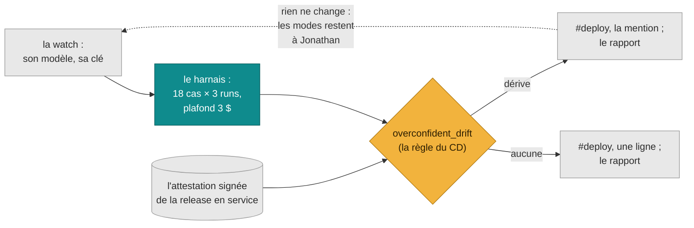

Ce qu'elle fait d'une dérive : elle la dit (une ligne dans `#deploy`, avec la mention, les cas qui ont
bougé ; le rapport dans `~/.glorfindel/harness-probe/`), et rien d'autre. La watch continue comme
avant ; changer un mode, retirer une autonomie, changer de modèle restent des décisions de Jonathan
(décision du 23/11). C'est la leçon d'Eregion appliquée au fournisseur : la sûreté ne se délègue pas à
la confiance du modèle, ni à la promesse qu'il ne changera pas. On le mesure, on le dit, un humain
décide.

---

## 9. Ce qui part chez le fournisseur, et le modèle de menace

| Usage | Ce qui part |
|---|---|
| La décision | la ligne de la détection (extraits de journaux, nom et identifiant de la VM, adresses, comptes, processus), l'enquête, l'incident, trois cycles passés, l'état d'isolation |
| L'écriture d'une règle | la technique, les colonnes de la table, la requête qui a manqué, les actions prises, des résumés de cycles |
| Le planificateur | le menu du catalogue et l'objectif |
| IA0, IA1 | les faits de la campagne, dont le raisonnement de Glorfindel |

**Ce qui ne part jamais** : une détection du plan de contrôle ou d'une identité (aucun appel, aucun nom
d'utilisateur ne sort : `agent.py:1064-1065`, `agent.py:1131-1132`) ; le magasin de la mémoire et son
embedding, locaux (les résumés des cycles rendus, eux, partent : voir le tableau ci-dessus). Aucune
donnée d'un client n'entraîne un modèle (`CLAUDE.md`, « Ce qu'on ne fait PAS »).
Un client qui ne veut rien envoyer prend un modèle local (`ollama/…`, §7.1).

**L'injection par les journaux.** Une ligne écrite par un attaquant peut se faire passer pour une
consigne. Ce qui la tient : le modèle ne décide pas seul (les gardes, le mode, `human_only` par défaut,
§2.3) ; un flot de lignes forgées ne peut pas affamer les vraies détections : le plafond de la watch le
borne avant tout appel (§2.5) ; les prompts de l'analyse disent que le contenu des runs est une donnée (`campaign_report.py:119-121`,
`triage.py:482`), et la vérification écarte ce que les faits ne soutiennent pas ; le harnais mesure les
cas plantés (§8.1). Les menaces et ce qui reste ouvert :
[`design/modele-de-menace.md`](design/modele-de-menace.md), §4.

---

## 10. Vers la 0.7 : l'enquête raisonnée

La direction du 22/11 et les réponses de Jonathan du 23/11 sont écrites dans
[`design/enquete-raisonnee.md`](design/enquete-raisonnee.md) (ENQ1, ENQ1b). ENQ2 en a posé la
première pierre : le catalogue fermé des lectures et leurs sept états (`glorfindel/enquiry/catalog.py`),
sans rien changer de ce que voit le modèle. ENQ3 a posé la base et sa première fiche, T1486, lues par
personne encore (§10.1). ENQ4 a posé la boucle, au harnais seulement (§10.2). ENQ5a a servi les trois
lectures qui jugent un rançongiciel, au harnais seulement, et la capture au banc (§10.3). Le reste n'est
pas codé.

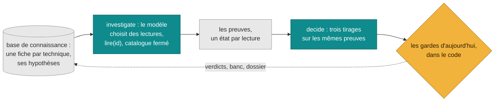

- `investigate` devient un raisonnement du modèle, qui choisit des lectures dans un catalogue fermé,
  jamais une requête ; le code remplit la VM et les valeurs.
- La base évolue, pondérée par source ; une leçon qui relâche attend un humain.
- **La base n'est jamais une garde** : les gardes de `decide` restent du code, dans le même ordre.
- **Les neuf questions tranchées le 23/11** (`enquete-raisonnee.md` §14) :
  - une enquête et trois tirages sur ses preuves, plus **la mémoire de l'enquête par objet** (la même
    VM, la même règle) : le modèle voit ce que la précédente a lu et le verdict humain ; le passé ne
    remplace jamais une lecture du jour, et « comme d'habitude » ne vaut « bénin » que sur un verdict
    humain, jamais sur une technique grave (§5.5) ;
  - 4 lectures en 30 s, gardées le 24/11 après la séance, recalées au run de bout en bout d'ENQ5 (§10.2) ;
    les tours se réservent dans la porte (PRT1),
    redimensionnée par PRT2 (fait, #1160) ;
  - une leçon qui relâche passe par une PR si elle est générale, par la couche du client acceptée sur
    une carte, étroite et datée, si elle est propre à l'environnement ;
  - sur une technique grave, une décision qui ne contient pas fait une carte qui propose d'isoler,
    sans dispense en v1 ; la base ne lève jamais un plafond ;
  - le verdict par hypothèse sur la console et sur Discord ;
  - les lectures nouvelles (le coffre, l'écriture par processus, les renommages) mesurées au banc
    d'abord, chacune dans son lot, avant d'entrer au catalogue ;
  - la séance de harnais en matrice complète (six configurations), qui mesure aussi la latence d'un
    tour et le coût d'un appel ; tenue le 24/11 (§6, §10.2).
- **Les décisions voisines** (`enquete-raisonnee.md` §15) : la porte des appels en dollars, deux
  enveloppes (le réel, les exercices) et trois seaux (PRT2) ; le disjoncteur des actions disruptives
  (DJA1) ; le seuil de confiance appris par action sur les verdicts, jamais sur la confiance (CAL1).
- Les lots ENQ2 à ENQ6, MEM2 et MEM-H mettent ce document à jour (`enquete-raisonnee.md` §13).

### 10.1 La base et la fiche T1486 (ENQ3) : codées, lues par personne

**Ce que le modèle ne voit pas encore : rien de la base.** Ni la watch, ni le graphe, ni `investigate`
n'importent `glorfindel/enquiry/knowledge.py` ni le magasin (`tests/unit/test_enquiry_knowledge.py`) ;
le prompt, le message, le few-shot et l'outil de décision n'ont pas bougé d'un octet (les empreintes
d'ENQ2 inchangées). La boucle d'ENQ4 la lit au harnais seulement (§10.2) ; ENQ5 la montrera au modèle en
production, derrière un interrupteur et après le run de bout en bout de Jonathan.

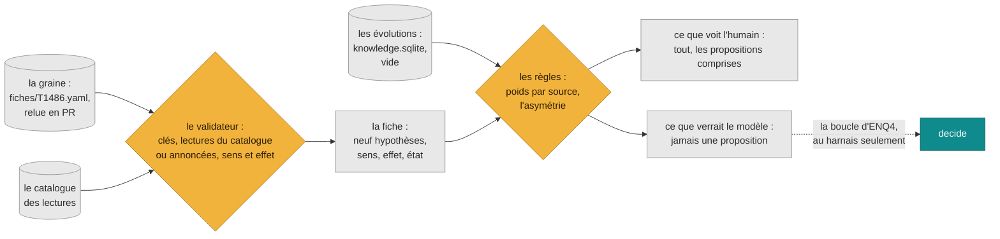

- **La fiche** (`enquete-raisonnee.md` §2.3) : la technique, les règles qu'elle enquête
  (`ransomware-disk-write`), `grave` (le miroir de `GRAVE_TTPS`, refusé s'il le contredit), trois
  lectures obligatoires et neuf hypothèses. Chacune a son énoncé, son `sens` (confirme, infirme,
  aucun), son `effet` (resserre, relâche, aucun, qui doit suivre le sens), ses lectures, un prédicat
  facultatif (du texte ; la boucle d'ENQ4 dit inconnu tant qu'aucun code ne le calcule, §10.2), ses sources, son état et sa limite.
  `heartbeat_gap`, `root_commands` et, depuis ENQ5a, **les trois lectures obligatoires de T1486**
  (`perf_minute_series`, `vault_jobs`, `vault_activity`, §10.3) sont au catalogue ; les sept autres
  lectures de la fiche sont **annoncées** (`ANNONCEES`, `knowledge.py:73`) : celles du dossier (§4.3) et
  les nouvelles (§4.4), qui entreront une à une, mesurées (Q8). Une lecture annoncée ne tourne nulle
  part : la boucle la dit « non servie » (le marqueur `Reading.servie`, ENQ5a), jamais « vide », une
  absence qu'aucune source ne garantit, jamais confondue avec un `sans_objet`.
- **Ses sources** : le banc (DOS8, le 12/11), un verdict (l'isolement de bree jugé à tort, le 11/11),
  les mesures écrites d'une règle, le code, et des sources externes (ATT&CK, Microsoft Learn). Le modèle
  n'est jamais une source de la graine : une hypothèse qu'il écrit est `proposee`.
- **Les poids** (`poids`, `knowledge.py:340`) : le banc 1,0 ; un verdict humain 0,8 ; le dossier 0,5
  pour un fait de la plateforme ou de Glorfindel, 0,2 pour un fait de l'invité ou d'un auteur inconnu ;
  le modèle 0,1. Le poids est toujours tiré de la source, jamais relu du magasin.
- **L'asymétrie** (`appliquee`, `knowledge.py:371`) : ce qui resserre s'applique seul ; ce qui relâche
  (un crédit donné à une hypothèse qui relâche, ou retiré à une qui resserre) attend un accord humain,
  et reste en attente sur la carte sinon. Un état ne change que par le banc ou un verdict humain
  (`SOURCES_D_ETAT`, `knowledge.py:314`) : `contestee` quand leurs contradictions atteignent 0,8,
  `mesuree` sur une confirmation du banc, pour une hypothèse qui resserre seulement. Le dossier compte,
  le modèle ne compte pas ; ni l'un ni l'autre ne change un état. `sens` et `effet` ne s'apprennent
  jamais : une leçon qui demande de les changer attend une PR (`evoluer`, `knowledge.py:397`).
- **Une hypothèse proposée n'est jamais montrée au modèle** (`vue_modele`) : elle va à l'humain seul,
  sans sens ni effet, que seule une PR lui donne. Une hypothèse retirée non plus. Des autres, le modèle
  ne lirait que l'énoncé de la graine, le sens, l'effet, l'état et les comptes (`VueModele`, construite
  champ par champ) : jamais une leçon, ni celles qui attendent un accord (une leçon du modèle et son
  texte libre comprises), ni celles qui attendent une PR.
- **La base ne lève jamais un plafond** (Q5) : une fiche n'a aucune clé pour cela, `lifted_by` y est
  refusé.

### 10.2 La boucle de l'enquête (ENQ4) : au harnais seulement

**Une boucle Python simple, pas un sous-graphe LangGraph** (décision de Jonathan du 23/11, la question C
de la revue 10) : `glorfindel/enquiry/loop.py`. Le graphe ne change pas ; le passage en sous-graphe se
rediscute après la séance de harnais, sur la mesure. **Rien de la production ne l'importe** : ni le
graphe, ni la watch, ni `investigate`, ni la CLI (`tests/unit/test_enquiry_loop.py`). Le prompt de
`decide`, son message, le few-shot et l'outil de décision n'ont pas bougé d'un octet (les empreintes
d'ENQ2).

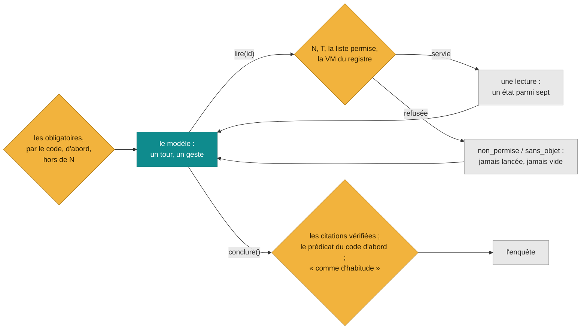

**Ce que voit le modèle** (`glorfindel/enquiry/message.py`, `enquete-raisonnee.md` §5.4). Son prompt à
lui, `ENQUIRY_PROMPT`, en anglais comme celui de `decide`, puis à chaque tour un message entier, sans
historique de conversation, dans l'ordre de la note : la détection ; la fiche (`vue_modele` : l'énoncé,
le sens, l'effet, l'état, les lectures, le genre et la date des sources, « calculée par le code » quand
l'hypothèse a un prédicat ; jamais la limite, jamais une hypothèse proposée) ; les lectures permises,
leur phrase et leur auteur, le budget restant (N et secondes) ; les lectures non servies ici, chacune
avec sa raison ; les lectures faites, chacune dans un bloc `<<< read <id> · state <état> · author
<auteur> · <n> line(s) >>>`, au plus 10 lignes numérotées, une ligne JSON chacune, chaque valeur bornée
à 200 caractères (aucun saut de ligne brut ne sort d'un bloc) ; puis la dernière enquête sur l'objet,
datée, sous un titre d'historique, avec ce que dit la règle 2 pour ce cas.

**Un outil, deux gestes.** `lire(id)` et `conclure()` sont les deux gestes d'un seul outil, `enquete` :
`completion_with_tool` force un outil par son nom (et repasse en `auto` sur un modèle qui refuse), un
seul outil est donc la forme que tout fournisseur du harnais sait rendre. `geste` vaut `lire` ou
`conclure` ; `id` est une énumération des lectures permises que le code construit à chaque tour (les
lectures déjà faites en sortent) ; au dernier tour, l'énumération ne tient plus que `conclure`. La
conclusion porte `hypotheses` (`id`, `verdict` parmi confirme, infirme, inconnu, `preuves` : `{lecture,
ligne}`), `comme_d_habitude` et `resume`. Aucun champ pour une VM, une valeur, une fenêtre ou une
requête ; ce que le modèle y ajoute est ignoré, et dit.

**Ce que le code tient** :
- **le budget N** (4, `Budget.n`) : chaque `lire` compte, un identifiant inconnu ou une lecture déjà
  faite comprise ; au-delà, `non_permise`, jamais lancée. Au plus N + 1 tours ; sans `conclure`,
  l'enquête finit au budget ;
- **le délai T** (30 s, `Budget.t`), **un vrai délai** sur une horloge monotone, pour toute l'enquête,
  tours du modèle compris : chaque lecture et chaque tour n'attendent que ce qui reste de T. Une lecture
  coupée par T est `echec` ; une lecture demandée une fois T passé est `non_permise` ; un modèle trop
  lent clôt l'enquête ;
- **ce que le code lit lui-même**, en parallèle avant le premier tour, hors de N (§5.2 de la note) : les
  obligatoires de la fiche ; **sans fiche, l'enquête de base**, l'aiguillage d'ENQ2 sur les colonnes de
  la ligne (`fixed.selection`). **Les trois obligatoires de T1486 sont servies depuis ENQ5a** (§10.3) ;
  une obligatoire encore annoncée porte le marqueur « non servie » (`Reading.servie` faux), jamais
  `vide` ni `non_permise` (c'est le code qui la demande), jamais un trou ;
- **les trous** (`Enquete.trous`, la garde de télémétrie G2) : seules les lectures que le code a lui-même
  demandées, en `echec` ou `refusee`, et (ENQ5a, §7.2 de la note) une obligatoire encore `en_attente`.
  **Jamais une lecture demandée par le modèle**, quel que soit son
  état : une ligne qui lui fait demander une lecture qui échoue, ou que le code ne sait pas remplir, ne
  retient jamais la contention (§5.1, §7.2 de la note) ;
- **la liste permise** : les lectures de la fiche que le catalogue sert sous ce système, et dont le code
  sait remplir les paramètres (sous Linux, pour T1486 : `heartbeat_gap` et `root_commands`) ; sans
  fiche, toute lecture du catalogue qui lit sous ce système (ENQ5a : les trois lectures du rançongiciel
  s'y ajoutent, sous Linux comme sous Windows). Une lecture annoncée demandée est
  `non_permise`, une lecture de la fiche sans objet sous ce système `sans_objet`, une lecture dont la
  ligne ne donne pas la valeur (`successful_auth_from_ip` sans adresse source) n'est pas offerte, et
  `refusee` si elle est demandée quand même, notée, jamais un trou ; un identifiant hors de la liste est
  `non_permise` : aucune n'est lancée ;
- **la VM** est celle du registre, chaque valeur de la ligne vérifiée par son paramètre
  (`catalog.PARAMS`) ; une détection non attribuée ne lit rien (`refusee`) ;
- **les citations** (§6.3 de la note) : l'hypothèse est dans la fiche ; chaque preuve est une lecture de
  l'hypothèse, faite aujourd'hui, en `lignes` (une ligne montrée, par son numéro : la preuve gardée est
  la ligne lue, jamais le texte du modèle) ou en `vide` (l'absence). **Une seule preuve qui ne tient
  pas rend toute l'hypothèse `inconnu`**, quelles que soient les autres (une ligne citée sans avoir été
  lue est une invention : le verdict qu'elle porte n'est pas pris) ; le prompt le dit. Ce que le modèle
  ajoute à sa conclusion, à une hypothèse ou à une preuve est ignoré, et noté. Une hypothèse à prédicat
  prend le verdict du code : **ceux de T1486-H1 et H2 sont codés depuis ENQ5a** (§10.3), calculés sur
  chaque enquête, citée ou non (`Enquete.verdicts_code`), et montrés au modèle dans la fiche (« now:
  … ») ; un désaccord est noté ; un test exige le prédicat le jour où ses lectures entrent au catalogue ;
- **la mémoire par objet** (`glorfindel/enquiry/reference.py`, §5.5 de la note) : la dernière enquête
  sur la même VM et la même règle (sa date, ses lectures bornées, la décision, le verdict humain), au
  plus 30 jours (gardés par Jonathan le 24/11, à revoir sur les verdicts en production). Elle vient après les lectures du
  jour, ne comble jamais une lecture du jour, ne répond jamais à une citation, ne ferme aucun trou
  (règle 1). « Comme d'habitude » n'est reçu que sur un verdict humain « bénin », jamais sur une
  technique grave (règle 2) ; refusé, il est dit.

**Au harnais** (`scripts/harness_enquete.py`, [`operations.md`](operations.md), « Le harnais de
l'enquête ») : les cas de la note (§9.2) que le catalogue sait servir, sur des lectures enregistrées ;
puis `decide` d'aujourd'hui sur ce que la boucle a lu **avec succès, ou d'office** (`Enquete.contexte` :
les lectures que le code a lancées, sauf une lecture demandée par le modèle qui a échoué ou que T a
coupée ; jamais une lecture non servie, que son message dirait « aucun résultat »). Une lecture d'office
en échec y reste, et reste un trou (ses `telemetry_gaps` sont les trous ci-dessus, G2) : aucune absence
qu'aucune source ne garantit n'arrive à `decide`. Son message est inchangé. Le compteur de HRN1
range chaque tour de la boucle en rôle `enquiry` : la latence d'un tour (médiane, p95, max) et le coût
d'un appel. La commande ne joue que **C4** de la matrice (la boucle, sans précédents) ; C5 et C6, la
boucle sous les clés et sous la distance, se jouent avec `ENQUETE=1 PRECEDENTS=1` (MEM-H, §8.1). Le genre reste **hors de l'attestation jusqu'à ENQ5**. **La séance est
plafonnée** par le `Budget` de HRN2 (`scripts/harness_meter.py`) : `--max-usd` (3 $ par défaut avec
`make llm-compare … ENQUETE=1`, au-dessus de l'estimation d'un passage, 1 à 2,5 $) et `--max-calls`
(par défaut cas × runs × (N + 1 tours + les tirages), 240), vérifiés avant chaque appel, un tour de la
boucle comme un appel de `decide` ; un coût inconnu compte comme un dépassement possible. Atteint, la
séance s'arrête et sort en code 3 ([`operations.md`](operations.md), « Le harnais de l'enquête »).

**Deux passages à la séance.** Un tour coupé par T n'a pas de latence : il sort des statistiques, et le
p95 d'un passage à T = 30 s est sous-estimé. La vraie mesure du dépassement est la **part des fins
`delai`** de ce passage ; un second passage à `ENQ_T=120` mesure la latence d'un tour sans coupure, qui
recale N et T.

**Ce que la séance a mesuré** (Jonathan, le 24/11, sur la v0.6.6 et `anthropic/claude-sonnet-5-5`,
3 runs, les lectures rejouées à 1 s chacune). Le passage 2 est la boucle sous les trois mémoires, à
T = 30 s (C4, C5, C6, §6) ; le passage 3 est C4 seul, à `ENQ_T=120`.

| Passage | Enquêtes | Bonnes décisions | Durée d'une enquête | Au-delà de T | Fins | Un tour | Hypothèses rendues, vérifiées |
|---|---|---|---|---|---|---|---|
| 2. T = 30 s, trois mémoires | 90 | 24, 27, 27 sur 30 | 12 s en médiane, 15 s au plus | 0/90 | 90 « conclue » | 1,7 s en médiane, 7,5 s au p95 | 184, 189, 182 ; 0 |
| 3. T = 120 s, sans mémoire | 30 | 24/30 | 12,8 s en médiane, 17,2 s au plus | 0/30 | 30 « conclue », en 3 tours le plus souvent (21 sur 30) | 2,0 s en médiane, 7,7 s au p95 | 189 ; 0 |

**Les citations sont à 0 sous les trois mémoires.** Toutes les hypothèses sont rendues « inconnu »,
sans preuve. Trois lectures de la fiche du rançongiciel ne sont pas servies (`perf_minute_series`,
`vault_jobs`, `vault_activity`, « sans_objet ») et aucun prédicat n'est codé. Le modèle ne choisit que
1 à 3 lectures : `heartbeat_gap` et `root_commands`, plus `disk_write_after_escalation` sur la force
brute. **La séance mesure donc `decide` et la mémoire, pas encore la valeur de l'enquête.**

**Le coût** : environ 7,30 $ pour la séance (1,23 $ pour 121 appels au passage 1, 4,63 $ pour 424 au passage 2,
1,44 $ pour 141 au passage 3), environ 0,011 $ l'appel. Une décision avec enquête coûte environ
0,05 $ : environ 0,012 $ pour l'appel de `decide` (24 %), 0,033 $ pour les tours de l'enquête (63 %) et
0,007 $ pour les tirages (13 %). Ces chiffres dimensionnent PRT2.

**Ce que Jonathan a décidé le 24/11, après la séance** (Q2, EH2) :
- **T = 30 s, qui compte le tout** (les lectures et les tours du modèle), **et N = 4**, tels que le code
  les tient. On les recale au run de bout en bout d'ENQ5, sur les vraies lectures KQL : le maximum
  mesuré (17 s) vaut pour une enquête presque vide, aux lectures de 1 s. Au pire, 5 tours à 7,7 s font
  38,5 s, avant même les lectures ;
- **la borne d'âge de la mémoire par objet reste à 30 jours**. On la revoit quand les verdicts en
  production diront combien de temps un « bénin » reste vrai.

**ENQ5 en deux lots** (décision de Jonathan, le 24/11) :
- **ENQ5a sert les lectures**, au harnais seulement, sur des lectures capturées au banc :
  `perf_minute_series` par un lecteur KQL ancré sur l'heure du signal, `vault_jobs` et
  `vault_activity`. Puis une courte séance, de 2 à 5 $ ;
- **ENQ5b branche l'enquête en production**, derrière `GLORFINDEL_ENQUIRY`, puis le run de bout en
  bout. MEM2b passe avant lui (§6).

### 10.3 Les lectures du rançongiciel (ENQ5a) : servies au harnais, capturées au banc

**Pourquoi** : à la séance du 24/11, les trois obligatoires de T1486 étaient non servies ; aucune
citation n'a passé (0/184), aucun prédicat ne s'est calculé : la séance a mesuré `decide` et la
mémoire, pas l'enquête. Le détail : `enquete-raisonnee.md` §9.6. **Rien de la production ne change** :
ni la watch, ni le graphe, ni `investigate`, ni le message, le prompt ou l'outil de `decide` ; le lecteur
et les prédicats sont du labo, comme la boucle (`tests/unit/test_enquiry_loop.py`).

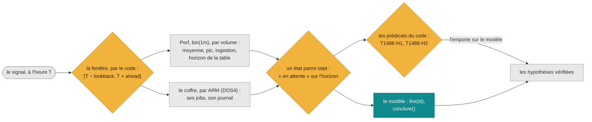

- **Le lecteur de la boucle** (`glorfindel/enquiry/lecteur.py`) : chaque lecture sur sa fenêtre ancrée
  sur l'heure du signal, par le code. Une requête d'`investigate` garde son texte pour `investigate` ;
  pour la boucle, son `ago()` devient une fenêtre `between (datetime(…) .. datetime(…))`, et une requête
  qu'on ne sait pas ancrer n'est jamais lancée. Le modèle donne un identifiant, jamais une requête, une
  VM, un coffre ni une fenêtre ; la VM vient du registre, le coffre de la configuration.
- **Ce que la source a ingéré** (EH10) : `perf_minute_series` rend l'horizon de la table pour la VM et
  l'heure d'ingestion de chaque minute ; une réponse vide reste `en_attente` tant que l'horizon n'a pas
  passé la fin de la fenêtre (`catalog.outcome`, `ingere`), au lieu de s'en remettre à la latence
  déclarée (45 s), qu'un retard de 25 minutes (bree, 11/11) dépassait. Une ligne `Horizon` nulle dit
  « rien d'ingéré » ; une lecture qui sait dire son ingestion et ne l'a pas dite n'est jamais `vide`.
  L'horizon lit le même compteur que la série : une VM qui envoie son CPU sans son disque n'en a pas.
- **Les prédicats** (`glorfindel/enquiry/predicats.py`) : H1 confirme sur une minute réglée de moyenne
  ≥ 25 Mo/s, infirme sur la minute du premier franchissement (calculé comme la règle livrée : sur un pas fin, la
  moyenne de deux échantillons au-delà de 45 Mo/s ; sinon un échantillon au-delà de 25) et la suivante, réglées, < 15 sur chaque volume ; H2
  confirme sur H1 infirmée et un job `Backup` parti dans les 5 min avant le premier pic, infirme sur H1
  confirmée ou des jobs lus en entier sans un tel job. **Limite connue** : au moment de décider, H1 est
  souvent `en_attente` (ses deux minutes ne sont pas réglées) et H2 `inconnu` ; ils se tranchent après
  coup, pour l'humain. Et « H1 infirmée » lit `Perf`, que l'invité écrit : un chiffrement bridé sous
  15 Mo/s à l'heure de la sauvegarde confirme H2 (le cas 3b) — elle aide l'humain, elle ne lève jamais
  une garde.
- **Le système de la VM** : reçu de l'appelant ; inconnu, une lecture qui en dépend n'est jamais lancée
  et dit `sans_objet`, jamais `vide`. Les trois lectures de T1486 n'en dépendent pas. Proposé pour
  ENQ5b : `osType` du disque OS du modèle de la VM (la plateforme), lu par la découverte.
- **La capture au banc** (`scripts/capture_enquete.py`) et **le harnais sur les captures**
  (`CAPTURES=`) : [`operations.md`](operations.md), « La capture d'un épisode au banc » et « Le harnais
  de l'enquête ». Une capture rejouée au moment de la décision ne montre que ce qui était ingéré alors.

---

## 11. Comment ce document vit

Un lot qui change ce qu'un modèle lit, rend, ou ce que le code vérifie derrière lui, met à jour la
section concernée et ses schémas, puis refait les numéros de ligne au commit de sa base. Le reste de ce
qui est dit ici vit dans les documents liés en tête : ce document les relie, il ne les remplace pas.
