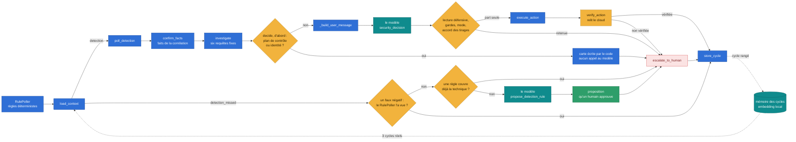
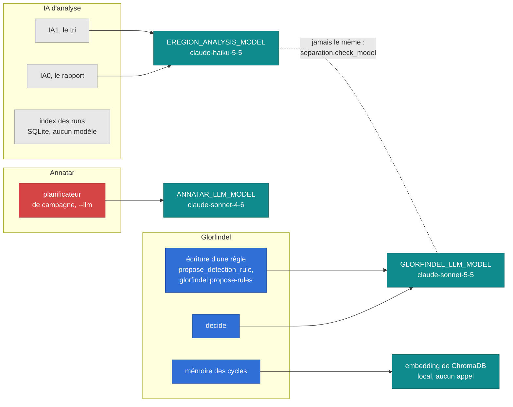
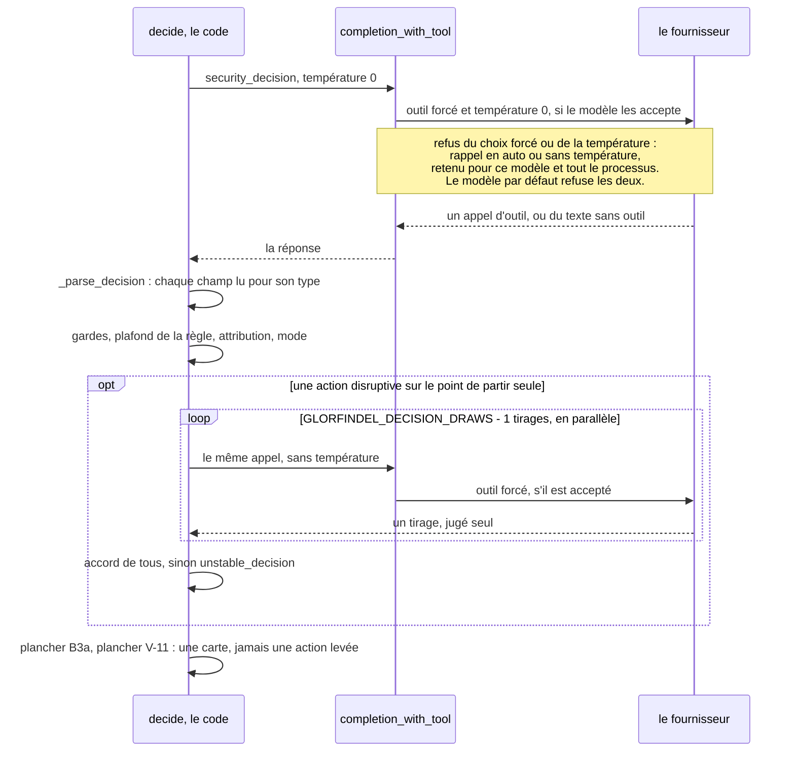
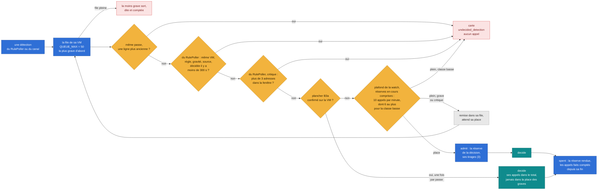
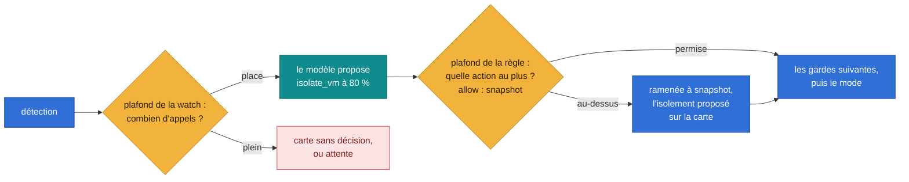
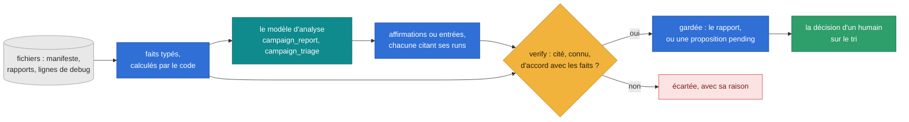
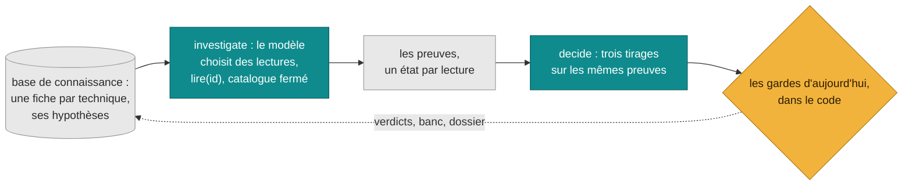

# Le raisonnement et le modèle dans Eregion

_Référence — 22/11 (RAI1, #1045). La carte d'ensemble : où un modèle intervient, sur quoi il raisonne,
ce qu'il rend, ce que le code vérifie derrière lui, avec quels modèles, et comment on le mesure. Elle
renvoie au détail, sans le recopier. Elle est tenue à jour par chaque lot qui change ce qu'un modèle lit
ou rend, à commencer par ENQ2 à ENQ6, MEM2 et MEM-H (§10)._

**Règle de lecture.** Chaque fait sur le code cite son `fichier:ligne`, au commit de base `a815a927`.
Un numéro de ligne vieillit : à chaque mise à jour, on relit le code et on refait les numéros. Les
schémas sont en Mermaid, avec le code couleur d'[`architecture.md`](architecture.md) (bleu = code de
Glorfindel, ambre = garde, vert = humain ou succès, rose = escalade, gris = données, rouge = Annatar),
plus une couleur à part : **sarcelle = un modèle** (un LLM, ou le modèle d'embedding de la mémoire).

**Lié** : [`glorfindel.md`](glorfindel.md) (le graphe, les gardes de `decide`, les modes) ;
[`architecture.md`](architecture.md) (« La place du modèle », « Les gardes qui encadrent le LLM ») ;
[`analysis.md`](analysis.md) (IA0, IA1) ; [`operations.md`](operations.md) (le harnais, le verrou) ;
[`observation.md`](observation.md) (la calibration en production) ;
[`design/memoire.md`](design/memoire.md) (MEM1) ;
[`design/dossier-isolation.md`](design/dossier-isolation.md) (DOS2, la décision notée) ;
[`design/enquete-raisonnee.md`](design/enquete-raisonnee.md) (ENQ1, la 0.7) ;
[`design/modele-de-menace.md`](design/modele-de-menace.md) (§4, le fournisseur du modèle).

---

## 0. En bref

- **Un modèle propose, le code décide.** Quatre endroits appellent un LLM : la décision de Glorfindel
  (`decide`), l'écriture d'une règle, le planificateur de campagne d'Annatar (facultatif) et l'IA
  d'analyse (le rapport IA0, le tri IA1). Chacun rend un appel d'outil à schéma fixe ; le code le lit
  défensivement, puis le juge. Aucun ne détecte, n'agit, ni ne vérifie (§1).
- **La mémoire n'a pas de LLM.** Elle range les cycles dans ChromaDB, sous un modèle d'embedding
  local ; le texte cherché n'est qu'un gabarit, et MEM1 a mesuré que la distance ne fait pas mieux que
  la date (§6).
- **Ce qui reste au code** : la détection, la corrélation, l'enquête d'aujourd'hui (six requêtes
  fixes), la décision sur le plan de contrôle et sur une identité, les actions, la vérification, les
  gardes et le routage (§1.3).
- **Avant l'appel, le plafond de la watch**, une borne qui tient (PRT1) : dix appels au modèle par
  minute pour toute la watch, dont six au plus pour les détections basses ; chaque décision réserve à
  son admission tous les tirages qu'elle peut faire et rend ceux qu'elle n'a pas faits ; les graves
  gardent toujours quatre places ; seul le plancher B3a passe au-delà.
  Au-delà, une détection basse est une carte sans décision, une grave attend sa place. À ne pas confondre avec le **plafond de la règle**,
  qui borne l'action après la réponse (§2.5, §2.6).
- **Trois modèles par défaut, un seul endroit** (`eregion_core/models.py`), tous appelés par LiteLLM et
  par une seule fonction (`eregion_core/llm_call.py`) qui force l'outil quand le modèle l'accepte. Le
  modèle par défaut de Glorfindel refuse le choix forcé comme la température : ses décisions partent
  en `auto`, et une réponse sans outil devient une escalade. Le modèle de l'analyse n'est jamais celui
  de Glorfindel (§7).
- **Ce que voit le modèle de la décision ne change pas sans un run de bout en bout** (la règle de
  `CLAUDE.md`), sauf un changement de la source du prompt ou de l'outil dont le rendu reste identique
  à l'octet, figé par un test (la dispense d'IR1a, §2.4).
- **La mesure** : le harnais (`make llm-compare`) note l'intégration, le jugement et les erreurs
  surconfiantes ; il atteste chaque verrou de dépendances pour le CD d'Imladris (anciennement H0) ; le
  rapport d'observation mesure la calibration sur les cartes jugées (§8).
- **Vers la 0.7**, l'enquête devient un raisonnement du modèle sur une base qui apprend, sans que la base
  devienne jamais une garde (§10).

---

## 1. Où le modèle intervient, et où il n'intervient pas

### 1.1 La chaîne de Glorfindel : le code et le modèle

Le graphe est construit dans `_build_graph` (`glorfindel/agent.py:3438`). Deux nœuds seulement
appellent un LLM : `decide` (`agent.py:2003-2217`) et `propose_detection_rule` (`agent.py:3212`). La
mémoire entre par `load_context`, qui demande trois cycles semblables (`agent.py:296-297`).

- `decide` sort avant tout appel sur une détection d'identité ou du plan de contrôle
  (`agent.py:2047-2050`) : leur carte est écrite par le code (`_identity_decision`, `agent.py:1302` ;
  `_control_plane_decision`, `agent.py:1237`).
- Sur une détection manquée, le nœud écarte d'abord un faux négatif (`agent.py:3239`), qui va droit à
  `store_cycle` (`agent.py:3393-3395`), et une technique déjà couverte par une règle (`agent.py:3286`),
  avant d'appeler le modèle.
- Une action dont l'effet n'est pas vérifié sur le cloud part en carte (`_route_after_verify`,
  `agent.py:3398-3404`).
- Toute exception d'un cycle finit en carte `cycle_failed`, jamais en action (`agent.py:3566`,
  `record_cycle_failure`, `agent.py:3569`).

### 1.2 Les modèles, par composant

| Usage | Où | Outil rendu | Modèle par défaut | Ce que le code fait derrière |
|---|---|---|---|---|
| La décision | `glorfindel/agent.py:2003` | `security_decision` (`agent.py:104-170`) | `DEFAULT_LLM_MODEL` | lecture défensive, gardes, mode, accord des tirages (§2.3) |
| L'écriture d'une règle | `glorfindel/detection_authoring.py:339` | `propose_detection_rule` (`detection_authoring.py:165`) | le même | une proposition, jugée routable, approuvée par un humain (§3) |
| Le plan d'une campagne | `annatar/campaign/planner.py:125` | `campaign_plan` (`planner.py:51-82`) | `DEFAULT_ANNATAR_MODEL` | filtre au catalogue, ordre et budget fixés par le code (§4) |
| Le rapport IA0 | `analysis/campaign_report.py:1153` | `campaign_report` (`campaign_report.py:68-94`) | `DEFAULT_ANALYSIS_MODEL` | chaque affirmation vérifiée contre les runs qu'elle cite (§5) |
| Le tri IA1 | `analysis/triage.py:504` | `campaign_triage` (`triage.py:435-462`) | le même | chaque entrée vérifiée, toute proposition `pending` (§5) |
| La mémoire | `glorfindel/memory.py:66-70` | aucun | l'embedding par défaut de ChromaDB | filtres de source, d'âge et de VM (§6) |
| L'index de l'IA d'analyse | `analysis/run_index.py:1-8` | aucun | aucun : une table SQLite, lue par clés (MEM3) | jamais la mémoire de Glorfindel (§5) |

Gothmog, Orodruin, la console et le bot n'appellent aucun modèle. La console affiche seulement le nom
du modèle de Glorfindel (`eregion_console/api.py:1088-1090`).

### 1.3 Ce qui reste au code

- **La détection** : le RulePoller lance les règles, en continu (`glorfindel/detection_rules.py:1738`).
  Aucun modèle sur ce chemin : une règle écrite par un modèle n'y entre qu'approuvée
  (`detection_authoring.py:19-22`).
- **La corrélation** : un brute force et la connexion qui le suit, un sudo et la session qui le porte,
  liés dans le RulePoller, « jamais dans le prompt, jamais par la confiance du modèle »
  (`glorfindel/correlation.py:1-7` ; [`design/correlation.md`](design/correlation.md)).
- **L'enquête d'aujourd'hui** : six requêtes fixes, choisies par le code sur les colonnes de la ligne,
  bornées à la VM du registre (`investigate`, `agent.py:647-782`). Le modèle ne peut demander aucune
  lecture : son seul outil est la décision (ENQ1 §1.1).
- **Le plan de contrôle et l'identité** : la carte est écrite par le code, sans enquête, sans appel et
  sans action recommandée (`agent.py:1240-1245`, `agent.py:1305-1311`).
- **Les actions** : une liste fermée et réversible (`AUTONOMOUS_ACTIONS`,
  `glorfindel/response/policy.py:10-17`) ; le reste demande un humain (`policy.py:35-46`), quelle que
  soit la confiance.
- **La vérification** : `verify_action` relit l'état du cloud après l'action (`agent.py:2635`).
- **Le routage** : une décision escaladée, une action qui demande un humain ou une action inconnue
  partent en carte (`_route_after_decide`, `agent.py:3413-3425`).
- **Chez Annatar et dans l'analyse** : la matérialisation d'un scénario (`annatar/campaign/synthesizer.py:1-5`),
  les faits d'une campagne et ses comptes (`analysis/campaign_report.py:6-8`), les éléments du tri et
  leurs causes (`analysis/triage.py:8-27`).

---

## 2. La décision de Glorfindel (`decide`)

### 2.1 Ce qu'elle lit

Deux messages (`agent.py:2096-2113`) :

- **Le prompt système**, `_SYSTEM_PROMPT` (`agent.py:172-242`) : la frontière d'autonomie, la façon de
  raisonner (ce qui est arrivé, ce que fait l'action, l'action minimale), les types d'événements, l'usage
  des cycles passés, puis les exemples. Il est mis en cache chez le fournisseur
  (`cache_control`, `agent.py:2103`).
- **Les exemples**, à la fin du prompt : six chaînes de raisonnement (`glorfindel/few_shot_examples.yaml:6-60`), mises en
  forme au chargement (`_load_few_shot_examples`, `agent.py:30-63`).
- **Le message**, `_build_user_message` (`agent.py:3641-3747`), en Markdown :
  - le signal entier, en JSON ;
  - l'indicateur principal normalisé ;
  - le contexte de l'enquête : une requête vide s'écrit « aucun résultat » ;
  - l'incident en cours sur la ressource ;
  - **l'état actuel de la VM**, lu dans les fichiers d'état, « source de vérité » (`agent.py:3711`, `:3717`) ;
  - les cycles passés, chacun avec sa source, `[RÉEL]` ou `[EXERCICE]` (`agent.py:3638`,
    `agent.py:3736-3742`), donnés comme historique, jamais comme état.

Ce que le modèle ne voit jamais : les requêtes en échec (`telemetry_gaps`, gardées hors du signal,
`investigate`, `agent.py:652-657`), si le signal courant est un exercice, le plan d'une carte
d'identité, et les champs de la ligne du cycle (§7.4).

### 2.2 Ce qu'elle rend

Un appel de l'outil `security_decision` (`agent.py:104-170`), huit champs requis : `reasoning`,
`confidence`, `action`, `reversible`, `explanation`, `escalate`, `escalation_reason`,
`suggested_steps`. La liste des actions qu'il annonce vient du code (`AUTONOMOUS_ACTIONS`,
`MODEL_GATED_ACTIONS`). Une action hors de ces listes est permise : elle part toujours en carte.

### 2.3 Ce que le code vérifie derrière

- **La lecture défensive** (`_parse_decision`, `agent.py:870-938`) : pas d'appel d'outil (possible dès
  que l'outil n'est plus forcé, le cas du modèle par défaut), des arguments
  illisibles, un booléen en texte, une confiance hors de [0, 1] ou qui n'est pas un nombre — jamais une
  exception, jamais une action. Une action illisible est une escalade. Seuls les champs du schéma sont
  gardés.
- **Les gardes, dans l'ordre du code** (`agent.py:2127-2141`) : la garde exécutable, la porte de
  confiance, le garde-fou du signal, la garde de télémétrie, la précondition de levée, le plafond de la
  règle, `never_block`, l'attribution, puis le mode d'autonomie. Ensuite l'accord des tirages
  (`agent.py:2143-2155`), puis les planchers (`agent.py:2157-2161`), qui proposent et n'exécutent
  jamais. Le détail de chaque garde : [`architecture.md`](architecture.md), « Les gardes qui encadrent
  le LLM », et [`glorfindel.md`](glorfindel.md).
- **Les tirages** : chaque tirage de confirmation passe la garde exécutable et la porte de confiance,
  comme le premier ; un appel en échec est un tirage qui n'accorde pas (`_confirming_draws`,
  `agent.py:1897-1922`). L'accord ne dépend pas de la confiance du premier tirage
  (`_apply_agreement_guard`, `agent.py:1925-1953`).
- **Un appel qui échoue**, après ses nouvelles tentatives, fait une carte `cycle_failed`
  (`agent.py:2114-2121`, `_decision_failed`, `agent.py:1975`).

### 2.4 Ce qui exige un run de bout en bout

- **La règle** (`CLAUDE.md`, Conventions) : un changement de `few_shot_examples.yaml`, de `_SYSTEM_PROMPT`
  ou de `_build_user_message()` attend un run de bout en bout sur T1486 et une autre technique, par
  Jonathan, avant la fusion. Les tests unitaires mockent le modèle : ils ne disent rien de ce qu'il en
  ferait.
- **La dispense d'IR1a** : un changement de la source du prompt ou du schéma de l'outil, dont le rendu
  reste identique à l'octet, se passe du run. Le test le fige par deux empreintes sha256
  (`tests/unit/test_identity_plan.py:153-163`). Elle ne vaut ni pour le message ni pour les exemples.
- **Ce que figent aussi les tests** : le message et le cycle de la mémoire, inchangés à l'octet par la
  ligne du cycle de DOS2 (`tests/unit/test_cycle_line.py:334`, `:350`) ; le prompt d'avant la puce de
  la clé de routage, pour le harnais des propositions (`tests/unit/test_detection_authoring.py:175`).
- **Ce qui n'en demande pas** : une garde, un plafond ou un mode qui change, quand ce que lit le modèle
  ne change pas. Ils se prouvent en tests et en mutants ([`design/preuves.md`](design/preuves.md)).

### 2.5 Avant l'appel : la file de décision et le plafond de la watch

Une détection n'appelle pas le modèle dès qu'elle arrive. Elle attend dans la file de sa VM, puis passe
une porte, `DecisionGate`, commune à toute la watch (`glorfindel/decision_queue.py:334`, créée une
fois par la watch, `glorfindel/watch/dispatch.py:35`, appelée avant chaque décision,
`dispatch.py:92-94`). Ces bornes viennent de SEC-A2 (#631), après l'audit du 06/11 : une ligne agrégée
par ses colonnes de texte fait une détection par valeur. Un compte local d'une VM surveillée qui écrit
vingt adresses nouvelles à chaque passe faisait ainsi **720 décisions par heure sur une seule VM**,
environ 2 160 appels au modèle, et une vraie détection de rançongiciel attendait des heures derrière
elles (`decision_queue.py:1-8`).

**Les trois classes** (`gravity`, `decision_queue.py:123`) : critique (une compromission que le
RulePoller a corrélée, COR1 : le mot de sa règle seule, jamais une ligne du canal `runs/`), grave (une
technique de `GRAVE_TTPS` : T1486, T1485, T1490, T1041, T1567, `decision_queue.py:92-95` — la donnée
est détruite ou s'en va), basse (le reste).

**Les bornes, toutes avant l'appel au modèle** (les constantes : `decision_queue.py:82-109`) :
- **`QUEUE_MAX` = 50** détections par file. Au-delà, la moins grave et la plus récente sort, avec sa
  carte, dite et comptée. Une détection grave ne sort jamais pour une autre : les non graves sortent
  d'abord, et une file pleine de graves refuse la nouvelle (`decision_queue.py:10-14`, `_enter`,
  `decision_queue.py:257-276`).
- **La plus grave d'abord** : critique, puis grave, puis basse, chaque classe dans son ordre d'arrivée
  (`decision_queue.py:15-20`).
- **`DEDUP_WINDOW_S` = 300 s**, pour les détections du RulePoller seulement (`decision_queue.py:449`) :
  une décision du modèle par VM, règle, gravité et source dans la
  fenêtre. Les autres détections de la fenêtre sont nommées sur une carte, sans appel. La fenêtre ne
  s'ouvre que sur une décision qui a contenu ou mis une carte devant un humain (`decision_queue.py:21-24`,
  `spent`, `decision_queue.py:486-506`).
- **`CRITICAL_ADDRESSES` = 3** adresses distinctes de la classe critique par VM dans la fenêtre, pour
  les détections du RulePoller seulement (`decision_queue.py:449-459`) :
  deux compromissions de deux adresses sont décidées toutes les deux, un flot d'adresses forgées ne
  l'est pas (`decision_queue.py:96-99`, `:365-376`).
- **Le plafond de la watch**, une borne qui tient depuis PRT1 (#1060) : **`MODEL_CALLS_PER_MIN` = 10**
  appels au modèle par minute, pour toute la watch ; la classe basse en prend au plus
  **`LOW_CALLS_PER_MIN` = 6** (`admit`, `decision_queue.py:434-484`, le calcul `:460-480` ; la règle,
  `decision_queue.py:33-53`). Avant PRT1, `admit` réservait un appel et les tirages de D-1 n'étaient
  comptés qu'après la décision : des fils de VM admis ensemble dépassaient la borne (cinq basses, 15
  appels pour 6 ; huit graves et deux basses, 30 appels dans la minute).
  - **La réserve** : une décision réserve, à son admission, tous les appels qu'elle peut faire
    (`reserve`, `decision_queue.py:393-402`) — `decision_draws` (3 par défaut), le premier tirage et
    ceux de confirmation, quel que soit le mode de la VM, lu dans `decide` après l'admission ; une
    proposition de règle, un appel. Elle est comptée tant que la décision est en cours, quelle que soit
    sa durée. Une réserve ne dépasse jamais la place de sa classe (6 pour la basse, 4 pour les
    graves) : une décision tient toujours dans une minute vide, et avec `GLORFINDEL_DECISION_DRAWS`
    au-dessus de 4, les tirages au-delà sont comptés après elle, comme avant.
  - **La réserve rendue** : à sa fin, la décision rend ce qu'elle n'a pas fait, et les appels faits
    comptent depuis sa fin, le côté sûr (`spent`, `decision_queue.py:486-506` ; `calls_made`,
    `decision_queue.py:175-188`). Un appel en `human_only`, en `non_disruptive` ou quand une garde a
    retenu l'action avant les tirages ; aucun quand le modèle n'a pas été atteint (`decision_model`
    absent : une identité ou le plan de contrôle lus en profondeur par `decide`). Ce qui ne se lit pas
    garde sa réserve : un appel qui échoue reste compté, un cycle échoué ou un graphe qui lève aussi
    (`decide_or_card`, `decision_queue.py:641-659`).
  - **À tout instant**, hors du plancher B3a, les appels comptés dans la minute glissante, réserves en cours comprises,
    restent sous dix, ceux de la classe basse sous six, et les graves et les critiques gardent leurs
    quatre places : une basse n'est admise que si sa réserve tient dans la place de la classe basse
    **et** dans le total ; une grave, si elle tient dans le total **ou** dans la place des graves. Le
    prix : la classe basse admet au plus deux décisions à trois tirages par minute, ou quatre d'un
    appel (une place de trois doit rester libre pour chacune).
  - Plafond atteint, une détection **basse** devient une carte `undecided_detection` (jamais une attaque
    que le monitoring a manquée, `detection_timeout` : elle attend, dans sa classe) : aucune action,
    aucune enquête, rien dans la mémoire (`record_undecided`, `decision_queue.py:571` ;
    `decision_queue.py:69-72`).
  - Plafond atteint, une détection **grave ou critique** n'est pas écartée : elle retourne dans sa
    file et attend sa place, le temps qu'un appel de la dernière minute vieillisse, ou au plus 5 s
    tant qu'une décision en cours peut rendre sa réserve (`room_in`, `decision_queue.py:404-411` ;
    `decide_or_card`, `decision_queue.py:641-659` ; `dispatch.py:95-97`). Sauf file pleine : elle en
    sort alors, dite et comptée (`dispatch.py:96`, `_enter`, `decision_queue.py:257-276`) — jamais
    une levée après un restore, protégée dans sa file comme une détection d'une technique grave
    (`protect`, `decision_queue.py:249`, `protected`, `:166-172`).
  - Le plancher B3a reste **le seul dépassement admis**, sur une détection seulement, comme celui de
    `decide` : sur une VM où un brute force a réussi puis root a été pris, sa détection passe, une fois
    par passe de sa règle ; une ligne du canal `runs/`, une fois par VM et par source dans la fenêtre
    (`_floor`, `decision_queue.py:413-432`). Ses appels sont comptés dans le total — la classe basse
    lui cède la place —, jamais dans la place des graves, qui gardent leurs quatre places
    (`_recent`, `decision_queue.py:382-391` ; `decision_queue.py:60-67`).
- **Ce qui appelle le modèle est compté** (`calls_model`, `MODEL_EVENTS`, `decision_queue.py:104-107`,
  `:146-149`) : une détection ; une attaque que le monitoring a manquée (`detection_timeout`, une ligne du
  canal `runs/` dont la décision préserve la VM), comptée et rangée dans la classe de sa technique,
  comme toute ligne du canal — jamais grave par son seul événement (SEC-E, V-08) — et jamais une
  carte : au-delà, elle attend, bornée par `CHANNEL_QUEUED_PER_VM` et `QUEUE_MAX` ; la levée après un
  restore vérifié (`recovery_complete`), comptée et rangée comme une grave quelle que soit sa
  technique (`call_class`, `decision_queue.py:152-163`) : jamais une carte, elle attend sa place ; et
  une proposition de règle (`detection_missed`, un
  exercice : comptée comme une basse ; au-delà, une carte « proposition de règle non faite
  (plafond) : relancer le scénario », avec ses étapes, `decision_queue.py:562-568` : rien ne la
  redemande). Une détection du plan de contrôle ou d'une identité est décidée par le code et ne
  compte pas (`decision_queue.py:71-72`).
- **`glorfindel respond`**, lancé à la main sur un fichier, ne passe pas par cette porte : seule la
  watch la crée (`dispatch.py:35`).

### 2.6 Le plafond de la watch n'est pas le plafond de la règle

Le même mot nomme deux choses qui n'ont rien en commun.

| | Le plafond de la watch (SEC-A2) | Le plafond de la règle (RDW1) |
|---|---|---|
| Ce qu'il borne | **combien** d'appels au modèle, par minute | **quelle action** une détection peut faire partir seule |
| Quand | **avant** l'appel, dans la file de décision | **après** la réponse, parmi les gardes de `decide` |
| Où | `glorfindel/decision_queue.py:82-109`, `DecisionGate.admit` | `glorfindel/rule_ceiling.py:1-30`, `_apply_rule_ceiling` (`agent.py:1770`), appelé `agent.py:2135` |
| Sa valeur | 10 appels par minute, 6 pour la classe basse | `ceiling.allow` de la règle : `[snapshot]` sur `ransomware-disk-write` (`glorfindel/rules/azure/detection_rules.yaml:65-68`) |
| Pourquoi | un flot de détections forgées affamait les vraies (audit du 06/11) | une sauvegarde écrit aussi vite qu'un chiffrement : le modèle a proposé `isolate_vm` à 80 % sur la panne bénigne du banc du 20/11 (`rule_ceiling.py:4-10`) |
| Ce qui en sort | une carte `undecided_detection` sans décision, ou une attente | l'action ramenée à l'instantané, l'isolement proposé à un humain sur la carte |

Un plafond de la règle se lève par un fait de la détection qu'elle nomme (`lifted_by`), vide pour
toute règle livrée (`rule_ceiling.py:20-23`). Le détail : [`glorfindel.md`](glorfindel.md), « Le
plafond par la règle ».

---

## 3. L'écriture d'une règle

Deux appelants partagent un seul appel (`glorfindel/detection_authoring.py:7-11`) : le nœud
`propose_detection_rule`, après une détection manquée (`agent.py:3311`), et
`glorfindel propose-rules`, pour une technique sans règle (`glorfindel/cli.py:2243`, `:2332`).

- **Ce qu'il lit** (`build_user_message`, `detection_authoring.py:273`) : l'entrée du catalogue de la
  technique, les vraies colonnes de la table (`getschema`, `detection_authoring.py:129-142`), la requête
  qui a manqué, les actions déjà prises sur la ressource, des résumés de cycles passés.
- **Le prompt** (`RULE_PROPOSAL_SYSTEM_PROMPT`, `detection_authoring.py:248-270`) : n'utiliser que les
  colonnes données, des seuils calibrés, et garder la clé de routage d'une table du plan des données
  (`ROUTING_KEY_INSTRUCTION`, `detection_authoring.py:233`).
- **Ce qu'il rend** : `propose_detection_rule` (`detection_authoring.py:165-220`), une analyse, un nom, la
  requête, un intervalle, une explication, une confiance. Une réponse sans outil lève
  (`_parse_proposal`, `detection_authoring.py:328-335`) : le cycle finit en carte.
- **Ce que le code vérifie** : la proposition est jugée à l'instant par le lecteur du chargement et de
  l'approbation (`proposed_rules.approval_refusal`, `glorfindel/proposed_rules.py:54` ;
  `agent.py:3331`). Une règle qui ne nomme pas sa VM est rangée « non approuvable ». Toute proposition
  attend un humain (`proposed_rules.approve`, `proposed_rules.py:156`) avant d'entrer dans le RulePoller.
- **La mesure** : `make llm-compare … PROPOSALS=1` (§8.2).
- **Le run de bout en bout** : aucun n'est exigé pour l'écriture d'une règle, qui ne fait que proposer.
  Le prompt d'avant la puce de la clé de routage est figé par empreinte
  (`tests/unit/test_detection_authoring.py:175`), et la mesure du harnais se joint à la PR qui change le
  prompt.

---

## 4. Le planificateur de campagne d'Annatar

Facultatif : `annatar campaign plan --llm` (`annatar/cli.py:398`, `use_llm=False` par défaut,
`annatar/campaign/planner.py:90`).

- **Ce qu'il lit** : le menu des techniques `implemented` du catalogue et l'objectif donné
  (`planner.py:138-145`).
- **Ce qu'il rend** : `campaign_plan`, une liste de techniques ordonnée (`planner.py:51-82`).
- **Ce que le code vérifie** : une technique hors du menu est retirée ; une réponse vide, sans outil ou
  qui échoue ramène l'ordre déterministe (`planner.py:98-106`, `planner.py:165-174`) ; l'ordre de la
  chaîne et le budget sont fixés par le code (`planner.py:108-110`). Le scénario est matérialisé sans
  modèle (`annatar/campaign/synthesizer.py:1-5`), et une technique destructive ne part pas sans
  `budget.allow_destructive`, lu dans le catalogue (`annatar/campaign/runner.py:204-208`).
- **Le run de bout en bout** : aucun n'est exigé ; le plan reste filtré et ordonné par le code.
- **Son modèle** : le sien, `claude-sonnet-4-6`, car le modèle par défaut de Glorfindel décline ce prompt
  (`eregion_core/models.py:20-24`).

---

## 5. L'IA d'analyse : le rapport (IA0) et le tri (IA1)

- **IA0, le rapport.** Les faits viennent des fichiers, jamais d'un modèle (`analysis/campaign_report.py:6-8`).
  Le modèle n'écrit que des affirmations typées, chacune citant des runs (`campaign_report.py:68-94`,
  `campaign_report.py:97-121`). `verify` (`campaign_report.py:1041`) écarte une affirmation sans
  citation, qui cite un run absent, que les faits contredisent, ou dont un nombre n'est pas dans les
  faits cités ; les écartées sont montrées, barrées, avec leur raison (`render`,
  `campaign_report.py:1211`).
- **IA1, le tri.** Ce qui est trié est calculé par le code (`items`, `analysis/triage.py:391`). Le
  modèle écrit une explication et une proposition d'un ensemble fermé par élément (`PROPOSALS`,
  `triage.py:94-100`). `verify` (`triage.py:544-577`) écarte une entrée que les faits ne soutiennent
  pas, ou qui porte une règle ; toute proposition gardée est écrite `pending` par le code.
- **La séparation.** Jamais le modèle de Glorfindel (`analysis/separation.py:44-54`), jamais sa mémoire :
  l'index des runs est une table SQLite à part, sans modèle (MEM3, `analysis/run_index.py:1-8` ;
  `campaign_report.py:588-596`).
- **Le run de bout en bout** : aucun n'est exigé pour l'analyse ; ses harnais la mesurent (§8.3).
- **Le détail** : [`analysis.md`](analysis.md).

---

## 6. La mémoire : un modèle d'embedding, pas un LLM

- **Le magasin** : une collection ChromaDB `cycles`, en distance cosinus (`glorfindel/memory.py:66-70`),
  sous la fonction d'embedding par défaut de ChromaDB, un modèle ONNX d'environ 80 Mo, chargé et appelé
  sur la machine (`scripts/chroma_model.py:5-8`, `:33-35`). Le magasin et le calcul d'embedding restent
  locaux ; en revanche, les résumés des trois cycles rendus partent chez le fournisseur, dans le message
  de la décision (`agent.py:3736-3742`) et dans celui de l'écriture d'une règle (`past_summaries`,
  `agent.py:3310`) (§2.1, §9).
- **Le texte cherché** n'est qu'un gabarit : technique, gravité, type, événement, fournisseur
  (`_signal_to_text`, `memory.py:282-289`). La ligne détectée n'y entre pas.
- **Ce qui est rendu** (`retrieve_similar`, `memory.py:120`) : trois cycles, réels seulement
  (`memory.py:202`), de moins de 90 jours (`memory.py:15-17`), au plus un par VM (`memory.py:33`),
  donnés au modèle comme historique (§2.1).
- **Ce que MEM1 a mesuré** (le 21/11, [`design/memoire.md`](design/memoire.md), §0) : la distance ne
  fait pas mieux que la date ; ce qui apporte, c'est la technique dans les clés de rang.
- **Ce qui vient** : MEM2 range les précédents par clés et par date, sur SQLite ; la mémoire n'aurait
  alors plus de modèle du tout. MEM3 l'a déjà fait pour l'index de l'IA d'analyse, qui n'était lu que
  par clés (`analysis/run_index.py:1-8`) ; MEM-H mesure au harnais si
  les précédents changent les décisions (`memoire.md` §6). MEM2 change ce que voit le modèle : il
  attend son run de bout en bout.

---

## 7. Les modèles

### 7.1 LiteLLM et les fournisseurs

Tous les appels passent par LiteLLM, qui nomme un modèle `<fournisseur>/<modèle>` et lit la clé du
fournisseur dans l'environnement. Les fournisseurs connus et leurs variables : `PROVIDER_ENV`
(`eregion_core/models.py:47-54`) — Anthropic, OpenAI, Azure OpenAI, Mistral, Ollama. Un modèle local
ou auto-hébergé se joint par `GLORFINDEL_LLM_BASE_URL` (`models.py:55-58`, `agent.py:2090-2092`) ;
le planificateur lit `ANNATAR_LLM_BASE_URL` (`planner.py:147`).

### 7.2 Les modèles par défaut

| Rôle | Constante | Valeur | Variable qui la remplace |
|---|---|---|---|
| Glorfindel : décision, écriture d'une règle | `DEFAULT_LLM_MODEL` (`models.py:19`) | `anthropic/claude-sonnet-5-5` | `GLORFINDEL_LLM_MODEL` |
| Annatar : le planificateur | `DEFAULT_ANNATAR_MODEL` (`models.py:24`) | `anthropic/claude-sonnet-4-6` | `ANNATAR_LLM_MODEL` |
| L'IA d'analyse | `DEFAULT_ANALYSIS_MODEL` (`models.py:27`) | `anthropic/claude-haiku-5-5` | `EREGION_ANALYSIS_MODEL` |

Une variable vide vaut le défaut (`models.py:30-39`). Aucun autre nom de modèle n'est écrit dans le
code (`tests/unit/test_models.py:11`). Changer le défaut, c'est une ligne, après le harnais et un run de
bout en bout (`models.py:9-13`).

### 7.3 Le tirage : température, outil forcé, bornes

Une seule fonction appelle le modèle, `completion_with_tool` (`eregion_core/llm_call.py:55-67`) :
- **l'outil forcé** (`tool_choice` qui le nomme) ; un modèle qui le refuse est rappelé une fois en
  `auto`, et retenu pour le processus (`llm_call.py:3-9`, `:42-52`) ;
- **la température** quand l'appelant en demande une ; un modèle qui la refuse la perd pour de bon, et
  `temperature_refused` le dit (`llm_call.py:11-14`, `:36-39`).

| Usage | Température | `max_tokens` | Délai | Nouvelles tentatives |
|---|---|---|---|---|
| Décision, premier tirage | 0 (`glorfindel/cycle_line.py:36`), sinon celle du fournisseur | 4096 (`agent.py:2098`) | `GLORFINDEL_LLM_TIMEOUT_S`, 120 s (`glorfindel/config.py:81`) | 2 (`agent.py:853`) |
| Décision, tirages de confirmation | celle du fournisseur | 4096 | le même | 2 |
| Écriture d'une règle | celle du fournisseur | 2048 (`detection_authoring.py:393-409`) | le même | aucune demandée |
| Planificateur | celle du fournisseur | 1024 (`planner.py:154-164`) | aucun demandé | aucune demandée |
| IA0, IA1 | celle du fournisseur | 2048 (`campaign_report.py:1165`, `triage.py:514`) | `EREGION_ANALYSIS_TIMEOUT_S`, 300 s (`campaign_report.py:1137-1138`) | aucune demandée |

Le modèle par défaut de Glorfindel refuse toute température fixée (mesuré le 26/10,
`cycle_line.py:32-35`) : son premier tirage est donc l'échantillonnage du fournisseur, et la ligne du
cycle le dit. Il refuse aussi le choix forcé (mesuré le 19/10, `llm_call.py:3-6`) : ses décisions
partent en `auto`, et une réponse sans outil devient une escalade (`_parse_decision`, `agent.py:870-938`). Le nombre de tirages qui doivent s'accorder est `GLORFINDEL_DECISION_DRAWS`, 3 par défaut,
de 2 à 10 (`config.py:105-106`) ; le seuil de la porte, `GLORFINDEL_CONFIDENCE_THRESHOLD`, 0,7
(`config.py:50`). Une valeur illisible retient tout (G2). Le nombre d'appels par minute, lui, est
borné avant l'appel par le plafond de la watch (§2.5).

### 7.4 La ligne du cycle (DOS2)

La ligne de debug de chaque cycle (`runs/glorfindel/<run_id>_debug.jsonl`, `_write_debug_record`,
`agent.py:3090`) porte, depuis DOS2, ce qui a décidé (`decision_fields`, `cycle_line.py:138-161`,
appelé `agent.py:3127-3128`) : `decision_model`, `decision_sampling` (la température demandée, refusée
ou non, `fixed` ou `provider_default`), `confirming_sampling`, `decision_temperature`,
`decision_draws`, `confidence_threshold`, `decision_draws_required`, `glorfindel_version` et
`rule_fingerprint` (`cycle_line.py:5-21`). Rien de cela n'entre dans la mémoire ni dans le message au
modèle (`cycle_line.py:23-26`).

---

## 8. La mesure

### 8.1 Le harnais de la décision

`scripts/llm_smoke.py` appelle le vrai `decide()` contre un vrai fournisseur, sans Azure ni mock
(`scripts/llm_smoke.py:1-20`). Dix-huit cas, en six genres (`llm_smoke.py:64-210`) : `act` (une menace
claire), `caution` (un signal ambigu, le discriminant), `paired` (le même brute force seul, puis dans un
incident), `floor` (le plancher B3a), `injection` (une consigne plantée dans une ligne,
`llm_smoke.py:150-182`) et `memory` (une mémoire d'exercices, ou empoisonnée, `llm_smoke.py:183-209`).

- **Deux notes** : l'intégration (un appel d'outil lisible) et le jugement.
- **La calibration** : la confiance moyenne des décisions justes et des fausses, et surtout les
  **erreurs surconfiantes** — fausses et au-dessus du seuil, donc passées par la porte
  (`llm_smoke.py:58-62`, `:470-479`). La leçon d'Eregion : la sûreté ne se délègue jamais à la confiance
  du modèle ; la porte n'est qu'une garde parmi d'autres.
- **`make llm-compare`** (`Makefile:514-515`) compare des modèles. Avec `ATTEST=1`, deux passages, le
  verrou de la release en service puis le candidat, écrivent `requirements/harness.json`, que le CD
  d'Imladris exige signée (`scripts/harness_attest.py` ; [`operations.md`](operations.md), « Verrou
  des dépendances »). Appels payants : le geste de Jonathan.

### 8.2 Le harnais des propositions de règles

`make llm-compare … PROPOSALS=1` mesure l'écriture d'une règle : la part des propositions qui portent
la clé de routage, sans puis avec la puce du prompt (`llm_smoke.py:487-668` ;
[`operations.md`](operations.md), « Le harnais des propositions de règles »).

### 8.3 Les harnais de l'analyse

`make report-eval` (`Makefile:503-504`, `scripts/report_eval.py`) mesure la fidélité du rapport et sa
tenue face à une consigne plantée ; `scripts/analysis_eval.py` fait de même pour le tri, sur les cas
d'`analysis/triage_cases.py` (`scripts/analysis_eval.py:1-14`).

### 8.4 La calibration en production

Le rapport d'observation compte les cartes jugées par tranche de confiance, par règle et au-dessus du
seuil de la porte, sans appel au modèle (`glorfindel/calibration.py` ; [`observation.md`](observation.md),
« Par confiance et par provenance »). C'est la mesure qui dira si le seuil de 0,7 tient sur des données
réelles.

---

## 9. Ce qui part chez le fournisseur, et le modèle de menace

| Usage | Ce qui part |
|---|---|
| La décision | la ligne de la détection (extraits de journaux, nom et identifiant de la VM, adresses, comptes, processus), l'enquête, l'incident, trois cycles passés, l'état d'isolation |
| L'écriture d'une règle | la technique, les colonnes de la table, la requête qui a manqué, les actions prises, des résumés de cycles |
| Le planificateur | le menu du catalogue et l'objectif |
| IA0, IA1 | les faits de la campagne, dont le raisonnement de Glorfindel |

**Ce qui ne part jamais** : une détection du plan de contrôle ou d'une identité (aucun appel, aucun nom
d'utilisateur ne sort : `agent.py:1243-1244`, `agent.py:1310-1311`) ; le magasin de la mémoire et son
embedding, locaux (les résumés des cycles rendus, eux, partent : voir le tableau ci-dessus). Aucune
donnée d'un client n'entraîne un modèle (`CLAUDE.md`, « Ce qu'on ne fait PAS »).
Un client qui ne veut rien envoyer prend un modèle local (`ollama/…`, §7.1).

**L'injection par les journaux.** Une ligne écrite par un attaquant peut se faire passer pour une
consigne. Ce qui la tient : le modèle ne décide pas seul (les gardes, le mode, `human_only` par défaut,
§2.3) ; un flot de lignes forgées ne peut pas affamer les vraies détections : le plafond de la watch le
borne avant tout appel (§2.5) ; les prompts de l'analyse disent que le contenu des runs est une donnée (`campaign_report.py:119-121`,
`triage.py:482`), et la vérification écarte ce que les faits ne soutiennent pas ; le harnais mesure les
cas plantés (§8.1). Les menaces et ce qui reste ouvert :
[`design/modele-de-menace.md`](design/modele-de-menace.md), §4.

---

## 10. Vers la 0.7 : l'enquête raisonnée

La direction du 22/11 et les réponses de Jonathan du 23/11 sont écrites dans
[`design/enquete-raisonnee.md`](design/enquete-raisonnee.md) (ENQ1, ENQ1b). Rien n'en est codé au
commit de base.

- `investigate` devient un raisonnement du modèle, qui choisit des lectures dans un catalogue fermé,
  jamais une requête ; le code remplit la VM et les valeurs.
- La base évolue, pondérée par source ; une leçon qui relâche attend un humain.
- **La base n'est jamais une garde** : les gardes de `decide` restent du code, dans le même ordre.
- **Les neuf questions tranchées le 23/11** (`enquete-raisonnee.md` §14) :
  - une enquête et trois tirages sur ses preuves, plus **la mémoire de l'enquête par objet** (la même
    VM, la même règle) : le modèle voit ce que la précédente a lu et le verdict humain ; le passé ne
    remplace jamais une lecture du jour, et « comme d'habitude » ne vaut « bénin » que sur un verdict
    humain, jamais sur une technique grave (§5.5) ;
  - 4 lectures en 30 s, recalées sur la latence mesurée ; les tours se réservent dans la porte (PRT1),
    redimensionnée par PRT2 avant ENQ5 ;
  - une leçon qui relâche passe par une PR si elle est générale, par la couche du client acceptée sur
    une carte, étroite et datée, si elle est propre à l'environnement ;
  - sur une technique grave, une décision qui ne contient pas fait une carte qui propose d'isoler,
    sans dispense en v1 ; la base ne lève jamais un plafond ;
  - le verdict par hypothèse sur la console et sur Discord ;
  - la séance de harnais en matrice complète (six configurations), qui mesure aussi la latence d'un
    tour et le coût d'un appel.
- **Les décisions voisines** (`enquete-raisonnee.md` §15) : la porte des appels en dollars, deux
  enveloppes (le réel, les exercices) et trois seaux (PRT2) ; le disjoncteur des actions disruptives
  (DJA1) ; le seuil de confiance appris par action sur les verdicts, jamais sur la confiance (CAL1).
- Les lots ENQ2 à ENQ6, MEM2 et MEM-H mettent ce document à jour (`enquete-raisonnee.md` §13).

---

## 11. Comment ce document vit

Un lot qui change ce qu'un modèle lit, rend, ou ce que le code vérifie derrière lui, met à jour la
section concernée et ses schémas, puis refait les numéros de ligne au commit de sa base. Le reste de ce
qui est dit ici vit dans les documents liés en tête : ce document les relie, il ne les remplace pas.
